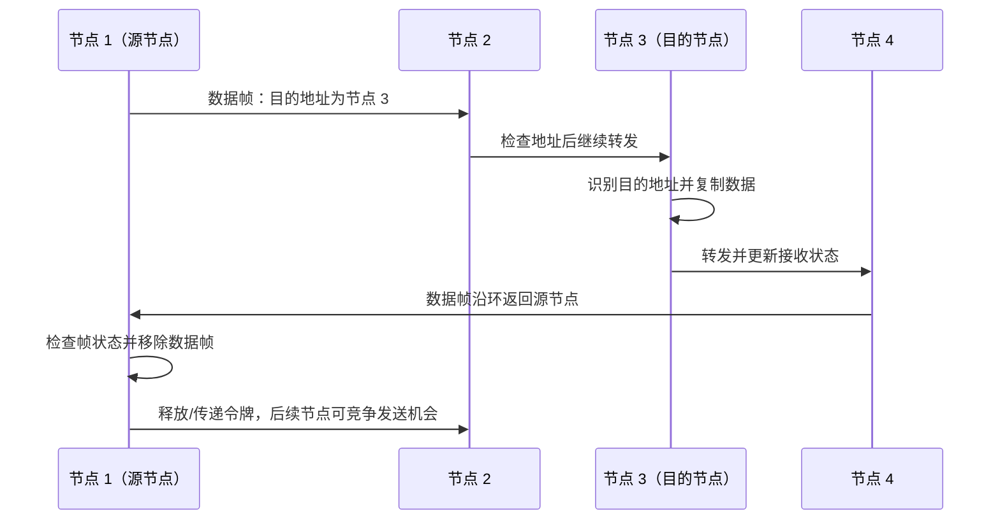
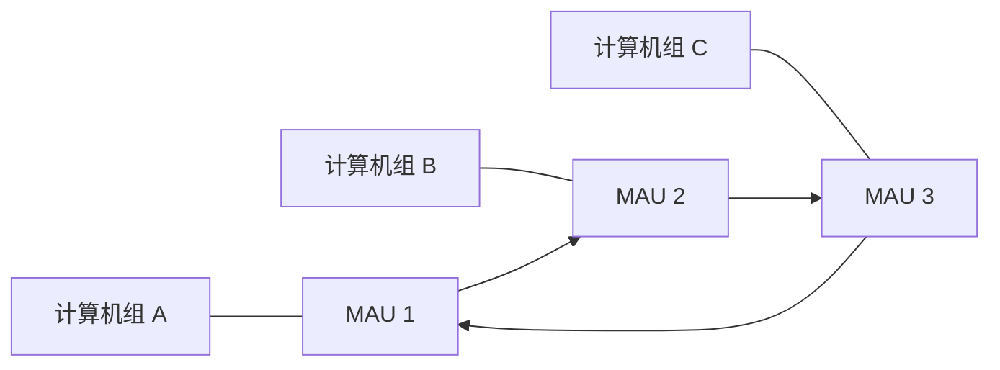
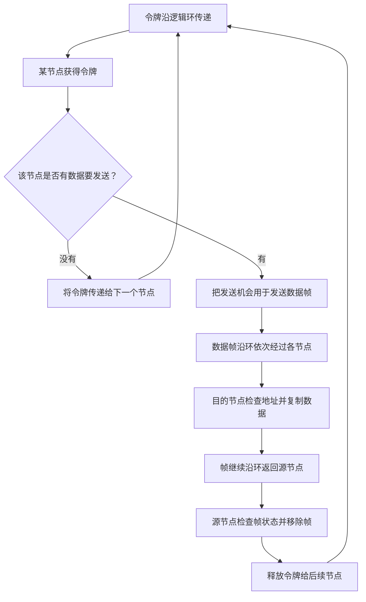

# 计算机网络数据链路层：轮询访问与令牌传递协议

> 本笔记根据课程视频整理，重点介绍轮询访问介质访问控制、令牌环网、令牌传递协议、令牌帧与数据帧的基本结构，以及 MAU（多站接入单元）设备。
>
> 整理原则：保留原讲解的主要知识点、示例和分析顺序，统一术语与 Markdown 层级，补充表格、文本示意图和 Mermaid 流程图，方便复习和打印。

---

## 一、轮询访问与令牌传递协议

### 1. 介质访问控制的几种方法

计算机网络中的介质访问控制方式，主要包括：

| 方法     | 基本思想                                                   |
| -------- | ---------------------------------------------------------- |
| 信道划分 | 将共享信道资源划分为不同部分，例如时间、频率或码片         |
| 随机访问 | 节点根据协议规则竞争信道，可能发生冲突，并通过相应机制处理 |
| 轮询访问 | 按一定次序或控制规则决定哪个节点可以发送数据               |

在本课程的考研大纲学习范围中，轮询访问部分重点了解**令牌传递协议**即可。

### 2. 什么是令牌传递协议

令牌传递协议（Token Passing）常与**令牌环网（Token Ring）**联系起来学习。

其核心思想是：

- 网络中的节点按照规定的方向组成逻辑环；
- 一个特殊的控制帧称为**令牌（Token）**；
- 令牌沿环依次传递；
- 只有获得令牌的节点，才有资格按照协议规则发送数据；
- 节点发送完数据后，要释放令牌或把令牌传递给后续节点。

因为同一时刻只有获得发送许可的节点能够使用信道，令牌传递可以避免多个节点随意同时发送所造成的竞争冲突。

---

## 二、令牌环网的历史背景

### 1. 令牌环网的出现

课程提到，IBM 在 20 世纪 80 年代推出了令牌环网技术。令牌环网的典型特点是采用逻辑环形结构，并使用令牌传递机制实现介质访问控制。

在令牌环网中，各节点依照固定方向传递令牌。一个节点只有在获得令牌后，才能按照规则发送自己的数据。

### 2. 令牌环网与早期以太网的竞争

早期以太网通常采用同轴电缆连接多台计算机；后来，也常使用集线器（Hub）连接多台计算机。

虽然集线器网络从物理连接形态看是星型结构，但集线器会把信号转发到其他端口，多个节点仍然共享同一个冲突域，因此其逻辑工作方式类似共享式总线网络。

在这种共享式网络中，多个节点可能同时发送数据，从而出现信号冲突。此前学习的 CSMA/CD 就是传统共享式以太网用来处理介质访问问题的协议。

后来，交换机（Switch）逐渐普及。交换机将通信分隔到不同端口和链路上，现代交换式全双工以太网通常不需要使用传统 CSMA/CD 来解决共享信道冲突。

因此，令牌环网技术逐渐退出主流市场。它和令牌传递协议如今更多作为理解轮询式介质访问控制的历史与原理案例，在本课程中不是高频重点，但需要理解其基本工作方式。

### 3. 逻辑拓扑与物理拓扑

| 网络类型             | 物理连接形态                    | 逻辑上的通信特点                                        |
| -------------------- | ------------------------------- | ------------------------------------------------------- |
| 同轴电缆总线型以太网 | 总线型                          | 多个节点共享传输介质，可能发生冲突                      |
| 以集线器连接的以太网 | 物理上呈星型                    | 集线器转发信号，节点仍处于共享冲突域                    |
| 交换式以太网         | 通常为星型                      | 交换机按端口转发，现代全双工链路通常无传统 CSMA/CD 冲突 |
| 令牌环网             | 可由 MAU 等设备实现物理星型布线 | 逻辑上构成环，令牌按环的方向传递                        |

**注意：物理上像星型，并不意味着逻辑上一定是星型。** 令牌环网可以由中心设备集中连接各站点，但逻辑通信仍按环形次序运行。

---

## 三、令牌传递协议的基本原理

### 1. 一个环形网络的例子

假设令牌环网中有四个节点，编号为 1、2、3、4。令牌沿固定方向传递。

```text
       ┌─────────┐
       ▼         │
     [节点 1] → [节点 2]
        ▲           │
        │           ▼
     [节点 4] ← [节点 3]
```

图中只用于表示逻辑环。真实设备的物理布线不一定是一根首尾相接的圆形电缆。

假设当前令牌由节点 1 持有：

- 若节点 1 有数据要发送，就可以使用令牌获得的发送机会；
- 若节点 1 没有数据要发送，就将令牌传递给下一个节点；
- 节点 2、3、4 依次执行同样的判断；
- 令牌最终会绕环一周，再次回到节点 1。

### 2. 令牌帧与数据帧

令牌环网中需要区分两类帧：

- **令牌帧（Token Frame）**：控制节点的发送权，通常不携带用户数据；
- **数据帧（Data Frame）**：携带源地址、目的地址和实际数据等内容。

从学习模型上，可以把令牌理解为网络中传递的“发送许可”。获得发送许可的节点，可以把令牌转换为数据帧，发送自己的数据。

### 3. 节点获得令牌后有数据要发送

假设节点 1 获得令牌，并想给节点 3 发送数据：

1. 节点 1 使用令牌获得发送许可；
2. 节点 1 发出数据帧，帧中包含源地址、目的地址、数据，以及差错检测等控制信息；
3. 数据帧沿环的固定方向依次经过各节点；
4. 节点 2 检查目的地址，发现不是发给自己，就继续转发；
5. 节点 3 发现目的地址与自己的地址相符，于是复制或接收数据部分，并在帧状态中标记相关接收状态；
6. 数据帧继续沿环传递，最终回到源节点 1；
7. 源节点 1 根据返回帧中的状态判断传输结果，并从环中移除该帧；
8. 源节点释放令牌，让后续节点获得发送机会。



### 4. 目的节点如何处理数据帧

数据帧经过环上的每一个节点时，该节点都会检查帧的相关信息：

- 如果目的地址不是自己的地址，就继续转发；
- 如果目的地址是自己的地址，就复制或接收数据部分；
- 目的节点会通过帧状态信息标记地址是否被识别、帧是否被复制或接收；
- 数据帧继续沿环传递，最终回到源节点。

因此，源节点不一定只靠“帧有没有回来”判断是否成功，也可以依据帧中返回的状态位判断目的节点是否识别和复制了帧。

> 课程讲解中将帧状态简化为 `TRUE/FALSE`：`TRUE` 表示已被接收，`FALSE` 表示没有被成功接收。实际令牌环帧格式中的 Frame Status 字段包含具体状态位，标准字段含义比单个布尔值更细。

### 5. 若数据帧发生差错

假设目的节点在检查数据帧时发现 CRC 校验失败，则不会把错误数据当作正确的数据交付上层，帧状态也可能无法体现成功接收。

当数据帧回到源节点后，源节点检查帧状态：

- 若显示目的节点已成功识别并复制数据，可以认为相关接收操作已完成；
- 若未获得成功接收的状态，源节点可以根据协议和上层策略决定重试；
- 重试次数一般不能无限增长，具体限制取决于协议实现与处理策略。

### 6. 节点没有数据要发送

如果节点获得令牌后没有数据要发送，就不必构造数据帧，而是将令牌继续交给下一个节点。

```text
节点获得令牌
      │
      ▼
  是否有数据？
   ┌──┴──┐
   │     │
  有     没有
   │     │
   ▼     ▼
发送数据  直接传递令牌
   │     │
   └──┬──┘
      ▼
下一个节点获得访问机会
```

课程基础模型中强调：节点获得令牌后发送完数据，就应当释放令牌，让后续节点有机会访问介质。实际 Token Ring 规范中还包含令牌持有时间等机制，不能把“每次只能发送一个数据帧”当作所有实现的绝对规则；做题时要以题目给定的简化模型或教材规定为准。

### 7. 令牌沿固定方向传递

令牌帧和数据帧都沿逻辑环规定的方向传递。

例如，若规定方向为：

\[
1\rightarrow2\rightarrow3\rightarrow4\rightarrow1
\]

则不能任意反向传递。固定方向让访问次序明确，便于协调各节点的发送机会。

---

## 四、令牌帧与数据帧的结构

令牌环网的帧结构可用来进一步理解令牌传递机制。以下按课程视频所涉及的字段进行整理。

### 1. 令牌帧

令牌帧的结构较简单，课程中将其概括为三个 8 bit 字段：

| 字段                  |  长度 | 作用                                     |
| --------------------- | ----: | ---------------------------------------- |
| SD（Start Delimiter） | 8 bit | 起始定界符，标记帧开始                   |
| AC（Access Control）  | 8 bit | 访问控制字段，包含令牌与优先级等控制信息 |
| ED（End Delimiter）   | 8 bit | 结束定界符，标记帧结束                   |

所以，课程中展示的令牌帧总长度为：

\[
8+8+8=24\text{ bit}=3\text{ Byte}
\]

示意结构：

```text
令牌帧
┌──────────────────┬──────────────────┬──────────────────┐
│ SD：开始定界符   │ AC：访问控制字段 │ ED：结束定界符   │
│     8 bit        │      8 bit       │      8 bit       │
└──────────────────┴──────────────────┴──────────────────┘
```

**字段说明：** 视频中的示意讲解有时会把访问控制信息简化地解释为“令牌号”或“当前节点编号”。严格地说，传统 IEEE 802.5 令牌环帧的 AC 字段本身并不是一个完整的站点编号字段；它包含访问控制相关的控制位。实际令牌由环上各站点按协议传递，节点通过令牌状态和令牌传递次序获得发送机会。复习帧格式时，应以标准字段定义为准。

### 2. 数据帧

课程中展示的数据帧包括以下字段：

| 字段      | 英文名称             | 长度（课程讲解中的常见格式） | 作用                       |
| --------- | -------------------- | ---------------------------: | -------------------------- |
| SD        | Start Delimiter      |                        8 bit | 标记帧开始                 |
| AC        | Access Control       |                        8 bit | 访问控制信息               |
| FC        | Frame Control        |                        8 bit | 帧控制信息                 |
| DA        | Destination Address  |                       48 bit | 目的地址                   |
| SA        | Source Address       |                       48 bit | 源地址                     |
| Data      | Data                 |                         可变 | 实际传输的数据             |
| FCS / CRC | Frame Check Sequence |                       32 bit | 差错检测                   |
| ED        | End Delimiter        |                        8 bit | 标记帧结束                 |
| FS        | Frame Status         |                        8 bit | 记录帧识别、复制等接收状态 |

其中：

- **DA** 是 Destination Address 的缩写，即目的地址；
- **SA** 是 Source Address 的缩写，即源地址；
- 在课程讲解中，一个 MAC 地址按 48 bit 处理；
- **FCS** 是帧校验序列，用于检测传输差错；
- **FS** 是帧状态字段，用来标记接收相关状态。

示意结构：

```text
┌────┬────┬────┬──────────┬──────────┬──────────┬─────┬────┬────┐
│ SD │ AC │ FC │    DA    │    SA    │   Data   │ FCS │ ED │ FS │
└────┴────┴────┴──────────┴──────────┴──────────┴─────┴────┴────┘
  8b   8b   8b    48 bit     48 bit     可变      32b   8b   8b
```

课程讲解提到，数据字段最多可包含约 \(4500\times8\) bit 的数据量。这个值用于还原课程视频中的帧结构示意；实际令牌环帧的最大信息字段长度应以具体 Token Ring 规范和教材定义为准。

---

## 五、MAU：多站接入单元

### 1. 什么是 MAU

MAU 是 **Multistation Access Unit** 的缩写，中文通常称为**多站接入单元**。

它是令牌环网中使用的连接设备，可用于连接多台计算机，并通过设备的环入、环出接口连接其他 MAU，构成更大范围的逻辑环网。

### 2. 一台 MAU 连接多个节点

例如，一台 MAU 有多个站点接口，每个接口连接一台计算机：

```text
          ┌──────────────┐
计算机 1 ──┤              ├── 计算机 2
计算机 3 ──┤     MAU      ├── 计算机 4
计算机 5 ──┤              ├── 计算机 6
          └──────────────┘

物理上：多个节点连接到中心设备
逻辑上：节点按照令牌环的规则组成一个环
```

### 3. 多台 MAU 连接

如果网络规模较大，可以用 MAU 的环入（RI）和环出（RO）接口将多台 MAU 连接起来，再在每台 MAU 上接入多台计算机。



图中连接方向用于表示逻辑环的关系，并不表示所有实际布线都一定是一根物理环形电缆。MAU 的连接与内部机制共同实现令牌环网的逻辑环结构。

### 4. MAU 的作用总结

- 集中连接多个节点；
- 支持构成逻辑令牌环；
- 可利用环入、环出接口连接其他 MAU；
- 配合令牌传递协议，让各节点按规则获得发送机会。

---

## 六、令牌传递协议为什么能够避免冲突

在令牌传递机制下，节点必须获得令牌后才能按照规则发送数据。令牌在环上逐个传递，因此不会像纯 ALOHA 或普通 CSMA 那样，让所有节点在信道空闲时各自竞争并同时开始发送。

其结果是：

- 正常情况下，同一时刻只有获得令牌的站点拥有发送权限；
- 多个节点不会任意同时争用同一段共享介质；
- 因竞争导致的碰撞能够避免或显著减少；
- 不需要依靠频繁的冲突检测与随机重传来维持访问秩序。

### 1. 高负载与 CSMA/CD 的差异

| 对比项             | 令牌传递（令牌环）                   | 传统共享式以太网 CSMA/CD               |
| ------------------ | ------------------------------------ | -------------------------------------- |
| 访问方式           | 按令牌传递次序获得发送权             | 发送前监听，多个节点仍可能同时竞争     |
| 同一时刻的发送权限 | 由令牌控制                           | 可能因传播时延发生冲突                 |
| 冲突处理           | 正常令牌访问不依靠节点竞争来解决冲突 | 检测冲突后停发并退避重传               |
| 高负载时的表现     | 访问机会按顺序分配，等待行为较可预测 | 竞争节点增多时，冲突和退避开销可能增加 |
| 学习重点           | 令牌、环形传递、数据帧绕环返回       | 载波监听、冲突检测、二进制指数退避     |

课程将令牌环网与传统共享式以太网进行比较时，重点是：高负载下，随机竞争可能产生更多冲突和重传开销，而令牌传递通过轮流授予发送权来减少这种竞争开销。

---

## 七、令牌传递协议的完整流程



### 流程要点

1. 令牌按照固定方向沿逻辑环传递。
2. 获得令牌的节点可以发送数据。
3. 若节点没有数据，就传递令牌。
4. 若节点有数据，就将数据封装成数据帧，沿环转发。
5. 每个中间节点都检查目的地址；目的节点复制或接收数据。
6. 数据帧绕环回到源节点后，由源节点检查状态并从环中移除。
7. 源节点释放令牌，后续节点再获得发送机会。

> 课程中的基础模型强调“获得令牌后发送一个数据帧再释放令牌”，便于理解轮询访问。实际实现还可能使用令牌持有时间等细节；做题时以题目明确采用的规则为准。

---

## 八、考研复习要点与易错点

### 1. 令牌传递协议属于哪一种介质访问控制方式

令牌传递属于**轮询访问／受控访问**的思路。节点不是随意竞争信道，而是等待令牌授予发送机会。

### 2. 为什么正常情况下不会发生信道竞争冲突

因为只有获得令牌的节点才能发送，其他节点没有令牌时不能随意占用信道。因此，它避免了多个节点自由竞争造成的冲突。

### 3. 令牌帧与数据帧的区别

| 对比项           | 令牌帧               | 数据帧                                 |
| ---------------- | -------------------- | -------------------------------------- |
| 主要功能         | 传递发送许可         | 携带实际数据                           |
| 是否承载用户数据 | 通常不承载           | 承载                                   |
| 结构             | 较简单               | 包含地址、数据、差错检测及帧状态等字段 |
| 传递方式         | 沿逻辑环固定方向传递 | 沿逻辑环固定方向传递                   |

### 4. 数据帧为什么要绕回源节点

数据帧沿环传递时，目的节点可以复制数据，但帧仍继续沿环移动。源节点收到返回的帧后，可以检查帧状态并将帧从环中移除，再释放令牌。

### 5. MAU 的作用是什么

MAU（多站接入单元）用于连接令牌环网中的多个站点，并可通过环入、环出接口连接多台 MAU，建立更大范围的逻辑环。

### 6. 物理拓扑与逻辑拓扑不要混淆

采用 MAU 后，计算机的物理布线可以呈星型，但节点通信仍然按照令牌环的逻辑顺序进行。因此，不能只根据设备外观判断网络的逻辑拓扑。

### 7. 令牌帧中的 AC 字段

课程讲解为了便于理解，会把令牌控制信息简化描述为“令牌号”或“当前节点编号”。严格的帧格式中，AC 是访问控制字段，包含访问控制相关的标志位，并非简单地存储一个站点编号。复习标准字段时要区分讲解模型和真实字段定义。

---

## 九、最后速查表

| 问题                                   | 结论                                                       |
| -------------------------------------- | ---------------------------------------------------------- |
| 令牌传递协议属于哪类介质访问控制？     | 轮询访问／受控访问                                         |
| 令牌传递协议常与什么网络技术一起学习？ | 令牌环网（Token Ring）                                     |
| 谁可以发送数据？                       | 获得令牌并遵守协议发送规则的节点                           |
| 节点暂时没有数据时怎么办？             | 将令牌传递给下一个节点                                     |
| 数据帧经过目的节点时会发生什么？       | 目的节点检查地址，复制或接收数据，并标记接收状态           |
| 数据帧最后回到哪里？                   | 回到源节点，由源节点检查状态并移除该帧                     |
| 令牌沿哪个方向传递？                   | 按规定的逻辑环方向传递                                     |
| MAU 是什么？                           | 多站接入单元，用来连接节点并构成逻辑令牌环                 |
| 令牌帧和数据帧有什么区别？             | 令牌帧传递发送许可，数据帧承载实际数据                     |
| 为什么令牌环不依靠随机竞争发送？       | 令牌控制发送权，正常情况下同一时刻只有一个站点获得发送机会 |

---

## 十、一页回顾

令牌传递协议是轮询访问介质访问控制的一种典型方式。令牌沿逻辑环固定方向逐个传递，只有获得令牌的节点才能按照规则发送数据。

如果节点没有数据，就继续传递令牌；如果节点要发送数据，就使用数据帧沿环传送。目的节点检查地址并复制数据，数据帧继续回到源节点，由源节点检查帧状态并移除帧，随后释放令牌，让下一个节点获得发送机会。

令牌环网可使用 MAU（多站接入单元）连接计算机并构建逻辑环。它与早期共享式以太网 CSMA/CD 的主要区别是：前者由令牌控制访问顺序，后者允许节点竞争共享介质，因此在高负载条件下可能产生冲突与重传开销。

**本节核心：令牌传递用“按顺序传令牌”的方式授予发送权，降低多个节点同时争用共享介质的冲突。**
