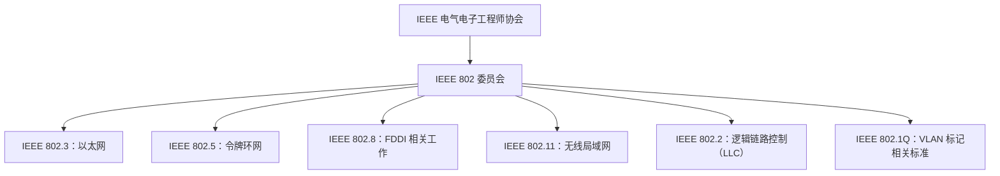
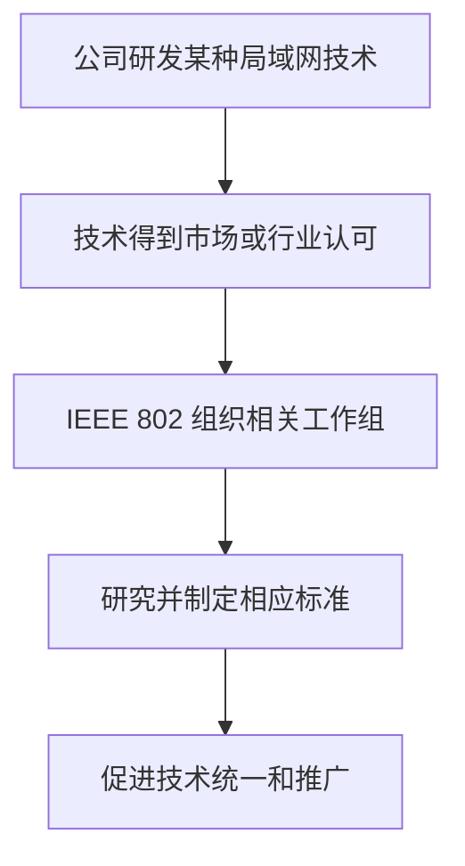
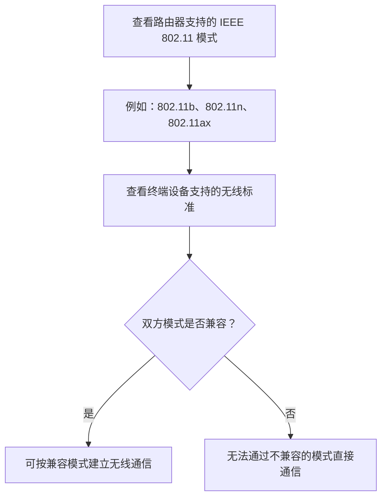
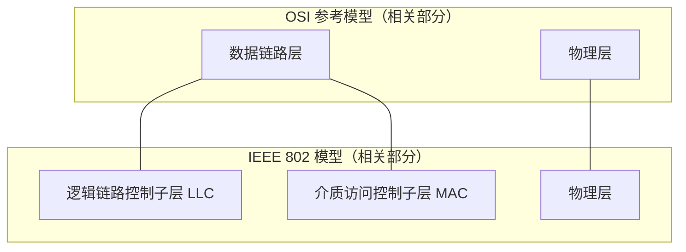
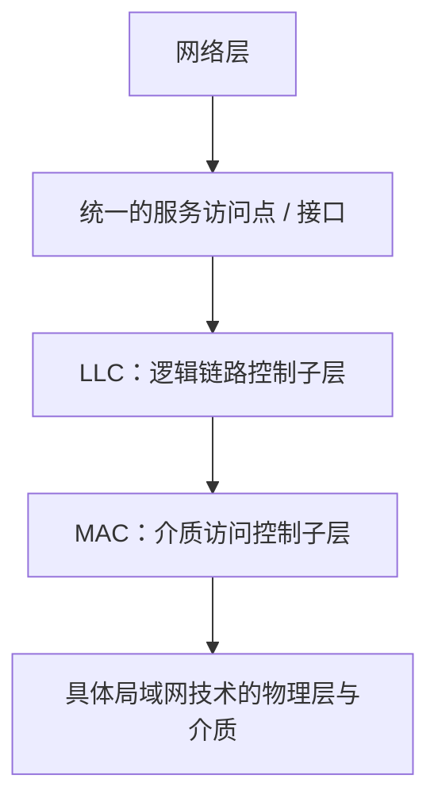

# 局域网与 IEEE 802 标准

## 一、考研大纲中的相关内容

学习局域网时，常会看到一些编号，例如 **IEEE 802.3、IEEE 802.11、IEEE 802.1Q**。这些编号代表什么，需要先弄清楚 IEEE 802 委员会与各类局域网技术之间的关系。

考研大纲中与本节相关的内容主要有：

- **以太网与 IEEE 802.3**
- **IEEE 802.11 无线局域网**
- **VLAN（虚拟局域网）的基本概念和基本原理**，其中会涉及 **IEEE 802.1Q**

## 二、IEEE 802 委员会与局域网技术的关系

### 1. IEEE 802 是什么？

**IEEE** 是电气电子工程师协会（Institute of Electrical and Electronics Engineers），是一个国际组织。

IEEE 下设许多委员会，其中 **IEEE 802 委员会**主要负责推进局域网相关技术的标准化工作。除了局域网，IEEE 802 也涉及城域网、个域网等方面；这些内容与本节重点关系不大，暂不展开。

IEEE 802 委员会下面还设有不同的工作组，例如：

- IEEE 802.3 工作组
- IEEE 802.5 工作组
- IEEE 802.8 工作组
- IEEE 802.11 工作组

每个工作组负责特定网络技术相关的标准化工作。

### 2. IEEE 802 编号的层级关系

> **理解重点：** IEEE 802 是委员会体系；802.3、802.11 等编号用于标识具体的标准或相关工作组。它们不是互不相关的随机编号。

### 3. 局域网技术是怎样形成标准的？

局域网技术最初通常不是由 IEEE 802 委员会直接发明的，而是由某个科技公司研发出来的。

科技公司研发网络技术，通常有商业目的，希望通过技术和产品获得收益。随着计算机网络发展，不同公司推出了不同的局域网技术。有些技术得到了市场和技术专家的广泛认可，IEEE 802 委员会便可以组织相应工作组，对技术进行研究、规范和标准化，以便形成较统一的标准，促进技术推广。

可以将这一过程概括为：

### 4. 几种局域网技术及其对应编号

| 技术                       | 相关公司或背景                                       | IEEE 802 相关编号 | 发展情况（按课程讲解）                                                   |
| -------------------------- | ---------------------------------------------------- | ----------------- | ------------------------------------------------------------------------ |
| 令牌环网（Token Ring）     | IBM 曾推出令牌环网技术                               | IEEE 802.5        | 曾受到市场和行业认可，后来随着以太网崛起而逐渐被淘汰，相关工作组后来解散 |
| 光纤分布式数据接口（FDDI） | 一种曾受到市场认可的局域网技术                       | IEEE 802.8        | 后来未能与以太网竞争，相关工作组后来解散                                 |
| 以太网（Ethernet）         | 20 世纪 80 年代由 DEC、Intel 和 Xerox 等公司共同推出 | IEEE 802.3        | 目前几乎所有有线局域网都采用以太网技术                                   |
| 无线局域网（WLAN）         | 由相关公司研发并逐步发展                             | IEEE 802.11       | 目前几乎所有无线局域网都采用 Wi-Fi 技术                                  |

由此可以记住：

- 看到 **IEEE 802.3 局域网**，通常可以理解为以太网。
- 看到 **IEEE 802.11 无线局域网**，通常可以理解为 Wi-Fi 所使用的无线局域网技术标准体系。
- **IEEE 802.1Q** 与 VLAN（虚拟局域网）相关。

## 三、IEEE 802.11 与 Wi-Fi 代际

### 1. IEEE 802.11 的作用

IEEE 802.11 工作组负责无线局域网相关技术的标准化。无线局域网技术最初同样由相关公司研发，而标准化有助于不同厂商的设备按照统一规范工作。

IEEE 802.11 标准会使用字母后缀来区分不同版本，例如 `802.11b`、`802.11ac` 和 `802.11ax`。

### 2. 常见标准与 Wi-Fi 代际对照

| IEEE 802.11 标准   | 常见称呼                       | 课程中的说明                               |
| ------------------ | ------------------------------ | ------------------------------------------ |
| `802.11b`          | Wi-Fi 1（第一代 Wi-Fi 的俗称） | 支持该模式的设备可使用相应标准进行无线通信 |
| `802.11ac`         | Wi-Fi 5                        | 2013 年推出                                |
| `802.11ax`         | Wi-Fi 6                        | 课程讲解时提到，许多家庭或公司使用 Wi-Fi 6 |
| Wi-Fi 7 对应的标准 | Wi-Fi 7                        | 课程讲解时预计从 2024 年开始逐步推广       |

> **注意：** 表中的“Wi-Fi 1”等是常见的代际称呼；IEEE 802.11 的字母后缀是标准编号的一部分。

### 3. 如何理解路由器支持的模式？

可以登录家用路由器的管理后台，查看它支持哪些无线模式。例如，路由器模式列表中可能会出现类似 `802.11b/g/n/ax` 的标记。

这表示路由器支持相应的 IEEE 802.11 标准模式。若某台设备使用其中一种受支持的无线标准，就可以在兼容的条件下与路由器进行无线通信。

可以用下面的方式理解：

## 四、IEEE 802 与 OSI 参考模型的关系

### 1. IEEE 802 的工作范围

如果与 **OSI 参考模型**进行对比，IEEE 802 的工作范畴主要对应：

- **物理层**
- **数据链路层**

不过，IEEE 802 将数据链路层进一步划分为两个子层：

1. **逻辑链路控制子层（LLC，Logical Link Control）**
2. **介质访问控制子层（MAC，Media Access Control）**

### 2. OSI 与 IEEE 802 的层次对应

### 3. MAC 子层：介质访问控制

**MAC** 是 Media Access Control（介质访问控制）的缩写。

MAC 子层实现的功能通常与传输介质有关。课程中涉及的功能包括：

- **组帧**
- **差错控制**
- **透明传输**
- **介质访问控制**

按照本课程的讲解口径，目前学过的数据链路层功能几乎都归入 MAC 子层。

### 4. LLC 子层：逻辑链路控制

**LLC** 是 Logical Link Control（逻辑链路控制）的缩写。IEEE 802 设置 LLC 子层，一个重要目的是兼容当时多种局域网技术，让网络层能够通过统一的服务访问点或接口使用底层数据链路服务。

#### 为什么曾经需要 LLC？

在 20 世纪 80 年代至 2000 年前后，局域网技术种类较多，不同公司研发的技术各有不同。它们通常会分别设计：

- 物理层
- MAC 子层

不同技术的 MAC 子层向上层网络层提供的调用接口或服务访问点可能有所区别。为了屏蔽这些差异，IEEE 802 设置 LLC 子层，向网络层提供统一的接口。

这样，无论底层采用哪一种局域网技术，网络层都可以通过 LLC 提供的统一接口访问数据链路层服务。

#### 为什么课程中说 LLC 的作用已经不突出？

按照课程讲解，目前有线局域网几乎由 IEEE 802.3（以太网）主导，无线局域网则几乎由 IEEE 802.11 主导。因此，过去为了兼容多种局域网技术而专门设置 LLC 子层的需求，已经不像早期那么突出。

课程中还提到，IEEE 802.2 工作组负责 LLC 相关工作，但后来该工作组解散；目前常见有线网卡和无线网卡主要实现 MAC 子层与物理层相关功能。

**考试提示：** LLC 子层主要了解其概念和设计目的即可，按照本课程的重点安排，它不是本节的核心考点。

## 五、本节重点回顾

| 编号或术语  | 需要记住的含义                                                                 |
| ----------- | ------------------------------------------------------------------------------ |
| IEEE        | 电气电子工程师协会                                                             |
| IEEE 802    | 负责局域网等相关网络技术标准化工作的委员会体系                                 |
| IEEE 802.3  | 以太网相关标准                                                                 |
| IEEE 802.5  | 令牌环网相关标准                                                               |
| IEEE 802.8  | FDDI 相关工作                                                                  |
| IEEE 802.11 | 无线局域网相关标准，通常与 Wi-Fi 联系起来理解                                  |
| IEEE 802.1Q | VLAN 相关标准                                                                  |
| LLC         | 逻辑链路控制子层，主要用于向网络层提供统一接口                                 |
| MAC         | 介质访问控制子层，负责组帧、差错控制、透明传输、介质访问控制等课程中讲解的功能 |

记忆时可以抓住三条主线：

1. **IEEE 802 负责相关网络技术的标准化，而不是最初发明所有局域网技术。**
2. **802.3 对应以太网，802.11 对应无线局域网，802.1Q 与 VLAN 相关。**
3. **IEEE 802 的相关层次包括物理层和数据链路层；数据链路层又划分为 LLC 和 MAC 两个子层。**
