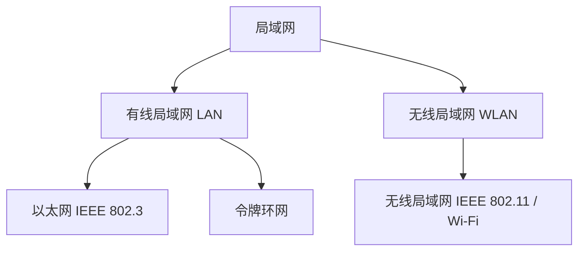
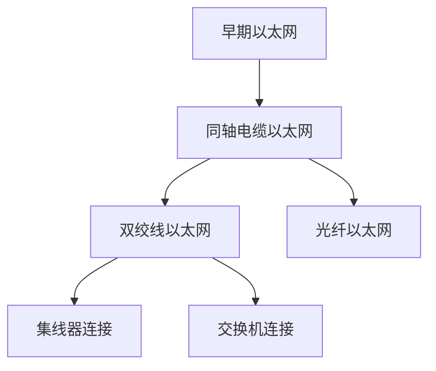
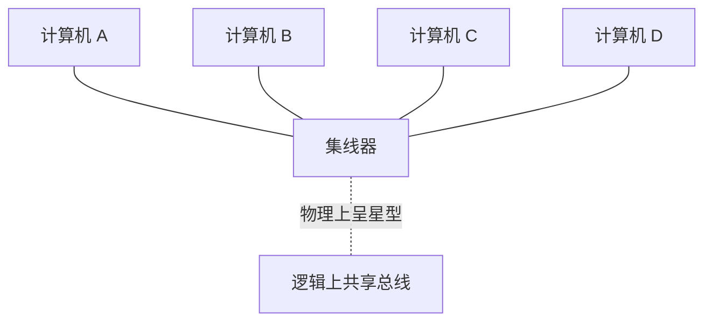
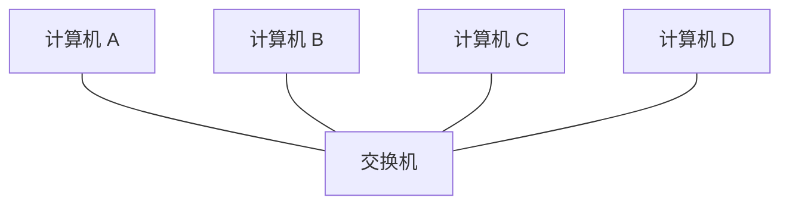
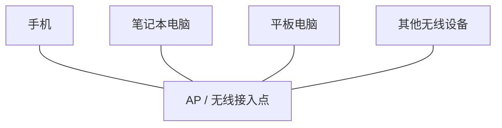
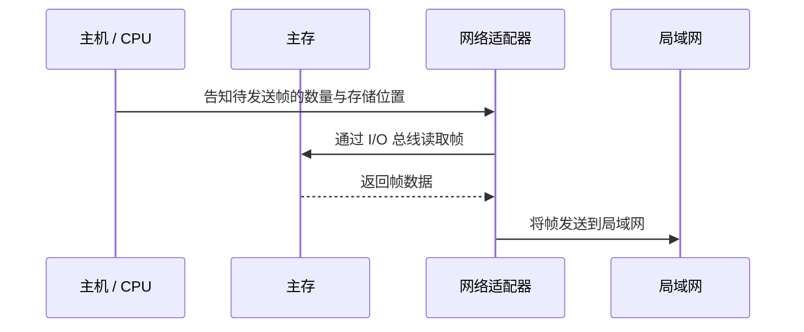
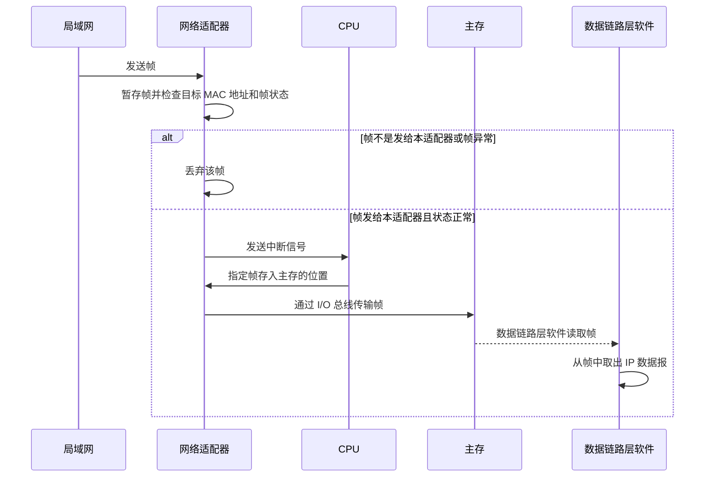
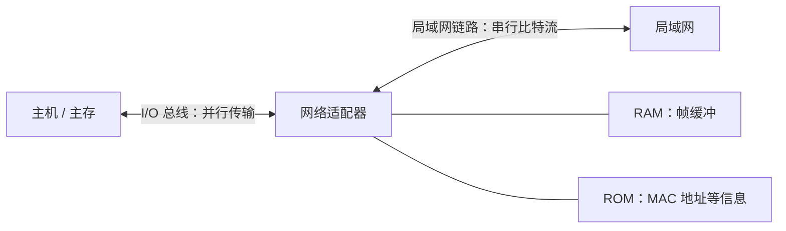

# 局域网的基本概念与体系结构

## 一、学习重点与整体框架

本部分需要了解局域网的基本概念和体系结构，并重点掌握两类局域网技术：

- **以太网（IEEE 802.3）**
- **无线局域网（IEEE 802.11，也就是 Wi-Fi）**

局域网技术经过几十年的发展，尤其是以太网从 20 世纪 80
年代发展至今，经历了多个阶段，体系结构也发生了较大变化。学习时可以先用整体框架串联知识，再结合教材逐项复习。

本节主要包括：

1.  局域网的特点
2.  局域网的分类
3.  局域网的拓扑结构、传输介质和介质访问控制方式
4.  网络适配器的硬件结构与功能

## 二、局域网的基本特点

### 1. 覆盖范围较小

局域网（LAN，Local Area Network）覆盖的地理范围较小，例如：

- 家庭内部网络
- 学校内部网络

### 2. 通信时延较低、误码率较低

局域网内部节点之间距离较近，因此通常具有：

- **较低的传播时延**：传输距离较短。
- **较低的误码率**：信号传输距离短，发生传输错误的概率相对较小。
- **较低的传输时延**：节点之间通常具有较高的通信带宽。

以上两点了解即可。

### 3. 以帧为单位传输数据

局域网内部节点之间的数据传输以**帧（Frame）**为单位，并支持单播、广播和多播三种传输方式。

```text
局域网中的节点：A、B、C、D、E、F、G

单播：A ─────────> B
      一对一

广播：A ─────────> 所有节点
      一对全部

多播：A ─────────> B、D、E（某个分组）
      一对部分
```

- **单播（Unicast）**：一对一发送。发送方指定某一个目标节点，例如 A
  将帧发送给 B。
- **广播（Broadcast）**：一对全部发送。发送方发送广播帧后，局域网内的所有节点都会接收该帧。
- **多播（Multicast）**：一对部分发送。发送方将帧发送给指定分组中的部分节点。

帧的目标节点通过 **MAC
地址**（物理地址，也称硬件地址）进行标识。每个网络适配器都有自己的 MAC
地址，MAC 地址长度为 **48 bit**。

## 三、局域网的分类与考查维度

局域网主要分为两大类：



- **LAN**：有线局域网的常见缩写。
- **WLAN**：无线局域网，W 表示 Wireless（无线）。

学习任何一种具体的局域网技术，都要关注以下三个维度，也是常见的考查点：

维度 需要关注的内容

---

1\. 拓扑结构 总线型、星型、环形或点对点等
2\. 传输介质 同轴电缆、双绞线、光纤或无线电磁波等
3\. 介质访问控制 是否需要竞争信道，以及采用什么协议

## 四、有线局域网

根据考研大纲，重点关注**以太网**和**令牌环网**。

### 1. 令牌环网

令牌环网由 IBM 于 1984 年推出，约在 2000
年前后逐渐退出主流市场。随着以太网发展，令牌环网逐渐被以太网取代。

维度 令牌环网的特点

---

拓扑结构 环形
传输介质 同轴电缆或双绞线
介质访问控制 令牌传递协议

令牌传递协议的具体内容可结合相关章节复习。

### 2. 以太网概述

以太网的标准化工作由 **IEEE 802.3 工作组**推进。以太网自 1980
年左右开始商用，后来逐步发展出同轴电缆、双绞线和光纤等不同介质的实现方式。

以太网物理层的编码方式需要结合具体标准判断；传统以太网常涉及曼彻斯特编码，不能将其不加区分地套用于所有后续高速以太网标准。

#### 以太网的主要发展路线



### 3. 同轴电缆以太网

早期以太网主要采用同轴电缆作为传输介质。典型标准包括：

---

标准 介质 名称中的含义 典型特征

---

10BASE5 同轴电缆 10 表示 10 Mbps；BASE 总线型
表示基带传输；5  
 表示单段电缆长度约为  
 500 m 这一量级

10BASE2 同轴电缆 10 表示 10 Mbps；BASE 总线型
表示基带传输；2  
 表示单段电缆长度约为  
 200 m 这一量级

---

同轴电缆网段可以通过分接器连接多台计算机，多个网段之间可以使用中继器连接。

#### 五四三原则

使用同轴电缆构建传统以太网时，需要了解"五四三原则"：

- 最多 **5 个网段**
- 最多 **4 个中继器**
- 最多 **3 个网段可以连接计算机**

这些限制会影响同轴电缆以太网的覆盖范围。

### 4. 光纤以太网

20 世纪 90 年代初，出现了以光纤作为传输介质的以太网标准。典型示例是
**10BASE-F**；其中 F 表示 Fiber（光纤）。

光纤以太网的主要用途之一是扩展网络覆盖范围，常用于中继器、集线器、交换机等中间设备之间的点对点连接。

```text
中间设备 A ═════ 光纤链路 ═════ 中间设备 B
                  点对点
```

光纤相较于传统同轴电缆具有适合长距离传输等特点。若采用两条光纤分别承担两个方向的数据传输，就可以实现全双工通信，从而避免两个方向争用同一传输信道的问题。

因此，在本节讨论的典型光纤以太网连接中：

维度 特点

---

拓扑结构 点对点
传输介质 光纤
介质访问控制 全双工链路不需要使用 CSMA/CD 竞争信道

标准名称中，BASE 后面的 **F**
通常提示该标准采用光纤介质。光纤以太网通常用于连接中间网络设备；具体部署方式会随技术和设备发展而变化。

### 5. 双绞线以太网

双绞线以太网在 20 世纪 80 年代后期逐步发展，典型标准是 **10BASE-T**，由
IEEE 802.3 工作组于 1990 年发布。T 表示 Twisted Pair（双绞线）。

标准名称可这样理解：

- **10**：10 Mbps
- **BASE**：基带传输
- **T**：双绞线

一根双绞线通常连接两个端点，不像同轴电缆那样在电缆中间通过分接器挂接多个节点。双绞线以太网的拓扑结构和介质访问控制方式，取决于使用集线器还是交换机。

#### （1）集线器连接的双绞线以太网

集线器连接多个节点时：

- **物理拓扑结构**：星型。
- **逻辑拓扑结构**：总线型。
- **通信方式**：半双工。
- **介质访问控制**：需要使用 CSMA/CD 协议。

集线器不会像交换机那样为各端口提供独立的冲突域，因此多个节点共享传输介质，存在信道竞争问题。



#### （2）交换机连接的双绞线以太网

交换机可以连接多根双绞线，每根双绞线连接一个节点。使用交换机连接时，物理和逻辑拓扑通常都呈星型。

介质访问控制取决于链路的工作模式：

- **半双工模式**：仍可能发生信道竞争，需要 CSMA/CD。
- **全双工模式**：两个方向可以同时传输，不需要使用 CSMA/CD 竞争信道。

较新的双绞线布线通常由多对双绞线构成，可以通过不同线对分别承载两个方向的数据，从而支持全双工通信。早期某些布线或设备可能只支持半双工。



#### （3）集线器与交换机对比

对比项目 集线器连接 交换机连接

---

物理拓扑 星型 星型
逻辑拓扑 总线型 通常为星型
通信模式 半双工 可半双工，也可全双工
介质访问控制 使用 CSMA/CD 半双工时需要；全双工时不需要

### 6. 以太网的介质访问控制总结

判断是否需要使用 CSMA/CD，关键是看链路是否存在共享信道竞争：

以太网类型 典型通信模式 是否需要 CSMA/CD

---

同轴电缆以太网 半双工，共享介质 需要
双绞线 + 集线器 半双工 需要
双绞线 + 交换机，半双工 半双工 需要
双绞线 + 交换机，全双工 全双工 不需要
光纤点对点链路，全双工 全双工 不需要

**记忆要点：**

- 同轴电缆以太网：典型情况下是共享介质、半双工，需要 CSMA/CD。
- 集线器连接的双绞线以太网：逻辑上是总线型、半双工，需要 CSMA/CD。
- 交换机连接的双绞线以太网：是否需要 CSMA/CD，取决于半双工还是全双工。
- 全双工点对点链路不需要通过 CSMA/CD 竞争信道。

## 五、无线局域网（IEEE 802.11 / Wi-Fi）

目前广泛使用的无线局域网技术是 **IEEE 802.11**，也就是常说的 Wi-Fi。

### 1. 基本结构

常见的基础设施模式由一个 AP（Access
Point，无线接入点）和多台移动设备组成。家庭路由器提供的 Wi-Fi
热点通常承担无线接入点的功能。



- **拓扑结构**：星型。
- **传输介质**：无线电磁波。
- **介质访问控制**：CSMA/CA。

无线设备通过电磁波与 AP 通信。由于无线信号可能相互干扰，无线局域网使用
**CSMA/CA（载波侦听多路访问/冲突避免）**来协调信道访问。

注意：无线局域网通常讨论 CSMA/CA；有线共享式以太网传统上讨论 CSMA/CD。

## 六、局域网硬件架构：网络适配器

### 1. 网络适配器的基本概念

网络适配器（Network Adapter）也称为：

- 网络接口卡（NIC）
- 网卡（常见称呼）

考试中常使用"网络适配器"这一名称。

典型计算机可以通过有线以太网或无线 Wi-Fi 接入局域网，因此可能配备：

1.  **以太网网络适配器**：实现符合 IEEE 802.3
    标准的数据链路层和物理层功能。
2.  **Wi-Fi 网络适配器**：实现符合 IEEE 802.11
    标准的数据链路层和物理层功能。

现代笔记本电脑通常具有 Wi-Fi
适配器，但不一定内置以太网接口。没有网线接口的电脑可以通过 USB-C
转以太网适配器连接网线。此类外接适配器本质上也是网络适配器，内部包含相应芯片和硬件地址。

### 2. 网络适配器的主要硬件

网络适配器通常包含 RAM 和 ROM 等部件。

部件 主要作用

---

ROM 保存网络适配器的 MAC 地址等信息
RAM 用于帧缓冲，暂存即将发送或刚刚接收的帧
无线天线（Wi-Fi 适配器） 发送和接收无线电磁波信号

#### MAC 地址

- MAC 地址也称**物理地址**或**硬件地址**。
- 长度为 **48 bit（6 Byte）**。
- 每个网络适配器具有自己的 MAC 地址。
- 有线以太网适配器和 Wi-Fi 适配器通常具有不同的 MAC 地址。

MAC 地址的分配由 IEEE 相关组织管理。典型的全球地址分配方式中：

- 高 24 bit 通常用于标识组织分配的前缀。
- 低 24 bit 由获得地址段的厂商分配。

厂商需要申请地址段并按分配规则使用，以避免地址冲突。MAC
地址通常由网络适配器提供，但在某些系统中也可以通过软件配置或随机化方式改变设备对外使用的地址，因此不能简单认为任何情况下都绝对无法修改。

### 3. 帧缓冲与滑动窗口

网络适配器中的 RAM 用于帧缓冲，例如：

- 即将发送到局域网上的帧；
- 刚从局域网上接收到的帧。

在滑动窗口机制中，发送窗口和接收窗口涉及的帧也需要存储在相应的缓冲区中。网络适配器的帧缓冲区是网络收发过程中的重要组成部分。

## 七、网络适配器发送和接收帧的过程

### 1. 发送帧

数据链路层为网络层提供服务。网络层准备 IP
数据报后，数据链路层将其封装成帧，再将帧发送到局域网上。

封装成帧的动作可能由主机中的软件完成，也可能在某些系统设计中由网络适配器完成，具体取决于系统实现。

假设主机需要发送 4 个帧，编号为 0、1、2、3：



基本过程：

1.  主机告知网络适配器要发送多少个帧。
2.  主机告知这些帧在主存中的存储位置。
3.  网络适配器通过 I/O 总线从主存读取帧。
4.  网络适配器将帧发送到局域网上。

### 2. 接收帧



基本过程：

1.  网络适配器收到帧后，先将帧放入帧缓冲区。
2.  检查帧的目标 MAC 地址是否与本适配器相符，并检查帧是否存在异常。
3.  如果帧不是发给自己的，或者帧存在异常，则丢弃。
4.  如果帧发给自己且状态正常，网络适配器向 CPU 发送中断信号。
5.  CPU 告知网络适配器应将帧存放到主存中的哪个位置。
6.  网络适配器通过 I/O 总线把帧传送到主存。
7.  主机中的数据链路层软件从帧中取出 IP 数据报，并交给网络层处理。

## 八、网络适配器的主要功能总结

网络适配器的核心任务是**向局域网发送帧**和**从局域网接收帧**。主要功能如下：

1.  **发送帧**：把待发送的帧发送到局域网上。
2.  **接收帧**：接收局域网上的帧，并根据目标 MAC 地址和帧状态进行处理。
3.  **实现相应标准的链路层与物理层功能**：
    - 接入 IEEE 802.3
      以太网时，实现对应的以太网数据链路层和物理层功能；
    - 接入 IEEE 802.11
      无线局域网时，实现对应的无线局域网数据链路层和物理层功能。
4.  **串并行转换**：
    - 主机与网络适配器之间通常通过 I/O 总线并行传输数据；
    - 网络适配器与局域网之间以串行比特流形式进行通信；
    - 因此网络适配器需要完成串行与并行数据之间的转换。
5.  **帧缓冲**：通过 RAM 暂存待发送或已接收的帧。



## 九、考前速查表

---

技术类型 拓扑结构 传输介质 介质访问控制 / 关键点

---

令牌环网 环形 同轴电缆或双绞线 令牌传递协议

10BASE5 / 10BASE2 总线型 同轴电缆 共享介质，典型情况下使用
CSMA/CD

光纤以太网 点对点 光纤 全双工链路通常不需要
CSMA/CD

双绞线 + 集线器 物理星型、逻辑总线型 双绞线 半双工，使用 CSMA/CD

双绞线 + 交换机 星型 双绞线 半双工需要
CSMA/CD；全双工不需要

IEEE 802.11 / 常见基础设施模式为星型 无线电磁波 CSMA/CA
Wi-Fi

---

### 关键概念对照

概念 含义

---

单播 一对一
广播 一对全部
多播 一对部分
MAC 地址 48 bit 的链路层硬件地址
CSMA/CD 传统共享式以太网的冲突检测机制
CSMA/CA 无线局域网使用的冲突避免机制
集线器 物理上连接成星型，逻辑上共享总线
交换机 通常形成星型拓扑，可支持全双工通信
网络适配器 实现网络收发，并提供相应链路层与物理层功能

---

**复习建议：**先记住每种局域网的三个维度------拓扑结构、传输介质、介质访问控制方式；再结合网络适配器的发送与接收流程理解帧如何在主机和局域网之间传递。
