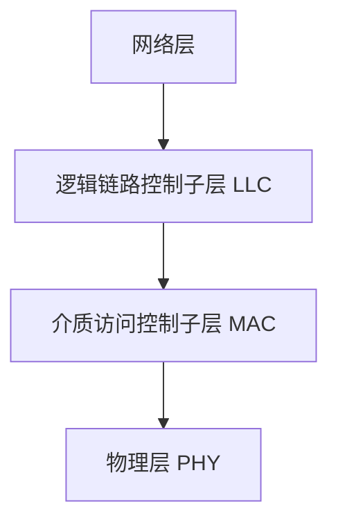
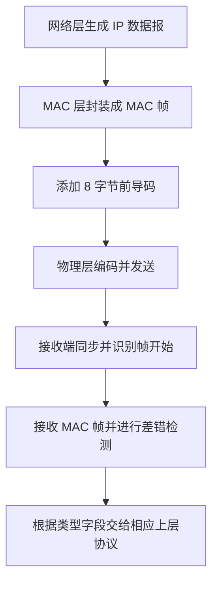
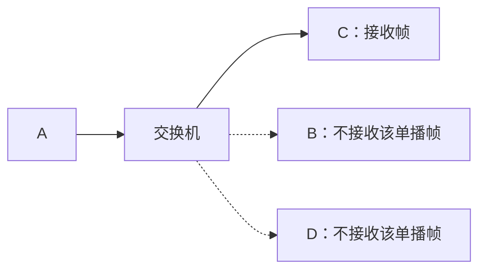
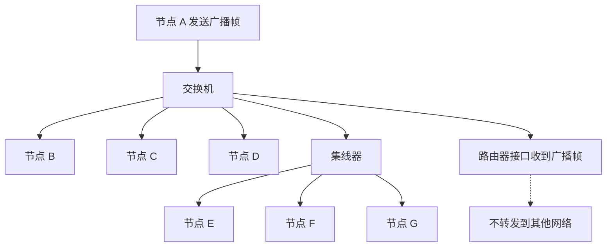

# 以太网与 IEEE 802.3

> 复习主题：IEEE 802.3、以太网物理层标准、MAC 帧格式、曼彻斯特编码、单播与广播、冲突域与广播域。  
> 说明：本文按知识点重新整理讲课内容，主要调整标题层级、表格、示意图和术语写法，便于查阅、背诵与打印。

---

## 一、IEEE 802.3 与以太网

### 1. IEEE 802.3 的主要任务

IEEE 802 委员会在局域网标准化过程中，将数据链路层划分为两个子层：

- **逻辑链路控制子层（LLC，Logical Link Control）**
- **介质访问控制子层（MAC，Media Access Control）**

其中，IEEE 802.3 工作组主要负责**以太网技术的标准化工作**，研究范围包括：

1. **物理层（PHY）**：规定传输介质、信号传输等相关技术。
2. **MAC 子层**：规定介质访问控制以及 MAC 帧格式等相关内容。

### 2. 数据链路层的子层划分

IEEE 802 最初的层次划分如下：



在实际的现代以太网中，LLC 子层已不再像最初设计时那样普遍发挥独立作用。常见的 Ethernet V2 帧在 MAC 帧中直接通过**类型字段**标识上层协议，因此从常见以太网帧的使用方式来看，可以理解为 MAC 层直接为网络层服务。

> **注意：** 从 IEEE 802 的经典体系结构看，数据链路层可以划分为 LLC 和 MAC 两个子层；学习 Ethernet V2 帧格式时，则要重点关注 MAC 帧中的类型字段。

---

## 二、以太网物理层标准

### 1. 经典以太网标准

以太网技术标准通常可以从传输介质和速率等方面区分。经典以太网的速率为 **10 Mbps**。

| 以太网标准 | 典型传输介质 |    速率 | 重点               |
| ---------- | ------------ | ------: | ------------------ |
| 10BASE5    | 同轴电缆     | 10 Mbps | 经典同轴电缆以太网 |
| 10BASE2    | 同轴电缆     | 10 Mbps | 经典同轴电缆以太网 |
| 10BASE-T   | 双绞线       | 10 Mbps | 使用双绞线         |
| 10BASE-F   | 光纤         | 10 Mbps | 使用光纤           |

### 2. 高速以太网

如果一个网段的带宽超过 **100 Mbps**，就可以称为高速以太网。

学习高速以太网时，除了关注速率和传输介质，更重要的是判断该技术标准支持**半双工**、**全双工**，还是两种模式都支持。

#### 2.1 半双工与全双工

| 通信模式 | 含义                                                           | 是否需要 CSMA/CD                      |
| -------- | -------------------------------------------------------------- | ------------------------------------- |
| 半双工   | 同一时刻，信道上的通信不能同时双向进行；发送前需要竞争共享信道 | 需要通过 CSMA/CD 解决介质访问冲突问题 |
| 全双工   | 两个方向可以同时进行数据传输                                   | 不需要使用 CSMA/CD                    |

**核心判断：只有工作在半双工模式下的以太网，才需要使用 CSMA/CD 协议进行介质访问控制。**

#### 2.2 根据传输介质判断双工模式

| 传输介质或连接方式              | 双工模式判断               | 复习要点                                 |
| ------------------------------- | -------------------------- | ---------------------------------------- |
| 同轴电缆                        | 只支持半双工               | 需要使用 CSMA/CD                         |
| 双绞线，速率小于 2.5 Gbps       | 可以支持半双工或全双工     | 具体模式取决于两端节点及连接方式         |
| 双绞线，速率大于或等于 2.5 Gbps | 按本课程总结，只支持全双工 | 不需要使用 CSMA/CD                       |
| 光纤                            | 只支持全双工               | 不需要使用 CSMA/CD；光纤相关考点相对较少 |

> 课程记忆方法：双绞线以 **2.5 Gbps** 为分界。低于该速率的标准可能支持半双工和全双工；达到或超过该速率时，按本课程总结只支持全双工。

### 3. 双绞线两端的设备决定工作模式

一根双绞线通常连接两个节点。连接建立时，两端设备会协商通信模式。

#### 3.1 双绞线连接集线器

集线器（Hub）工作在物理层，只能工作在半双工模式。因此，计算机通过双绞线连接集线器时，两端只能采用半双工模式，需要使用 CSMA/CD。


#### 3.2 双绞线连接交换机

交换机通常支持全双工。计算机与交换机连接时，如果两端都支持全双工，就会采用全双工模式，不需要使用 CSMA/CD。


#### 3.3 交换机和集线器连接

交换机连接终端计算机的端口通常可以工作在全双工模式；但交换机与集线器相连的端口，由于集线器只支持半双工，因此这段连接只能采用半双工模式，需要使用 CSMA/CD。

集线器连接的计算机之间也只能工作在半双工模式，连接同一个集线器的节点会共享相应的冲突域。

### 4. 同轴电缆网段与中继器

同轴电缆网段通常通过**中继器（Repeater）**连接。中继器两端对应不同的网段，不同网段可以使用不同的物理层技术标准。

例如：

- 左侧网段使用 10BASE5。
- 中间网段使用 10BASE2。

由于同轴电缆以太网只支持半双工，因此只要节点在发送数据，同一共享信道上的其他节点就不能同时发送，否则可能发生信号冲突。


### 5. 曼彻斯特编码

以太网物理层采用**曼彻斯特编码**。常见记忆口诀：

> **跳零反跳一看中间，中间必变。**

含义：

- 每个比特周期的中间一定会发生一次电平跳变。
- 在本课程采用的约定下，**上跳表示 0，下跳表示 1**。

由于曼彻斯特编码在每个比特周期的中间都必须有跳变，因此可以利用不符合这一规则的信号作为违规编码的示例，辅助理解帧结束的标记方式。以太网帧发送结束后，线路上还会留有帧间间隙，接收方也可以据此判断当前帧已发送完毕。

---

## 三、以太网 MAC 层标准

### 1. 两种常见标准

以太网 MAC 帧格式主要涉及以下两种标准：

1. **DIX Ethernet V2 标准**：由 DEC、Intel 和 Xerox 三家公司联合推出，也称 Ethernet V2，是目前常见的以太网帧格式。
2. **IEEE 802.3 标准**：IEEE 802.3 工作组在相关技术基础上制定了自己的标准，与 Ethernet V2 的帧格式大体相似，但有一个关键字段的含义不同。

两种格式的主要区别是：**中间两个字节的含义不同**。

| 标准        | 第 3 个字段（2 字节）              |
| ----------- | ---------------------------------- |
| Ethernet V2 | 类型字段，表示上层网络层协议的类型 |
| IEEE 802.3  | 长度字段，表示数据字段的长度       |

### 2. Ethernet V2 的 MAC 帧格式

Ethernet V2 的 MAC 帧可以分为五个字段：

| 顺序 | 字段           |          长度 | 含义                                          |
| ---: | -------------- | ------------: | --------------------------------------------- |
|    1 | 目的地址       |        6 字节 | 接收方的 MAC 地址                             |
|    2 | 源地址         |        6 字节 | 发送方的 MAC 地址                             |
|    3 | 类型           |        2 字节 | 指明上层使用的协议类型                        |
|    4 | 数据           | 46～1500 字节 | 网络层交给 MAC 层传输的数据，通常是 IP 数据报 |
|    5 | 帧检验序列 FCS |        4 字节 | 使用 CRC 进行差错检测                         |

记忆口诀：

> **六六二 N 四，收发协数验。**

对应关系：

- **六**：目的地址，6 字节。
- **六**：源地址，6 字节。
- **二**：类型字段，2 字节。
- **N**：数据字段，长度可变，为 46～1500 字节。
- **四**：帧检验序列 FCS，4 字节。
- **收发协数验**：接收地址、发送地址、协议类型、数据、校验。

#### 2.1 MAC 地址与目的地址

MAC 地址长度为 **48 bit，即 6 字节**。在一个 MAC 帧中：

- 前 6 字节：目的 MAC 地址，说明帧要交给谁。
- 后 6 字节：源 MAC 地址，说明帧由谁发送。

例如，节点 A 要向节点 B 发送帧：


#### 2.2 广播地址

如果目的 MAC 地址的 **48 个比特全部为 1**，则该帧是广播帧。

- 单播帧：目的地址对应某个特定节点。
- 广播帧：目的地址为全 1，供同一个局域网内的节点接收。

广播帧能否继续传播，取决于经过的网络设备。交换机会转发广播帧到其他端口，而路由器不会将收到的二层广播帧继续转发到其他网络。

### 3. Ethernet V2 的类型字段与 IEEE 802.3 的长度字段

#### 3.1 Ethernet V2：类型字段

在常见 Ethernet V2 帧格式中，MAC 层上方直接对应网络层。因此，帧中的 **2 字节类型字段**用来说明数据应该交给哪个上层协议处理。

例如，接收方收到帧并取出数据后，需要知道应该交给 IPv4、IPv6 等哪个网络层协议处理。类型字段就是用于标识这一信息的。

#### 3.2 IEEE 802.3：长度字段

在 IEEE 802.3 的经典体系结构设计中，数据链路层划分为 LLC 子层和 MAC 子层，LLC 子层负责与网络层对接。因此，MAC 子层不必通过同一个字段直接标识网络层协议，而是可以使用这两个字节表示数据字段长度。

所以，这两种标准的关键区别可以记为：

- **Ethernet V2：类型（Type）**——表示上层协议类型。
- **IEEE 802.3：长度（Length）**——表示数据字段长度。

### 4. 数据字段为什么是 46～1500 字节

数据字段长度范围为 **46～1500 字节**。

#### 4.1 最大长度

如果网络层交给数据链路层的 IP 数据报太长，就需要在网络层进行分片，使每个需要封装到以太网帧中的数据部分不超过 1500 字节。

#### 4.2 最小长度

如果数据字段不足 46 字节，就需要进行填充，使数据字段达到最小长度要求。填充内容可用比特 0 等方式补足，具体取决于实现。

因此，数据字段的范围为：

\[
46 \leq N \leq 1500 \quad \text{字节}
\]

### 5. MAC 帧的总长度

Ethernet V2 帧中，除数据字段外的固定字段长度为：

\[
6 + 6 + 2 + 4 = 18 \text{ 字节}
\]

数据字段为 46～1500 字节，所以 MAC 帧长度为：

\[
46 + 18 = 64 \text{ 字节（最小）}
\]

\[
1500 + 18 = 1518 \text{ 字节（最大）}
\]

| 项目           |          长度 |
| -------------- | ------------: |
| MAC 帧最小长度 |       64 字节 |
| MAC 帧最大长度 |     1518 字节 |
| 固定字段合计   |       18 字节 |
| 数据字段长度   | 46～1500 字节 |

> 这里的 64～1518 字节是 MAC 帧本身的长度，不包括物理层在帧前添加的 8 字节前导码。

### 6. 帧格式对比图


---

## 四、以太网帧的物理层传输

### 1. 前导码：8 字节

MAC 层构造好帧后，会将其交给物理层传输。物理层会在以太网帧前添加 **8 字节前导码**，由以下两部分组成：

| 部分                |   长度 | 比特模式或作用                                          |
| ------------------- | -----: | ------------------------------------------------------- |
| 前同步码            | 7 字节 | 由 `10101010...` 的交替比特模式构成，用于帮助接收方同步 |
| 帧开始定界符（SFD） | 1 字节 | `10101011`，用于标记帧的开始                            |
| 合计                | 8 字节 | 7 字节同步码 + 1 字节定界符                             |

记忆口诀：

> **八字节前导码：七同步，一定界。**

### 2. 前同步码的作用

假设节点 A 要向节点 B 发送一个 MAC 帧：

1. A 先发送 7 字节交替的前同步码。
2. B 根据收到的同步信号调整接收节奏，使发送端与接收端保持同步。
3. 同步之后，A 发送 1 字节帧开始定界符。
4. B 识别到定界符后，知道后续信号进入 MAC 帧部分。

### 3. 帧开始定界符的作用

前同步码是交替的 `1` 和 `0`；帧开始定界符最后两个比特为连续的 `11`，完整模式为：

```text
10101011
```

接收方通过这个特殊的比特模式判断：前导码结束，后面开始的是实际的以太网 MAC 帧。

### 4. 帧结束的判断

发送一个 MAC 帧结束后，线路上会留出帧间间隙。接收方可以根据这段空隙判断当前帧传输结束。

课程中还用**曼彻斯特编码的违规编码**辅助说明帧结束标记的原理：

- 正常的曼彻斯特编码在每个比特周期中间一定发生跳变。
- 如果某段信号在比特周期中间没有发生规定的跳变，就可以作为违规编码的示例。
- 接收端可以借此理解如何通过不符合正常编码规则的信号识别特殊边界。

> 复习时应掌握：前同步码用于同步，SFD 用于标识帧开始；帧发送结束后存在帧间间隙。上述违规编码部分是课程讲解中用于帮助理解结束标记的一种说明方式。

### 5. 从 MAC 帧到物理层的封装流程



---

## 五、单播帧与广播帧的传播

### 1. 相关设备及其地址

在网络中，终端节点具有 MAC 地址；交换机和路由器也具备数据链路层功能，因此也涉及 MAC 地址。具有多个网络接口的设备，可能会在不同接口上使用相应的 MAC 地址；具体实现可能存在差异。

- **集线器（Hub）**：工作在物理层，不根据 MAC 地址判断帧的目的地，不需要通过 MAC 地址进行帧转发决策。
- **交换机（Switch）**：工作涉及物理层和数据链路层，会检查 MAC 帧的目的地址，并据此转发。
- **路由器（Router）**：具有网络层功能，也涉及数据链路层；不同网络之间的转发由路由器完成。

### 2. 单播帧的传播规则

单播帧的目的地址是某个特定节点的 MAC 地址。

#### 2.1 交换机根据目的 MAC 地址转发

当 A 向 C 发送单播帧时：

1. A 构造帧，在目的地址字段写入 C 的 MAC 地址，在源地址字段写入 A 的 MAC 地址。
2. 帧到达交换机。
3. 交换机检查目的 MAC 地址，并从连接 C 的相应端口转发。
4. 最终由 C 接收该单播帧。



#### 2.2 单播帧经过集线器

假设 A 向 F 发送单播帧，F 与 E、G 一样连接在集线器上：

1. 交换机根据目的地址，将帧从连接集线器的端口转发出去。
2. 集线器不会读取目的 MAC 地址后再做选择，而是将收到的物理层信号转发到连接的其他端口。
3. E、F、G 都可能收到相应信号并检查帧。
4. 只有目的地址为 F 的节点 F 会接收该帧；E、G 因发现目的地址不是自己而丢弃该帧。

因此，要区分两个概念：

- **收到信号或帧**：集线器会把信号转发给多个连接节点。
- **接收并处理该帧**：只有目的 MAC 地址匹配的节点才会接收单播帧。

### 3. 典型单播情形整理

| 发送情形                       | 设备的处理方式                                                                                       | 最终结果                                  |
| ------------------------------ | ---------------------------------------------------------------------------------------------------- | ----------------------------------------- |
| A → C，经过交换机              | 交换机根据目的 MAC 地址选择相应端口                                                                  | C 接收单播帧                              |
| A → F，经过交换机和集线器      | 交换机转发到集线器；集线器把信号转发到多个端口                                                       | E、F、G 可能都收到信号，但只有 F 接收该帧 |
| E → A，先经过集线器再到交换机  | 集线器把信号转发到其他端口；交换机检查目的地址 A                                                     | A 接收该帧，其他节点不处理该单播帧        |
| E → F，E 和 F 连接同一个集线器 | 集线器把信号转发给 F、G 等；交换机也可能从连接集线器的端口收到信号，但不会把帧从进入的端口再转发回去 | 只有 F 接收该单播帧                       |

### 4. 广播帧的传播规则

当目的 MAC 地址的 48 个比特全部为 1 时，该帧为广播帧。

假设 A 发送广播帧：

1. 交换机识别到这是广播帧。
2. 交换机会将广播帧转发到除接收该帧的入口端口以外的其他端口。
3. 与这些端口相连的集线器会继续把物理层信号转发给其连接的节点。
4. 同一个局域网中的 B、C、D、E、F、G 等节点，以及路由器相应接口，都可能收到这个广播帧。
5. **路由器不会把收到的二层广播帧继续转发到其他网络。**

所以，广播帧在路由器处不会继续传播到其他局域网。



### 5. 单播与广播对比

| 对比项        | 单播帧                                | 广播帧                                   |
| ------------- | ------------------------------------- | ---------------------------------------- |
| 目的 MAC 地址 | 某个特定节点的 MAC 地址               | 48 个比特全部为 1                        |
| 交换机处理    | 根据目的 MAC 地址转发到相应端口       | 转发到除入口端口外的其他端口             |
| 集线器处理    | 无法按 MAC 地址筛选，会转发物理层信号 | 同样会转发物理层信号                     |
| 终端节点处理  | 目的地址匹配的节点接收，其他节点丢弃  | 同一个局域网内的节点均可收到广播帧       |
| 路由器处理    | 根据网络层信息进行相应路由转发        | 不会将收到的二层广播帧继续转发到其他网络 |

---

## 六、冲突域与广播域

### 1. 冲突域

如果两个节点同时发送数据可能导致冲突，那么这两个节点处于同一个冲突域。

- 同一个集线器连接的节点共享冲突域。
- 交换机可以隔离冲突域：不同交换机端口连接的节点可以分别进行通信，通常不会因为另一端口同时发送数据而发生同一共享信道上的冲突。
- 路由器也能隔离冲突域。

### 2. 广播域

如果一个节点发送广播帧，另一个节点能够收到这个广播帧，那么二者处于同一个广播域。

- 交换机不会隔离广播域：收到广播帧后，会将它转发到其他端口。
- 集线器不会隔离广播域：会把收到的物理层信号转发给连接的节点。
- 路由器能够隔离广播域：不会将收到的二层广播帧继续转发到其他网络。

### 3. 2020 年第 35 题：冲突域与广播域的数量

题目中的网络由交换机、集线器和路由器共同连接。

分析方法：

1. **先数冲突域。** 同一个集线器连接的节点属于同一个冲突域；交换机可以隔离冲突域。按题图逐段划分，共有 **4 个冲突域**。
2. **再数广播域。** 交换机和集线器不会隔离广播域；路由器会隔离广播域。题图被路由器划分为 **2 个广播域**。

因此，该题答案为：**冲突域 4 个，广播域 2 个，选择 C 选项。**

### 4. 三种设备的域隔离特性

| 设备          | 工作层次（本课程常用概括） | 隔离冲突域 | 隔离广播域 |
| ------------- | -------------------------- | ---------- | ---------- |
| 集线器 Hub    | 物理层                     | 否         | 否         |
| 交换机 Switch | 物理层、数据链路层         | 是         | 否         |
| 路由器 Router | 物理层、数据链路层、网络层 | 是         | 是         |

记忆口诀：

> **交换机隔离冲突域，不隔离广播域；路由器既隔离冲突域，也隔离广播域；集线器既不隔离冲突域，也不隔离广播域。**

---

## 七、考研复习总结

### 1. 物理层考点

1. IEEE 802.3 工作组主要负责以太网技术的标准化工作，涉及物理层和 MAC 子层。
2. 以太网标准的命名可以从速率、BASE 和传输介质等信息理解。
3. 常见传输介质包括同轴电缆、双绞线和光纤。
4. 同轴电缆以太网只支持半双工，需要使用 CSMA/CD。
5. 双绞线以太网需要结合速率以及两端连接的设备判断双工模式：
   - 连接集线器时，只能采用半双工。
   - 连接通常支持全双工的交换机时，可采用全双工。
   - 按本课程总结，速率达到或超过 2.5 Gbps 的双绞线标准只支持全双工。
6. 光纤以太网只支持全双工；这部分相对不是考试重点。
7. 以太网物理层使用曼彻斯特编码，记忆口诀是“跳零反跳一看中间，中间必变”。

### 2. MAC 帧考点

#### Ethernet V2 格式

> **六六二 N 四，收发协数验。**

- 目的地址：6 字节。
- 源地址：6 字节。
- 类型字段：2 字节，表示上层协议类型。
- 数据字段：46～1500 字节。
- FCS：4 字节，采用 CRC 进行差错检测。
- MAC 帧长度：64～1518 字节。

#### IEEE 802.3 格式

> **六六二 N 四，收发长数验。**

与 Ethernet V2 相比，关键区别是中间两个字节：

- Ethernet V2：**类型**字段。
- IEEE 802.3：**长度**字段。

### 3. 前导码考点

> **八字节前导码：七同步，一定界。**

- 7 字节前同步码：帮助发送端与接收端同步。
- 1 字节帧开始定界符：`10101011`，标识 MAC 帧开始。
- MAC 帧传输结束后存在帧间间隙。

### 4. 单播、广播和网络设备考点

1. 目的 MAC 地址是特定节点地址时，为单播帧。
2. 目的 MAC 地址 48 bit 全为 1 时，为广播帧。
3. 交换机按照目的 MAC 地址转发单播帧；广播帧会被转发到除入口端口之外的其他端口。
4. 集线器不判断 MAC 地址，会将物理层信号转发到连接的其他端口。
5. 路由器不会将接收到的二层广播帧继续转发到其他网络。
6. 交换机隔离冲突域，但不隔离广播域；路由器既隔离冲突域，也隔离广播域；集线器两者都不隔离。

---

## 八、快速记忆表

| 知识点            | 口诀或结论                           |
| ----------------- | ------------------------------------ |
| 以太网 MAC 帧字段 | 六六二 N 四                          |
| Ethernet V2 字段  | 收发协数验                           |
| IEEE 802.3 字段   | 收发长数验                           |
| 数据字段长度      | 46～1500 字节                        |
| MAC 帧长度        | 64～1518 字节                        |
| 前导码            | 8 字节 = 7 字节同步码 + 1 字节定界符 |
| 前导码中的 SFD    | `10101011`                           |
| 曼彻斯特编码      | 跳零反跳一看中间，中间必变           |
| 同轴电缆以太网    | 半双工，需要 CSMA/CD                 |
| 双绞线连接集线器  | 半双工，需要 CSMA/CD                 |
| 双绞线连接交换机  | 通常可全双工，不需要 CSMA/CD         |
| 光纤以太网        | 全双工                               |
| 交换机            | 隔离冲突域，不隔离广播域             |
| 路由器            | 隔离冲突域，也隔离广播域             |
| 集线器            | 不隔离冲突域，也不隔离广播域         |
| 2020 年第 35 题   | 4 个冲突域，2 个广播域，选 C         |
