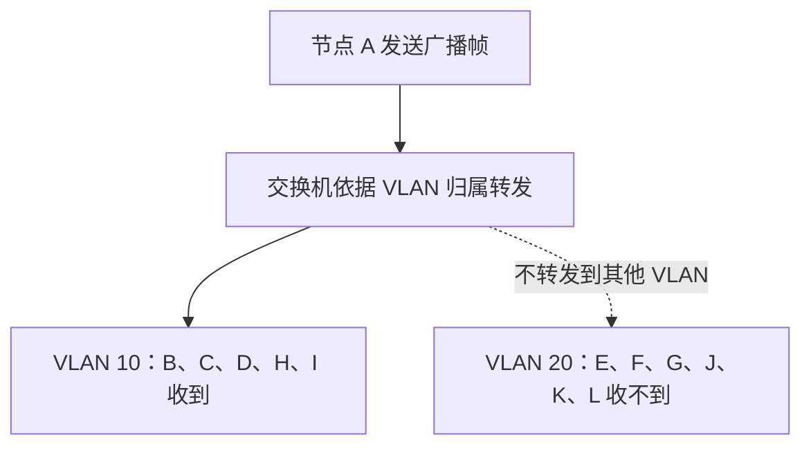
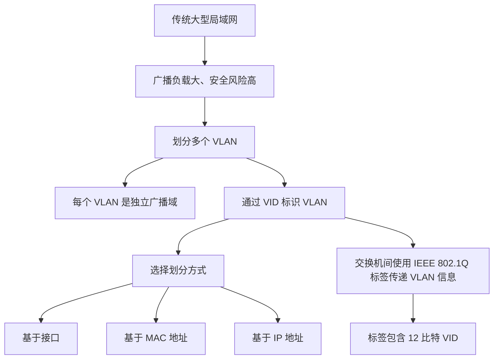

# VLAN（虚拟局域网）

## 一、VLAN 的基本概念

### 1. 名称与标准

- **LAN（Local Area Network）**：局域网。
- **VLAN（Virtual Local Area Network）**：虚拟局域网。
- VLAN 相关技术主要由 IEEE 802.1Q 工作组负责，因此许多 VLAN 相关标准以 **IEEE 802.1Q** 命名。
- VLAN 是 2022 年加入考纲的考点。
- 学习顺序上，VLAN 与以太网技术关系紧密，可以在学习以太网后连贯学习。

### 2. 传统大型局域网面临的问题

以校园网为例，校园网内部可能通过许多交换机连接学生电脑、数据中心、校园网服务器等设备。

通过交换机连接的各个节点，若处于同一个局域网中，就可能处于同一个广播域。一个节点发送广播帧后，交换机会将广播帧转发到相应的其他端口，经过逐层转发，广播帧可能到达整个局域网中的大量节点。

传统大型局域网主要面临以下问题：

1. **广播负载过大**
   - 局域网规模越大、连接节点越多，广播帧出现和传播的影响可能越大。
   - 广播帧过多会增加网络传输负载，也会增加各节点接收、处理广播帧的负担。
   - 严重时可能发生广播风暴，导致大量网络带宽被广播帧占用。

2. **安全性不足**
   - 校园网服务器、数据中心等可能是高敏感节点。
   - 如果这些节点暴露在整个大型局域网中，其他节点可能探测到它们，也可能增加遭受攻击的风险。

### 3. VLAN 的解决思路

IEEE 802.1Q 相关技术可以将一个局域网中的节点重新分组，划分为多个虚拟局域网。

- 每个 VLAN 都是一个**独立的广播域**。
- 一个 VLAN 中的广播帧，不会被转发到其他 VLAN 中。
- 不同 VLAN 相互隔离，可以限制不同 VLAN 之间的直接访问，从而有助于降低广播负载、提升网络安全性。
- VLAN 需要通过**支持 VLAN 功能的以太网交换机**进行配置；普通的不支持 VLAN 功能的交换机无法实现这一配置。

## 二、VLAN 的划分示例

假设两台交换机连接多个终端，交换机之间通过一条干线链路连接。

```text
  VLAN 10 的终端                         VLAN 10 的终端
 A ─┐                                  ┌─ H
 B ─┤                                  ├─ I
 C ─┤      ┌──────────┐  干线链路  ┌──────────┐
 D ─┴──────┤ 交换机一 ├════════════┤ 交换机二 ├──────┐
           └──────────┘            └──────────┘      │
                                                     │
  VLAN 20 的终端                                     │
 E ─┐                                                ├─ 其他终端
 F ─┤                                                │
 G ─┤                                                │
 J ─┤                                                │
 K ─┤                                                │
 L ─┘                                                ┘
```

> 示意图仅用于理解 VLAN 分组和交换机间干线链路；具体端口、终端分布以交换机配置为准。

可以将节点分成两个组：

- **VLAN 10**：例如 A、B、C、D、H、I。
- **VLAN 20**：例如 E、F、G、J、K、L。

其中，`10` 和 `20` 是 VLAN ID，简称 **VID**，用于标识不同的 VLAN。

### 1. 广播域的变化

假设 A 属于 VLAN 10，A 发送一个广播帧：

- 属于 VLAN 10 的 B、C、D、H、I 可以收到该广播帧。
- 属于 VLAN 20 的 E、F、G、J、K、L 收不到这个广播帧。



### 2. 安全性方面的作用

可以把敏感节点划分到一个 VLAN，把普通终端划分到其他 VLAN。只要终端与敏感节点不属于同一个 VLAN，终端就不能通过二层 VLAN 内的直接转发访问该敏感节点。

需要注意：**VLAN 隔离不等于完整的安全防护**。如果网络设备配置了三层路由或其他转发规则，不同 VLAN 之间仍可能通信，因此还需要结合访问控制等措施。

## 三、VLAN 的三种划分方式

### 1. 基于交换机接口划分 VLAN

管理员在交换机中配置 **VID 与交换机端口号的映射关系**。

例如：

| 交换机       | VID | 对应接口               |
| ------------ | --: | ---------------------- |
| 交换机一     |  10 | 1、2、3、4、8          |
| 交换机二     |  10 | 1、2、3                |
| 交换机一、二 |  20 | 按实际配置指定对应端口 |

当 A 从交换机一的 1 号接口发送广播帧进入交换机时，交换机根据端口与 VID 的映射关系，确定该帧属于 VLAN 10，再从属于 VLAN 10 的其他相关端口转发，例如 2、3、4 号接口，以及连接交换机二的 8 号接口。

交换机二也需要配置对应的端口与 VID 映射关系。收到来自交换机一的 VLAN 10 帧后，交换机二会将帧转发给本交换机中属于 VLAN 10 的相关终端。

**特点：**

- 配置依据是终端连接的交换机端口。
- 如果一台计算机更换了连接端口，它所属的 VLAN 可能随端口配置而改变。
- 例如，某终端原先连接在 VLAN 10 对应的端口，换到 VLAN 20 对应的端口后，就可能被划分到 VLAN 20。

### 2. 基于 MAC 地址划分 VLAN

管理员在交换机中配置 **VID 与设备 MAC 地址的映射关系**。

每个网络接口通常具有自己的 MAC 地址。交换机根据帧中发送方的 MAC 地址，判断发送方属于哪个 VLAN，再按相应 VLAN 的规则转发帧。

例如，A 的 MAC 地址被配置为属于 VLAN 10，那么 A 发送的广播帧就会在 VLAN 10 内传播；交换机能够根据转发表确定 B、C、D、H、I 对应的端口，并将帧转发给这些终端。

**特点：**

- 配置依据是设备的 MAC 地址，而不是终端接入的端口。
- 如果终端更换交换机端口，只要其 MAC 地址及相关配置不变，通常仍属于原来的 VLAN。

### 3. 基于 IP 地址划分 VLAN

管理员配置 **VID 与 IP 地址的映射关系**，根据 IP 地址确定终端所属的 VLAN。

IP 地址属于网络层概念，因此基于 IP 地址划分 VLAN，需要交换机具备相应的网络层功能支持，设备实现也会更复杂。

这种划分方式可以根据 IP 地址进行逻辑分组。相关方案还可以结合网络层功能，让不同物理局域网中的主机被划分到同一逻辑 VLAN 中。

例如，路由器两侧分别连接不同的局域网，在支持相应功能的设备与方案中，可以根据 IP 地址将其中某些主机划分到同一逻辑分组。

**特点：**

- 配置依据是 IP 地址。
- 需要相应的网络层功能支持。
- 可以根据 IP 地址进行逻辑分组；跨越路由器实现这种逻辑分组，需要相应设备与网络方案支持，并非普通二层 VLAN 自身就能直接跨路由器。

### 4. 三种方式对比

| 划分方式      | 交换机中维护的映射关系 | 主要特点                                                    |
| ------------- | ---------------------- | ----------------------------------------------------------- |
| 基于接口      | VID ↔ 交换机端口号     | 终端更换端口后，所属 VLAN 可能改变                          |
| 基于 MAC 地址 | VID ↔ MAC 地址         | 终端更换端口后，MAC 地址不变且配置不变时，通常仍属于原 VLAN |
| 基于 IP 地址  | VID ↔ IP 地址          | 需要相应网络层功能支持，可按 IP 地址进行逻辑分组            |

## 四、交换机之间如何传递 VLAN 信息

前面提到：当 A 发送广播帧时，交换机一需要把帧转发给交换机二。交换机二如何知道这个帧属于哪个 VLAN？

关键在于：**交换机之间的干线链路使用带有 VLAN 标记的 IEEE 802.1Q 帧，以携带 VID 信息。**

- 主机与交换机之间通常使用标准以太网帧。
- 交换机之间的干线链路上，可以使用 IEEE 802.1Q 帧。
- 802.1Q 帧在标准以太网帧中插入 4 字节的 VLAN 标签，其中包含 VID 信息。
- 交换机二收到带标签的帧后，可以读取 VID，判断该帧属于哪个 VLAN，再按对应 VLAN 的转发规则处理。

## 五、IEEE 802.1Q 帧的格式

### 1. 标准以太网帧与 802.1Q 帧

标准以太网帧常用记忆口诀：

**6 + 6 + 2 + n + 4**

其中：

- 6 字节：目的 MAC 地址。
- 6 字节：源 MAC 地址。
- 2 字节：类型/长度字段。
- `n` 字节：数据字段。
- 4 字节：FCS（帧校验序列，CRC 校验）。

  802.1Q 帧在标准以太网帧中增加 4 字节 VLAN 标签，常用口诀为：

**6 + 6 + 4 + 2 + n + 4**

新增的 4 字节位于**源 MAC 地址之后、原类型/长度字段之前**。

```text
标准以太网帧
┌──────────┬──────────┬────────────┬────────────┬──────────────┐
│ 目的 MAC │ 源 MAC   │ 类型/长度  │ 数据       │ FCS          │
│  6 字节  │  6 字节  │  2 字节    │ n 字节     │ 4 字节       │
└──────────┴──────────┴────────────┴────────────┴──────────────┘

IEEE 802.1Q 帧
┌──────────┬──────────┬──────────────┬────────────┬────────────┬──────────────┐
│ 目的 MAC │ 源 MAC   │ VLAN 标签    │ 类型/长度  │ 数据       │ FCS          │
│  6 字节  │  6 字节  │  4 字节      │  2 字节    │ n 字节     │ 4 字节       │
└──────────┴──────────┴──────────────┴────────────┴────────────┴──────────────┘
```

### 2. VLAN 标签的 4 字节结构

VLAN 标签总长为 4 字节，即 32 比特，由以下部分组成：

| 字段 |    长度 | 作用                                                     |
| ---- | ------: | -------------------------------------------------------- |
| TPID | 16 比特 | 常见固定值为 `0x8100`，用于标识带有 IEEE 802.1Q 标签的帧 |
| PCP  |  3 比特 | 优先级字段                                               |
| DEI  |  1 比特 | 丢弃资格指示字段                                         |
| VID  | 12 比特 | VLAN 标识符                                              |

> 课程讲解中常将中间的 4 比特概括为“没有意义、可以随便写”，用于突出末尾 12 比特 VID 的作用。严格来说，802.1Q 标签中的这 4 比特由 **PCP（3 比特）和 DEI（1 比特）**组成，具有实际用途，并非无意义字段。

结构示意：

```text
VLAN 标签：共 32 比特（4 字节）
┌──────────────────┬─────────┬───────┬────────────────────────┐
│ TPID             │ PCP     │ DEI   │ VID                    │
│ 16 比特          │ 3 比特  │ 1 比特│ 12 比特                │
└──────────────────┴─────────┴───────┴────────────────────────┘
```

### 3. VID 的作用

- VID 是 VLAN ID，用于标识帧所属的 VLAN。
- VID 占 12 比特。
- 交换机根据接入端口配置、MAC 地址映射、IP 地址映射等规则，判断终端或帧所属的 VLAN。
- 交换机在干线链路上传输帧时，可以通过 VLAN 标签携带 VID，让对端交换机识别 VLAN。

### 4. 帧校验序列（FCS）

由于 802.1Q 帧比标准以太网帧多了 4 字节 VLAN 标签，帧内容发生变化，因此在插入 VLAN 标签后，需要重新计算并生成 FCS（CRC 校验值）。

## 六、知识总结

### 1. VLAN 的主要作用与特点

1. 一个 VLAN 构成一个独立的广播域。
2. VLAN 可以将大型局域网划分成多个更小的广播域，降低广播传播范围和相关负载。
3. 不同 VLAN 之间相互隔离，有助于提升网络安全性；若配置了三层路由或其他转发规则，仍需配合访问控制措施。
4. VLAN 需要支持 VLAN 功能的交换机，并由管理员进行配置。
5. 每个 VLAN 通过 VID 进行标识。

### 2. 三种 VLAN 划分方式

- **基于接口**：记录 VID 与接口号的映射关系。
- **基于 MAC 地址**：记录 VID 与 MAC 地址的映射关系。
- **基于 IP 地址**：记录 VID 与 IP 地址的映射关系，需要相应网络层功能支持。

### 3. IEEE 802.1Q 帧

- 主机与交换机之间通常使用标准以太网帧。
- 交换机之间的干线链路可以使用 IEEE 802.1Q 帧。
- 标准以太网帧的记忆口诀：`6 + 6 + 2 + n + 4`。
- 802.1Q 帧的记忆口诀：`6 + 6 + 4 + 2 + n + 4`。
- VLAN 标签共 4 字节，其中包含 12 比特的 VID。
- 插入 VLAN 标签后，需要重新计算 FCS。

### 4. 复习流程图


