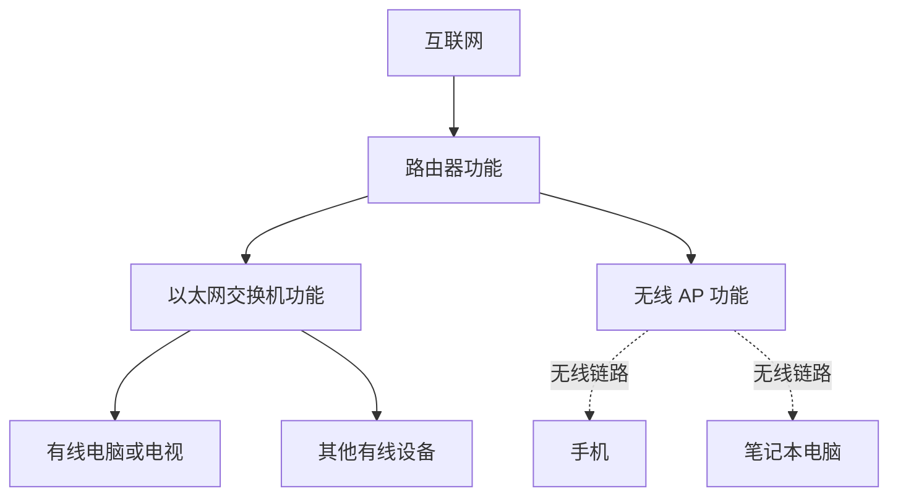
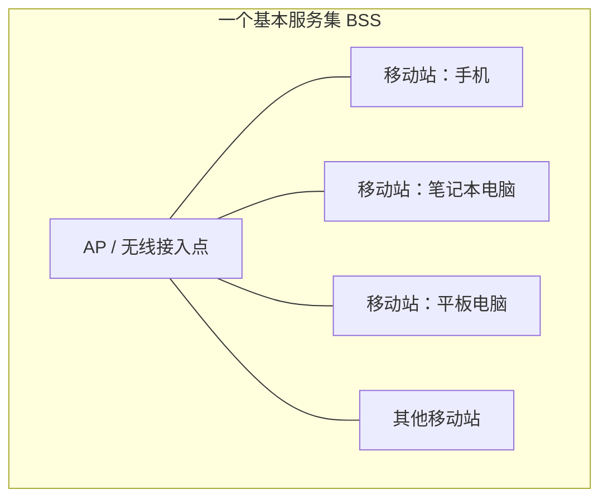
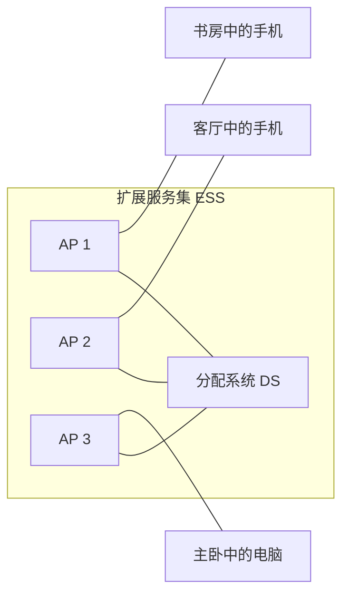
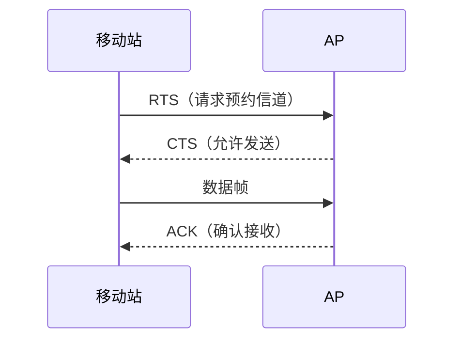
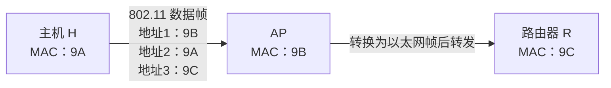

# IEEE 802.11 无线局域网

> **复习重点：** 无线局域网的分类、BSS/ESS/SSID/BSA 等基本概念、无线局域网的帧分类，以及 802.11 数据帧中 To DS、From DS 两个比特和地址 1～3 的含义。  
> **理解原则：** 先联系日常使用 Wi-Fi 的经验理解概念，再回到教材掌握术语和考试表达。

---

## 一、无线局域网的分类

无线局域网（WLAN）主要分为两类。

### 1. 有固定基础设施的无线局域网

这类网络具有固定的接入设备，最常见的例子就是日常使用的 **Wi-Fi**。

例如，在家中放置一台位置固定的无线路由器，手机、电脑等无线设备连接到路由器，通过它接入网络。

- 有固定的接入点（AP）。
- 移动设备通过 AP 接入网络。
- IEEE 802.11 工作组的主要工作方向之一，就是这类无线局域网。

### 2. 无固定基础设施的移动自组织网络

移动自组织网络不依赖固定的路由器或 AP，设备之间可以自行组织网络并进行通信。

生活中的例子包括：

- 苹果设备的**隔空投送（AirDrop）**。
- 华为设备的**华为分享**。
- 手机、电脑之间近距离传输文件或照片。
- 某些多屏协同功能，例如把手机画面投到电脑上，在电脑上访问手机的相关信息。

这些功能背后可以涉及设备之间直接建立通信连接、形成自组织网络的机制。

#### 移动自组织网络的特点

- 节点之间在逻辑上是平等的。
- 不需要依赖固定的中心接入点来组织所有通信。
- 可以用于文件传输、照片分享等场景。

与之相比，有固定基础设施的无线局域网具有明确的 AP：AP 位于网络中心，手机、电脑等设备作为接入 AP 的节点。

| 对比项          | 有固定基础设施的无线局域网 | 移动自组织网络                     |
| --------------- | -------------------------- | ---------------------------------- |
| 是否依赖固定 AP | 是                         | 不依赖固定 AP                      |
| 节点关系        | AP 与移动站的角色不同      | 节点在逻辑上平等                   |
| 生活中的例子    | 手机连接家里的 Wi-Fi       | 隔空投送、华为分享等设备间通信场景 |
| 本节学习重点    | **重点掌握**               | 了解即可，通常不是本节重点         |

> **学习提示：** 移动自组织网络简单了解即可。本节重点学习有固定基础设施的 IEEE 802.11 无线局域网。

---

## 二、家用路由器的硬件组成与网络连接

### 1. 家用路由器在功能上由什么组成？

从功能上看，一台普通家用路由器可以理解为以下设备的组合：

1. **路由器**：连接家庭内部网络与外部互联网。
2. **以太网交换机**：连接有线设备。
3. **无线 AP（Access Point，无线接入点）**：让手机、电脑等设备通过无线链路接入网络。



### 2. 802.3 有线局域网与 802.11 无线局域网

- 与以太网交换机相连的有线设备，可以组成符合 **IEEE 802.3** 标准的有线局域网。
- 与无线 AP 相连的无线设备，可以组成符合 **IEEE 802.11** 标准的无线局域网。
- 在功能上，可以把 AP 理解为一台无线交换设备：移动站与 AP 通过无线链路传输数据。

因此，两侧使用的链路接入技术和帧格式并不相同：

| 网络类型   | 相关标准    | 典型链路 | 常见设备               |
| ---------- | ----------- | -------- | ---------------------- |
| 有线局域网 | IEEE 802.3  | 有线链路 | 以太网交换机、有线电脑 |
| 无线局域网 | IEEE 802.11 | 无线链路 | AP、手机、笔记本电脑   |

### 3. 门户（Portal）

如果要把 802.11 无线局域网与 802.3 有线局域网连接起来，可以引入**门户（Portal）**。

门户的作用是连接不同类型的局域网，并完成相应的协议转换。从功能上理解，它相当于连接两种不同局域网的一种网桥。

```mermaid
flowchart LR
    Phone[手机] -. 802.11 无线链路 .-> AP[无线 AP]
    AP --> WLAN[802.11 无线局域网]
    WLAN --> Portal[门户 Portal]
    Portal --> LAN[802.3 有线局域网]
    LAN --> TV[电视或电脑]
```

通过门户把无线局域网和有线局域网连接起来后，两类设备可以处于同一个更大的局域网中，因此可以使用投屏等局域网功能。

---

## 三、IEEE 802.11 无线局域网的基本概念

## 1. 基本服务集 BSS

**基本服务集（Basic Service Set，BSS）** 是 IEEE 802.11 无线局域网中的基本组成单元。

一个 BSS 通常包括：

- 一个无线接入点 AP。
- 多个通过无线链路接入 AP 的移动站。

AP 相当于基站，手机、电脑等可以移动的无线设备则称为**移动站（Station，STA）**。



通俗理解：

- **AP**：平时连接的 Wi-Fi 热点。
- **BSS**：一个 AP 加上接入它的多台手机、电脑等设备。
- **移动站**：手机、电脑等无线终端。
- **基站**：在这个模型中，AP 承担类似基站的作用。

在一个采用固定基础设施的 BSS 中，移动站之间的通信需要通过 AP 转发，而不是由两个移动站直接交换 802.11 数据帧。

### 2. 介质访问控制：CSMA/CA

在无线局域网中，移动站与 AP 之间使用 **CSMA/CA** 协议实现介质访问控制。

CSMA/CA 的相关过程会使用 RTS、CTS 等控制帧预约信道，并可通过 ACK 确认数据帧是否被正确接收。后文会进一步说明这些帧的作用。

### 3. 服务集标识符 SSID

**服务集标识符（Service Set Identifier，SSID）** 就是平时看到的 Wi-Fi 名称。

- SSID 用于标识无线网络。
- SSID 的长度不能超过 **32 字节**。
- 连接 Wi-Fi 时，手机或电脑上显示的网络名称就是 SSID。

### 4. 基本服务区 BSA

**基本服务区（Basic Service Area，BSA）** 是一个 BSS 所覆盖的地理范围。

通俗地说，就是在某个范围内能够接收到这个 AP 的 Wi-Fi 信号。信号覆盖范围会受到距离、墙体、干扰等因素影响。

### 5. 本节概念速查

| 术语    | 英文全称                                               | 通俗理解                                     |
| ------- | ------------------------------------------------------ | -------------------------------------------- |
| AP      | Access Point                                           | 无线接入点、Wi-Fi 热点                       |
| STA     | Station                                                | 手机、电脑等无线终端                         |
| BSS     | Basic Service Set                                      | 一个 AP 及其关联的移动站组成的基本服务集     |
| SSID    | Service Set Identifier                                 | Wi-Fi 名称，最长 32 字节                     |
| BSA     | Basic Service Area                                     | 一个 BSS 的无线覆盖区域                      |
| CSMA/CA | Carrier Sense Multiple Access with Collision Avoidance | 无线局域网使用的介质访问控制协议             |
| Portal  | —                                                      | 连接不同类型局域网、进行协议转换的设备或功能 |

---

## 四、扩展服务集 ESS 与无线漫游

### 1. 为什么需要扩展服务集？

单个 AP 的无线覆盖范围有限。如果家中某些房间的 Wi-Fi 信号比较弱，可以通过部署多个 AP 扩展覆盖范围。

多个基本服务集通过**分配系统（Distribution System，DS）**连接起来，可以形成一个**扩展服务集（Extended Service Set，ESS）**。



### 2. 用子母路由器理解 ESS

以全屋 Wi-Fi 的子母路由器为例：

1. 母路由器的 WAN 口连接运营商提供的网络，通常连接家中的光猫。
2. 子路由器通过母路由器或分配系统连接起来。
3. 将子路由器部署在书房、客厅、主卧等位置，以改善不同区域的 Wi-Fi 覆盖。
4. 从功能上看，各子路由器可以承担无线 AP 的作用。

母路由器通常还具有路由和以太网交换等功能：

- 路由功能负责连接家庭内部网络与外部互联网。
- 母路由器上的多个 LAN 口可连接电视、电脑等有线设备。
- 这些有线设备在逻辑上可以接入同一个以太网交换网络。
- 多个无线 AP 则负责不同区域内的无线接入。

### 3. 扩展服务集的特点

- 一个 ESS 中可以包含多个 BSS。
- 各 AP 通过分配系统连接起来。
- 对用户而言，整个 ESS 可以表现为一个整体。
- 全屋 Wi-Fi 通常可以设置相同的 SSID，使用户在不同位置看到的 Wi-Fi 名称保持一致。

### 4. 漫游（Roaming）

**漫游**是指移动站从一个 BSS 切换到另一个 BSS 的过程，并尽可能保持通信不中断。

例如：

1. 手机在书房时连接书房的 AP。
2. 用户拿着手机走到客厅，客厅 AP 的信号更适合当前连接。
3. 手机切换到客厅 AP。
4. 继续移动到其他房间时，也可以切换到相应的 AP。


对用户来说，漫游的效果就是在家中移动时，设备能够在不同 AP 之间切换，而不必每次手动选择另一个 Wi-Fi 名称。

> **记忆：** BSS 是基本服务集；多个 BSS 通过分配系统连接，可以形成 ESS；移动站在不同 BSS 之间切换称为漫游。

---

## 五、IEEE 802.11 帧的分类

IEEE 802.11 的帧分为三大类：

1. **数据帧（Data Frame）**
2. **控制帧（Control Frame）**
3. **管理帧（Management Frame）**

| 帧类型 | 主要作用                       | 典型例子               |
| ------ | ------------------------------ | ---------------------- |
| 数据帧 | 承载实际需要传输的数据         | 普通数据帧             |
| 控制帧 | 辅助信道访问、预约和确认等过程 | RTS、CTS、ACK          |
| 管理帧 | 管理无线连接、发现无线网络等   | 探测请求帧、探测响应帧 |

### 1. 数据帧

数据帧用于传输实际的数据内容。例如，移动站要把数据发送给 AP，就会发送数据帧。

### 2. 控制帧

在 CSMA/CA 相关过程中，常见控制帧包括：

- **RTS（Request To Send）**：请求发送，发送方用于预约信道。
- **CTS（Clear To Send）**：允许发送，接收方响应 RTS，表示可以发送。
- **ACK（Acknowledgment）**：确认帧，接收方成功接收并检查数据帧后，可以返回 ACK。

基本过程可以概括为：



### 3. 管理帧

管理帧用于无线网络的发现、连接和管理等过程。

例如：

- **探测请求帧（Probe Request）**：设备主动探测周围的无线网络。
- **探测响应帧（Probe Response）**：AP 收到探测请求后，可以返回响应，提供相关无线网络信息。

通俗理解：手机搜索附近的 Wi-Fi 时，会涉及发现周边 AP 的过程；探测请求帧与探测响应帧就是相关的管理帧。

---

## 六、IEEE 802.11 数据帧格式

## 1. 数据帧的总体组成

本节课程使用的示意格式可以概括为：

- **首部：30 字节**（课程讲解的格式中包含地址 4）。
- **数据部分：N 字节**。
- **校验部分：4 字节**。

其中，数据部分长度可变：最短可以为 0 字节，最长不超过 2312 字节。

> 课程口诀：**“30、N、4，首、数、验”**  
> 即首部、数据部分、校验部分分别对应 30 字节、N 字节和 4 字节。地址 4 在本节讨论的固定基础设施场景中通常不是重点。

### 2. 帧控制字段（Frame Control）

帧控制字段位于数据帧首部的开头，占 **2 字节（16 比特）**。它包含协议版本、类型、子类型、To DS、From DS 等信息。

| 字段              |   长度 | 说明                             |
| ----------------- | -----: | -------------------------------- |
| 协议版本          | 2 比特 | 用于表示协议版本，本节不作重点   |
| 类型（Type）      | 2 比特 | 区分管理帧、控制帧和数据帧       |
| 子类型（Subtype） | 4 比特 | 在大类基础上进一步区分具体帧类型 |
| To DS             | 1 比特 | 表示帧是否发往分配系统/AP 方向   |
| From DS           | 1 比特 | 表示帧是否来自分配系统/AP 方向   |

课程按照比特位置，将 To DS 和 From DS 称为帧控制字段中的**第 9、10 比特**。

### 3. 类型与子类型

类型字段的两个比特用于区分三大类帧：

| 帧类型 | Type 字段 |
| ------ | --------- |
| 管理帧 | `00`      |
| 控制帧 | `01`      |
| 数据帧 | `10`      |

子类型字段由 4 比特组成，用于进一步区分具体帧。例如，在控制帧中：

| 控制帧 | Subtype 字段 |
| ------ | ------------ |
| RTS    | `1011`       |
| CTS    | `1100`       |
| ACK    | `1101`       |

因此，接收方可以先根据类型字段判断帧的大类，再根据子类型字段确定具体帧类型，并进行相应处理。

---

## 七、To DS、From DS 与地址 1～3

这是本节数据帧格式中需要重点掌握的内容。

### 1. 为什么要区分“去往 AP”和“来自 AP”？

在固定基础设施无线局域网中，两个移动站之间不能直接通过一跳 802.11 数据帧完成通信，通常需要 AP 转发。

假设手机 A 要向手机 B 发送数据：

1. A 先把数据帧发送给 AP。
2. AP 再把数据帧转发给 B。

因此，帧在传输过程中有两个方向状态：

- **去往 AP**：移动站发送给 AP。
- **来自 AP**：AP 转发给移动站。


无线信号可能被覆盖范围内的多个设备接收到。To DS 和 From DS 两个比特可以帮助接收设备识别帧的传输方向。例如，其他移动站即使检测到了一个发给 AP 的帧，也可以根据方向字段判断该帧不是发给自己的。

### 2. To DS 与 From DS 两个比特

按照本节课程使用的表述，`1` 可以理解为 True，`0` 可以理解为 False：

| To DS | From DS | 本节关注的含义 |
| ----: | ------: | -------------- |
|   `1` |     `0` | 去往 AP        |
|   `0` |     `1` | 来自 AP        |

- To DS = 1、From DS = 0：移动站把帧发往 AP。
- To DS = 0、From DS = 1：帧由 AP 转发给移动站。

### 3. 地址字段

802.11 数据帧格式中有地址字段：

- 地址 1：6 字节，即 48 比特。
- 地址 2：6 字节，即 48 比特。
- 地址 3：6 字节，即 48 比特。
- 地址 4：也是 6 字节，但在本节讨论的固定基础设施网络中通常不是重点。

前三个地址分别对应接收方向、发送方向以及最终源/目的节点等信息；它们的具体含义要结合 To DS、From DS 两个比特判断。

### 4. 两种常考状态下的地址含义

#### 情况一：去往 AP（To DS = 1，From DS = 0）

帧从移动站发往 AP：

| 地址字段 | 含义                            | 例子       |
| -------- | ------------------------------- | ---------- |
| 地址 1   | 中转节点，即 AP 的 MAC 地址     | AP         |
| 地址 2   | 起点，即发送移动站的 MAC 地址   | A          |
| 地址 3   | 终点，即最终目的节点的 MAC 地址 | B 或路由器 |

记忆顺序：**中、起、止**。

#### 情况二：来自 AP（To DS = 0，From DS = 1）

帧由 AP 转发给移动站：

| 地址字段 | 含义                          | 例子 |
| -------- | ----------------------------- | ---- |
| 地址 1   | 终点，即目的移动站的 MAC 地址 | B    |
| 地址 2   | 中转节点，即 AP 的 MAC 地址   | AP   |
| 地址 3   | 起点，即原始发送方的 MAC 地址 | A    |

记忆顺序：**止、中、起**。

### 5. 数据帧口诀

> **30、N、4，首、数、验；首部三加一地址。**  
> **第 9、10 比特表去来，真正中转靠 AP。**  
> **去往 AP：中起止；来自 AP：止中起。**

逐句理解：

1. **“30、N、4，首、数、验”**：课程示意格式中的首部、数据部分和校验部分分别为 30 字节、N 字节、4 字节。
2. **“首部三加一地址”**：首部包含地址 1～4；本节重点关注前三个地址。
3. **“第 9、10 比特表去来”**：根据帧控制字段中的 To DS 和 From DS 判断帧的传输方向。
4. **“真正中转靠 AP”**：固定基础设施无线局域网中，移动站之间的通信需要通过 AP 转发。
5. **“去往 AP：中起止；来自 AP：止中起”**：确定方向后，再按对应顺序理解地址 1～3。

> **易错提醒：** 不要只背地址 1、2、3 的固定含义。必须先判断帧是“去往 AP”还是“来自 AP”，再判断三个地址分别代表什么。

---

## 八、2017 年考研真题：地址 1、地址 2、地址 3 的判断

题目描述：主机 H 要发送一个封装了访问 Internet 的 IP 分组的 IEEE 802.11 数据帧。已知：

- 主机 H 的 MAC 地址为 `9A`。
- AP 的 MAC 地址为 `9B`。
- 路由器 R 的 MAC 地址为 `9C`。

问题是：数据帧 F 的地址 1、地址 2、地址 3 分别是什么？

### 解题步骤

1. H 要将数据发送到 Internet，因此最终需要把数据交给路由器 R。
2. 当前 H 正在通过无线链路向 AP 发送帧，所以该帧属于**去往 AP**的帧。
3. 去往 AP 时，地址 1、地址 2、地址 3 对应“中、起、止”。

| 地址字段 | 对应节点         | MAC 地址 |
| -------- | ---------------- | -------- |
| 地址 1   | 中转节点 AP      | `9B`     |
| 地址 2   | 起点主机 H       | `9A`     |
| 地址 3   | 最终目的路由器 R | `9C`     |

因此：

- 地址 1 = `9B`
- 地址 2 = `9A`
- 地址 3 = `9C`

对应题目中的 **B 选项**。



### 题目补充：AP 的帧格式转换功能

在常见网络结构中：

- AP 与移动站之间通常通过无线链路通信，使用 IEEE 802.11 帧格式。
- AP 与路由器、以太网交换机或其他 AP 之间通常使用有线链路。
- 在通过以太网有线链路转发数据时，AP 通常需要把无线链路上的 802.11 帧转换为适用于有线以太网链路的帧格式。

因此，AP 除了提供无线接入，也可能承担帧格式转换和转发等工作。

---

## 九、802.11 无线局域网的重点总结

### 1. 基本概念

- **AP**：无线接入点，也就是 Wi-Fi 热点。
- **BSS**：一个 AP 与接入它的移动站组成的基本服务集。
- **SSID**：Wi-Fi 名称，长度不能超过 32 字节。
- **BSA**：一个 BSS 的无线覆盖范围。
- **ESS**：多个 BSS 通过分配系统连接形成的扩展服务集。
- **漫游**：移动站从一个 BSS 切换到另一个 BSS，并尽可能保持通信不中断。
- **Portal**：连接不同类型局域网，并实现相应协议转换的设备或功能。

### 2. 帧的分类

| 类别   | 主要作用                     | 例子                          |
| ------ | ---------------------------- | ----------------------------- |
| 数据帧 | 传输实际数据                 | Data                          |
| 控制帧 | 信道预约、发送控制、接收确认 | RTS、CTS、ACK                 |
| 管理帧 | 发现与管理无线网络           | Probe Request、Probe Response |

### 3. 数据帧格式重点

- 课程示意格式：首部 30 字节、数据部分 N 字节、校验部分 4 字节。
- 帧控制字段占 2 字节。
- 类型字段占 2 比特，子类型字段占 4 比特。
- To DS 和 From DS 用于表示帧的传输方向。
- 地址 1、地址 2、地址 3 各占 6 字节。
- 固定基础设施场景下，地址 4 通常不是本节考试重点。

### 4. 必须掌握的地址对应关系

| 帧的方向 | To DS | From DS | 地址 1      | 地址 2      | 地址 3          |
| -------- | ----: | ------: | ----------- | ----------- | --------------- |
| 去往 AP  |     1 |       0 | 中转节点 AP | 起点/发送方 | 终点/最终目的地 |
| 来自 AP  |     0 |       1 | 终点/接收方 | 中转节点 AP | 起点/原始发送方 |

**解题顺序：先看 To DS、From DS，再套用地址口诀。**

---

## 十、补充了解：RTS、CTS、ACK 控制帧格式

这一部分属于拓展内容，通常不需要像数据帧地址字段那样重点记忆，了解结构和用途即可。

### 1. 帧控制字段

RTS、CTS、ACK 三种控制帧开头都有 2 字节的帧控制字段。其基本字段划分与前文类似：

- 前 2 比特：协议版本。
- 接下来的 2 比特：帧类型。
- 接下来的 4 比特：子类型。

由于 RTS、CTS、ACK 都属于控制帧，所以三者的 **Type 字段均为 `01`**；它们的 Subtype 字段不同。

| 帧  | Type | Subtype |
| --- | ---- | ------- |
| RTS | `01` | `1011`  |
| CTS | `01` | `1100`  |
| ACK | `01` | `1101`  |

### 2. 持续期（Duration）字段

RTS、CTS、ACK 帧中都包含持续期相关字段。

在 CSMA/CA 的信道预约过程中，发送方需要说明预计还要占用信道多长时间。持续期字段以**微秒**为单位，表示当前帧结束后还需要保留信道的时间。

- RTS 发起信道预约，其持续期通常较长。
- AP 收到 RTS 并同意预约后，发送 CTS；CTS 中的剩余持续期会相应减少。
- 后续的数据传输和确认过程也会根据剩余预约时间继续进行。

这三种控制帧的具体格式稍作了解即可，重点仍然是理解 CSMA/CA 的预约过程及数据帧格式中的关键字段。

---

## 十一、考前快速自测

复习时可以遮住右侧答案，先尝试自己解释。

| 问题                                                   | 参考答案         |
| ------------------------------------------------------ | ---------------- |
| Wi-Fi 名称对应哪个术语？                               | SSID             |
| 一个 AP 与关联的移动站组成什么？                       | BSS              |
| BSS 的覆盖范围叫什么？                                 | BSA              |
| 多个 BSS 通过分配系统连接后形成什么？                  | ESS              |
| 移动站从一个 BSS 切换到另一个 BSS 叫什么？             | 漫游             |
| IEEE 802.11 无线局域网采用什么介质访问控制协议？       | CSMA/CA          |
| RTS、CTS、ACK 属于哪类帧？                             | 控制帧           |
| 探测请求帧、探测响应帧属于哪类帧？                     | 管理帧           |
| 去往 AP 时，地址 1、2、3 如何记忆？                    | 中、起、止       |
| 来自 AP 时，地址 1、2、3 如何记忆？                    | 止、中、起       |
| 固定基础设施无线局域网中，移动站之间通常如何传输数据？ | 经过 AP 转发     |
| AP 在无线和有线网络之间还可能承担什么功能？            | 帧格式转换与转发 |

---

## 十二、本节最终记忆框架

```text
IEEE 802.11 无线局域网
│
├── 无线局域网分类
│   ├── 有固定基础设施：Wi-Fi，重点
│   └── 移动自组织网络：了解
│
├── 基本概念
│   ├── AP：无线接入点
│   ├── BSS：基本服务集
│   ├── SSID：Wi-Fi 名称，最长 32 字节
│   ├── BSA：基本服务区
│   ├── ESS：扩展服务集
│   └── 漫游：不同 BSS 之间切换
│
├── 帧的分类
│   ├── 数据帧
│   ├── 控制帧：RTS、CTS、ACK
│   └── 管理帧：探测请求、探测响应
│
└── 数据帧格式（重点）
    ├── 30、N、4：首部、数据、校验
    ├── 帧控制字段：类型、子类型、To DS、From DS
    ├── 第 9、10 比特：表示去往 AP / 来自 AP
    ├── 去往 AP：中、起、止
    ├── 来自 AP：止、中、起
    └── 移动站之间的通信需要 AP 转发
```

> **最后提醒：** 不必机械背诵每个概念的长篇定义。要能结合 Wi-Fi、子母路由器、设备漫游等生活场景解释术语，并在做题时先判断数据帧方向，再确定地址 1～3 的含义。
