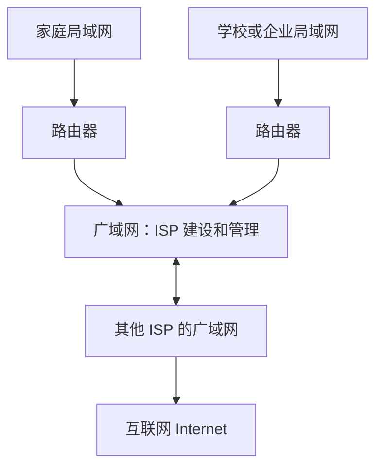
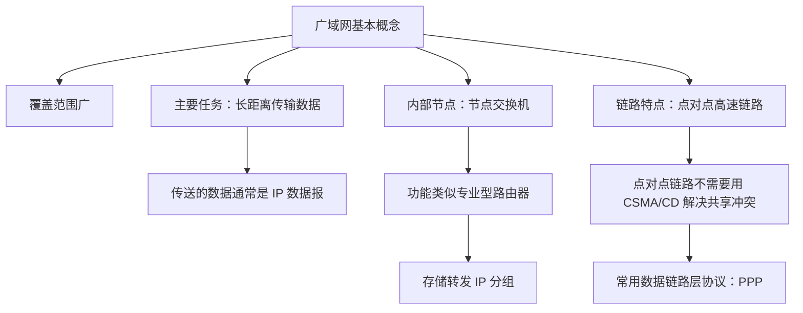

# 广域网的基本概念

## 一、考纲定位与学习要求

广域网（WAN，Wide Area Network）是计算机网络中的基础概念之一。

在考研 408 的相关教材中，广域网通常只作简要介绍，涉及内容不多。因此，学习这一部分时，**理解基本概念和主要特点即可，不需要过度深究**。可以结合王道书再阅读一遍，加深理解。

## 二、广域网、局域网与互联网的关系

### 1. 基本概念

- **局域网（LAN）**：通常由个人或某个单位使用，例如家庭网络、学校网络和企业网络。
- **广域网（WAN）**：覆盖范围较广，通常由各大互联网服务提供商（ISP）搭建和管理，例如中国电信、中国移动和中国联通。
- **互联网（Internet）**：世界范围内的各种局域网和广域网互联互通后形成的网络。

通常情况下，局域网通过**路由器**接入广域网。不同 ISP 建设的广域网也可以互联互通，从而形成覆盖范围更大的网络。

### 2. 网络关系示意图

> **理解要点：** 局域网通常属于个人或单位；广域网通常由 ISP 建设和管理；各局域网和广域网互联互通，形成互联网。

## 三、广域网的主要特点与功能

### 1. 覆盖范围广

与局域网相比，广域网的覆盖范围更大，可能覆盖几十公里，甚至几千公里。

### 2. 主要任务

广域网的主要任务是**长距离传送主机发送的数据**。在现代互联网中，主机发送的数据通常是 **IP 数据报**。

### 3. 内部节点的主要功能

广域网内部的节点交换机，在功能上可以理解为专业型路由器。它们的主要功能是对 **IP 数据报（IP 分组）进行存储转发**。

### 4. 广域网的链路特点

- 主机可以通过**点对点链路**接入广域网。
- 广域网内部的各个节点之间，通常也通过**点对点的高速链路**连接。

## 四、节点交换机是什么

广域网图示中的白色方形节点通常标注为**节点交换机**。这里的“交换机”不是日常所说的以太网交换机。

- **广域网节点交换机**：在功能上更接近专业型路由器，主要负责存储转发 IP 分组。
- **以太网交换机**：用于以太网等局域网环境，两者不能仅因为名称中都有“交换机”就视为同一种设备。

### 为什么称为“节点交换机”？

这主要是历史术语沿用造成的。在 20 世纪八九十年代，广域网中用于实现分组交换的设备曾被学术界和商业界称为“节点交换机”，因为它负责交换 IP 分组。

现在理解这一术语时，需要注意：**广域网中的节点交换机在功能上更像路由器，而不是我们熟悉的以太网交换机。**

## 五、点对点链路与总线型链路的区别

局域网和广域网常见的链路连接方式有所不同。

| 对比项目           | 总线型链路                                    | 点对点链路                                     |
| ------------------ | --------------------------------------------- | ---------------------------------------------- |
| 常见场景           | 局域网内部的某些连接方式                      | 广域网主机接入、广域网内部节点之间的连接       |
| 连接特点           | 多个节点共享一条传输介质                      | 链路连接两端的节点                             |
| 信号冲突           | 多个节点同时发送数据时，可能发生冲突          | 不存在多个节点共享同一链路发送所导致的这类冲突 |
| 数据链路层协议举例 | 可使用 CSMA/CD 等机制解决共享介质上的冲突问题 | PPP 是点对点链路常用的数据链路层协议           |

### 1. 总线型链路

在总线型链路中，多个节点共享同一条传输介质。如果多个节点同时发送数据，就可能发生信号冲突。因此，在相关以太网环境中，可以通过数据链路层的 **CSMA/CD 协议**解决总线冲突问题。

### 2. 点对点链路

点对点链路连接两个节点，不存在多个节点同时竞争同一共享链路而产生的上述信号冲突问题。因此，这类链路不需要使用 CSMA/CD 来解决共享介质冲突。

之后学习的数据链路层协议 **PPP（Point-to-Point Protocol，点对点协议）**，就是点对点链路常用的协议。

## 六、知识结构图

## 七、复习要点

1. **局域网、广域网和互联网的关系**：局域网通过路由器接入广域网；多个局域网和广域网互联互通，形成互联网。
2. **广域网的特点**：覆盖范围广，主要负责长距离传送主机发送的数据。
3. **广域网传输的数据**：通常是 IP 数据报，也称 IP 分组。
4. **节点交换机**：广域网中的节点交换机主要负责存储转发 IP 分组，功能上更接近路由器，不等同于以太网交换机。
5. **链路与协议**：共享总线上的多个节点同时发送数据可能发生冲突，可使用 CSMA/CD；点对点链路常用 PPP 协议。
6. **学习要求**：广域网相关内容以理解基本概念为主，不必过度深究。
