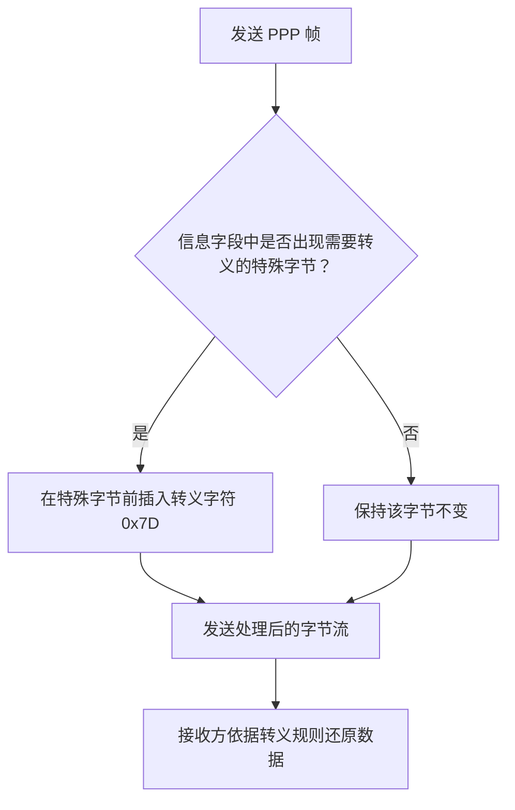
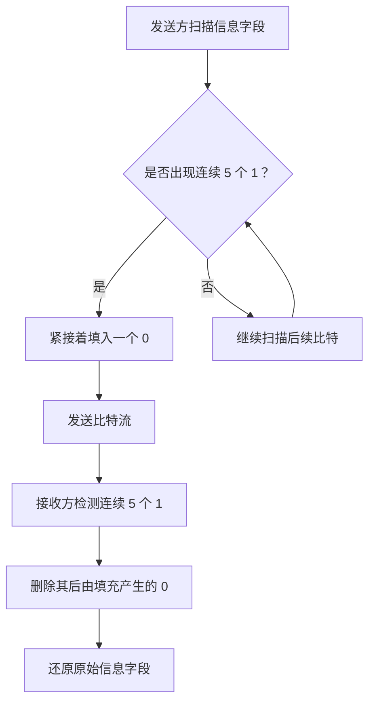

# PPP 协议（点对点协议）

## 一、PPP 协议的基本概念

PPP（Point-to-Point Protocol，点对点协议）属于**数据链路层**。

在以太网中，数据链路层使用以太网 MAC 帧（Ethernet MAC Frame）传输数据，MAC 帧内部可以携带 IP 分组。类似地，PPP 作为数据链路层协议，也定义了自己的 **PPP 帧**，用于在点对点链路上传输数据。

例如，两台路由器之间有一条点对点线路，就可以使用 PPP 帧传输数据。PPP 帧的信息部分既可以携带 IP 分组，也可以携带其他协议的数据。

## 二、PPP 协议的组成

PPP 协议主要包含以下三个部分：

| 组成部分            | 英文全称                 | 主要作用                                  |
| ------------------- | ------------------------ | ----------------------------------------- |
| 链路控制协议（LCP） | Link Control Protocol    | 用于链路控制                              |
| 网络控制协议（NCP） | Network Control Protocol | 用于网络层协议相关的控制                  |
| PPP 帧格式          | PPP Frame Format         | 定义 PPP 帧的格式，用于封装和传输协议数据 |

LCP 和 NCP 都是 PPP 协议中的子协议。它们的具体作用将在后续内容中进一步介绍。

PPP 帧的信息部分不仅可以携带网络层协议数据（例如 IP 分组），也可以携带 LCP 或 NCP 的协议数据。

## 三、PPP 帧的格式

PPP 帧的格式如下：

| 字段                    |     长度 | 说明                                                       |
| ----------------------- | -------: | ---------------------------------------------------------- |
| 标志字段（Flag）        |   1 字节 | 固定为 `0x7E`，即二进制 `01111110`，用于标记帧的开始或结束 |
| 地址字段（Address）     |   1 字节 | 固定为 `0xFF`                                              |
| 控制字段（Control）     |   1 字节 | 固定为 `0x03`                                              |
| 协议字段（Protocol）    |   2 字节 | 指明信息部分携带的是哪一种协议的数据                       |
| 信息字段（Information） | 可变长度 | 存放协议数据，通常不超过 1500 字节                         |
| 帧校验序列（FCS）       |   2 字节 | 存放 CRC 循环冗余校验码，用于检测比特错误                  |
| 标志字段（Flag）        |   1 字节 | 固定为 `0x7E`，标记帧的结束                                |

> **记忆重点：** PPP 帧首尾的标志字段均为 `0x7E`；地址字段为 `0xFF`；控制字段为 `0x03`；协议字段占 2 字节；信息字段长度可变；FCS 用于差错检测。

### 3.1 标志字段（Flag）

- 位于 PPP 帧的开头和结尾。
- 固定值为 `0x7E`，二进制形式为 `01111110`。
- 用于标记 PPP 帧的开始和结束，也称为**帧定界符**。

### 3.2 地址字段和控制字段

- 地址字段占 1 字节，固定为 `0xFF`。
- 控制字段占 1 字节，固定为 `0x03`。
- 在这里，它们的取值是固定的。

### 3.3 协议字段（Protocol）

- 占 **2 字节**。
- 用于指明 PPP 帧的信息部分具体携带哪一种协议的数据。
- 例如，信息部分携带 IPv4 分组时，协议字段的值为 `0x0021`。
- 如果信息部分携带 LCP 或 NCP 的协议数据，协议字段则使用相应的值。

因此，PPP 帧能够通过协议字段区分信息部分承载的不同协议数据。

### 3.4 信息字段（Information）

- 长度可变。
- 通常不超过 **1500 字节**。
- 可以携带 IP 分组，也可以携带 LCP、NCP 等协议的数据。

### 3.5 帧校验序列（FCS）

FCS（Frame Check Sequence，帧校验序列）占 **2 字节**，主要用于存储 CRC（循环冗余校验）校验码。

接收方根据 FCS 检测 PPP 帧是否发生比特错误。如果检测到差错，就直接丢弃该帧。其处理方式与以太网帧类似：**丢弃错误帧，但不会因此向发送方返回确认信息**。

## 四、PPP 的透明传输

### 4.1 为什么需要透明传输？

PPP 帧通过首尾的 `0x7E`（二进制 `01111110`）作为帧定界符。

但是，信息字段中的数据也可能出现与帧定界符相同的比特组合。如果不作处理，接收方就可能把信息字段中的数据误认为帧的开始或结束。

因此，PPP 需要采用相应的方法，确保信息字段中的特定数据不会被误认为帧定界符。这就是**透明传输**要解决的问题。

PPP 支持两种实现透明传输的方法：

| 方法               | 适用场景 | 传输单位           |
| ------------------ | -------- | ------------------ |
| 字节（字符）填充法 | 异步传输 | 以字符／字节为单位 |
| 零比特填充法       | 同步传输 | 连续传送比特流     |

### 4.2 异步传输与同步传输

| 类型     | 含义                                       | PPP 帧的传输方式                   |
| -------- | ------------------------------------------ | ---------------------------------- |
| 异步传输 | 两个点对点相连的节点之间没有统一的时钟信号 | 以字符（通常按字节组织）为单位传送 |
| 同步传输 | 两个点对点相连的节点之间有统一的时钟信号   | 将 PPP 帧中的比特连续传送          |

### 4.3 字节（字符）填充法

字节填充法用于**异步传输**。

当信息字段中出现与帧定界符相同的特殊字节时，发送方会在该字节前插入一个**转义字符**。PPP 使用的转义字符为 `0x7D`。

接收方收到转义字符后，就知道后续相应字节需要按转义规则处理，不能直接把它解释为真正的帧定界符。

**理解要点：** 字节填充法通过插入转义字符，避免信息字段中的特殊字节被误认为帧定界符。

### 4.4 零比特填充法

零比特填充法用于**同步传输**，即将 PPP 帧中的比特连续传送。

处理规则如下：

- **发送方：** 在信息字段中，只要发现 **5 个连续的 `1`**，就立即填入一个 `0`。
- **接收方：** 如果检测到 **5 个连续的 `1`**，并且后面紧跟一个由填充产生的 `0`，就将这个 `0` 删除。

这样可以避免信息字段中的比特组合被误认为帧定界符。

**理解要点：** 零比特填充法是在比特流中插入 `0`；接收方再根据规则删除填充的 `0`。

### 4.5 两种透明传输方法对比

| 对比项       | 字节（字符）填充法       | 零比特填充法                                        |
| ------------ | ------------------------ | --------------------------------------------------- |
| 适用传输方式 | 异步传输                 | 同步传输                                            |
| 处理单位     | 字节／字符               | 比特                                                |
| 发送方的处理 | 在特殊字节前插入转义字符 | 每出现 5 个连续的 `1`，就填入一个 `0`               |
| 接收方的处理 | 按转义规则还原数据       | 每检测到 5 个连续的 `1`，就删除其后由填充产生的 `0` |

## 五、PPP 协议的特点

### 5.1 只支持点对点全双工链路

PPP 是数据链路层协议，只支持**点对点、全双工**的链路。

在总线型链路中，不能使用 PPP 作为数据链路层协议。

### 5.2 能够检测差错，但不提供可靠传输

PPP 接收方会检查帧中的 FCS：

- 如果检测出差错，就丢弃该帧。
- PPP 不会因为丢弃错误帧而向发送方返回类似 `ACK` 的确认信息。

因此，PPP 可以进行差错检测，但不提供确认与重传机制。按照本节内容的表述，PPP 链路能够检测并丢弃错误帧，但**不提供可靠传输保证**。

### 5.3 支持多种网络层协议

PPP 帧中的协议字段可以指明信息字段所携带的数据类型。

只需根据承载的数据类型使用相应的协议字段值，PPP 帧就可以封装多种协议的数据，例如：

- IPv4 分组；
- IPv6 分组；
- AppleTalk 协议的数据；
- LCP、NCP 等 PPP 相关协议的数据。

### 5.4 PPP 帧长度是字节的整数倍

PPP 帧的长度一定是**字节的整数倍**。这是协议格式的规定，记住这一特点即可。

## 六、考前速记

| 考点               | 关键内容                                     |
| ------------------ | -------------------------------------------- |
| 协议层次           | 数据链路层                                   |
| 适用链路           | 点对点、全双工；不适用于总线型链路           |
| 组成部分           | LCP、NCP、PPP 帧格式                         |
| 帧定界符           | 首尾均为 `0x7E`，即 `01111110`               |
| 地址字段           | `0xFF`，1 字节                               |
| 控制字段           | `0x03`，1 字节                               |
| 协议字段           | 2 字节；IPv4 对应 `0x0021`                   |
| 信息字段           | 长度可变，通常不超过 1500 字节               |
| FCS                | 2 字节，使用 CRC 进行差错检测                |
| 异步传输的透明传输 | 字节（字符）填充法，使用转义字符 `0x7D`      |
| 同步传输的透明传输 | 零比特填充法；连续 5 个 `1` 后填入 `0`       |
| 差错处理           | 检测到差错后丢弃帧，不返回确认信息           |
| 可靠性             | 不提供确认与重传机制，因此不提供可靠传输保证 |
| 帧长度             | 一定是字节的整数倍                           |

## 七、本节小结

本节主要学习了 PPP 协议的基本概念、组成、帧格式、透明传输方法及协议特点。

需要重点掌握：

1. PPP 帧各字段的名称、长度和作用。
2. 字节（字符）填充法与零比特填充法的区别，以及它们各自对应的传输方式。
3. PPP 能够进行差错检测，但不提供确认与重传机制。
4. PPP 支持多种网络层协议，且帧长度是字节的整数倍。

下一节将进一步介绍 LCP 和 NCP 这两个子协议的作用。
