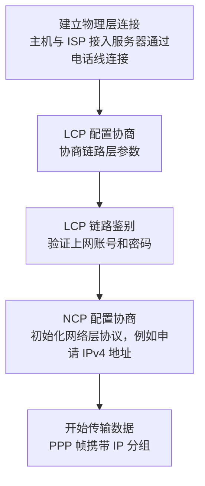
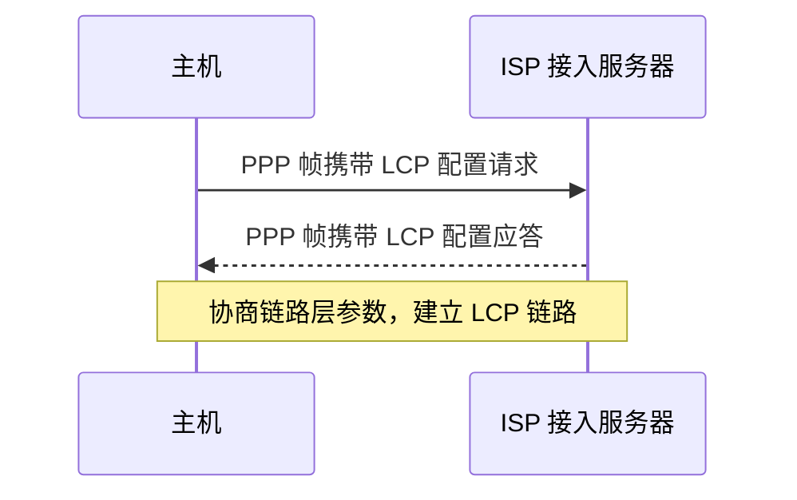
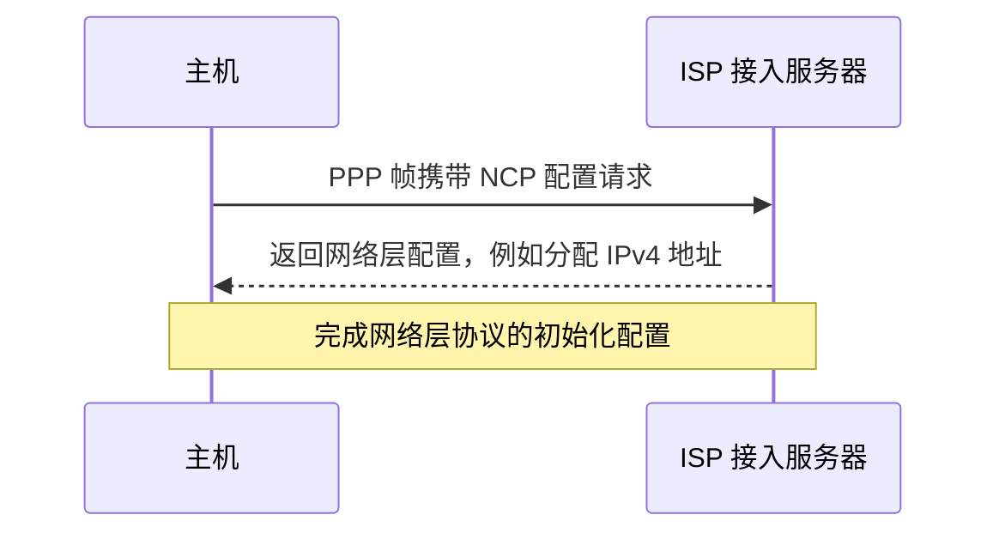
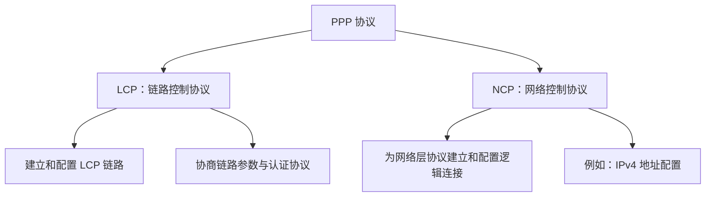

# PPP 点对点协议：工作过程、LCP 与 NCP

## 一、学习重点

本节结合 PPP（Point-to-Point Protocol，点对点协议）的工作过程，理解两个子协议的作用：

- **LCP（Link Control Protocol，链路控制协议）**：用于建立和配置 LCP 链路。
- **NCP（Network Control Protocol，网络控制协议）**：为网络层协议建立和配置逻辑连接。

刚开始不容易理解时，可以结合下面的拨号上网实例，按 PPP 协议的工作顺序来理解。

## 二、PPP 协议的应用背景：拨号上网

### 1. 20 世纪 90 年代的拨号上网

在 20 世纪 90 年代，个人互联网正在全世界范围内迅速普及。很多个人电脑通过电信公司的电话线接入互联网，这种使用电话线联网的方式被称为**拨号上网**，背后使用的就是 PPP 协议。

在 2004 年左右，普通居民楼里通常已经铺设了电话线，但光纤、网线等还没有普遍铺设到居民楼。因此，可以通过电话线将个人电脑连接到 ISP（互联网服务提供商）的接入服务器，再使用 PPP 协议进行协商。协商完成后，电脑就可以上网。

### 2. 拨号上网的连接关系

```text
个人电脑（主机）
      │
      │ 电话线（物理线路）
      │
ISP 接入服务器（例如电信公司的路由器）
```

用户向 ISP 购买联网服务后，ISP 会将电话线连接到主机与接入服务器之间。电话线连接好后，主机与 ISP 接入服务器之间就建立了**物理层连接**。

接下来，主机和接入服务器使用 PPP 协议协商链路层参数，并完成后续的认证与网络层初始化。

## 三、PPP 协议的工作过程

PPP 的工作过程可以按以下顺序理解：

1. 建立物理层连接。
2. 进行 LCP 配置协商。
3. 进行 LCP 链路鉴别（认证）。
4. 进行 NCP 配置协商。
5. 开始传输网络层数据。

### 1. 工作过程总览



### 2. 第一步：建立物理层连接

主机与 ISP 接入服务器之间先建立物理层连接。在当时的拨号上网场景中，这条物理线路通常是电话线。

物理层连接建立后，双方就可以开始使用 PPP 协议协商数据链路层相关的参数。

### 3. 第二步：LCP 配置协商

**LCP 是 PPP 的一个子协议，负责建立和配置 LCP 链路。**

主机会向 ISP 接入服务器发送 **LCP 配置请求**。LCP 协议定义的协议数据单元会由 PPP 帧携带。

LCP 配置请求中可以协商数据链路层相关的属性，例如：

- **MTU（最大传输单元）**：双方可以协商链路层的 MTU，例如不超过 1500 字节。
- **认证协议**：可以协商后续链路鉴别阶段使用哪种认证协议，例如 PAP。

如果 ISP 接入服务器同意主机提出的配置，就会返回 **LCP 配置应答**。该应答信息同样由 PPP 帧携带。

这一来一回的过程称为 **LCP 配置协商**。经过配置请求和配置应答后，两个节点之间建立起 LCP 链路。



> **理解要点：** LCP 配置协商主要处理数据链路层相关的参数，例如 MTU，以及后续使用哪种认证协议。

### 4. 第三步：LCP 链路鉴别（认证）

LCP 链路建立后，主机与 ISP 接入服务器还需要进行链路鉴别，也就是验证上网账号和密码。

可以把它理解为：ISP 提供上网账号和密码，主机连接 ISP 接入服务器时需要提交相关信息。只有账号和密码验证通过，ISP 才能确认用户具有接入资格。

具体过程如下：

1. 主机向 ISP 接入服务器发送上网账号和密码等认证信息，这些信息由 PPP 帧携带。
2. ISP 接入服务器验证账号和密码。
3. 服务器通过 PPP 帧返回认证成功或认证失败等信息。
4. 如果认证成功，LCP 链路就成为**已鉴别的 LCP 链路**。

前面提到的 PAP 就是一种可供协商使用的认证协议，本节不需要深入展开其细节。

### 5. 第四步：NCP 配置协商

**NCP 是 PPP 的另一个子协议，负责为网络层协议建立和配置逻辑连接。**

在前面的步骤中，主机与 ISP 接入服务器之间已经建立了物理层连接和数据链路层连接。但网络层开始传输数据前，通常仍需要进行初始化。

以最熟悉的 IPv4 为例：如果主机的网络层要与路由器的网络层传输 IP 分组，主机首先需要有一个 IP 地址。因此，网络层数据传输需要完成相应的前置配置，这就是 NCP 配置协商所要完成的事情。

过程如下：

1. 主机向 ISP 接入服务器发送 NCP 配置请求。
2. 如果网络层使用 IP 协议，主机就需要请求 IP 地址等相关配置。
3. ISP 接入服务器为主机动态分配一个 IP 地址。
4. 完成配置协商后，主机拥有 IP 地址，可以进行后续的网络层通信。



### 6. 第五步：开始传输数据

完成前面的过程后，主机与 ISP 接入服务器之间已经建立了物理层连接，LCP 链路也已经完成鉴别，并且 NCP 已经完成网络层相关配置。

说得直白一些，就是联网成功，可以正式上网了。之后，主机与路由器之间就可以使用 PPP 帧携带 IP 分组，进行数据传输。

## 四、LCP 与 NCP 的区别

| 对比项目                | LCP                                        | NCP                                        |
| ----------------------- | ------------------------------------------ | ------------------------------------------ |
| 英文全称                | Link Control Protocol                      | Network Control Protocol                   |
| 中文名称                | 链路控制协议                               | 网络控制协议                               |
| 主要作用                | 建立和配置 LCP 链路                        | 为网络层协议建立和配置逻辑连接             |
| 主要处理内容            | 数据链路层相关参数，例如 MTU、认证协议协商 | 网络层协议的初始化配置，例如申请 IPv4 地址 |
| 在 PPP 工作过程中的位置 | 先进行配置协商，之后可进行链路鉴别         | LCP 链路建立并完成鉴别后进行配置协商       |

### 记忆方法

- **LCP：管链路。** 建立和配置 LCP 链路，协商数据链路层参数。
- **NCP：管网络层。** 根据网络层协议进行初始化配置，例如 IPv4 地址配置。

可以用下面的关系图辅助记忆：



## 五、PPP 支持多种网络层协议

PPP 协议支持多种高层网络协议，例如：

- IPv4
- IPv6
- AppleTalk

不同的高层网络协议需要使用相应的 NCP 来完成配置。因此，NCP 并不只用于 IPv4，而是根据所使用的网络层协议进行相应配置。

## 六、PPP 的演变：PPPoE

### 1. PPPoE 的含义

随着以太网技术逐渐广泛应用，PPP 协议也发生了演变。现在较常见的一种形式是 **PPPoE**。

- **PPPoE**：Point-to-Point Protocol over Ethernet。
- **含义**：基于以太网的 PPP 协议。

本质上，可以理解为在以太网传输的内容中封装 PPP 相关数据，使 PPP 能够应用于以太网场景。

### 2. PPPoE 的应用

很多 ISP 仍然会使用 PPPoE 来验证宽带接入的合法性。用户需要先使用 ISP 提供的上网账号和密码进行验证；验证通过后，宽带连接才能正常使用。

可以用下面的示意图理解封装关系：


## 七、本节复习总结

### 1. PPP 工作过程

```text
物理层连接
    ↓
LCP 配置协商
    ↓
LCP 链路鉴别
    ↓
NCP 配置协商
    ↓
传输 IP 分组等网络层数据
```

### 2. 必须掌握的内容

- **LCP 的作用**：建立和配置 LCP 链路；协商数据链路层参数，例如 MTU，以及链路鉴别阶段采用的认证协议。
- **NCP 的作用**：为网络层协议建立和配置逻辑连接；例如，在使用 IPv4 时申请或配置 IP 地址。
- **PPP 的工作过程**：建立物理层连接后，先进行 LCP 配置协商，再进行链路鉴别，随后进行 NCP 配置协商，完成后即可传输网络层数据。
- **PPPoE**：基于以太网的 PPP 协议，可用于宽带接入认证。

### 3. 考试提示

根据本节讲解，PPP 协议在历年真题中的考查频率相对较低。复习时重点理解工作过程，以及 LCP 和 NCP 两个子协议各自的作用，并掌握相应思维导图中的知识点即可。
