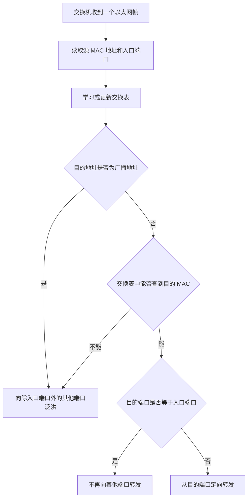
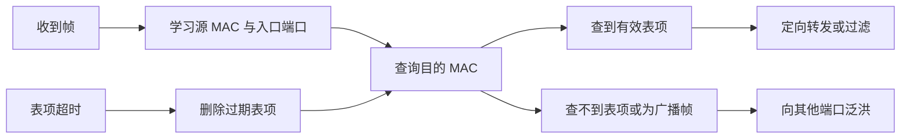

# 以太网交换机的功能原理

> **课程主题：** 以太网交换机的工作原理、自学习功能与两种交换方式  
> **所属层次：** 数据链路层  
> **复习重点：** 交换表的自学习、未知单播帧与广播帧的转发、交换表老化、直通交换与存储转发交换、直通交换时延计算

---

## 目录

- [以太网交换机的功能原理](#以太网交换机的功能原理)
  - [目录](#目录)
  - [一、以太网交换机的基本概念](#一以太网交换机的基本概念)
    - [1. 交换机所处的层次](#1-交换机所处的层次)
    - [2. 网桥与交换机](#2-网桥与交换机)
    - [3. 本节需要掌握的内容](#3-本节需要掌握的内容)
  - [二、以太网交换机的基本功能](#二以太网交换机的基本功能)
    - [集线器与交换机转发行为的区别](#集线器与交换机转发行为的区别)
  - [三、交换表与自学习功能](#三交换表与自学习功能)
    - [1. 交换表的作用](#1-交换表的作用)
    - [2. 自学习与转发的基本规则](#2-自学习与转发的基本规则)
      - [（1）学习源地址](#1学习源地址)
      - [（2）根据目的地址转发](#2根据目的地址转发)
    - [3. 自学习与转发流程图](#3-自学习与转发流程图)
    - [4. 结合示例理解帧的转发过程](#4-结合示例理解帧的转发过程)
      - [第 1 帧：A 发送给 C](#第-1-帧a-发送给-c)
      - [第 2 帧：B 发送给 C](#第-2-帧b-发送给-c)
      - [第 3 帧：C 发送给 A](#第-3-帧c-发送给-a)
      - [第 4 帧：H 发送给 A](#第-4-帧h-发送给-a)
      - [第 5 帧：H 发送给 C](#第-5-帧h-发送给-c)
      - [第 6 帧：C 发送给 H](#第-6-帧c-发送给-h)
      - [第 7 帧：J 发送广播帧](#第-7-帧j-发送广播帧)
      - [第 8 帧：K 发送给 J](#第-8-帧k-发送给-j)
    - [5. 示例中学习到的交换表](#5-示例中学习到的交换表)
    - [6. 交换表老化机制](#6-交换表老化机制)
      - [解决办法：为表项设置有效时间](#解决办法为表项设置有效时间)
    - [7. 自学习功能总结](#7-自学习功能总结)
  - [四、交换机的两种交换方式](#四交换机的两种交换方式)
    - [1. 直通交换](#1-直通交换)
      - [（1）工作原理](#1工作原理)
      - [（2）优点](#2优点)
      - [（3）缺点与限制](#3缺点与限制)
      - [（4）为什么不适合速率匹配？](#4为什么不适合速率匹配)
    - [2. 存储转发交换](#2-存储转发交换)
      - [（1）工作原理](#1工作原理-1)
      - [（2）优点](#2优点-1)
      - [（3）缺点](#3缺点)
    - [3. 两种交换方式对比](#3-两种交换方式对比)
  - [五、真题：直通交换的转发时延](#五真题直通交换的转发时延)
    - [1. 题目条件](#1-题目条件)
    - [2. 解题思路](#2-解题思路)
    - [3. 本题关键](#3-本题关键)
  - [六、本节总结](#六本节总结)
    - [1. 以太网交换机的自学习功能](#1-以太网交换机的自学习功能)
    - [2. 直通交换与存储转发交换](#2-直通交换与存储转发交换)

---

## 一、以太网交换机的基本概念

### 1. 交换机所处的层次

- 以太网交换机属于**数据链路层设备**。
- 它可以根据以太网帧中的**目的 MAC 地址**，决定应该从哪个端口转发该帧。
- 学习以太网、IEEE 802 标准和 VLAN 的基本原理之后，再学习以太网交换机，知识之间会更容易衔接起来。

### 2. 网桥与交换机

在较早的考纲中，数据链路层设备包括网桥和交换机。课程中提到，2022 年以后的 408 大纲已经删除了网桥这一设备的单独考查要求。

| 设备                            | 端口特点       | 关系                       |
| ------------------------------- | -------------- | -------------------------- |
| 网桥（Bridge）                  | 通常有两个端口 | 较简单的数据链路层互连设备 |
| 以太网交换机（Ethernet Switch） | 有多个端口     | 本质上是多端口网桥         |

交换机上连接网线的接口，既可以称为**端口**，也可以称为**接口**，本课程中不严格区分这两种说法。

### 3. 本节需要掌握的内容

1. **自学习功能**：交换机如何学习 MAC 地址与端口号之间的对应关系。
2. **交换表**：交换机依据什么信息进行定向转发。
3. **交换表老化**：节点移动、拔线或更换接口后，如何避免长期使用错误的表项。
4. **两种交换方式**：
   - 直通交换（Cut-through Switching）
   - 存储转发交换（Store-and-forward Switching）

---

## 二、以太网交换机的基本功能

- 交换机工作在**数据链路层**，主要任务是接收并转发以太网帧。
- 交换机依据帧中的**目的 MAC 地址**，选择相应端口转发帧。
- 交换机的每个端口通常支持**全双工通信**。
- 如果交换机端口连接的是集线器（Hub），则连接到集线器的相关链路需要按半双工方式工作。

### 集线器与交换机转发行为的区别

- **集线器**：收到信号后，会将信号转发到其他接口，不会根据 MAC 地址进行定向转发。
- **交换机**：会学习源 MAC 地址，并根据目的 MAC 地址决定是定向转发、泛洪，还是不再转发。

---

## 三、交换表与自学习功能

### 1. 交换表的作用

每台以太网交换机都会维护自己的交换表（也称转发表）。交换表用于记录：

| MAC 地址            | 端口号                 |
| ------------------- | ---------------------- |
| 某个节点的 MAC 地址 | 该节点所在的交换机端口 |

交换表在刚开始时是**空的**。交换机通过不断接收以太网帧，逐步学习各个节点所在的位置。

以太网 MAC 帧的格式可以简写为：

```text
目的 MAC 地址（6 字节）
源 MAC 地址（6 字节）
类型/长度字段（2 字节）
数据字段（长度可变）
帧校验序列 FCS（4 字节）
```

也可以用课程中便于记忆的形式表示为：

```text
6 | 6 | 2 | n | 4
```

其中：

- 前 6 字节：目的 MAC 地址。
- 接下来的 6 字节：源 MAC 地址。
- 再后面的 2 字节：类型/长度字段。
- `n`：数据字段长度。
- 最后 4 字节：帧校验序列（FCS）。

每个 MAC 地址长度为 **6 字节，也就是 48 比特**。MAC 地址通常使用十六进制表示，每个十六进制位对应 4 个二进制位。

为了简化下文示例，假设节点 A、B、C 等的 MAC 地址只有末尾两位不同。讲解过程中只写末尾两位，例如：

- A：`9A`
- B：`9B`
- C：`9C`
- D：`9D`
- H：`92`
- J：`94`
- K：`95`

这里的两位仅用于示例，表示完整 MAC 地址的末尾部分。

### 2. 自学习与转发的基本规则

交换机每收到一个帧，都会先利用**源 MAC 地址和帧的进入端口**学习发送方的位置，再查询目的 MAC 地址，决定如何转发。

#### （1）学习源地址

交换机收到帧后：

1. 读取帧的源 MAC 地址。
2. 记录该帧是从哪个端口进入交换机的。
3. 将“源 MAC 地址—入口端口”写入或更新到交换表中。

例如，某帧的源 MAC 地址是 A，且该帧从端口 1 进入，那么交换机就记录：

| MAC 地址 | 端口号 |
| -------- | -----: |
| A        |      1 |

如果交换表中已经存在该地址，交换机可以刷新相关表项；如果发现该节点从新的端口进入，则可以更新其对应的端口信息。

#### （2）根据目的地址转发

学习源地址之后，交换机再查询目的 MAC 地址：

| 查询结果                                | 处理方式                               |
| --------------------------------------- | -------------------------------------- |
| 交换表中查不到目的 MAC 地址             | 向除入口端口之外的其他端口转发，即泛洪 |
| 目的 MAC 地址对应另一个端口             | 只从对应端口定向转发                   |
| 目的 MAC 地址对应的端口就是帧的入口端口 | 不必再从同一个端口转发该帧             |
| 目的地址是广播地址                      | 向除入口端口之外的其他端口转发         |

广播 MAC 地址的二进制位全为 1，通常写作 `FF:FF:FF:FF:FF:FF`。

> **注意：** 泛洪并不意味着所有终端都会接收该帧。终端还会检查帧的目的 MAC 地址；目的地址与自身不匹配的普通终端会丢弃该帧。广播帧则会被同一广播域中的节点处理。

### 3. 自学习与转发流程图



### 4. 结合示例理解帧的转发过程

假设网络中有两台交换机，每台交换机都维护自己的交换表。部分终端直接连接交换机，部分终端通过集线器连接交换机。

为方便说明，假设各节点知道彼此的 MAC 地址。交换机一和交换机二的交换表初始都为空。

#### 第 1 帧：A 发送给 C

**帧的源地址为 A，目的地址为 C。**

1. 第 1 帧从交换机一的端口 1 进入。
2. 交换机一学习到 A 位于端口 1，登记 `A → 1`。
3. 交换机一查询目的地址 C，发现交换表中还没有 C。
4. 因此，交换机一将该帧转发到除端口 1 外的其他端口。
5. C 所在端口能够收到该帧；其他节点会根据目的 MAC 地址判断是否接收。
6. 该帧同时到达交换机二。交换机二也根据源地址学习到 A 从端口 1 方向到达，登记 `A → 1`。

此时，两台交换机都学到了 A 的位置，但还不知道 C 的位置。

#### 第 2 帧：B 发送给 C

**帧的源地址为 B，目的地址为 C。**

1. 第 2 帧从交换机一的端口 2 进入。
2. 交换机一学习到 `B → 2`。
3. 交换机一仍然查不到 C，因此将该帧泛洪到除入口端口外的其他端口。
4. C 收到该帧，其他不匹配目的地址的终端丢弃该帧。
5. 交换机二也收到该帧，并学习到 B 位于通往交换机一的端口 1，登记 `B → 1`。

#### 第 3 帧：C 发送给 A

**帧的源地址为 C，目的地址为 A。**

1. 第 3 帧从交换机一的端口 3 进入。
2. 交换机一学习到 `C → 3`。
3. 交换机一查询目的地址 A，发现表中已有 `A → 1`。
4. 因此，交换机一只从端口 1 转发该帧，不再向其他端口泛洪。
5. A 收到该帧。

经过前面几个帧的传输，交换机已经逐步建立了 MAC 地址与端口的对应关系。

#### 第 4 帧：H 发送给 A

**帧的源地址为 H，目的地址为 A。**

1. 第 4 帧从交换机二的端口 2 进入。
2. 交换机二学习到 `H → 2`。
3. 交换机二查到 A 位于端口 1，于是只从端口 1 转发该帧，发送给交换机一。
4. 该帧从交换机一的端口 8 进入。
5. 交换机一根据源地址学习到 `H → 8`。
6. 交换机一查询目的地址 A，发现 `A → 1`，于是从端口 1 转发。
7. A 收到第 4 帧。

同一个帧经过两台交换机时，两台交换机可以分别学习到 H 在各自看来所对应的端口。

#### 第 5 帧：H 发送给 C

**帧的源地址为 H，目的地址为 C。**

1. 第 5 帧从交换机二的端口 2 进入。
2. 交换机二已经学习过 `H → 2`，因此不需要重新建立不同的映射。
3. 交换机二查找目的地址 C，但此时还没有 C 的有效表项。
4. 交换机二将帧泛洪到除端口 2 外的其他端口，包括通往交换机一的端口 1。
5. 交换机一从端口 8 收到该帧。H 的表项已经存在，不需要重新登记。
6. 交换机一查到 `C → 3`，因此只从端口 3 转发该帧。
7. C 收到第 5 帧。交换机二一侧的其他节点也可能收到泛洪帧，但目的地址不匹配的节点会丢弃它。

这个例子说明：同一个帧在不同交换机中可能产生不同的转发结果，因为每台交换机维护的是自己的交换表。

#### 第 6 帧：C 发送给 H

**帧的源地址为 C，目的地址为 H。**

1. 第 6 帧从交换机一的端口 3 进入。
2. 交换机一已经学习过 `C → 3`。
3. 交换机一查到 `H → 8`，因此将帧从端口 8 转发给交换机二。
4. 交换机二从端口 1 收到该帧，学习到 `C → 1`。
5. 交换机二查到 `H → 2`，于是只从端口 2 转发。
6. H 收到第 6 帧。

至此，交换机二也学到了 C 的位置。

#### 第 7 帧：J 发送广播帧

**源地址为 J，目的地址为广播地址。**

1. 第 7 帧由 J 发送，先到达与 J 相连的集线器。
2. 集线器将帧转发到其他连接接口，因此 K、L 等节点也会收到该帧。
3. 交换机二从端口 5 收到该帧，学习到 `J → 5`。
4. 因为目的地址是广播地址，交换机二将帧转发到除端口 5 外的其他端口。
5. H 等节点以及交换机一都可以收到该广播帧。
6. 交换机一从端口 8 收到该帧，学习到 `J → 8`。
7. 交换机一同样将广播帧转发到除端口 8 外的其他端口，因此 A、B、C、D 以及与集线器相连的节点等也可以收到该广播帧。

交换机收到广播帧时，会向除入口端口之外的其他端口泛洪。

#### 第 8 帧：K 发送给 J

**源地址为 K，目的地址为 J。**

1. 第 8 帧由 K 发送，先到达与 K、J、L 相连的集线器。
2. 集线器会将帧转发到其他接口，因此 J 和 L 都会收到该帧。
3. J 检查目的 MAC 地址后发现与自身地址匹配，因此接收该帧；L 的地址不匹配，因此丢弃该帧。
4. 交换机二从端口 5 收到该帧，学习到 `K → 5`。
5. 交换机二查到 `J → 5`，也就是说源节点 K 和目的节点 J 都在交换机二看来连接于端口 5。
6. 由于帧是从端口 5 进入的，不需要再从端口 5 转发出去，因此交换机二不会把该帧重新发送到同一个端口。

这里要区分：**集线器会向其他接口转发信号，而交换机不会将从某端口进入、且目的端口仍为该端口的帧再转发回该端口。**

### 5. 示例中学习到的交换表

根据前面 8 个帧的传输，交换表中已经登记的主要信息如下。这里只列出示例中实际发送过帧、因而被交换机学习到的节点。

**交换机一：**

| MAC 地址末尾 | 对应端口 | 学习依据             |
| ------------ | -------: | -------------------- |
| A（`9A`）    |        1 | 第 1 帧的源地址      |
| B（`9B`）    |        2 | 第 2 帧的源地址      |
| C（`9C`）    |        3 | 第 3 帧的源地址      |
| H（`92`）    |        8 | 第 4 帧从端口 8 进入 |
| J（`94`）    |        8 | 第 7 帧从端口 8 进入 |

**交换机二：**

| MAC 地址末尾 | 对应端口 | 学习依据             |
| ------------ | -------: | -------------------- |
| A（`9A`）    |        1 | 第 1 帧从端口 1 进入 |
| B（`9B`）    |        1 | 第 2 帧从端口 1 进入 |
| C（`9C`）    |        1 | 第 6 帧从端口 1 进入 |
| H（`92`）    |        2 | 第 4 帧的源地址      |
| J（`94`）    |        5 | 第 7 帧的源地址      |
| K（`95`）    |        5 | 第 8 帧的源地址      |

> **说明：** 表项会受到实际帧的传输、表项老化和节点位置变化的影响。上表仅对应讲解中的示例过程，并不意味着交换机在任何时刻都只有这些表项。

### 6. 交换表老化机制

考虑一种情况：H 原来连接在交换机二一侧，后来拔掉网线，改为连接到交换机一一侧。

此时，交换机可能暂时保留旧的映射：

- 交换机一中仍记录 `H → 8`。
- 交换机二中仍记录 `H → 2`。

这些信息已经不符合 H 的新位置。如果 A 此时给 H 发送帧：

1. 交换机一根据旧表项，将帧转发到端口 8。
2. 交换机二又根据旧表项，尝试将帧从端口 2 转发。
3. 如果端口 2 后面已经没有 H，H 就无法正常收到该帧。

#### 解决办法：为表项设置有效时间

交换表中的每个表项通常都有一个**老化时间（有效期）**：

- 表项在有效时间内可以用于转发。
- 超过有效时间后，表项自动失效或被删除。
- 表项失效后，如果交换机仍然不知道目的 MAC 地址的位置，就会将帧向除入口端口之外的其他端口泛洪。
- 当 H 在新位置发送帧时，交换机可以根据该帧的源 MAC 地址和入口端口，重新学习 H 的正确位置。

这样可以应对节点突然离开、拔线或更换接口等情况。

### 7. 自学习功能总结

以太网交换机的自学习功能可以概括为：

1. **初始状态**：交换表为空。
2. **学习源地址**：每收到一个帧，就根据帧的源 MAC 地址和入口端口登记或更新表项。
3. **查询目的地址**：
   - 查不到：向除入口端口外的其他端口泛洪。
   - 查得到且对应其他端口：定向转发。
   - 查得到且对应入口端口：不再从该端口转发。
   - 广播帧：向除入口端口外的其他端口泛洪。
4. **表项老化**：表项在有效时间过后失效，避免长期使用过时的端口信息。
5. **即插即用**：节点可以动态接入、拔除或更换位置，交换机通过自学习逐渐更新转发信息。



---

## 四、交换机的两种交换方式

以太网交换机有两种常见的交换方式：

1. **直通交换（Cut-through Switching）**
2. **存储转发交换（Store-and-forward Switching）**

两者的关键区别是：交换机是在收到帧的前一部分后就开始转发，还是在完整接收并处理整个帧后再转发。

### 1. 直通交换

#### （1）工作原理

以太网帧的目的 MAC 地址位于帧的开头，占 **6 字节**。直通交换方式只需要接收并检查帧开头的目的 MAC 地址，就可以查询交换表，确定帧应该从哪个端口转发。

确定出口后，交换机便可以开始转发后续数据，不必等待整个帧都接收完毕。


这种工作方式可以类比为：先读取必要的目的地址信息，再尽快开始转发。

#### （2）优点

- **转发时延较低**：不需要先接收完整个帧，只需接收并处理目的 MAC 地址部分，就能够开始转发。

#### （3）缺点与限制

- **不适合需要速率匹配的场景**。
- 按本课程的讲解，直通交换不能像存储转发那样先完整接收帧，再进行协议格式转换。
- 由于没有完整接收整个帧，不能在转发前对完整帧进行基于 FCS/CRC 的差错检测。

#### （4）为什么不适合速率匹配？

假设：

- 节点 A 以 `100 Mbps` 的速率发送帧。
- 节点 B 只能以 `10 Mbps` 的速率接收帧。
- 交换机采用直通交换方式。

直通交换机检查完目的 MAC 地址并确定出口后，会尽快把后续数据转发出去。若数据以较高的速率直接到达接收能力较低的 B，就可能无法满足两端的速率要求。

因此，直通交换方式不适合需要速率匹配的场景。

### 2. 存储转发交换

#### （1）工作原理

存储转发方式的处理步骤为：

1. 先将整个以太网帧完整接收。
2. 将帧保存到交换机的高速缓存中。
3. 检查目的 MAC 地址，并查询交换表。
4. 可以对完整帧进行差错检测等处理。
5. 根据出口链路的要求进行必要处理，再从相应端口转发。


#### （2）优点

- **支持差错检测**：可以利用帧尾的 FCS，并依据 CRC（循环冗余校验）规则检查帧是否存在差错。
- **适合速率匹配**：交换机先完整接收并暂存帧，再向出口转发，可以在一定程度上处理不同链路之间的速率差异。
- **适合需要协议处理的场景**：完整接收帧后，可以根据需要进行相应的协议格式处理。例如课程以 VLAN 为例，说明普通 MAC 帧与带 802.1Q 标签的帧之间可能需要进行相应处理。

#### （3）缺点

- **转发时延更高**：需要先接收整个帧，再进行后续处理和转发。

### 3. 两种交换方式对比

| 比较项目           | 直通交换                                      | 存储转发交换                       |
| ------------------ | --------------------------------------------- | ---------------------------------- |
| 接收范围           | 接收并检查帧开头的目的 MAC 地址后即可开始转发 | 先完整接收整个帧                   |
| 转发时延           | 较低                                          | 较高                               |
| 是否完整缓存整个帧 | 不要求                                        | 是                                 |
| 差错检测           | 不能在转发前对完整帧进行 FCS/CRC 检查         | 可以对完整帧进行差错检测           |
| 速率匹配           | 不适合需要速率匹配的场景                      | 更适合需要速率匹配的场景           |
| 协议格式处理       | 直通转发限制了完整帧处理能力                  | 可以在完整接收后进行必要的协议处理 |
| 核心特点           | 先检查目的地址，尽快开始转发                  | 先完整接收，再检查、处理和转发     |

> **记忆方法：**
>
> - **直通交换：** 快，但完整帧处理能力有限。
> - **存储转发：** 慢一些，但能够完整接收帧并进行更多处理。

---

## 五、真题：直通交换的转发时延

### 1. 题目条件

2013 年相关真题（课程中提到的第 38 题）：

- 一台以太网交换机的速率为 `100 Mbps`。
- 采用直通交换方式转发以太网帧。
- 不考虑前导码。
- 求由交换机引起的转发时延至少是多少。

### 2. 解题思路

直通交换方式只需要接收并处理目的 MAC 地址。目的 MAC 地址占 **6 字节**。

换算为比特数：

\[
6\ \text{字节} \times 8 = 48\ \text{比特}
\]

接收 48 比特所需的时间为：

\[
t = \frac{\text{需要接收的比特数}}{\text{链路速率}}
\]

代入题目条件：

\[
t = \frac{48\ \text{bit}}{100 \times 10^6\ \text{bit/s}}
= 0.48 \times 10^{-6}\ \text{s}
= 0.48\ \mu\text{s}
\]

因此，直通交换方式引起的转发时延**至少为 0.48 微秒**，选择题中对应课程所述的 **B 选项**。

### 3. 本题关键

- 目的 MAC 地址占 **6 字节 = 48 比特**。
- 直通交换只需读取目的 MAC 地址即可开始转发。
- 不考虑前导码时，最小时延按 `48 bit ÷ 100 Mbps` 计算。
- 得到结果：**0.48 μs**。

---

## 六、本节总结

### 1. 以太网交换机的自学习功能

这是本节最重要的内容，也是考试重点。

- 每台交换机维护自己的交换表，初始为空。
- 交换机每收到一个帧，就根据**源 MAC 地址和入口端口**学习或更新表项。
- 转发时根据**目的 MAC 地址**查询交换表。
- 目的地址未知时，交换机将帧向除入口端口外的其他端口泛洪。
- 目的地址已知时，交换机通常只向对应端口定向转发；如果目的端口就是入口端口，则不必再转发回该端口。
- 广播帧会向除入口端口外的其他端口泛洪。
- 交换表项存在老化时间，超过有效期后会失效，防止节点拔线或更换接口后继续使用过时信息。
- 正因为有自学习和表项更新机制，交换机可以支持**即插即用**。

### 2. 直通交换与存储转发交换

| 方式         | 核心操作                               | 主要优点                                       | 主要限制                                 |
| ------------ | -------------------------------------- | ---------------------------------------------- | ---------------------------------------- |
| 直通交换     | 检查前 6 字节的目的 MAC 地址后开始转发 | 转发时延低                                     | 不便于完整帧差错检测、速率匹配及协议处理 |
| 存储转发交换 | 完整接收帧并暂存，处理后再转发         | 可进行差错检测，并适合速率匹配和必要的协议处理 | 转发时延较高                             |

```text
以太网交换机
│
├─ 自学习功能（重点）
│  ├─ 依据源 MAC 地址和入口端口学习
│  ├─ 依据目的 MAC 地址转发
│  ├─ 未知目的地址或广播帧：向其他端口泛洪
│  ├─ 已知目的地址：定向转发
│  └─ 交换表项老化：避免使用过时的端口信息
│
└─ 两种交换方式
   ├─ 直通交换
   │  ├─ 只需检查目的 MAC 地址（前 6 字节）
   │  └─ 时延低，但完整帧处理能力有限
   │
   └─ 存储转发交换
      ├─ 完整接收并缓存帧
      ├─ 可以进行差错检测
      ├─ 适合速率匹配和必要的协议处理
      └─ 时延较高
```

> **考前重点回顾：**
>
> 1. **学习看源地址，转发看目的地址。**
> 2. **目的地址未知或为广播地址：泛洪到除入口端口外的其他端口。**
> 3. **已知目的端口就是入口端口：不再向该端口转发。**
> 4. **直通交换时延题：目的 MAC 地址为 6 字节，`48 bit ÷ 速率`。**
> 5. **直通交换时延较低；存储转发可以对完整帧进行差错检测等处理。**
