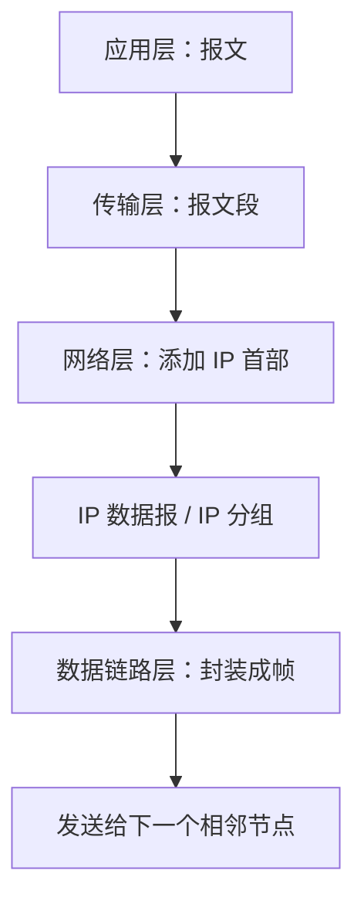
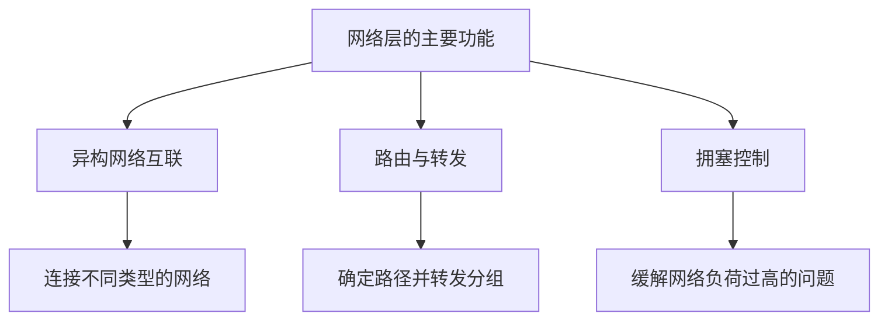
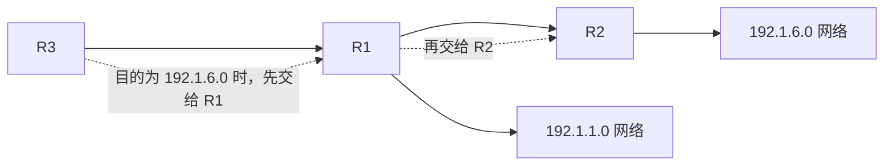
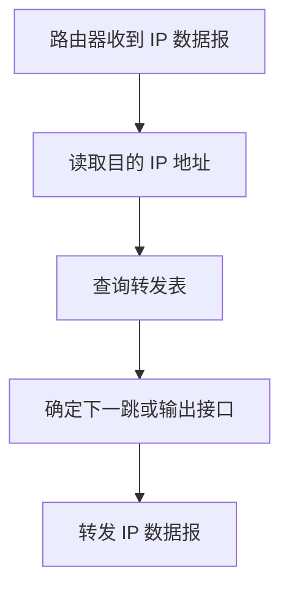
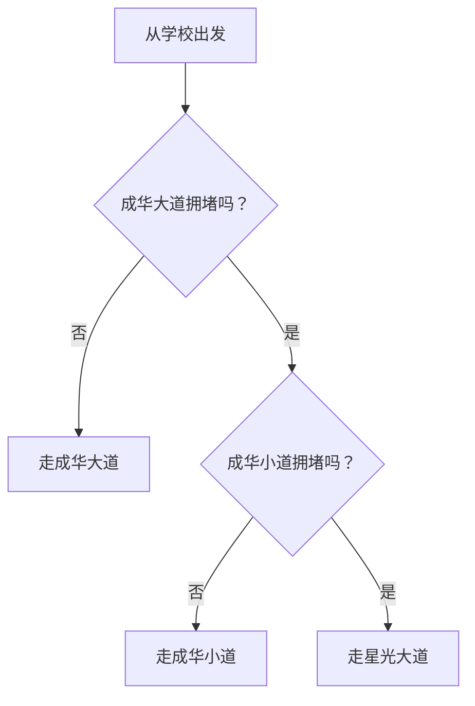
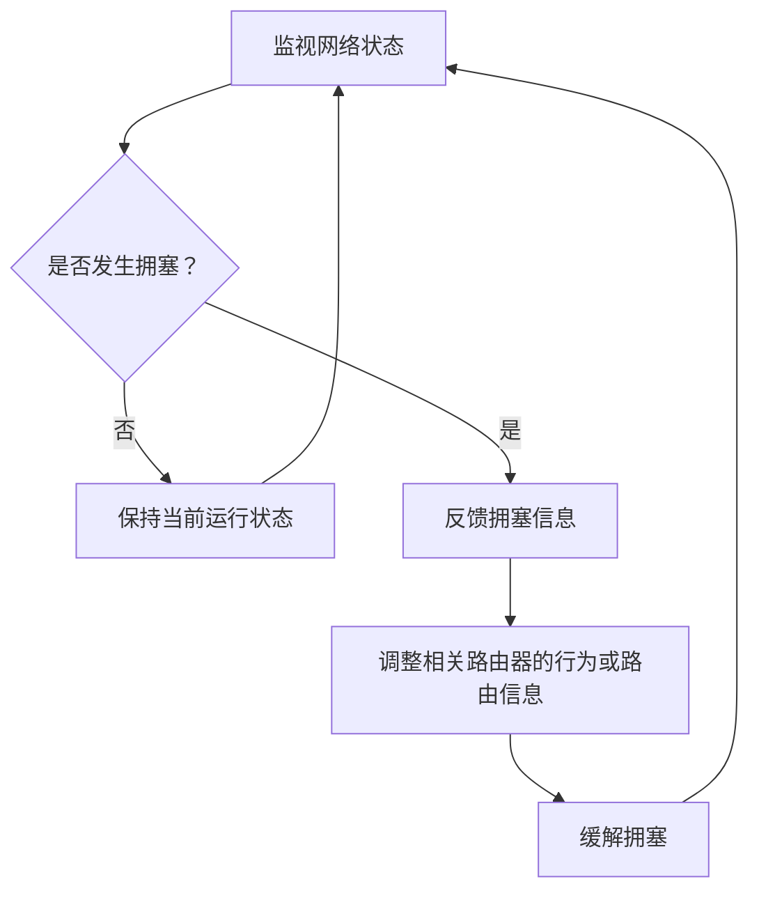

# 计算机网络：网络层概述与基本功能

## 一、网络层在五层协议模型中的位置

网络层在五层协议模型中处于**第三层**，为上层的传输层提供服务。

### 1. 数据在各层之间的传递

回顾数据传输过程：

1. **应用层**：数据传输单位是报文。
2. **传输层**：接收应用层的报文，并将其拆分成报文段。
3. **网络层**：在报文段的基础上添加网络层首部，形成 IP 数据报。
4. **数据链路层**：将 IP 数据报封装成帧，再传递给下一个相邻节点。

网络层添加的首部称为 **IP 数据报首部**。首部中包含源 IP 地址和目的 IP 地址，用于标识数据的发送方与接收方。

> **术语说明：**在计算机网络课程中，**IP 数据报**与**IP 分组**这两个术语通常等价。

### 2. 网络层与数据链路层的区别

- **网络层**：依据 IP 数据报首部中的源 IP 地址、目的 IP 地址等信息，配合路由器完成**主机到主机**的数据传输。
- **数据链路层**：将 IP 数据报封装成帧，负责**相邻节点之间**的数据传输。

网络中的每台主机都会被分配 IP 地址。路由器可以根据 IP 数据报首部中的目的 IP 地址，决定将分组转发到哪个方向。

### 3. 认识 IP 地址

可以在电脑或手机上查询自己的 IP 地址，也可以搜索了解公网 IP 地址。

常见的 IPv4 地址由 **4 个十进制数**组成，数字之间用小圆点分隔。例如：

`59.175.x.x`

IPv4 地址总长度为 **32 比特**。为了方便人类阅读，通常将 32 比特划分为 4 组，每组 8 比特，并将每组转换为十进制数，这种表示方式称为点分十进制表示法。

- 每组 8 比特，也就是 1 个字节。
- 8 比特可以表示的无符号整数范围是 `0～255`。
- 因此，IPv4 地址的每个十进制分组范围都是 `0～255`。

| 项目           | 说明                           |
| -------------- | ------------------------------ |
| IPv4 地址长度  | 32 比特                        |
| 分组数量       | 4 组                           |
| 每组长度       | 8 比特（1 字节）               |
| 每组十进制范围 | 0～255                         |
| 常见表示形式   | 点分十进制，例如 `192.168.1.1` |

---

## 二、考研大纲与王道书章节对应关系

本部分按照计算机考研（408）网络层相关知识的讲解顺序整理。王道书的相关内容基本按照考纲的标题顺序编排，部分考点会根据内容之间的联系进行调整。

| 考纲内容           | 王道书对应章节 | 说明                                                      |
| ------------------ | -------------- | --------------------------------------------------------- |
| 网络层的功能       | 4.1            | 先简要了解，部分功能会在后续章节展开                      |
| IPv4               | 4.2            | 重点内容，历年考查较多                                    |
| IPv6               | 4.3            | 内容相对独立，优先级较低                                  |
| 路由算法与路由协议 | 4.4            | 两个考点联系紧密，通常结合考查                            |
| IP 多播            | 4.5            | 内容相对独立，考查较少                                    |
| 移动 IP            | 4.6            | 内容相对独立，考查较少                                    |
| 网络层设备         | 4.7            | 重点理解路由器功能，常与 IPv4、路由算法和路由协议结合考查 |

### 1. 历年考查情况与复习建议

讲解中统计了 2009 年至 2023 年相关考查情况，并根据历年真题分析各节的优先级。每年计算机考研真题通常包含 **8 道计算机网络选择题和 1 道大题**。

> 以下考频与复习优先级沿用课程讲解中的统计口径，主要用于安排复习顺序。

| 章节                   | 考查情况（课程统计）                                        | 复习建议                         |
| ---------------------- | ----------------------------------------------------------- | -------------------------------- |
| 4.1 网络层的功能       | 历史上只考过 2 道小题，且多为简单概念题                     | 简要了解即可                     |
| 4.2 IPv4               | 历年考查频率高，约 80% 的大题涉及 IPv4 相关内容             | **重点学习**                     |
| 4.3 IPv6               | 截至课程统计时考过 1 道小题                                 | 低优先级，快速学习               |
| 4.4 路由算法与路由协议 | 考过 4 道小题、2 道大题                                     | **重点学习**                     |
| 4.5 IP 多播            | 截至课程统计时未考过                                        | 时间不足时可暂缓                 |
| 4.6 移动 IP            | 截至课程统计时未考过                                        | 时间不足时可暂缓                 |
| 4.7 网络层设备         | 主要介绍路由器功能，经常与 IPv4、路由算法和路由协议结合考查 | **重点学习，并结合其他章节理解** |

### 2. 各章节的学习安排

#### 重点章节

- **4.2 IPv4**：重点掌握。历年大题中，IPv4 相关内容占比较高，强化阶段还需要结合真题整理解题技巧。
- **4.4 路由算法与路由协议**：重点掌握。理解路由器如何通过路由协议交换信息、形成路由表。
- **4.7 网络层设备**：重点理解路由器的功能。虽然单独成节，但其内容与 IPv4、路由算法及路由协议联系紧密。

#### 低优先级章节

- **4.3 IPv6**：内容相对独立，截至课程统计时考过 1 道小题。
- **4.5 IP 多播**：内容相对独立，截至课程统计时未考过。
- **4.6 移动 IP**：内容相对独立，截至课程统计时未考过。

时间不足时，可以先保证重点章节掌握，再快速学习这些低优先级内容，做到能够完成课后基础小题。

#### SDN 的学习时机

SDN（软件定义网络）的基本概念是课程讲解中提到的新增考点：它于 2022 年加入大纲，并在 2023 年考查过。

SDN 相对独立，不影响后续内容的学习。建议先学习路由算法、路由协议，理解路由和路由表的含义后，再回头学习 SDN。

---

## 三、网络层的主要功能

按照考纲要求，网络层主要需要了解以下三个方面：

1. 异构网络互联
2. 路由与转发
3. 拥塞控制

### 3.1 异构网络互联

#### 1. 什么是异构网络

路由器是网络中非常重要的设备，可以把不同的网络连接起来，形成更大范围的互联网。

不同网络的形态可能各不相同，例如：

- 网络拓扑结构不同；
- 物理层和数据链路层的实现方式不同；
- 使用的局域网技术不同；
- 连接的主机类型不同。

例如：

- 有的网络采用以太网技术；
- 有的网络采用 IEEE 802.11 无线局域网技术，也就是常见的 Wi-Fi；
- 还有的网络可能采用令牌环网技术；
- 不同网络中可能连接电脑、手机等不同类型的设备。

由于网络的拓扑结构、底层实现方式及接入设备存在差异，因此这些网络称为**异构网络**。

#### 2. 网络层的作用

网络层通过相关处理实现异构网络之间的互连，并屏蔽不同网络在物理层和数据链路层实现方式上的差异，使不同网络中的主机能够进行通信。

#### 3. 网关这一术语

在 TCP/IP 相关文献中，**路由器有时也会被称为网关**。网关这一术语也可能出现在考研真题中。

---

### 3.2 路由与转发

路由与转发是网络层的两个重要功能，但二者并不相同。

| 比较项   | 路由（Routing）              | 转发（Forwarding）                   |
| -------- | ---------------------------- | ------------------------------------ |
| 核心含义 | 规划到达目的网络的路径       | 根据已有信息，将分组送往合适的下一跳 |
| 参与范围 | 通常需要多个路由器相互配合   | 是单台路由器执行的动作               |
| 主要依据 | 路由协议、网络状态及路由计算 | 转发表中的匹配结果                   |
| 主要结果 | 形成或更新路由信息、路由表   | 将收到的分组转发到相应接口或下一跳   |

#### 1. 路由：规划转发路径

路由功能需要多个路由器相互配合。各个路由器可以运行某一种路由协议，例如：

- RIP 路由协议；
- OSPF 路由协议。

这些路由器通过路由协议交换网络可达性等信息，并依据协议规则计算路径，最终形成各自的路由表。

路由表帮助路由器判断：如果一个 IP 数据报要到达某个目的网络，应该从哪里转发。

#### 2. 路由表示例

假设网络中有 R1、R2、R3、R4 四个路由器，它们共同运行 RIP 路由协议。

- R2 告诉邻居：通过 R2 可以到达 `192.1.6.0` 网络。
- R1 告诉邻居：通过 R1 可以直接到达 `192.1.1.0` 网络。
- R3 接收到相关路由信息后，就可能知道：如果要向 `192.1.1.0` 网络发送数据报，可以先把数据报转发给 R1，再由 R1 转发到目标网络。
- 类似地，R2 告诉 R1 可以经由 R2 到达 `192.1.6.0` 网络，R1 再将该信息传播给 R3。于是，R3 可以在自己的路由表中记录：若目的网络是 `192.1.6.0`，可以先转发给 R1，再经由 R2 到达目标网络。

**核心理解：**路由器通过路由协议相互交换信息，从而学习如何到达不同的目的网络，并据此构建路由表。

> 图示用于理解路由信息的传播和转发方向，实际网络拓扑、链路连接及路由计算结果以具体题目条件为准。

#### 3. 转发：依据转发表转发分组

在路由表的基础上，可以通过整理和精简路由信息，形成更适合快速查找的**转发表**。

每台路由器都有自己的转发表。转发表通常比路由表更精简，其设计目标之一是提高检索和转发效率。

转发的过程可以概括为：

1. 路由器收到一个 IP 数据报。
2. 查看数据报中的目的 IP 地址。
3. 查询转发表，确定相应的转发接口或下一跳。
4. 将数据报转发出去。

#### 4. 路由与转发的关键区别

- **路由**：多个路由器相互配合，学习网络可达性并规划路径。
- **转发**：单台路由器根据转发表，将当前收到的 IP 数据报发送到相应的下一跳。

可以把二者理解为：**路由解决“路径怎么规划”，转发解决“这个分组现在往哪里送”。**

---

### 3.3 拥塞控制

#### 1. 什么是网络拥塞

当网络中出现过量分组，超出了网络能够承受的负荷时，就可能导致整体网络性能下降，这种现象称为**网络拥塞**。

网络拥塞类似于节假日道路堵车：

- 车辆数量增加；
- 道路及收费站的处理能力有限；
- 当车辆过多时，通行效率反而可能下降。

计算机网络也存在类似现象：当网络中的分组数量过多时，可能出现分组数量继续增加、有效吞吐率反而下降的情况。

#### 2. 静态与动态拥塞控制

从控制策略来看，拥塞控制可以分为静态和动态两种方式：

| 类型         | 也称为   | 基本思路                                       | 特点                                                   |
| ------------ | -------- | ---------------------------------------------- | ------------------------------------------------------ |
| 静态拥塞控制 | 开环控制 | 在网络运行前预先设计防止拥塞的策略             | 策略提前设定，网络运行后通常不根据实时拥塞情况动态调整 |
| 动态拥塞控制 | 闭环控制 | 动态监视网络状态，发现拥塞后反馈信息并进行调整 | 能根据实时网络状况灵活调整                             |

#### 3. 静态拥塞控制：提前规划路线

可以用从学校前往二仙桥的例子理解静态控制。

老司机提前给出一套规则：

1. 首先走成华大道；
2. 如果成华大道拥堵，就改走成华小道；
3. 如果成华小道也拥堵，就改走星光大道。

这套方案在出发前就已经规划好，属于预先设计的防拥塞策略，类似于**开环控制**。

#### 4. 动态拥塞控制：根据实时情况调整

同样是从学校前往二仙桥，如果不提前固定路线，而是使用高德地图等导航工具，根据实时路况选择路线，就类似于动态拥塞控制。

动态控制通常包括以下过程：

1. 持续监视网络状态；
2. 及时发现发生拥塞的位置；
3. 将拥塞信息传递给相关路由器或节点；
4. 根据反馈调整转发行为或相关路由信息；
5. 尽量避开拥塞路径，缓解网络拥塞。

如果原有的几条道路都堵塞，实时导航还可能重新规划其他可行路线。对应到网络中，动态控制也可能根据实时状态调整原有的转发策略。

#### 5. 使用 ICMP 传递拥塞信息的示例

课程中以路由器 R2 为例说明：假设 R2 监测到 `192.1.6.0` 网络发生拥塞，那么它可以选择向其他路由器发送 ICMP 报文，通知相关节点该网络当前比较拥堵。

相关节点收到拥塞信息后，可以降低向该网络发送 IP 数据报的速度，从而在一定程度上缓解拥塞。

> **理解重点：**这个例子用于说明“监测拥塞—反馈信息—调整发送行为”的闭环思路。具体协议是否使用、报文格式及实际控制机制，需要以相应协议和题目条件为准。

---

## 四、本节重点回顾

### 1. 分层与数据单位

| 层次       | 数据单位或封装结果   | 本节要点                                   |
| ---------- | -------------------- | ------------------------------------------ |
| 应用层     | 报文                 | 将应用数据交给传输层                       |
| 传输层     | 报文段               | 对应用层数据进行传输层处理                 |
| 网络层     | IP 数据报（IP 分组） | 添加 IP 首部，包含源 IP 地址和目的 IP 地址 |
| 数据链路层 | 帧                   | 将 IP 数据报封装成帧，传给相邻节点         |

### 2. 网络层三个主要功能

- **异构网络互联**：通过网络层及路由器连接不同类型的网络，屏蔽底层网络实现方式的差异。
- **路由与转发**：
  - 路由：多个路由器配合，通过路由协议学习网络信息并规划路径。
  - 转发：单台路由器查询转发表，将分组送往相应的下一跳。
- **拥塞控制**：
  - 开环控制：事先设计控制策略；
  - 闭环控制：监视网络状态，反馈拥塞信息，并根据状态动态调整。

### 3. 复习优先级

**重点掌握：**

- 4.2 IPv4
- 4.4 路由算法与路由协议
- 4.7 网络层设备

**可以先快速学习的低优先级内容：**

- 4.3 IPv6
- 4.5 IP 多播
- 4.6 移动 IP

**学习顺序建议：**先理解路由、路由表和转发，再学习 SDN 的基本概念。

---

## 五、术语速查

| 术语                | 含义                                                         |
| ------------------- | ------------------------------------------------------------ |
| IP 数据报 / IP 分组 | 网络层的数据单位，课程中两个术语通常等价                     |
| 源 IP 地址          | 标识数据报的发送方地址                                       |
| 目的 IP 地址        | 指明数据报要到达的目标地址                                   |
| 异构网络            | 在拓扑结构、底层技术或接入设备等方面存在差异的网络           |
| 路由                | 通过路由计算和路由协议等方式确定到达目的网络的路径           |
| 路由表              | 路由器保存的路由信息                                         |
| 转发表              | 供路由器快速查询并执行转发的表项集合                         |
| 路由协议            | 用于路由器之间交换路由信息、支持路由计算的协议               |
| 网络拥塞            | 网络负荷过高，造成网络整体性能下降的现象                     |
| 开环控制            | 预先设计控制策略，通常不根据运行中的实时状态动态反馈调整     |
| 闭环控制            | 监视系统状态，根据反馈信息动态调整控制行为                   |
| ICMP                | 网际控制报文协议，课程示例中用于说明网络状态或拥塞信息的反馈 |

---

_整理说明：本文以课程讲解为基础，主要调整了排版、标题层级、术语书写和图示格式。考频统计按课程讲解中的时间范围与统计口径保留；图示用于帮助理解，不替代具体题目中的拓扑和协议条件。_
