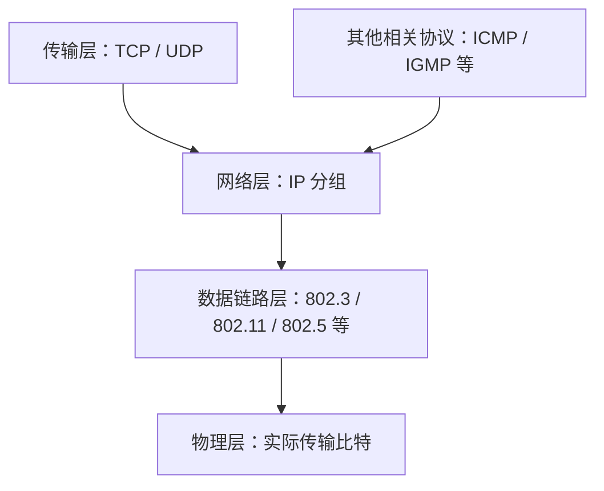
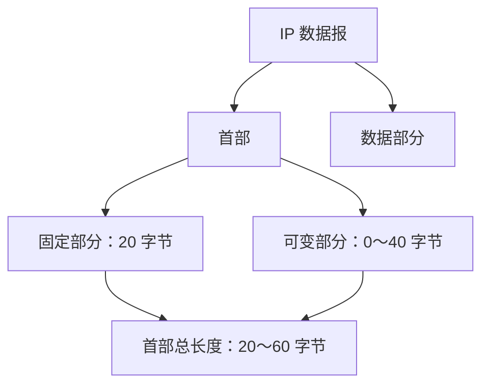
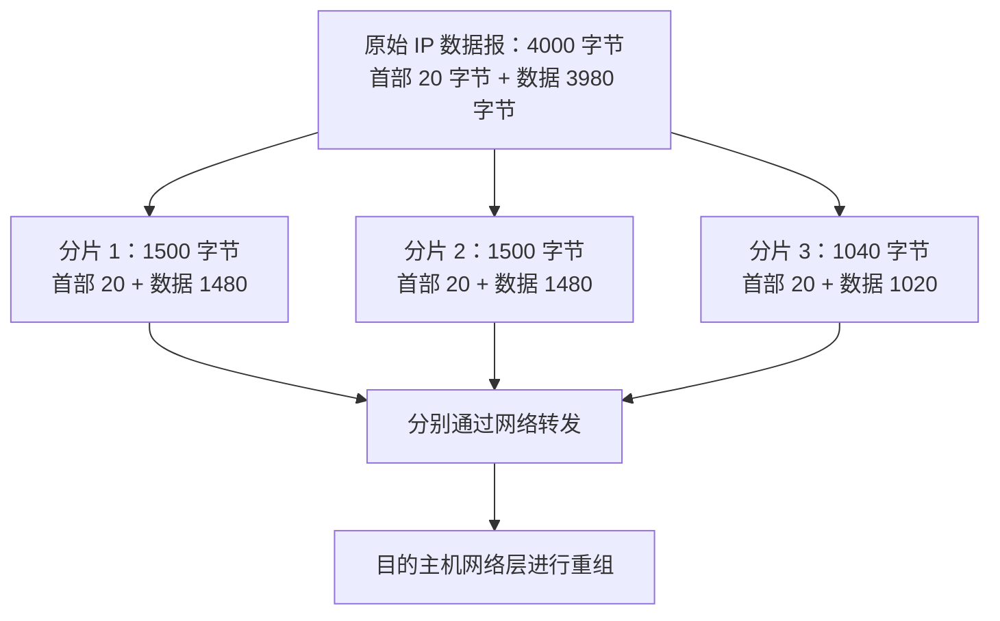
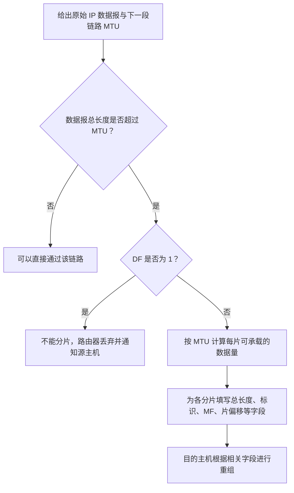

# IPv4 分组（IP 数据报）

> 计算机网络｜网络层重点
>
> 本笔记按课程讲解顺序整理，保留 IPv4 分组的基本结构、首部字段、MTU 与分片、分片重组、TTL 等内容，便于复习、查阅和打印。

---

## 一、IPv4 与 IP 协议的作用

### 1. IPv4、IPv6 的含义

`IP` 是一个整体术语，`v4` 和 `v6` 表示 IP 协议的不同版本：

- **IPv4**：第四个版本的 IP 协议。
- **IPv6**：第六个版本的 IP 协议。

IPv4 是互联网中非常重要的网络层协议。网络层之上主要是传输层，常见的传输层协议有 **TCP** 和 **UDP**，它们进行网络数据传输时都依赖 IP 协议。

### 2. IP 分组承载什么数据？

IP 协议定义了重要的数据结构——**IP 数据报**，也称为 **IP 分组**，二者在本课程语境中是同义词。

IP 分组通过路由器进行存储转发，可以承载来自不同上层协议的数据：

- TCP 传来的数据；
- UDP 传来的数据；
- ICMP、IGMP 等协议的数据。

IP 协议还会调用更底层的数据链路层和物理层协议。例如，数据链路层可以采用以太网 `IEEE 802.3`、无线局域网 `IEEE 802.11`、`IEEE 802.5` 等不同技术。

因此，IP 协议在互联网中处于核心地位：它负责把上层数据封装成 IP 分组，并借助底层网络技术进行传输。



---

## 二、IP 分组的整体结构

### 1. IP 分组由什么组成？

一个 IP 数据报由两大部分组成：

1. **首部**
2. **数据部分**

首部又可以分成：

- **固定部分**：固定占 **20 字节**；
- **可变部分**：长度可以为 **0～40 字节**。

因此：

- 不含可变部分时，首部长度为 20 字节；
- 首部最大长度为 \(20+40=60\) 字节；
- 历年考研题中，首部可变部分通常为空，因此常见首部长度为 20 字节；
- 但解题时仍要以题目给出的首部长度字段为准，不能无条件认为首部一定是 20 字节。

### 2. IP 分组结构示意图



### 3. 首部字段总览

| 字段            |   长度 | 主要作用                                                    |
| --------------- | -----: | ----------------------------------------------------------- |
| 版本            |  4 bit | 表示 IP 协议版本                                            |
| 首部长度        |  4 bit | 表示 IP 首部长度，单位为 4 字节                             |
| 区分服务        |  8 bit | 用于区分服务，通常不是本节考试重点                          |
| 总长度          | 16 bit | 表示整个 IP 数据报的长度，单位为 1 字节                     |
| 标识            | 16 bit | 标识原始 IP 数据报，供分片重组时识别                        |
| 标志            |  3 bit | 关注 MF、DF 两个位                                          |
| 片偏移          | 13 bit | 表示当前分片数据在原始数据报数据部分中的位置，单位为 8 字节 |
| 生存时间（TTL） |  8 bit | 限制 IP 数据报在网络中经过的路由器数量                      |
| 协议            |  8 bit | 指明数据部分应交给哪个上层协议                              |
| 首部校验和      | 16 bit | 对 IP 首部进行校验                                          |
| 源地址          | 32 bit | 发送方的 IP 地址                                            |
| 目的地址        | 32 bit | 接收方的 IP 地址                                            |
| 可选字段与填充  |   可变 | 可选信息及为满足对齐要求而添加的填充                        |

> **考点提醒：** 考试题通常会提供 IP 首部结构图，不一定要求死记每个字段处于第几个字节或第几个比特，但需要理解各字段的含义，并能结合题目所给结构图进行计算和分析。

---

## 三、首部第一行：版本、首部长度、区分服务、总长度

### 1. 版本（4 bit）

版本字段占 **4 bit**，用于表示该 IP 数据报所符合的 IP 协议版本。

- IPv4 的版本值为十进制 `4`；
- 对应的二进制为 `0100`。

### 2. 首部长度（4 bit）

首部长度字段占 **4 bit**，表示 IP 首部总长度，但它不是直接以字节为单位，而是以 **4 字节为单位**。

换算公式：

\[
\text{首部长度（字节）}=\text{首部长度字段值}\times 4
\]

例如：

- 首部不包含可变部分时，首部长度为 20 字节；
- \(20\div4=5\)，所以首部长度字段的值为 `5`。

首部长度字段占 4 bit，作为无符号数，其可表示范围为 0～15。按该字段的单位换算，最大首部长度为：

\[
15\times4=60\text{ 字节}
\]

固定部分占 20 字节，因此可变部分最多为：

\[
60-20=40\text{ 字节}
\]

#### 为什么需要填充？

可变部分末尾可能包含**填充（Padding）**，用于凑足 4 字节的整数倍。这是因为首部长度字段以 4 字节为单位进行计数。

### 3. 区分服务（8 bit）

区分服务字段占 **8 bit**，用于区分服务。按本节课程讲解，通常不是考试重点，知道首部中存在这个字段即可。

### 4. 总长度（16 bit）

总长度字段表示**整个 IP 数据报的总长度**，也就是：

\[
\text{总长度}=\text{首部长度}+\text{数据部分长度}
\]

总长度字段占 **16 bit**，以 **1 字节为单位**。

16 bit 无符号数的可表示范围为 0～65535。因此，从字段表示能力来看：

- 理论上，数据部分最短可以为 0 字节，即只有首部；
- 若首部取最小的 20 字节，数据部分的理论最大值为 \(65535-20=65515\) 字节。

这里的“理论最短”和“理论最长”只根据总长度字段及最小首部长度进行分析。实际传输时，IP 数据报的大小还会受到下一段数据链路的 MTU 等因素限制，后文将继续说明。

### 5. 三个长度相关字段：口诀

> **四一八，首总偏。**

| 字段     | 计量单位 | 记忆方法 |
| -------- | -------- | -------- |
| 首部长度 | 4 字节   | “四”     |
| 总长度   | 1 字节   | “一”     |
| 片偏移   | 8 字节   | “八”     |

这三个字段很容易混淆，尤其要区分首部长度、总长度和片偏移各自的计量单位。

---

## 四、结合真题理解首部字段

课程中以一道 **2012 年真题**说明：题目可以直接给出 IP 数据报首部的结构图和十六进制内容，我们要根据字段含义进行分析，不必只靠死记字段所在的位置。

题目给出了 IP 数据报前 40 个字节的信息。根据首部结构图，可以逐步分析：

### 第一步：求首部长度

首部长度字段的值为 `5`，该字段以 4 字节为单位：

\[
5\times4=20\text{ 字节}
\]

因此首部长度是 20 字节。首行所对应的 20 个字节是首部信息，后续才是数据部分。

### 第二步：求 IP 数据报总长度

根据题目给出的总长度字段，将其对应的 16 bit 十六进制数转换为十进制，得到 `48`。

总长度以 1 字节为单位，所以整个 IP 数据报总长度为 **48 字节**。

### 第三步：求数据部分长度

\[
\text{数据部分长度}=\text{总长度}-\text{首部长度}
\]

\[
48-20=28\text{ 字节}
\]

因此，数据部分长度为 **28 字节**。题目中只给出了 20 个字节的数据部分信息，所以还缺少 8 个字节的信息。

> **真题分析方法：** 先从首部长度字段求出首部有多长，再从总长度字段求出整个 IP 数据报有多长，最后相减得到数据部分长度。

---

## 五、MTU：最大传送单元

### 1. 为什么 IP 数据报的实际长度会受限制？

实际网络传输中，IP 数据报通常要封装到数据链路层的帧中。不同数据链路技术对一帧能够承载的数据量有不同限制。

以太网帧的数据字段通常为 **46～1500 字节**，其中承载的网络层数据就是 IP 数据报。因此，以太网的 MTU 为 **1500 字节**，即一个以太网帧的数据字段最多承载 1500 字节的 IP 数据报。

### 2. MTU 的定义

**最大传送单元（Maximum Transmission Unit，MTU）**，表示一段数据链路能够承载的最大数据量。

- 英文缩写：`MTU`
- 以太网的 MTU：`1500 字节`
- MTU 会限制 IP 数据报在对应数据链路上传输时的最大长度。

如果一个 IP 数据报的总长度超过下一段数据链路的 MTU，就需要考虑对该 IP 数据报进行**分片**；是否允许分片还要结合首部中的 DF 标志位判断。

---

## 六、IP 分片：为什么需要分片？

### 1. 分片的基本场景

假设：

- 主机 A 构造了一个总长度为 **4000 字节**的 IP 数据报；
- 从主机 A 到第一台路由器的链路 MTU 为 **4000 字节**；
- 从该路由器到下一个节点的链路 MTU 为 **1500 字节**。

在第一段链路上，4000 字节的 IP 数据报可以直接放入一个帧中传输，不需要分片。

当路由器准备通过下一段链路转发它时，发现下一段链路的 MTU 只有 1500 字节，因此需要把这个大的 IP 数据报分成更小的分片，再分别发送。

### 2. 原始数据报与分片结果

原始 IP 数据报：

- 首部：20 字节；
- 数据部分：3980 字节；
- 总长度：4000 字节。

在 MTU 为 1500 字节、每个分片的首部为 20 字节的情况下，每个分片的数据部分最多为：

\[
1500-20=1480\text{ 字节}
\]

将原始数据部分拆分：

- 第一个分片的数据部分：1480 字节；
- 第二个分片的数据部分：1480 字节；
- 第三个分片的数据部分：\(3980-1480-1480=1020\) 字节。

因此得到三个分片：

| 分片       | 首部长度 |  数据部分长度 | 分片总长度 |
| ---------- | -------: | ------------: | ---------: |
| 第一个分片 |  20 字节 |     1480 字节 |  1500 字节 |
| 第二个分片 |  20 字节 |     1480 字节 |  1500 字节 |
| 第三个分片 |  20 字节 |     1020 字节 |  1040 字节 |
| **合计**   |  60 字节 | **3980 字节** |  4040 字节 |

> 表格中“分片总长度”的合计包含了每个分片各自的首部，因此合计值大于原始数据报的 4000 字节。原始数据部分仍然是 3980 字节，分片后额外产生了分片首部开销。

### 3. 分片示意图



### 4. 为什么每个分片都要有自己的首部？

每个分片都是一个**独立的、更小的 IP 数据报**，因此每个分片都需要自己的 IP 首部。

这样，每个分片就可以在网络中独立地进行存储转发；不同分片也可能沿着不同路径转发。各个分片到达目的主机的时间和顺序可能不同，因此目的主机需要根据首部中的相关字段，将它们重新组装成原始 IP 数据报。

---

## 七、分片重组相关字段：标识、标志、片偏移

分片重组主要依赖 IP 首部第二行的三个字段：

1. **标识（Identification）**
2. **标志（Flags）**
3. **片偏移（Fragment Offset）**

### 1. 标识（16 bit）

标识字段占 **16 bit**，通常由发送方生成。课程中用自增序列进行说明：发送方发出的第一个完整 IP 数据报标识为 1，第二个为 2，第三个为 3，以此类推。

当一个 IP 数据报被分片后，各个分片会复制原始数据报的标识。接收方就可以利用标识等信息，判断多个分片原本属于哪个 IP 数据报。

例如，在课程中的分片示例里，原始数据报的标识设为 `777`，那么三个分片的标识都为 `777`。

### 2. 标志（3 bit）

标志字段占 **3 bit**。本节重点关注最低位 `MF` 和次低位 `DF`，最高位通常不作为本节重点。

#### MF：More Fragments

`MF` 表示当前分片之后是否还有更多分片。

- `MF = 1`：后面还有更多分片，当前分片不是最后一个；
- `MF = 0`：后面没有更多分片，当前分片是最后一个分片；未发生分片的完整数据报也会使用 `MF = 0`。

#### DF：Don't Fragment

`DF` 表示是否允许分片。

- `DF = 1`：不允许分片；
- `DF = 0`：允许分片。

如果路由器要把一个 IP 数据报转发到下一段链路，但该链路的 MTU 无法容纳这个数据报，同时数据报的 `DF = 1`、不允许分片，那么路由器就无法按原样转发，也不能分片。此时路由器会丢弃这个 IP 数据报，并向源主机发送 **ICMP 报文**，通知源主机出现了异常。

### 3. 片偏移（13 bit）

片偏移字段占 **13 bit**，表示当前分片的数据部分在原始 IP 数据报的数据部分中所处的位置。

片偏移以 **8 字节为单位**，换算公式为：

\[
\text{原始数据中的起始位置（字节）}=\text{片偏移字段值}\times8
\]

例如：

- 第一个分片从原始数据部分的第 0 字节开始，因此片偏移为 `0`；
- 第二个分片从原始数据部分的第 1480 字节开始，片偏移为 \(1480\div8=185\)；
- 第三个分片从原始数据部分的第 2960 字节开始，片偏移为 \(2960\div8=370\)。

注意：**片偏移表示的是分片数据在原始数据部分中的位置，不是分片首部在整个 IP 数据报中的位置。**

---

## 八、完整分片示例：标识、MF、DF 与片偏移

继续使用前面的数据：

- 原始 IP 数据报总长度：4000 字节；
- 原始首部：20 字节；
- 原始数据部分：3980 字节；
- MTU：1500 字节；
- 三个分片的数据部分长度依次为 1480、1480、1020 字节；
- 原始标识设为 `777`；
- 原始数据报允许分片，因此 `DF = 0`。

### 1. 三个分片的字段值

| 字段                           | 第一个分片 | 第二个分片 | 第三个分片 |
| ------------------------------ | ---------: | ---------: | ---------: |
| 总长度                         |  1500 字节 |  1500 字节 |  1040 字节 |
| 标识                           |        777 |        777 |        777 |
| DF                             |          0 |          0 |          0 |
| MF                             |          1 |          1 |          0 |
| 片偏移                         |          0 |        185 |        370 |
| 数据部分在原始数据中的起始字节 |          0 |       1480 |       2960 |
| 数据部分长度                   |  1480 字节 |  1480 字节 |  1020 字节 |

### 2. 为什么标识相同？

三个分片都来自同一个原始 IP 数据报，因此复制原始数据报的标识，均为 `777`。接收方可结合标识等信息，判断这些分片属于同一个原始数据报。

### 3. 为什么 MF 分别为 1、1、0？

- 第一个分片之后还有第二、第三个分片，因此 `MF = 1`；
- 第二个分片之后还有第三个分片，因此 `MF = 1`；
- 第三个分片之后没有更多分片，因此 `MF = 0`。

### 4. 为什么片偏移分别为 0、185、370？

片偏移的单位是 8 字节：

- 第一个分片：起始位置为 0 字节，\(0\div8=0\)；
- 第二个分片：起始位置为 1480 字节，\(1480\div8=185\)；
- 第三个分片：起始位置为 2960 字节，\(2960\div8=370\)。

目的主机收到这些分片后，可以先根据标识等信息辨认属于同一个原始数据报的分片，再根据片偏移确定各分片数据的顺序和位置，最终完成重组。

---

## 九、分片与重组的常考注意点

### 1. 分片可以发生在哪里？

分片不一定只发生在源主机或某一台固定路由器上：

- **源主机**构造的 IP 数据报过大，无法通过下一段链路时，可以进行分片；
- **中间路由器**收到一个数据报后，如果下一段链路的 MTU 更小，也可能需要继续分片；
- 一旦一个数据报被分成多个分片，每个分片就可以独立转发，并可能沿不同路径到达目的主机；
- **目的主机**才负责对到达的分片进行重组。

由于各个分片独立转发，它们最终到达目的主机时可能会乱序。

### 2. 为什么除最后一个分片外，其他分片的数据部分必须是 8 字节的整数倍？

片偏移字段以 8 字节为单位，因此除了最后一个分片之外，其他分片的数据部分长度必须是 8 字节的整数倍，才能让后续分片的起始位置用片偏移字段准确表示。

在本例中：

- 前两个分片的数据部分都是 1480 字节；
- \(1480\div8=185\)，能够整除；
- 最后一个分片的数据部分为 1020 字节；
- \(1020\div8\) 不能整除，但最后一个分片不需要再为后续分片提供起始偏移，因此可以不是 8 字节的整数倍。

> **常考陷阱：** 除最后一个分片之外，其他分片的数据部分长度必须是 8 字节的整数倍。不要误把这个要求应用到最后一个分片。

### 3. 分片问题的解题流程



---

## 十、首部第三行：TTL、协议、首部校验和

### 1. 生存时间（TTL，8 bit）

生存时间字段占 **8 bit**，考试中通常使用缩写 `TTL`。

它限制一个 IP 数据报在网络中可以经过的路由器数量。每经过一台路由器，路由器都会将 TTL 减 1：

\[
\text{TTL}_{\text{处理后}}=\text{TTL}_{\text{处理前}}-1
\]

如果 TTL 减到 0，路由器就会丢弃这个 IP 数据报，并向源主机发送 ICMP 报文，通知源主机发生了异常。

#### 示例一：TTL 设置为 6

数据报经过路由器时，TTL 依次递减：

```text
初始 TTL = 6
经过第 1 台路由器：TTL = 5
经过第 2 台路由器：TTL = 4
经过第 3 台路由器：TTL = 3
经过第 4 台路由器：TTL = 2
```

在 TTL 仍未减到 0 的情况下，数据报可以继续转发，并最终到达目的节点（具体能经过多少台路由器取决于初始 TTL 和实际路径）。

#### 示例二：TTL 设置为 4，但路径上的路由器过多

```text
初始 TTL = 4
经过第 1 台路由器：TTL = 3
经过第 2 台路由器：TTL = 2
经过第 3 台路由器：TTL = 1
经过第 4 台路由器：TTL = 0
```

当 TTL 减为 0 时，处理它的路由器会丢弃数据报，并发送 ICMP 报文通知源主机。

> **考点：** 每经过一台路由器，TTL 减 1；TTL 减到 0，数据报被丢弃，并由相关路由器向源主机发送 ICMP 报文。

### 2. 协议（8 bit）

协议字段占 **8 bit**，用于指明 IP 数据报的数据部分应交给哪个上层协议处理。

例如：

| 上层协议 | 协议字段值 |
| -------- | ---------: |
| TCP      |          6 |
| UDP      |         17 |

目的主机的网络层通过协议字段，判断数据部分应交给 TCP、UDP 或其他相应协议。

### 3. 首部校验和（16 bit）

首部校验和字段占 **16 bit**，用于校验 **IP 数据报的首部**，不校验数据部分。

这样可以减轻路由器处理首部校验的负担。按照课程讲解，数据部分的差错不由 IP 首部校验和负责处理。

首部校验和的计算方法与 UDP 校验和相关内容类似，具体计算会放在 UDP 协议部分进一步学习。其基本思路是根据首部内容计算校验信息，并把结果写入首部校验和字段。

---

## 十一、源地址与目的地址

IP 首部最后两项地址字段都占 **32 bit**：

- **源地址（Source Address）**：发送方的 IP 地址；
- **目的地址（Destination Address）**：接收方的 IP 地址。

它们用于标明 IP 数据报从哪里发出、要发送到哪里。

---

## 十二、IPv4 首部重点汇总

### 1. 字段与作用速查

| 字段       |   位数 | 复习要点                                            |
| ---------- | -----: | --------------------------------------------------- |
| 版本       |  4 bit | IPv4 的值为 4，即二进制 `0100`                      |
| 首部长度   |  4 bit | 以 4 字节为单位                                     |
| 区分服务   |  8 bit | 本节通常不是考试重点                                |
| 总长度     | 16 bit | 首部加数据部分，以 1 字节为单位                     |
| 标识       | 16 bit | 用于识别分片原本属于哪个 IP 数据报                  |
| 标志       |  3 bit | 重点关注 MF、DF                                     |
| 片偏移     | 13 bit | 以 8 字节为单位                                     |
| TTL        |  8 bit | 每经过一台路由器减 1；减到 0 后丢弃并发送 ICMP 报文 |
| 协议       |  8 bit | TCP 为 6，UDP 为 17                                 |
| 首部校验和 | 16 bit | 校验首部，不校验数据部分                            |
| 源地址     | 32 bit | 发送方 IP 地址                                      |
| 目的地址   | 32 bit | 接收方 IP 地址                                      |

### 2. 分片字段重点对比

| 字段   |   长度 | 核心作用                           | 记忆重点                       |
| ------ | -----: | ---------------------------------- | ------------------------------ |
| 标识   | 16 bit | 识别分片所属的原始数据报           | 同一原始数据报的各分片标识相同 |
| 标志   |  3 bit | 表示分片相关状态                   | 重点记 MF、DF                  |
| 片偏移 | 13 bit | 确定分片数据在原始数据部分中的位置 | 以 8 字节为单位                |

### 3. MF 与 DF 对比

| 标志位 | 英文全称       | 含义             | 取值解释                     |
| ------ | -------------- | ---------------- | ---------------------------- |
| MF     | More Fragments | 后面是否还有分片 | `1`：后面还有；`0`：后面没有 |
| DF     | Don't Fragment | 是否允许分片     | `1`：不允许；`0`：允许       |

### 4. 分片计算公式

\[
\text{分片数据部分最大长度}=\text{MTU}-\text{分片首部长度}
\]

\[
\text{分片总长度}=\text{分片首部长度}+\text{该分片的数据部分长度}
\]

\[
\text{片偏移字段值}=\frac{\text{该分片数据在原始数据部分中的起始字节位置}}{8}
\]

计算分片时还要检查：

- 每个分片都具有自己的首部；
- 同一原始数据报的分片具有相同标识；
- 除最后一个分片外，各分片的数据部分长度必须是 8 字节的整数倍；
- `MF` 用于判断后面是否还有分片；
- `DF = 1` 时不允许分片；
- 最终由目的主机完成分片重组。

---

## 十三、考前复习清单

- [ ] 知道 IP 分组也称 IP 数据报，整体由首部和数据部分组成。
- [ ] 记住首部固定部分为 20 字节，可变部分为 0～40 字节，首部最大为 60 字节。
- [ ] 记住口诀：**四一八，首总偏**——首部长度以 4 字节为单位，总长度以 1 字节为单位，片偏移以 8 字节为单位。
- [ ] 会使用首部长度和总长度计算数据部分长度。
- [ ] 理解 MTU 的含义，知道以太网 MTU 为 1500 字节。
- [ ] 会按照 MTU 计算分片的数据部分长度和分片总长度。
- [ ] 理解标识、MF、DF 和片偏移的作用，并能据此分析分片重组。
- [ ] 牢记除最后一个分片之外，其余分片的数据部分长度必须为 8 字节的整数倍。
- [ ] 理解 TTL 每经过一台路由器减 1，减到 0 后数据报被丢弃，并向源主机发送 ICMP 报文。
- [ ] 记住协议字段中 TCP 对应 6、UDP 对应 17。
- [ ] 知道首部校验和校验的是 IP 首部，源地址和目的地址各占 32 bit。

---

## 十四、本节核心结论

IPv4 数据报由首部和数据部分组成。首部中需要重点理解的内容包括长度相关字段、分片相关字段、TTL、协议字段、首部校验和以及源/目的地址。

考试中较常见的重点是 **IP 分片计算**和 **TTL 的处理过程**。处理分片题时，要结合 MTU、每个分片的首部开销、标识、MF、DF 与片偏移进行分析；处理 TTL 题时，要逐台路由器递减 TTL，并判断何时因 TTL 变为 0 而丢弃数据报、发送 ICMP 报文。
