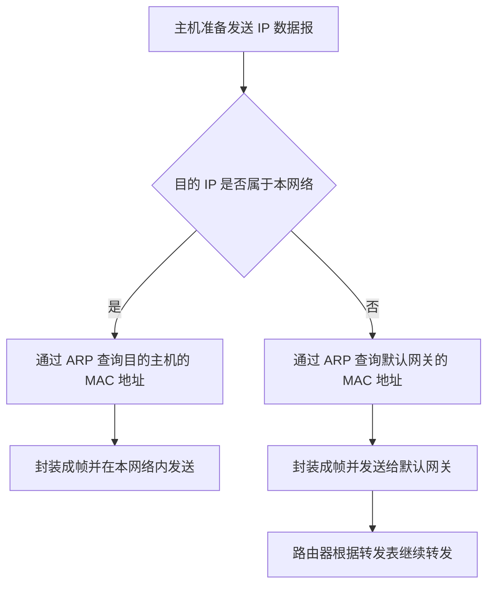
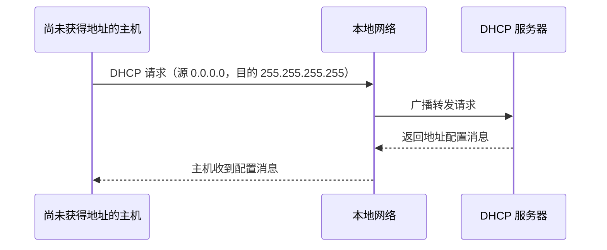

# IPv4 地址的最初分类方案

> 本文根据课程讲解整理，主要优化标题层级、排版、表格和示意图，保留原讲解的知识脉络与内容，便于复习、查阅和打印。

## 一、IPv4 地址方案的发展脉络

IPv4 地址的设计在技术发展过程中经历了几次变化：

1. **最初的分类编址**：把 IPv4 地址分为 A、B、C、D、E 五类。
2. **子网划分**：随着互联网发展，原先的分类方式逐渐无法满足需求，于是提出子网划分。
3. **CIDR**：子网划分仍不能满足后续需求，因此进一步优化 IPv4 地址结构，提出 CIDR。
4. **NAT**：由于 IPv4 地址数量不足，又在 CIDR 技术的基础上提出 NAT 方案。

因此，学习时可以按照技术发展的顺序理解：

```text
IPv4 地址分类
    ↓
子网划分
    ↓
CIDR
    ↓
NAT
```

大纲和教材的排列顺序不一定等于技术发展的顺序。本节先学习 IPv4 地址最初的分类方案。

## 二、IPv4 地址的基本特点

### 1. IPv4 地址长度

IPv4 分组首部中包含源地址和目的地址：

- **源地址**：发送方的 IP 地址。
- **目的地址**：接收方的 IP 地址。
- 源地址和目的地址都占 **32 bit**。

32 bit 地址理论上有：

\[
2^{32} = 4,294,967,296
\]

种不同的比特组合，约为 **42 亿**。

最初的设计方案最多只有约 42 亿个地址。若按照现代的使用规模，为每台主机、每个路由器接口分配全球唯一的 IP 地址，数量显然不够。例如，全世界每个人都使用一台手机，手机数量就可能超过 42 亿。

### 2. 理解最初设计时的时代背景

IPv4 协议在 **1981 年**问世时，互联网主要由政府、学校、军队等大型机构使用，尚未进入普遍民用的时代。因此，在当时看来，32 bit 的 IP 地址似乎足够使用。

IP 地址资源的管理涉及国际管理机构，例如 ICANN 等机构及相关地址分配体系。

## 三、A、B、C、D、E 五类地址

最初的 IPv4 分类方案把地址分为五类：

| 地址类别 | 主要用途 | 地址前缀 |
| -------- | -------- | -------- |
| A 类     | 单播地址 | `0`      |
| B 类     | 单播地址 | `10`     |
| C 类     | 单播地址 | `110`    |
| D 类     | 多播地址 | `1110`   |
| E 类     | 保留地址 | `1111`   |

其中：

- **A、B、C 类地址**称为单播地址，可以分配给特定主机或接口使用。
- **D 类地址**称为多播地址，用于 IP 多播（也称 IP 组播）。
- **E 类地址**在最初的设计中保留，供未来用途使用。

### 1. 单播与多播

- **单播**：把数据发送给一个特定的接收对象。
- **多播**：把一个 IP 分组发送给属于同一个多播组的一组主机。

可以用 QQ 号和 QQ 群号作类比：

- 单播地址类似个人 QQ 号，一个地址对应一个接收对象。
- 多播地址类似 QQ 群号，一个多播组可以包含多台主机。向多播地址发送数据时，属于该组的主机可以接收相应的数据。

## 四、A、B、C 类地址的两级结构

最初的分类编址把 IP 地址划分为两部分：

1. **网络号**：标识某个特定的网络。
2. **主机号**：标识该网络中的某台主机。

### 1. 各类地址的网络号和主机号

| 地址类别 | 网络号长度 | 主机号长度 | 地址结构        |
| -------- | ---------: | ---------: | --------------- |
| A 类     |      8 bit |     24 bit | 网络号 + 主机号 |
| B 类     |     16 bit |     16 bit | 网络号 + 主机号 |
| C 类     |     24 bit |      8 bit | 网络号 + 主机号 |

可以用下面的示意图理解：

```text
A 类：| 网络号 8 bit |          主机号 24 bit          |
B 类：|     网络号 16 bit     |     主机号 16 bit     |
C 类：|          网络号 24 bit          | 主机号 8 bit |
```

网络号所占的位数并不固定。给出一个 32 bit 的 IPv4 地址后，可以根据地址开头的比特判断其类别。

### 2. 各类地址的二进制前缀

| 地址类别 | 开头比特 | 网络号/主机号划分 |
| -------- | -------- | ----------------- |
| A 类     | `0`      | 8 bit / 24 bit    |
| B 类     | `10`     | 16 bit / 16 bit   |
| C 类     | `110`    | 24 bit / 8 bit    |
| D 类     | `1110`   | 多播地址          |
| E 类     | `1111`   | 保留地址          |

## 五、点分十进制表示法

IPv4 地址在计算机内部以二进制表示。为了便于人类阅读，通常把 32 bit 分成四组，每组 8 bit，再把每组转换为十进制数，并用点号分隔。

例如：

```text
二进制：11000000 10101000 00000001 00000001
十进制：192      .168     .1       .1
```

因此，地址写作：

```text
192.168.1.1
```

每组 8 bit 的取值范围为 **0～255**。

## 六、根据首个十进制数判断地址类别

根据 A、B、C 类地址的前缀，可以得到常见的首字节范围：

| 地址类别 | 首字节范围 | 说明                                 |
| -------- | ---------: | ------------------------------------ |
| A 类     |     1～126 | 以 `0` 开头；`0` 和 `127` 有特殊用途 |
| B 类     |   128～191 | 以 `10` 开头                         |
| C 类     |   192～223 | 以 `110` 开头                        |
| D 类     |   224～239 | 以 `1110` 开头                       |
| E 类     |   240～255 | 以 `1111` 开头                       |

例如：

- `125.x.x.x`：按传统分类，属于 A 类地址。
- `129.x.x.x`：属于 B 类地址。
- `200.x.x.x`：属于 C 类地址。

> 注意：分类判断依据是地址的二进制前缀。上表是传统分类编址下的范围；其中一些地址段另有特殊用途。

## 七、网络号分配与主机号分配

在最初的分类编址方案中，如果一个单位希望接入互联网，就需要向 IP 地址管理体系申请一个地址段。

- 管理机构确定该地址段的**网络号**。
- 单位内部的网络管理员为主机分配不同的**主机号**。
- 同一网络中的主机和连接该网络的路由器接口，其网络号必须一致。
- 按照当时的设计要求，分配给主机或相关路由器接口的 IP 地址需要全球唯一。

### 1. 学校申请 B 类地址

假设一所学校获得了一个 B 类地址段，并用点分十进制形式表示其固定网络号为 `116.1`。那么学校内部地址可以示意为：

```text
固定网络号：116.1
主机号：    后 16 bit，由学校内部规划

示例：
116.1.0.1
116.1.0.5
116.1.4.4
```

学校内部各主机和连接内部网络的路由器接口，前 16 bit 网络号应保持一致；主机号由学校管理员分配，不能重复。

路由器与路由器直接相连的接口，在本例为简化理解可以暂不配置 IP 地址；但路由器连接学校内部普通节点所在网络的接口，需要配置 IP 地址，并与该网络中的其他节点使用相同的网络号。

### 2. 公司申请 C 类地址

假设某公司获得了一个 C 类地址段，其网络号示意为 `200.1.1`：

```text
固定网络号：200.1.1
主机号：    后 8 bit，由公司内部规划

示例：
200.1.1.1
200.1.1.2
200.1.1.3
```

公司内部主机以及连接该内部网络的路由器接口，前 24 bit 网络号必须一致。

如果主机 H7 被错误地配置为 `200.1.2.2`，它的前 24 bit 网络号与其他节点的网络号不一致，因此不能按预期在该网络中正常通信。

## 八、默认网关的作用

在早期 TCP/IP 文档中，网关通常指路由器。因此，**默认网关可以理解为主机向其他网络发送数据时，默认交给它转发的路由器接口**。

主机接入网络时，通常需要配置：

- 自己的 IP 地址；
- 默认网关的 IP 地址。

默认网关一般是与该主机处于同一局域网、可直接到达的路由器接口地址。

### 1. 主机发送数据时如何选择下一跳

主机需要判断目的 IP 地址是否属于本网络：

- **目的主机在本网络内**：直接通过 ARP 查询目的主机的 MAC 地址，然后在本网络内发送帧，不需要先交给默认网关。
- **目的主机在其他网络**：通过 ARP 查询默认网关接口的 MAC 地址，把帧发送给默认网关，由路由器继续转发 IP 分组。



## 九、路由器转发表与 IP 分组转发

一个简化的路由器转发表可以包含两项：

- **目的网络号**
- **转发接口**

路由器收到 IP 分组后，会查看 IP 首部中的目的 IP 地址，确定其目的网络号，再与转发表中的网络号进行匹配。

示意表如下：

| 目的网络号             | 转发接口 | 含义                                     |
| ---------------------- | -------- | ---------------------------------------- |
| `116.1`（前 16 bit）   | `b2`     | 转发到学校内部网络                       |
| `200.1.1`（前 24 bit） | `b0`     | 转发到公司网络                           |
| 其他目的网络           | `b1`     | 转发给 ISP，再由互联网中的路由器继续转发 |

以上是用于讲解的简化示例。实际路由选择还涉及路由表中的前缀长度、路由优先级等规则。

### 1. H1 向 H7 发送数据报

假设：

- H1 的 IP 地址为 `116.1.0.1`；
- 学校路由器面向学校内部网络的接口地址为 `116.1.0.5`；
- H7 的 IP 地址为 `200.1.1.2`。

H1 构造的 IP 数据报为：

| 字段         | 地址        |
| ------------ | ----------- |
| 源 IP 地址   | `116.1.0.1` |
| 目的 IP 地址 | `200.1.1.2` |

由于目的地址属于另一个网络，H1 先把数据报交给默认网关。

1. H1 通过 ARP 查询默认网关 `116.1.0.5` 对应的 MAC 地址。
2. H1 把 IP 数据报封装进 MAC 帧，帧的目的 MAC 地址填写为学校路由器内部接口的 MAC 地址。
3. 交换机依据目的 MAC 地址转发帧，使其到达学校路由器。
4. 学校路由器查看目的 IP 地址 `200.1.1.2`，发现其目的网络号与 `200.1.1` 匹配，于是从 `b0` 接口转发。
5. 学校路由器重新封装帧，将帧的目的 MAC 地址设置为公司路由器相应接口的 MAC 地址。
6. 公司路由器收到数据后，匹配到公司内部网络，从连接该网络的接口转发。
7. 公司路由器通过 ARP 查询 H7 的 MAC 地址，重新封装帧并发送给 H7。
8. H7 收到帧后，拆除链路层封装，检查 IP 数据报的目的地址，确认目的地址是自己，于是接收数据。

### 2. IP 地址与 MAC 地址在转发过程中的变化

在这个例子中：

- **IP 数据报的源 IP 地址和目的 IP 地址通常在整个转发过程中保持不变**。
- **每一段链路上的 MAC 帧地址会随着下一跳而变化**。路由器收到帧后，会去掉原有链路层封装，再根据下一跳重新封装成帧。


### 3. H1 向互联网中的其他主机发送数据报

如果 H1 的目的主机位于互联网中的其他网络，目的网络号既不匹配学校内部网络，也不匹配示例中的公司网络，则学校路由器会通过 `b1` 接口将分组交给 ISP 路由器。

ISP 路由器继续根据自己的转发表选择下一跳。经过互联网中的多台路由器逐层转发后，分组最终到达目的网络。

## 十、H1 向同一网络内的 H6 发送数据报

假设：

- H1 的 IP 地址为 `116.1.0.1`；
- H6 的 IP 地址为 `116.1.4.4`。

H1 构造的 IP 数据报：

| 字段         | 地址        |
| ------------ | ----------- |
| 源 IP 地址   | `116.1.0.1` |
| 目的 IP 地址 | `116.1.4.4` |

由于这是 B 类地址，传统分类编址下网络号为前 16 bit。H1 对比源地址与目的地址的前 16 bit，发现两者相同，因此判断 H6 与自己属于同一个网络。

发送过程如下：

1. H1 通过 ARP 查询 H6 的 MAC 地址。
2. H1 将 IP 数据报封装成帧，帧的目的 MAC 地址填写为 H6 的 MAC 地址。
3. 交换机根据 MAC 地址转发该帧。
4. 如果链路中有集线器，集线器会把收到的帧转发给与其相连的所有节点。
5. H5 也可能收到该帧，但发现帧的目的 MAC 地址不是自己，于是丢弃该帧。
6. H6 发现帧的目的 MAC 地址与自己的 MAC 地址相符，于是接收该帧，拆除链路层封装并检查 IP 数据报的目的地址。

这个过程不需要经过默认网关。

## 十一、ARP 协议的作用

ARP（地址解析协议）用于在本地网络中，根据已知的 IPv4 地址查询对应的 MAC 地址。

本节涉及的典型场景包括：

- 主机向本网络内的另一台主机发送数据时，查询目的主机的 MAC 地址。
- 主机向其他网络发送数据时，查询默认网关接口的 MAC 地址。
- 路由器向下一跳或目的网络内的主机发送数据时，查询相应接口或主机的 MAC 地址。

## 十二、特殊用途的 IPv4 地址

以下是传统分类编址相关的常见特殊地址。它们有特定用途，不能简单地当作普通主机地址使用。

### 1. 网络号确定、主机号全为 0

含义：**表示网络本身**，用于路由表或转发表中标识一个网络。

- 不能分配给普通主机或路由器接口作为其普通地址。
- 不能作为普通 IP 分组的源地址或目的地址使用。

例如，若学校网络号为 `116.1`，对应的主机号全零地址可写作 `116.1.0.0`，它用于表示该网络，而不是分配给某台主机。

### 2. 网络号确定、主机号全为 1

含义：**定向广播地址**，表示向指定网络中的所有主机广播 IP 分组。

- 只能作为目的地址使用，不能作为源地址使用。
- 例如，C 类网络 `200.1.1` 的主机号有 8 bit；主机号全为 1 时，点分十进制形式为 `200.1.1.255`。

如果 H1 要向该公司网络广播一个 IP 分组，目的地址可以写成 `200.1.1.255`。分组到达目的网络后，网络中的节点可以收到该广播分组。

### 3. 网络号全为 0、主机号非 0

含义：表示**本网络中的某台主机**。

- 可以作为源地址使用。
- 不能作为目的地址使用。

例如，源地址可以写作 `0.0.0.1`，用于表示本网络中主机号对应为 1 的主机；目的地址仍应填写接收方的完整 IP 地址。

### 4. 网络号和主机号全为 0

地址为：

```text
0.0.0.0
```

含义：表示**本网络上的本主机**，在主机尚未获得 IP 地址时有特殊用途。

- 可以作为源地址使用。
- 不能作为目的地址使用。

例如，一台刚接入网络、尚未获得 IP 地址的主机，可以在 DHCP 地址申请过程中暂时把源 IP 地址写为 `0.0.0.0`，表示自己还没有可用的 IP 地址。

### 5. 全 1 地址：本网络广播地址

地址为：

```text
255.255.255.255
```

含义：**受限广播地址**，用于向本地网络广播。

例如，主机刚接入网络、还没有获得 IP 地址时，可以发送 DHCP 请求：

- 源 IP 地址：`0.0.0.0`
- 目的 IP 地址：`255.255.255.255`

DHCP 请求会在本地网络中广播，使网络中的 DHCP 服务器能够收到请求，并向主机提供 IP 地址配置。

### 6. 以 127 开头的环回地址

以 `127` 开头的地址用于**环回测试**。常见示例：

```text
127.0.0.1
```

在传统分类编址的讲解中，127 开头的地址被保留用于环回用途。

例如，开发者在同一台计算机上开发游戏客户端和服务器端程序时，可以让客户端向 `127.0.0.1` 发送数据，以便与本机上的服务器进程通信。

这类数据不会像普通目的地址那样发送到外部网络，而是在本机协议栈内部完成环回处理。

- 环回地址既可作为源地址，也可作为目的地址。
- 它不能作为普通网络中分配给主机或路由器接口的地址。

### 7. 特殊地址汇总表

| 地址形式               | 含义                                 | 可作源地址     | 可作目的地址                   |
| ---------------------- | ------------------------------------ | -------------- | ------------------------------ |
| 网络号 + 主机号全 0    | 表示网络本身                         | 否             | 否（作为普通主机间分组地址时） |
| 网络号 + 主机号全 1    | 指定网络的广播地址                   | 否             | 是                             |
| 网络号全 0、主机号非 0 | 本网络中的对应主机                   | 是（特殊场景） | 否                             |
| `0.0.0.0`              | 本网络上的本主机；尚未获得地址时使用 | 是（特殊场景） | 否                             |
| `255.255.255.255`      | 本地受限广播                         | 否             | 是                             |
| `127.0.0.0/8`          | 环回地址范围                         | 是             | 是                             |

> 特殊地址的具体使用还受到协议、实现和后续标准的约束。此表用于理解本节的传统分类编址知识。

## 十三、主机号全 0 和全 1 对可用主机数的影响

对于一个确定的网络，如果主机号占 \(n\) bit，那么主机号一共有：

\[
2^n
\]

种组合。

在传统分类编址的普通网络中：

- 主机号全 0：表示网络本身；
- 主机号全 1：表示该网络的广播地址。

因此，该网络可分配给普通主机或接口的地址数量为：

\[
2^n - 2
\]

例如：

- A 类网络主机号占 24 bit，传统计算的可用地址数为 \(2^{24}-2\)。
- C 类网络主机号占 8 bit，传统计算的可用地址数为 \(2^8-2=254\)。

## 十四、DHCP 与全零地址、全一地址的配合

主机刚接入网络时，可能还没有 IP 地址。为了获取地址，它可以通过 DHCP 协议发送请求。

在本节的简化讲解中，典型情况如下：

1. 主机尚未获得 IP 地址，将源 IP 地址设为 `0.0.0.0`。
2. 将目的 IP 地址设为 `255.255.255.255`，向本地网络广播 DHCP 请求。
3. 本地网络中的 DHCP 服务器收到请求。
4. DHCP 服务器返回配置消息，为主机分配 IP 地址等网络参数。



## 十五、本节重点回顾

1. IPv4 地址长度为 32 bit，源地址和目的地址各占 32 bit。
2. 传统分类编址把地址分为 A、B、C、D、E 五类。
3. A、B、C 类地址用于单播；D 类地址用于多播；E 类地址保留。
4. A、B、C 类地址的网络号长度分别为 8 bit、16 bit、24 bit。
5. 点分十进制把 32 bit 地址分为四组，每组 8 bit，每组范围为 0～255。
6. 同一网络中的主机及连接该网络的路由器接口，其网络号应保持一致。
7. 默认网关用于把发往其他网络的 IP 分组交给路由器转发。
8. 路由器依据目的 IP 地址中的目的网络号查询转发表，选择转发接口。
9. IP 分组经过路由器转发时，源 IP 地址和目的 IP 地址通常保持不变；每一段链路上的 MAC 帧地址会变化。
10. ARP 用于根据 IPv4 地址查询本地链路上的 MAC 地址。
11. 主机号全 0 表示网络本身，主机号全 1 表示指定网络的广播地址。
12. `0.0.0.0` 和 `255.255.255.255` 可在主机尚未获得 IP 地址时的 DHCP 过程中配合使用。
13. `127.0.0.1` 是常见环回地址，用于本机测试和通信。
14. 在传统分类编址的普通网络中，若主机号占 \(n\) bit，可分配的普通主机地址数为 \(2^n-2\)。

本节通过地址分类、默认网关、路由器转发表、ARP 和特殊地址等内容，串联起了 IPv4 分组转发的基本流程，为后续学习子网划分、CIDR 和 NAT 打下基础。
