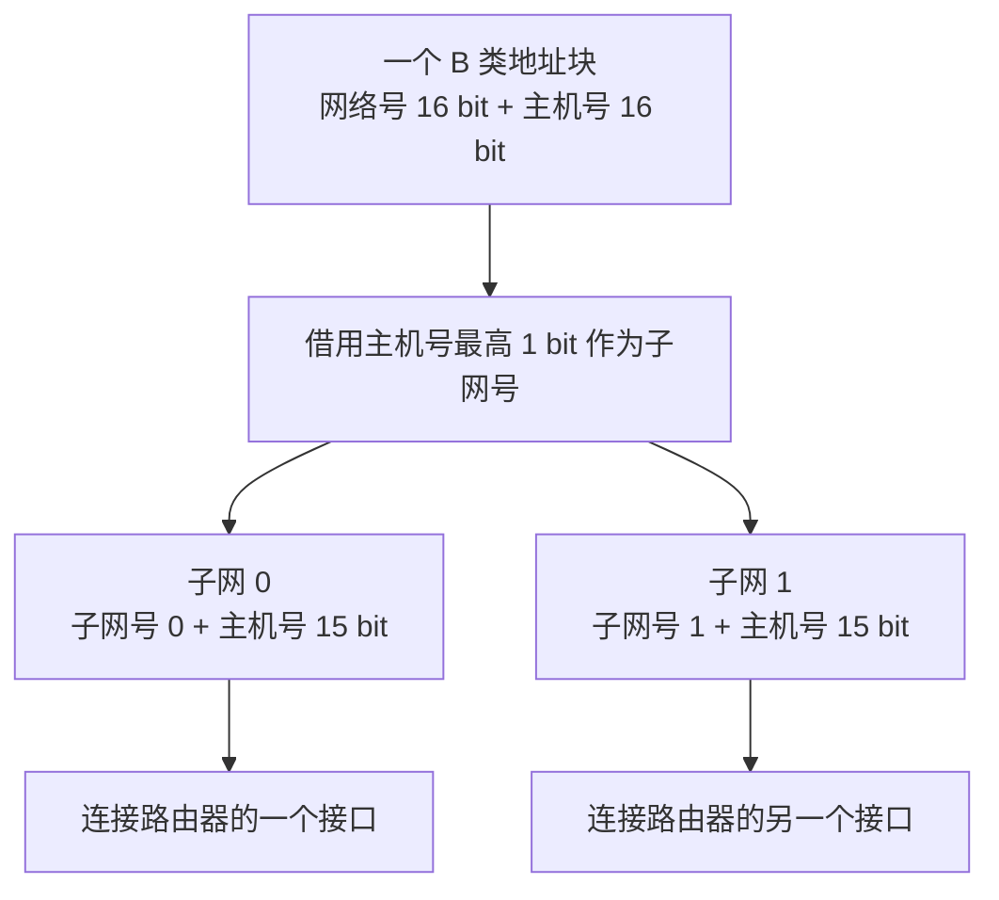
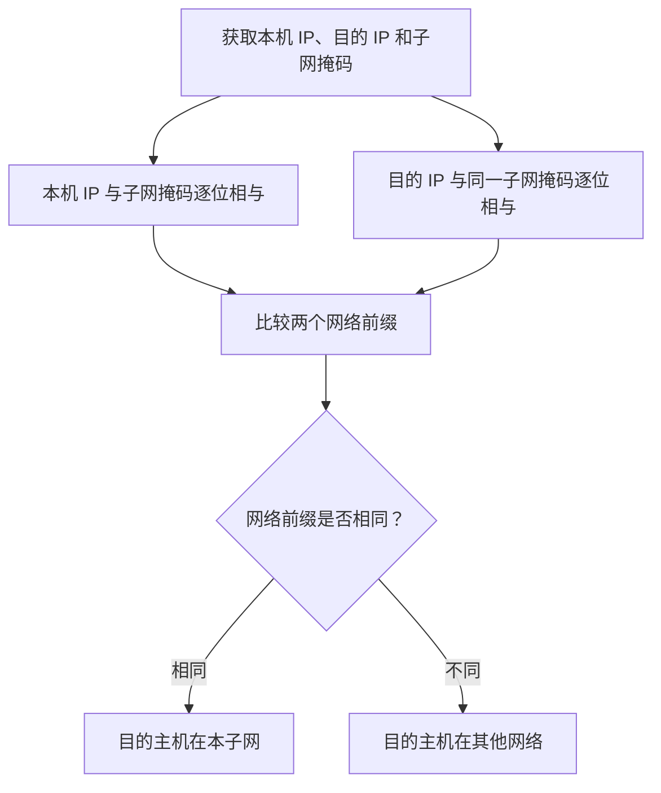
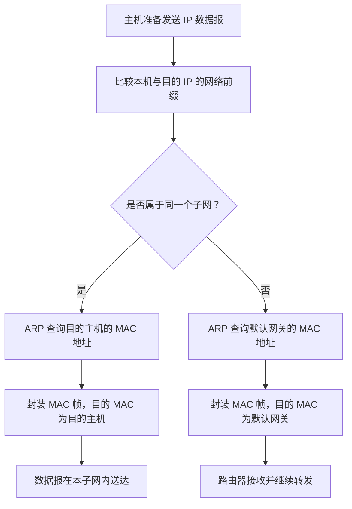
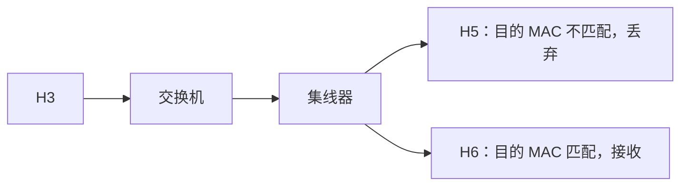
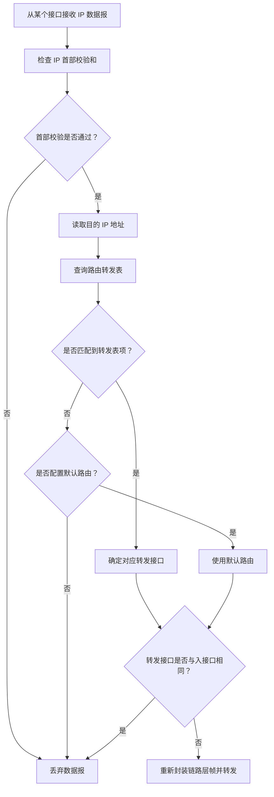
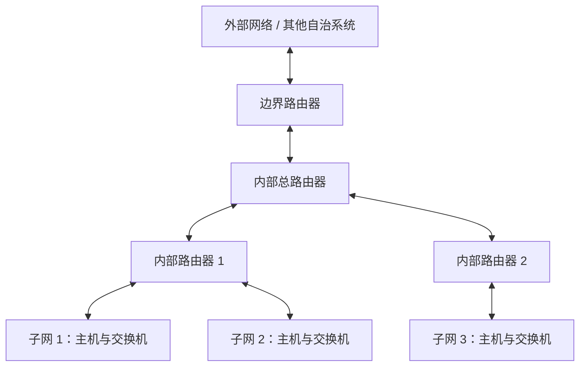

# 子网划分与子网掩码

## 一、知识点定位与学习脉络

本节学习 **子网划分（Subnetting）** 和 **子网掩码（Subnet Mask）**。按照 IPv4 地址技术的发展脉络，可以先暂时跳过 NAT，先理解子网划分，再学习 CIDR（无分类编址，讲稿中也称变长子网技术），之后再学习 NAT。

IPv4 地址最初采用 A、B、C、D、E 五类地址的分类方式。随着互联网发展，传统分类方式逐渐暴露出地址利用率不够高等问题，于是引入了子网划分技术。子网划分需要子网掩码的支持；在此基础上，后来又发展出 CIDR 等技术。

本节除了介绍概念，还会围绕综合网络图练习主机发送 IP 数据报、路由器转发数据报以及默认路由等内容。这些过程是考研网络层综合题的重要基础。

### 技术发展脉络

```text
IPv4 分类编址（A、B、C、D、E 类）
                |
                v
           子网划分
                |
                v
           子网掩码
                |
                v
       CIDR（无分类编址）
                |
                v
              NAT
```

> 本节重点：理解子网划分的动机、子网掩码的计算方法、主机如何判断目的地址是否在本网络，以及路由器如何根据转发表转发 IP 数据报。

---

## 二、为什么需要子网划分

### 1. 传统分类编址的问题

以某学校申请到一个 **B 类 IPv4 地址块** 为例：

- 前 16 bit 是网络号，由 IP 地址管理机构分配。
- 后 16 bit 是主机号，由学校自行分配。
- 如果不再划分子网，主机号理论上可表示 \(2^{16}\) 种组合。
- 主机号全 0 表示网络地址，主机号全 1 表示广播地址，因此通常可分配给主机的地址数量为：

\[
2^{16}-2
\]

这对一个学校中的某个小型局域网而言，可能过于庞大。大量地址无法被充分利用，因此需要一种方式，把一个较大的地址块分成多个较小的网络。

### 2. 子网划分的基本思想

在不改变原有网络号的前提下，从原本的主机号部分借用若干个比特作为 **子网号**，剩余比特继续作为 **主机号**。

例如，某 B 类网络原本的结构为：

```text
|<------ 网络号 16 bit ------>|<------ 主机号 16 bit ------>|
```

如果从主机号最高位借用 1 bit 作为子网号，则结构变为：

```text
|<------ 网络号 16 bit ------>|子网号 1 bit|<-- 主机号 15 bit -->|
```

这时可以形成两个子网：

- 子网 0：子网号为 `0`。
- 子网 1：子网号为 `1`。

每个子网对应一个独立网络。路由器的每个接口连接一个独立网络，因此不同子网可以分别连接到路由器的不同接口。



从地址块的角度看，子网划分就是把一个较大的地址块拆分成多个较小的地址块；每个地址块对应一个独立网络。例如，学校有两个校区时，可以把申请到的地址块划分为两个连续的地址范围，分别用于两个校区。

### 3. 划分更多子网

如果从主机号中借用 2 bit 作为子网号，则可以用 2 bit 表示 \(2^2=4\) 种子网号：

| 子网号 | 对应子网 |
| ------ | -------- |
| `00`   | 子网 0   |
| `01`   | 子网 1   |
| `10`   | 子网 2   |
| `11`   | 子网 3   |

因此，一个原本较大的地址块可以被拆分为 4 个大小相等的子网。这里的“大小相等”指各子网分到的 IP 地址块大小相同。

如果原先主机号有 \(n\) bit，从中借用前 \(k\) bit 作为子网号，则：

- 子网号长度为 \(k\) bit。
- 剩余主机号长度为 \(n-k\) bit。
- 可以划分出 \(2^k\) 个大小相等的子网。
- 每个子网的地址块包含 \(2^{n-k}\) 个地址组合。

**注意：**在每个子网中，主机号全 0 和全 1 都不能分配给普通主机：

- 主机号全 0：表示该子网的网络地址。
- 主机号全 1：表示该子网的广播地址。

### 4. 子网划分带来的地址结构变化

传统分类编址的 IPv4 地址可看成两级结构：

```text
网络号 + 主机号
```

引入子网划分之后，地址结构变为三级：

```text
网络号 + 子网号 + 主机号
```

子网划分的主要作用是：**将一个较大的 IP 地址块拆分为多个相互独立的较小网络，提高 IP 地址资源的利用率。**

---

## 三、子网掩码的作用与表示方法

### 1. 引入子网掩码的原因

主机发送 IP 数据报时，需要先判断目的 IP 地址与自己的 IP 地址是否属于同一个网络。

- 如果属于同一个网络，主机可以直接把数据报交付给目的主机，不需要先经过默认网关转发。
- 如果不属于同一个网络，主机需要把数据报发送给默认网关，由路由器继续转发。

在传统分类编址中，可以根据 A、B、C 类地址的网络号长度判断网络归属。例如，C 类网络通常比较双方地址的前 24 bit。

但是，进行子网划分后，仅仅比较原来的网络号已经不够了，还必须考虑子网号。**只有网络号和子网号都相同，两个 IP 地址才属于同一个子网。**

因此，主机和支持子网划分的路由器需要使用子网掩码来提取网络号与子网号。

### 2. 子网掩码的定义

子网掩码是一个 32 bit 的二进制数：

- 网络前缀对应的比特全部为 `1`。
- 主机号对应的比特全部为 `0`。

进行子网划分后，子网掩码中的连续 `1` 同时覆盖原来的网络号和子网号。

例如，前面举例从 B 类地址的 16 bit 主机号中借用 1 bit 作为子网号，则：

- 网络号：16 bit。
- 子网号：1 bit。
- 主机号：15 bit。
- 网络前缀长度：17 bit。
- 子网掩码：17 个 `1`，后接 15 个 `0`。

用点分十进制表示，该子网掩码为 `255.255.128.0`，也可以简写为 `/17`。

### 3. 子网掩码与 IP 地址逐位相与

主机可以将 IP 地址与子网掩码进行逐位 AND（与）运算，提取出网络前缀。

与运算规则：

| 运算      | 结果 |
| --------- | ---: |
| `0 AND 0` |  `0` |
| `0 AND 1` |  `0` |
| `1 AND 0` |  `0` |
| `1 AND 1` |  `1` |

所以：

- `0` 与任何比特相与，结果都是 `0`。
- `1` 与某个比特相与，结果等于该比特本身。
- 子网掩码末尾的 `0` 会把 IP 地址中对应的主机号部分清零。
- 子网掩码前面的 `1` 会保留 IP 地址中的网络号和子网号。

可概括为：

\[
\text{网络前缀}=\text{IP 地址}\ \text{AND}\ \text{子网掩码}
\]

如果需要判断目的主机和本机是否在同一个子网，可以分别计算：

\[
\text{本机网络前缀}=\text{本机 IP}\ \text{AND}\ \text{子网掩码}
\]

\[
\text{目的网络前缀}=\text{目的 IP}\ \text{AND}\ \text{子网掩码}
\]

再比较两个结果：

- 结果相同：属于同一个子网。
- 结果不同：属于不同子网。



### 4. 主机和路由器接口都需要配置子网掩码

在进行了子网划分的网络中，相关主机需要配置：

- IP 地址；
- 子网掩码；
- 默认网关地址（需要与其他网络通信时使用）。

与各个子网相连接的路由器接口也需要配置 IP 地址和相应的子网掩码。对于同一个子网中的主机，网络前缀长度相同，因此使用相同的子网掩码。

子网掩码取决于网络前缀的长度。网络前缀由原来的网络号和子网号组成。

---

## 四、子网划分对路由器转发表的影响

### 1. 传统路由器与支持子网划分的路由器

传统路由表可以只包含：

- 目的网络；
- 转发接口。

支持子网划分的路由器需要在转发表项中增加子网掩码，通常包含：

- 目的网络号；
- 子网掩码；
- 转发接口。

| 类型                               | 转发表项包含的内容             |
| ---------------------------------- | ------------------------------ |
| 传统路由器（按分类编址判断网络号） | 目的网络号、转发接口           |
| 支持子网划分的路由器               | 目的网络号、子网掩码、转发接口 |

### 2. 路由器如何使用子网掩码查表

路由器收到 IP 数据报后，会读取目的 IP 地址，并根据转发表逐项检查。对支持子网划分的路由器而言，其基本判断方式是：

1. 取出某条转发表项中的子网掩码。
2. 将目的 IP 地址与该子网掩码逐位相与。
3. 将相与结果与该表项的目的网络号比较。
4. 如果匹配成功，就按照该表项对应的转发接口转发。

例如，路由器收到目的地址为 `166.1.0.1` 的 IP 数据报时，会按照路由表中的子网掩码计算目的网络前缀，再与表中的目的网络号比较；匹配成功后，从相应接口（讲解示例中可能是 B3）转发出去。另一个目的地址如果与第一条不匹配，就继续检查其他表项，匹配到相应网络后，从对应接口（示例中可能是 B2）转发。

> 具体接口名称与地址取决于课程配图。这里保留讲稿中的 B2、B3 等接口称呼，用于说明转发表的匹配过程。

---

## 五、主机发送 IP 数据报的基本过程

主机发送 IP 数据报时，首先判断目的 IP 地址与本机是否属于同一个网络，再决定以哪个 MAC 地址作为帧的目的 MAC 地址。

### 1. 目的主机在本子网

如果目的 IP 地址与本机具有相同的网络前缀：

1. 通过 ARP 协议获取目的主机的 MAC 地址。
2. 将 IP 数据报封装成 MAC 帧。
3. 帧的目的 MAC 地址填写为目的主机的 MAC 地址。
4. 通过交换机等链路层设备将帧送达目的主机。

### 2. 目的主机在其他网络

如果目的 IP 地址与本机的网络前缀不同：

1. 通过 ARP 协议获取默认网关接口的 MAC 地址。
2. 将 IP 数据报封装成 MAC 帧。
3. 帧的目的 MAC 地址填写为默认网关接口的 MAC 地址。
4. 将帧发给默认网关，由路由器继续转发 IP 数据报。

**需要区分：**跨网络通信时，IP 数据报中的目的 IP 地址仍然是最终目的主机的 IP 地址；发给默认网关时，MAC 帧的目的 MAC 地址才是默认网关接口的 MAC 地址。



---

## 六、综合训练一：H3 给 H6 发送数据报（同一子网）

假设 H3 要给 H6 发送 IP 数据报，且 H3 与 H6 属于同一个子网。

### 处理过程

1. H3 构造 IP 数据报：
   - 源 IP 地址填写 H3 的 IP 地址；
   - 目的 IP 地址填写 H6 的 IP 地址。
2. H3 使用配置好的子网掩码，分别计算本机 IP 地址与目的 IP 地址的网络前缀。
3. 两个网络前缀相同，说明 H6 与 H3 属于同一个子网。
4. H3 通过 ARP 协议获取 H6 的 MAC 地址。
5. H3 将 IP 数据报封装成 MAC 帧，帧的目的 MAC 地址填写为 H6 的 MAC 地址。
6. MAC 帧经过交换机，再到达集线器。集线器将帧转发给连接的主机，例如 H5 和 H6。
7. H5 发现帧的目的 MAC 地址不是自己的 MAC 地址，因此不接收该帧；H6 接收该帧。
8. H6 去除 MAC 帧的首部和尾部，得到 IP 数据报，并根据目的 IP 地址确认数据报发给自己。

这次通信在局域网内部就完成了，不需要经过路由器转发。



---

## 七、综合训练二：H1 给 H3 发送数据报（跨子网）

假设 H1 与 H3 分别属于两个不同的子网。

### 处理过程

1. H1 构造 IP 数据报：
   - 源 IP 地址填写 H1 的 IP 地址；
   - 目的 IP 地址填写 H3 的 IP 地址。
2. H1 使用本机子网掩码分别计算本机 IP 和目的 IP 的网络前缀。
3. 两个网络前缀不相同，说明 H3 不在 H1 所在的子网中。
4. H1 通过 ARP 协议获取默认网关对应接口的 MAC 地址。
5. H1 将 IP 数据报封装成 MAC 帧，帧的目的 MAC 地址填写为默认网关接口（讲解示例中的 B3 接口）的 MAC 地址。
6. 帧经交换机到达路由器。路由器的数据链路层去除帧的首部和尾部控制信息，将 IP 数据报交给网络层。
7. 路由器根据目的 IP 地址查找转发表：将目的 IP 地址与每条表项中的子网掩码逐位相与，再与目的网络号比较。
8. 示例中，第二条表项匹配成功，于是路由器从 B2 接口转发。
9. 路由器将 IP 数据报重新封装成 MAC 帧，并通过 B2 接口发出。
10. 帧经交换机到达 H3，H3 接收并处理 IP 数据报。


### 本例的关键点

- 判断是否同一子网：由主机使用自己的子网掩码比较网络前缀。
- 跨子网发送：主机先把帧交给默认网关。
- 路由器转发：依据 IP 数据报的目的 IP 地址查转发表。
- 每一段链路上的 MAC 地址用于当前链路的帧传送；IP 数据报的源、目的 IP 地址表示端到端的源主机和目的主机。

---

## 八、综合训练三：H1 与 H7 通信（新旧编址方式兼容）

这个例子用于说明：进行了子网划分的网络，可以与未进行子网划分、仍采用传统分类编址方式的网络通信。新技术能够兼容旧技术，有利于网络设备逐步升级，不需要全世界的主机和路由器在同一时间完成改造。

### 1. H1 给 H7 发送数据报

假设 H7 的 IP 地址为 `200.1.1.2`，其所在网络是一个没有进行子网划分的传统 C 类网络。

处理过程如下：

1. H1 构造 IP 数据报，源地址填写 H1 的 IP 地址，目的地址填写 H7 的 IP 地址 `200.1.1.2`。
2. H1 使用自己的子网掩码计算网络前缀，发现目的地址与自己不在同一个子网。
3. H1 将数据报封装成 MAC 帧，并把帧发给默认网关。
4. 支持子网划分的路由器使用目的 IP 地址与转发表中的子网掩码逐位相与，并逐项匹配；讲解示例中，第三条表项匹配成功。
5. 路由器将数据报发给下一跳路由器。
6. 下一跳是传统路由器，其路由表只包含目的网络号和转发接口。该路由器先根据目的 IP 地址判断其属于 C 类地址，再提取前 24 bit 作为网络号（等价于使用 C 类默认子网掩码）。
7. 与传统路由表匹配成功后，路由器从相应接口（示例中的 C2）转发数据报。
8. 数据报经互联网中的路由器逐跳转发，最终到达 H7。

### 2. 默认子网掩码

对于没有进行子网划分的传统分类网络，可以使用默认子网掩码：

| 地址类别 | 默认子网掩码的二进制形式  | 点分十进制表示  | 简写  |
| -------- | ------------------------- | --------------- | ----- |
| A 类     | 8 个 `1`，后接 24 个 `0`  | `255.0.0.0`     | `/8`  |
| B 类     | 16 个 `1`，后接 16 个 `0` | `255.255.0.0`   | `/16` |
| C 类     | 24 个 `1`，后接 8 个 `0`  | `255.255.255.0` | `/24` |

这些默认子网掩码本质上就是用来提取传统分类编址中的网络号：

- A 类地址提取前 8 bit。
- B 类地址提取前 16 bit。
- C 类地址提取前 24 bit。

使用统一的“目的 IP 地址与子网掩码逐位相与，再和目的网络号比较”的处理方式，可以让路由器按照相同的基本逻辑处理已划分子网的网络和未划分子网的传统网络。

### 3. H7 给 H1 发送数据报

反向发送时，H7 所在网络没有进行子网划分，因此 H7 根据传统 C 类地址规则，将自己的 IP 地址前 24 bit 与目的地址前 24 bit 进行比较。

1. H7 发现目的地址与本网络不属于同一个网络。
2. H7 通过 ARP 获取默认网关的 MAC 地址，并将帧交给默认网关。
3. 公司的路由器检查目的地址。讲解示例中，目的地址属于 B 类网络，因此按照前 16 bit 提取目的网络号，再查找转发表，匹配第二条表项并从 C 接口转发。
4. 数据报到达支持子网划分的路由器后，该路由器使用目的 IP 地址和各表项的子网掩码进行逐位相与，再与目的网络号比较。
5. 讲解示例中，第一条表项匹配成功，数据报从 B3 接口发出。
6. 由于 B3 接口与 H1 属于同一个网络，路由器可以通过 ARP 获取 H1 的 MAC 地址，将帧直接交付给 H1。

因此，子网划分后的网络与传统未划分子网的网络可以相互通信。

---

## 九、综合训练四：H1 给互联网中的主机发送数据报（默认路由）

假设 H1 要向互联网中的某台主机发送数据报，目的 IP 地址为 `111.2.3.4`。

### 1. 主机发送到默认网关

1. H1 构造 IP 数据报，源地址为 H1 的 IP 地址，目的地址为 `111.2.3.4`。
2. H1 使用自己的子网掩码检查源、目的 IP 地址的网络前缀。
3. 发现目的地址不在本子网内，因此 H1 需要将数据报发送给默认网关。
4. H1 通过 ARP 获取默认网关接口的 MAC 地址，并将 IP 数据报封装成 MAC 帧发送给路由器。

### 2. 默认路由的作用

当目的地址与路由表中其他目的网络表项都不匹配时，可以使用默认路由作为兜底表项。

默认路由通常表示为：

- 目的网络号：`0.0.0.0`；
- 子网掩码：`0.0.0.0`；
- CIDR 写法：`0.0.0.0/0`；
- 转发接口：根据实际网络配置确定。讲解示例中从 B1 接口发出。

由于 `0.0.0.0` 子网掩码的 32 bit 全部为 `0`，所以任何目的 IP 地址与它逐位相与，结果都是 `0.0.0.0`，因而能够匹配默认路由的目的网络号。

```text
目的 IP 地址：任意 32 bit 地址
子网掩码：    00000000 00000000 00000000 00000000
逐位相与结果：00000000 00000000 00000000 00000000
```

因此，在已经配置默认路由的前提下，当其他表项都无法匹配时，就可以按照默认路由指定的接口转发数据报。

讲解示例中，数据报经 B1 接口发往下一跳路由器。后续传统路由器根据目的 IP 地址判断地址类别、提取相应的传统网络号并查表；如果所有普通表项都不匹配，则按该路由器配置的默认路由继续转发。数据报经过互联网中的多个路由器，最终到达目的主机。

> 默认路由不是凭空存在的：路由器需要预先配置默认路由，才能在普通表项不匹配时按默认路由转发。

---

## 十、路由器转发 IP 数据报的完整流程

路由器转发 IP 数据报时，可以按以下步骤理解：

1. 路由器从某个接口收到一个 IP 数据报。
2. 检查 IP 数据报首部中的首部校验和，确认首部是否存在比特错误。
3. 如果首部校验通过，则读取目的 IP 地址。
4. 根据转发表逐项查找匹配项。
   - 对支持子网划分的路由器：将目的 IP 地址与每条表项的子网掩码逐位相与，并将结果与目的网络号比较。
   - 对传统分类编址路由器：按照 A、B、C 类地址的默认网络号长度提取网络号，再与路由表匹配。
5. 如果有匹配项，确定对应的转发接口。
6. 如果普通表项都无法匹配，并且配置了默认路由，则使用默认路由。
7. 将 IP 数据报封装成新的链路层帧，从对应接口发出。



### 特殊情况：转发接口与入接口相同

如果查表结果显示，数据报应从接收该数据报的同一个接口转发出去，则不需要再把数据报从原接口转发回去，可以直接丢弃。

例如，H1 原本要向 H2 发送数据报，但由于协议栈出现错误，数据报被封装成广播帧。广播帧经过交换机后到达路由器的 B3 接口。路由器根据目的 IP 地址查表，发现转发接口仍然是 B3，即入接口与出接口相同。此时路由器不再将数据报转发回去，而是丢弃该数据报。

---

## 十一、子网掩码的简写：斜线记法

### 1. 表示方式

子网掩码除了使用点分十进制表示，也可以采用斜线记法（CIDR 前缀长度记法）。

例如：

- `192.168.1.10/17`：表示 IP 地址为 `192.168.1.10`，网络前缀长度为 17 bit，即子网掩码前 17 bit 为 `1`，后 15 bit 为 `0`。
- `192.168.1.0/17`：表示目的网络前缀长度为 17 bit。
- `192.168.1.0/24`：表示目的网络前缀长度为 24 bit。
- `0.0.0.0/0`：表示默认路由使用 0 bit 网络前缀，即子网掩码的 32 bit 全为 `0`。

### 2. 点分十进制、二进制和斜线记法对照

| 子网掩码二进制结构    | 点分十进制      | 斜线记法 |
| --------------------- | --------------- | -------- |
| 8 个 `1` + 24 个 `0`  | `255.0.0.0`     | `/8`     |
| 16 个 `1` + 16 个 `0` | `255.255.0.0`   | `/16`    |
| 17 个 `1` + 15 个 `0` | `255.255.128.0` | `/17`    |
| 24 个 `1` + 8 个 `0`  | `255.255.255.0` | `/24`    |
| 0 个 `1` + 32 个 `0`  | `0.0.0.0`       | `/0`     |

在主机配置中，可以使用 `IP 地址/前缀长度` 的形式表示 IP 地址和子网掩码；在路由表中，也可以用“目的网络号/前缀长度”简洁地表示目的网络和对应的子网掩码。

这种记法更简洁，也更方便阅读和书写。计算机内部进行处理时，仍然可以理解为使用 32 bit 的 IP 地址和 32 bit 的子网掩码。

---

## 十二、综合复习：主机与路由器分别做什么

### 1. 主机发送数据报

主机发送 IP 数据报时，先判断目的 IP 地址与本机是否属于同一个网络：

- 对进行了子网划分的网络：使用本机配置的子网掩码，分别计算本机 IP 与目的 IP 的网络前缀，再比较两个前缀。
- 对未进行子网划分的传统分类网络：可按 A、B、C 类地址的默认网络号长度进行比较。

若目的主机和本机属于同一个网络：

1. 通过 ARP 获取目的主机的 MAC 地址。
2. 将 IP 数据报封装成 MAC 帧。
3. 把帧直接发送给目的主机，不需要经过路由器转发。

若目的主机和本机不属于同一个网络：

1. 通过 ARP 获取默认网关的 MAC 地址。
2. 将 IP 数据报封装成 MAC 帧。
3. 将帧发送给默认网关，由路由器继续转发。

### 2. 路由器转发数据报

路由器收到 IP 数据报后：

1. 检查 IP 首部校验和。
2. 读取目的 IP 地址。
3. 使用目的 IP 地址查找转发表。
4. 对支持子网划分的转发表项，使用子网掩码逐位相与，再与目的网络号匹配。
5. 选择对应转发接口；如果普通表项都不匹配且已配置默认路由，则使用默认路由。
6. 将数据报重新封装成链路层帧并转发。
7. 若查表结果要求数据报从原入接口发出，则不转发回去，直接丢弃。

### 3. 本节核心概念对照

| 概念         | 作用或含义                                                 |
| ------------ | ---------------------------------------------------------- |
| 网络号       | 传统分类编址中标识网络的部分                               |
| 子网号       | 从原主机号中借用若干比特，用来继续划分网络                 |
| 主机号       | 标识子网内部主机的部分；全 0、全 1 不能分配给普通主机      |
| 网络前缀     | 网络号与子网号合在一起的部分                               |
| 子网掩码     | 通过连续的 `1` 标出网络前缀、连续的 `0` 标出主机号         |
| 子网划分     | 将一个较大的 IP 地址块划分成多个较小的独立网络             |
| 默认网关     | 主机访问其他网络时首先交付数据报的路由器接口               |
| 默认子网掩码 | 未进行子网划分的传统 A、B、C 类网络所使用的默认掩码        |
| 默认路由     | 普通路由表项无法匹配时使用的兜底路由，常表示为 `0.0.0.0/0` |
| 斜线记法     | 用 `/前缀长度` 表示子网掩码中连续 `1` 的数量               |

---

## 十三、拓展：学校网络中的多个子网与自治系统（AS）

在前面的简化拓扑中，学校划分出的多个子网都直接连接到同一个总路由器。实际网络中，也可以增加更多路由器，让学校内部不同子网之间的通信由不同路由器负责。

例如：

- H1 给 H9 发送数据报，可以经由负责对应子网的内部路由器转发。
- H1 给 H3 发送数据报，也可以经由另一个内部路由器转发。
- 这样可以分担总路由器的转发负担。

一个自治系统（Autonomous System，简称 **AS**）由一组统一管理、在路由方面具有共同管理策略的网络和路由器组成。在讲解中的拓扑里，自治系统内部有多个路由器、主机和交换机；其中负责与其他自治系统通信的边界路由器，承担本自治系统与外部网络之间的通信任务。



该拓展用于理解：子网划分之后，网络拓扑不一定只能由一个总路由器连接所有子网；增加内部路由器可以分担跨子网通信的转发任务。

---

## 十四、考前检查清单

复习本节时，建议逐项确认自己能够独立解释和完成以下内容：

- [ ] 说明为什么传统 A、B、C 类地址划分会造成地址利用率不高的问题。
- [ ] 说明如何从主机号中借用比特作为子网号，以及借用 \(k\) bit 后可以划分多少个子网。
- [ ] 解释主机号全 0 和全 1 分别代表什么。
- [ ] 将子网掩码与 IP 地址逐位相与，求出网络前缀。
- [ ] 判断两个 IP 地址是否属于同一个子网。
- [ ] 区分同一子网与跨子网通信时，MAC 帧目的地址分别应该填写谁的 MAC 地址。
- [ ] 解释支持子网划分的路由器如何使用“目的网络号、子网掩码、转发接口”查表。
- [ ] 说出 A、B、C 类网络的默认子网掩码。
- [ ] 解释新旧编址方式可以兼容通信的原因。
- [ ] 解释默认路由为什么通常使用 `0.0.0.0/0`。
- [ ] 说出路由器接收并转发 IP 数据报的大致步骤。
- [ ] 理解斜线记法，例如 `/17`、`/24` 和 `/0`。
- [ ] 能够分析 H3→H6、H1→H3、H1↔H7、H1→互联网的四种发送场景。

> **本节最重要的判断原则：**主机使用子网掩码比较网络前缀，以确定目的地址是否在本网络；路由器使用转发表中的目的网络号和子网掩码匹配目的 IP 地址，以选择转发接口。
