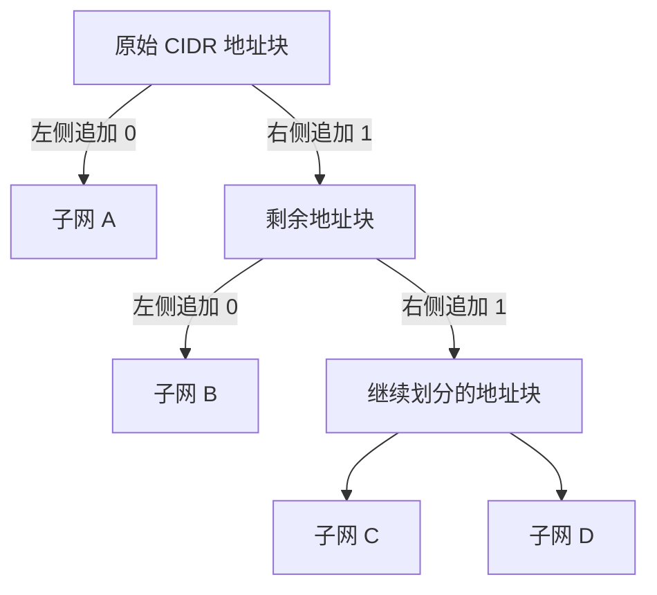

# CIDR 无分类编址与子网划分

## 一、CIDR 的提出与学习重点

### 1. CIDR 的提出背景

CIDR（Classless Inter-Domain Routing，无分类域间路由选择）技术于 **1993 年**提出。

当时，互联网开始在民用领域快速发展，越来越多的用户和设备接入互联网。在传统方式下，每台需要接入互联网的主机都需要消耗一个全球唯一的 IP 地址，因此 IP 地址资源逐渐紧张。

为提高 IP 地址资源的利用率，人们提出了 **CIDR 无分类编址技术**。

### 2. 本节学习重点

- 理解无分类编址为什么优于传统的 IP 地址分类方式。
- 掌握 CIDR 地址块的表示方法。
- 掌握 **定长子网划分**与**变长子网划分**。
- 重点掌握变长子网划分的分析方法，以及根据子网前缀配置路由转发表的方法。

---

## 二、传统 IP 地址分类方式的缺陷

### 1. 传统分类方式

早期的 IPv4 地址被划分为 A、B、C、D、E 五类。一个单位（如学校、企业或政府部门）需要接入互联网时，需要申请相应类别的地址块，具体取决于单位内主机的数量。

### 2. 示例：一个单位需要 2000 个 IP 地址

- 一个 C 类地址块的主机号占 **8 个比特**。
- 一个 C 类地址块共有 \(2^8=256\) 个 IP 地址。
- 256 个地址无法满足 2000 台主机的需求，因此该单位需要申请 B 类地址块。
- 一个 B 类地址块包含约 6 万多个 IP 地址，但单位实际只需要 2000 多个地址。

这会导致大量 IP 地址被闲置，造成地址资源浪费。浪费越严重，IP 地址资源耗尽的速度就越快。

### 3. 传统分类方案的问题

| 问题 | 说明 |
|---|---|
| 地址块大小固定 | A、B、C 类地址块能够提供的地址数量相差较大。 |
| 分配不够灵活 | 单位实际需要的地址数量可能处于两个类别的地址块容量之间。 |
| 地址利用率低 | 为满足需求，可能不得不分配远大于实际需求的地址块。 |

**CIDR 的核心思路：取消传统的 A、B、C 等分类方式，让网络前缀长度可以变化，从而更加灵活地分配 IP 地址。**

---

## 三、CIDR 无分类编址

### 1. IP 地址的结构

采用 CIDR 无分类编址后，一个 IP 地址划分为两个部分：

- **网络前缀（Network Prefix）**：标识网络，由地址管理机构分配。
- **主机号（Host ID）**：标识网络中的主机或接口，在分配的地址块内由获得地址块的单位进一步使用和划分。

网络前缀的长度是**可变的**。

```text
┌──────────────────────────────┬────────────────────┐
│           网络前缀           │       主机号       │
│      长度可变，由上级分配    │  剩余低位，用于划分 │
└──────────────────────────────┴────────────────────┘
```

### 2. CIDR 斜线记法

CIDR 地址通常写成：

```text
IP 地址 / 网络前缀长度
```

斜线后面的数字表示网络前缀占多少个比特。

例如，一个 `/21` 地址块表示：

- 网络前缀占 21 个比特；
- 主机号占 \(32-21=11\) 个比特；
- 对应的子网掩码前 21 位为 `1`，后 11 位为 `0`。

```text
网络前缀：11111111 11111111 11111000 00000000
主机号：   前 21 位为网络前缀，末尾 11 位为主机号
```

### 3. 示例：单位需要 2000 个 IP 地址

假设某单位需要约 2000 台主机接入互联网。

可以为该单位分配一个网络前缀长度为 21 位的 CIDR 地址块：

- 网络前缀：21 位；
- 主机号：11 位；
- 地址块总数：\(2^{11}=2048\) 个 IP 地址。

2048 个 IP 地址足以容纳该单位约 2000 台主机（这里计算的是地址块总数；普通 IPv4 子网中网络地址和广播地址通常不能分配给普通主机）。

相较于必须申请一个容量约为 6 万多个地址的 B 类地址块，CIDR 的分配方式更灵活，利用率更高。

### 4. 地址块范围的理解

假设一个 CIDR 地址块的网络前缀已经固定，那么：

- 前面的网络前缀由地址管理机构规定，不能随意更改；
- 后面的主机号部分可以在该地址块内部进行分配；
- 主机号从全 `0` 变化到全 `1`，构成这个地址块的地址范围。

以网络前缀长度为 21 位的地址块为例，剩余 11 位主机号共有 \(2^{11}=2048\) 种组合。

### 5. CIDR 的优点

- 取消传统的 IP 地址分类方式。
- 网络前缀长度可变，地址分配更灵活。
- 能够根据实际需求分配不同大小的地址块。
- 提高 IP 地址资源的利用率，在一定程度上缓解 IP 地址耗尽问题。

---

## 四、定长子网划分

### 1. 基本原理

当一个单位获得 CIDR 地址块后，还可以在内部继续划分多个子网。

**定长子网划分**与传统子网划分的思路相同：从主机号部分取出 \(k\) 个比特作为子网号。

若从可分配的主机号部分取出 \(k\) 位作为子网号，则：

- 子网数量：\(2^k\) 个；
- 每个子网剩余的主机号位数相同；
- 每个子网的地址块大小相同。

```text
原始地址块
┌────────────────┬────────────────────────────┐
│   原网络前缀   │        可分配的主机号      │
└────────────────┴────────────────────────────┘
                         │ 取出 k 位
                         ▼
┌────────────────┬──────────┬─────────────────┐
│   原网络前缀   │  子网号  │    子网内主机号 │
└────────────────┴──────────┴─────────────────┘
```

### 2. 示例：学校划分四个子网

假设某学校获得一个地址块：

- 前 16 个比特是地址管理机构分配的网络前缀；
- 后 16 个比特由学校使用和划分。

若学校采用定长子网划分，并希望划分为 4 个子网：

1. 因为 \(2^2=4\)，所以从主机号中取出 2 位作为子网号。
2. 剩余主机号位数为 \(16-2=14\) 位。
3. 每个子网包含 \(2^{14}=16384\) 个 IP 地址。

因此，四个子网的地址块大小完全相同。

### 3. 定长子网划分的缺点

不同子网的实际地址需求可能不同，但定长划分要求每个子网的地址块大小相同。

例如，学校有四个校区：

- 第一个校区主机很多，可能需要 \(2^{15}\) 个 IP 地址；
- 第四个校区主机较少，可能只需要 \(2^{10}\) 个 IP 地址。

若每个子网都只能分配 \(2^{14}\) 个地址：

- 第四个校区会浪费大量地址；
- 第一个校区分到的地址块又可能不够用。

**定长划分的问题：子网大小固定，难以适应不同子网的实际需求。**

---

## 五、变长子网划分

### 1. 基本原理

为解决定长子网划分不够灵活的问题，人们采用**变长子网划分**。

变长子网划分允许同一个地址块内部的不同子网具有不同的大小。不同子网所使用的网络前缀长度也可以不同。

| 比较项 | 定长子网划分 | 变长子网划分 |
|---|---|---|
| 子网大小 | 相同 | 可以不同 |
| 子网号长度 | 相同 | 可以不同 |
| 地址分配灵活性 | 较低 | 较高 |
| 适用场景 | 各子网需求接近 | 各子网需求差异较大 |

### 2. ISP 分层分配地址的例子

假设某个一级 ISP（互联网服务提供商）从顶级 IP 地址管理机构获得一个地址块。地址块的网络前缀占 6 位，剩余 26 位可由该 ISP 自行分配。

地址块总数为：

\[
2^{26}=67,108,864
\]

也就是约 6700 多万个 IP 地址。

一级 ISP 可以根据各地区的需求，把地址块继续分配给二级 ISP。例如：

- 北京、上海人口较多，对 IP 地址的需求较高，可以获得较大的地址块；
- 青海人口较少，可以获得较小的地址块。

如果某地区获得的地址块网络前缀长度为 9 位，则主机号长度为 \(32-9=23\) 位，地址块大小为：

\[
2^{23}=8,388,608
\]

如果另一个地区获得的地址块网络前缀长度为 11 位，则主机号长度为 \(32-11=21\) 位，地址块大小为：

\[
2^{21}=2,097,152
\]

这样，各级 ISP 都可以继续按照下一级网络的地址需求划分地址块，实现地址资源的分层级管理。

> 核心原则：每往下分配一级，就根据下一级的实际需求，把自己拥有的地址块划分成不同大小的子网。

---

## 六、变长子网划分示例：给不同用户分配地址

### 1. 初始条件

假设“咸鱼电信”从上一级 IP 地址管理机构租用了一个 CIDR 地址块：

- 网络前缀占 27 位；
- 最后 5 位可以由咸鱼电信分配。

因此，咸鱼电信拥有的 IP 地址总数为：

\[
2^5=32
\]

即 32 个 IP 地址。

```text
原始 CIDR 地址块
┌───────────────────────────────┬───────────────┐
│       上级分配的网络前缀      │  咸鱼电信可分配│
│            27 位              │      5 位      │
└───────────────────────────────┴───────────────┘
```

### 2. 第一笔业务：铁柱的网吧，需要 12 个 IP 地址

网吧共有 12 台电脑，每台电脑需要一个 IP 地址，并且所有电脑必须处于同一个子网中。

#### 分配方法

将可分配的 5 位中的最高位取出，作为下一级子网号：

- 该位为 `0`：分配给铁柱的网吧；
- 该位为 `1`：保留给咸鱼电信继续划分。

整个 32 个地址的地址块由此分为两个大小相等的地址块，每个地址块包含 16 个 IP 地址。

铁柱网吧的子网：

- 网络前缀长度：\(27+1=28\) 位；
- 主机号长度：\(32-28=4\) 位；
- 地址块大小：\(2^4=16\) 个 IP 地址。

16 个地址足以满足网吧 12 台电脑的需求。

```text
原始地址块：32 个地址
├── 子网号为 0：16 个地址 → 铁柱网吧（/28）
└── 子网号为 1：16 个地址 → 咸鱼电信继续分配
```

完成第一笔分配后，咸鱼电信还剩下 16 个 IP 地址资源。

### 3. 第二笔业务：旺财家，需要 5 个 IP 地址

旺财家有 5 口人，每人一台电脑，共需要 5 个 IP 地址，而且所有电脑必须位于同一个子网中。

#### 分配方法

从剩余的 16 个地址中，再取出 1 位作为下一级子网号：

- 左侧地址块：该位为 `0`；
- 右侧地址块：该位为 `1`。

每个地址块包含：

\[
2^3=8
\]

个 IP 地址。

分配其中一个 8 地址的地址块给旺财家：

- 网络前缀长度：\(28+1=29\) 位；
- 主机号长度：\(32-29=3\) 位；
- 地址块大小：\(2^3=8\) 个 IP 地址。

#### 为什么 8 个地址最多支持 6 台普通主机？

在普通 IPv4 子网中：

- 主机号全 `0` 的地址表示网络地址；
- 主机号全 `1` 的地址表示广播地址。

这两个地址不能分配给普通主机，因此：

\[
8-2=6
\]

旺财家的子网最多可分配 6 个普通主机地址，足以满足 5 台电脑的需求。

### 4. 第三笔业务：狗剩需要一条路由器直连主机的点对点链路

狗剩家只有一台电脑，但它需要通过一条路由器直连主机的点对点链路接入咸鱼电信。

在这种链路中，需要分别给：

- 路由器接口分配一个 IP 地址；
- 狗剩的主机分配一个 IP 地址。

因此，至少需要两个可分配的 IP 地址。

普通 IPv4 子网需要保留网络地址和广播地址，所以至少要有 2 位主机号：

| 主机号 | 含义 |
|---|---|
| `00` | 网络地址，不能分配给普通节点 |
| `01` | 可分配给一个节点 |
| `10` | 可分配给一个节点 |
| `11` | 广播地址，不能分配给普通节点 |

因此，需要一个主机号为 2 位的子网：

\[
2^2=4
\]

即分配一个包含 4 个 IP 地址的地址块，实际可分配给路由器接口和主机的地址为 2 个。

该子网的网络前缀长度为：

\[
32-2=30
\]

也就是一个 `/30` 地址块。

> 虽然狗剩只有一台主机，但路由器接口也需要一个地址，因此这条点对点链路需要两个可分配地址。按照这里采用的普通 IPv4 子网规则，需要消耗一个包含 4 个地址的 `/30` 地址块。

### 5. 地址分配过程总览

```text
咸鱼电信原始地址块：32 个地址（/27）
│
├── 子网号 0：16 个地址（/28）
│   └── 铁柱网吧：需要 12 个地址
│
└── 子网号 1：剩余 16 个地址
    │
    ├── 再划分出 8 个地址（/29）
    │   └── 旺财家：需要 5 个地址，最多可分配 6 个普通主机地址
    │
    └── 剩余地址继续划分
        └── 狗剩点对点链路：4 个地址（/30），可分配 2 个节点地址
```

地址块大小按 32 → 16 → 8 → 4 逐级减半。每次划分都是从当前可用地址块中再取出 1 位作为新的网络前缀。

### 6. 为什么剩余的 4 个地址不能继续划分成更小的普通子网？

在分配狗剩的 `/30` 地址块后，咸鱼电信还剩下 4 个 IP 地址。

如果再从这 4 个地址中取出 1 位作为网络前缀，主机号就只剩 1 位，只能产生 `0` 和 `1` 两种状态。按照普通 IPv4 子网的网络地址和广播地址规则，这两种地址都不能分配给普通主机，因此无法形成可用的普通子网。

所以，在本例采用的规则下，地址块划分到 `/30` 后，不能再继续划分成可供普通节点使用的更小子网。

---

## 七、变长子网划分与路由转发表

完成子网划分后，需要配置咸鱼电信路由器的转发表，以保证铁柱网吧、旺财家和狗剩都可以接入互联网。

### 1. 路由表项的基本组成

路由表项通常包括：

- 目的网络（网络前缀）；
- 子网掩码或 CIDR 前缀长度；
- 转发接口等转发信息。

路由器收到 IP 数据报后，会将目的 IP 地址与各条路由表项的网络前缀进行匹配。

### 2. 匹配示例

假设路由器收到一个目的地址指向狗剩主机的 IP 数据报。按照示例中的转发表，依次检查：

1. **第一条 `/28` 表项**：比较目的 IP 地址的前 28 位。若网络前缀不一致，则匹配失败。
2. **第二条 `/29` 表项**：比较目的 IP 地址的前 29 位。若网络前缀不一致，则匹配失败。
3. **第三条 `/30` 表项**：比较目的 IP 地址的前 30 位。若网络前缀一致，则匹配成功，并从对应的接口（示例中为 `F3`）转发出去。

这种逐条比较的过程体现了不同长度的网络前缀如何用于区分不同的子网。

### 3. 最长前缀匹配

当路由表中存在多条可能匹配目的 IP 地址的路由时，路由器通常采用**最长前缀匹配**：选择与目的 IP 地址匹配的、网络前缀最长的路由表项。

变长子网划分要求各子网的网络前缀能够明确区分各个地址块。示例中，各子网通过逐级增加网络前缀的方式形成不同的地址范围。

---

## 八、变长子网划分与哈夫曼树的联系

### 1. 相似之处

变长子网划分可以借助二叉树来理解：

- 将原始 CIDR 地址块看作根结点；
- 每次把一个地址块平均分为两半；
- 左分支对应二进制 `0`，右分支对应二进制 `1`；
- 每个叶子结点对应一个最终子网；
- 从根结点走到叶子结点的路径，决定了该子网相对于原始网络前缀增加的子网号。

这种结构与哈夫曼树、哈夫曼编码具有相似之处：可以通过树上的路径表示二进制编码，并使不同叶子对应的编码互不构成前缀关系。

**注意：这里是借助哈夫曼树的结构来理解和构造子网划分方案，并不是说子网划分本身就是哈夫曼编码算法。**

### 2. 从根到叶构造二叉树

数据结构中的哈夫曼树一般按特定规则自底向上构造；本类子网划分题则从原始地址块出发，自顶向下进行划分，因此可以将这个解题思路记作：

**从根到叶构造二叉树。**

构造规则如下：

1. 根结点表示原始 CIDR 地址块。
2. 将地址块拆分为大小相等的左右两部分。
3. 左分支标记为 `0`，右分支标记为 `1`。
4. 若一个地址块还需要继续划分，就将对应结点继续拆分。
5. 最终每个叶子结点对应一个子网。
6. 根据根到叶的路径，可以确定该子网新增的网络前缀位。

### 3. 路径与网络前缀的关系

假设原始 CIDR 地址块的网络前缀长度为 \(p\)，根到某个叶子结点的路径长度为 \(d\)，则：

- 该子网的网络前缀长度为 \(p+d\)；
- 新增加的 \(d\) 位就是路径上的 `0`、`1` 序列；
- 剩余主机号位数为 \(32-(p+d)\)。

例如，一个叶子结点的路径是“右、左”，那么按照“左 `0`、右 `1`”的规则，它新增的子网号就是 `10`。如果原始网络前缀为 27 位，则该子网的网络前缀为 29 位，即原始前缀后追加 `10`。

### 4. 树的高度限制

设原始 CIDR 地址块中可自由分配的主机号有 \(h\) 位。

在本节采用的普通 IPv4 子网规则下，最小子网至少需要保留 2 位主机号，以容纳：

- 网络地址；
- 广播地址；
- 至少两个可分配地址（例如路由器接口和主机）。

因此，新增网络前缀的位数最多为 \(h-2\)，从根到叶的路径长度不应超过 \(h-2\)。

例如，原始地址块有 5 位可分配位时，路径长度最多为 3，最终子网仍保留 2 位主机号。

> 记忆重点：根结点表示原始地址块；左 `0`、右 `1`；叶子结点表示子网；路径越深，网络前缀越长，子网地址块越小。

---

## 九、定长子网划分真题：2017 年第 38 题

### 1. 题意

给定一个网络前缀长度为 16 位的网络，将其划分为 **128 个规模相同的子网**，求每个子网可以分配的最大 IP 地址数。

“规模相同”说明这是定长子网划分。

### 2. 解题步骤

**第一步：计算子网号位数。**

因为：

\[
2^7=128
\]

所以需要从原主机号部分取出 7 位作为子网号。

**第二步：计算每个子网的主机号位数。**

原始主机号有：

\[
32-16=16 \text{ 位}
\]

取出 7 位作为子网号后，剩余：

\[
16-7=9 \text{ 位}
\]

**第三步：计算可分配的最大 IP 地址数。**

每个子网共有：

\[
2^9=512
\]

个 IP 地址。普通 IPv4 子网中，网络地址和广播地址不能分配给普通主机，所以：

\[
2^9-2=512-2=510
\]

### 3. 答案

每个子网可以分配的最大普通主机 IP 地址数为 **510 个**。

---

## 十、变长子网划分真题：2019 年题目

### 1. 题意

给定一个网络前缀长度为 20 位的网络，剩下 12 位可用于子网划分。要求将其划分为 **5 个子网**，求可能出现的最小子网能够分配的 IP 地址数。

做题时不必先把原始网络地址完全转换成二进制。因为原始的前 20 位网络前缀已经确定，划分过程只涉及剩余的 12 位。

### 2. 第一步：确定叶子结点数量

需要得到 5 个子网，每个子网对应二叉树中的一个叶子结点，因此需要构造一棵具有 **5 个叶子结点**的二叉树。

### 3. 第二步：让其中一个子网尽可能小

子网越小，网络前缀越长，对应的叶子结点就越深。

因此，要寻找可能出现的最小子网，可以在构造过程中尽可能加深某个叶子结点，同时保证最终叶子结点总数为 5。

### 4. 第三步：自顶向下构造二叉树

从根结点开始，每次将一个地址块划分成左右两个地址块：

- 左分支对应 `0`；
- 右分支对应 `1`。

可以按下面的过程构造：

1. 根结点向下划分，得到 2 个叶子。
2. 让右侧结点继续划分，得到 3 个叶子。
3. 让左侧的一个叶子继续划分，得到 4 个叶子。
4. 再让最左侧的叶子继续划分，得到 5 个叶子。

最终得到 5 个子网，其中最深的叶子结点代表可能出现的最小子网。

### 5. 第四步：计算最小子网大小

原始网络前缀为 20 位。最深叶子距离根结点 4 层，因此需要追加 4 位子网号。

最小子网的网络前缀长度为：

\[
20+4=24
\]

剩余主机号位数为：

\[
32-24=8
\]

该子网总共有：

\[
2^8=256
\]

个 IP 地址。

扣除网络地址和广播地址后，可分配给普通主机的 IP 地址数为：

\[
2^8-2=256-2=254
\]

### 6. 答案

可能出现的最小子网可分配的普通主机 IP 地址数为 **254 个**。

### 7. 如何写出各子网网络前缀

- 原始网络前缀为题目给定的前 20 位。
- 每个叶子结点的路径决定新增的子网号。
- 路径长度等于新增网络前缀的位数。
- 将路径上的 `0`、`1` 按顺序接到原始网络前缀之后，即可得到该子网的网络前缀。

例如，路径为 `1000` 的叶子结点，其网络前缀就是原始的 20 位前缀后追加 `1000`，总长度为 24 位。

---

## 十一、本节总结

### 1. CIDR 无分类编址

- CIDR 技术于 1993 年提出。
- 取消传统的 A、B、C、D、E 类地址分类。
- 一个 IP 地址分为网络前缀和主机号。
- 网络前缀长度可变。
- CIDR 斜线记法中，斜线后的数字表示网络前缀所占的比特数。
- CIDR 让地址分配更灵活，提高地址资源利用率。

### 2. 定长子网划分

- 从主机号部分取出 \(k\) 位作为子网号。
- 可以划分 \(2^k\) 个子网。
- 每个子网大小相同。
- 若每个子网剩余 \(n\) 位主机号，则地址块大小为 \(2^n\)。
- 对于普通 IPv4 子网，通常可分配给普通主机的地址数为 \(2^n-2\)。

### 3. 变长子网划分

- 不同子网可以具有不同大小的地址块。
- 子网号长度可以不同。
- 可以根据各子网的实际需求分配地址。
- 可以用“从根到叶构造二叉树”的思路辅助分析。
- 左分支对应 `0`，右分支对应 `1`；每个叶子结点对应一个子网。
- 叶子越深，新增的网络前缀越长，子网越小。

### 4. 路由转发表

- 路由表项包含目的网络前缀及相应转发信息。
- 路由器根据目的 IP 地址匹配路由表项。
- 存在多条匹配路由时，通常采用**最长前缀匹配**。

### 5. 特别注意

在普通 IPv4 子网中：

- 主机号全 `0` 的地址表示网络地址；
- 主机号全 `1` 的地址表示广播地址；
- 这两个地址通常不能分配给普通主机使用。

因此，具有 \(n\) 位主机号的普通 IPv4 子网，常见的可分配普通主机地址数量为：

\[
2^n-2
\]

---

## 十二、解题速查表

| 已知条件 | 解题方法 |
|---|---|
| 要划分为 \(N\) 个等大子网 | 找最小的 \(k\)，使 \(2^k\ge N\)；若题目要求恰好为 \(N\) 个且 \(N\) 是 2 的幂，则直接取 \(k=\log_2N\) |
| 等大划分为 \(2^k\) 个子网 | 从原主机号部分取出 \(k\) 位作为子网号 |
| 原前缀为 `/p`，再取出 \(k\) 位子网号 | 新前缀长度为 `/(p+k)` |
| 新前缀长度为 `/p` | 主机号位数为 \(32-p\) |
| 主机号有 \(n\) 位 | 地址块大小为 \(2^n\) |
| 普通 IPv4 子网可分配的主机地址数 | 通常为 \(2^n-2\) |
| 变长划分、给定子网数量 | 将每个子网看作叶子结点，自顶向下拆分地址块 |
| 求可能出现的最小子网 | 在满足叶子结点数量的前提下，寻找路径最深的叶子 |
| 写出变长子网的网络前缀 | 将根到叶路径上的 `0`、`1` 追加到原始网络前缀之后 |
| 路由表有多条匹配项 | 使用最长前缀匹配 |

---

## 十三、变长子网划分示意图

下面的示意图表达“每次将地址块二分，最终叶子结点对应不同大小的子网”的思路。



> 复习时优先掌握：CIDR 斜线记法、定长划分的位数计算、变长划分的二叉树思路、网络地址与广播地址的排除，以及最长前缀匹配。
