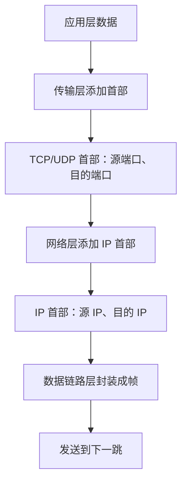
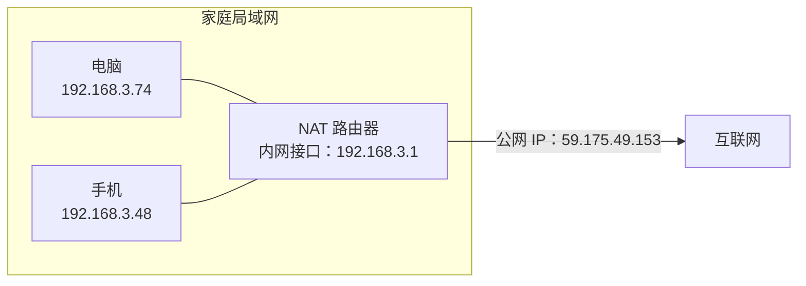
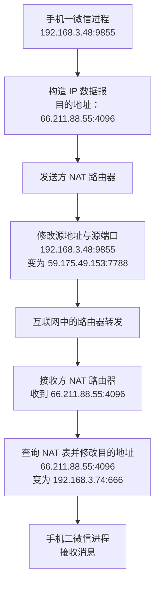
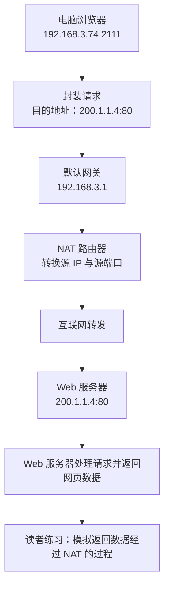
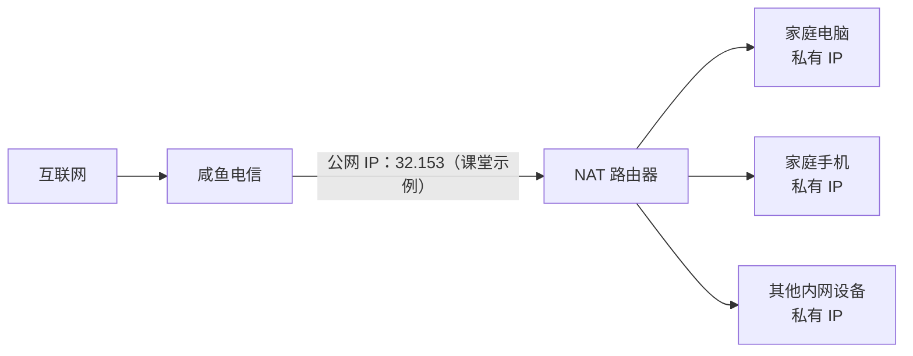

# 网络地址转换（NAT）

## 一、NAT 技术概述

### 1. NAT 的含义

NAT 是 **Network Address Translation（网络地址转换）** 的英文缩写：

- **N（Network）**：网络
- **A（Address）**：地址
- **T（Translation）**：转换

NAT 技术可以让一个局域网内的多台主机共享一个全球唯一的公网 IP 地址，从而缓解 IPv4 地址资源紧缺的问题。

### 2. NAT 技术的提出背景

IPv4 地址和相关技术经历了以下发展过程：

| 时间    | 技术或方案               | 主要目的                                      |
| ------- | ------------------------ | --------------------------------------------- |
| 1981 年 | IPv4                     | 提供网络层寻址与通信能力                      |
| 早期    | A、B、C、D、E 类地址划分 | 对 IPv4 地址进行分类管理                      |
| 1985 年 | 子网划分、子网掩码       | 提高 IP 地址的利用率                          |
| 1993 年 | CIDR（无分类编址）       | 进一步提高 IP 地址的分配与利用效率            |
| 1994 年 | NAT（网络地址转换）      | 让多个内部主机共享公网 IP，缓解 IPv4 地址不足 |

IPv4 地址长度为 32 位，总数为 \(2^{32}\)，约为 42 亿个。互联网快速发展后，手机、电脑、平板、智能手表等设备都需要进行网络通信，原有的地址分配方式难以满足需求，因此提出了 NAT 技术。

家庭网络、学校内部网络等场景通常都会使用 NAT。

---

## 二、端口号：理解 NAT 的基础

NAT 的工作过程会涉及端口号，因此需要先理解端口号的作用。

### 1. 为什么需要端口号

网络层通过 **IP 地址** 定位网络中的主机，但真正进行数据通信的通常是主机上的进程与进程。

例如：

- 小美要给小帅发送一条微信消息。
- 消息本质上是在小美手机上的微信进程与小帅手机上的微信进程之间传递。
- 只使用源 IP 地址和目的 IP 地址，只能定位通信双方的主机，无法进一步精准定位到主机上的指定进程。

因此，传输层引入了**端口号**。

### 2. 端口号的定义与特点

端口号是传输层使用的软件概念，不是计算机上的硬件插口。

- 端口号长度为 **16 位**。
- 每台主机有 \(2^{16}=65536\) 个端口号，编号范围为 **0～65535**。
- 主机可以把某个端口分配给自己的某个进程。
- 端口号只需要在本机范围内进行区分；不同主机可以使用相同的端口号。

例如：

| 主机       | 进程 | 端口号示例 |
| ---------- | ---- | ---------: |
| 小帅的手机 | 微信 |       1234 |
| 小美的手机 | 微信 |        666 |
| 小超的手机 | QQ   |       1234 |

小帅和小超可以分别把自己的 1234 端口分配给不同进程，因为端口号在不同主机上相互独立。

### 3. IP 地址与端口号如何定位进程

- **IP 地址**：定位网络中的某一台主机。
- **端口号**：定位该主机上的某个特定进程。
- **IP 地址 + 端口号**：共同定位网络中的某个特定进程。

```text
IP 地址
  └── 定位一台主机
        └── 端口号
              └── 定位该主机上的特定进程
```

### 4. 传输层首部与网络层首部

应用层数据交给传输层后，传输层会为数据添加首部：

- 使用 TCP 时，添加 TCP 首部。
- 使用 UDP 时，添加 UDP 首部。
- TCP、UDP 首部中都包含**源端口号**和**目的端口号**。

随后，数据交给网络层。IPv4 会为数据添加 IP 首部，其中包含：

- **源 IP 地址**
- **目的 IP 地址**

例如，小帅的微信进程向小美的微信进程发送消息：

| 首部       | 字段         |      示例 | 含义                 |
| ---------- | ------------ | --------: | -------------------- |
| 传输层首部 | 源端口号     |      1234 | 发送方进程对应的端口 |
| 传输层首部 | 目的端口号   |       666 | 接收方进程对应的端口 |
| 网络层首部 | 源 IP 地址   | 发送方 IP | 发送方主机           |
| 网络层首部 | 目的 IP 地址 | 接收方 IP | 接收方主机           |

### 5. 数据封装的层次关系



---

## 三、公网 IP 与私有 IP

### 1. NAT 的核心思路

NAT 的基本思想是：一个局域网内有多台主机，这些主机可以共享一个全球唯一的公网 IP 地址。

局域网内部的每台主机仍然拥有自己的内网 IP 地址。NAT 路由器把内部主机的内网地址和端口映射为公网地址和端口，使外部网络能够识别不同的通信。

例如，一个局域网内有多个进程，可以为不同进程建立不同的端口映射：

- 公网 IP + 1234 → 局域网内的某个进程
- 公网 IP + 2333 → 局域网内的另一个进程
- 公网 IP + 666 → 手机上的游戏进程
- 公网 IP + 888 → 微信进程

**核心目标：让多台内网主机共享一个公网 IP，并借助端口号区分不同的通信。**

### 2. 公网 IP（外网 IP）

公网 IP 也称外网 IP：

- 是全球范围内用于公网寻址的 IP 地址。
- 通常由 ISP（互联网服务提供商）分配。
- 局域网对外通信时，外部网络通常看到的是公网 IP，而不是内部主机的私有 IP。

### 3. 私有 IP（内网 IP）

NAT 技术推出后，互联网技术标准规定了一些只能用于内部网络的特殊 IP 地址。这些地址不能作为公网 IP 使用，可以由不同局域网重复使用。

这些私有 IP 地址只能分配给局域网内部的节点，不能作为公网 IP 使用，而且不同局域网可以重复使用。

在某一个局域网内，分配给各个节点的内网 IP 必须唯一、不重复；但在不同局域网中，可以重复使用同一个私有 IP 地址。

例如，两个不同家庭网络都可以存在 `192.168.3.3` 这台内部主机，因为两个地址分别属于不同的局域网。

### 4. 如何查看自己的公网 IP 和内网 IP

以讲解中的示例为例：

- 通过浏览器搜索“IP 地址”，可以查看当前网络对外使用的公网 IP。
- macOS 可以在系统设置的网络相关页面查看本机 IP 地址。
- Windows 可以在网络设置中查看本机 IP 地址。
- 手机也可以在 Wi-Fi 的网络详情页面查看内网 IP。

讲解中的电脑公网 IP 示例为 `59.175.49.153`，电脑内网 IP 为 `192.168.3.74`。手机和电脑连接同一个 Wi-Fi 时，浏览器查到的公网 IP 相同，但内网 IP 不同。

这说明手机和电脑共享了同一个公网 IP。

### 5. 内网 IP、子网掩码与默认网关

讲解中的家庭网络示例：

| 配置项   | 电脑                    | 手机            |
| -------- | ----------------------- | --------------- |
| 公网 IP  | `59.175.49.153`         | `59.175.49.153` |
| 内网 IP  | `192.168.3.74`          | `192.168.3.48`  |
| 子网掩码 | `255.255.255.0`（示例） | `255.255.255.0` |
| 默认网关 | `192.168.3.1`           | `192.168.3.1`   |

默认网关通常指向家庭路由器的内网接口，相关配置可以通过 DHCP 自动获取。

子网掩码 `255.255.255.0` 中有 24 个二进制位为 1，因此对应 `/24` 网络前缀：

- 电脑：`192.168.3.74`
- 手机：`192.168.3.48`
- 两者的网络前缀都是 `192.168.3`
- 两者的主机号不同，因此它们是同一局域网中的不同主机

### 6. 局域网与公网的关系



---

## 四、NAT 路由器与 NAT 表

### 1. 家用路由器的多种功能

家用路由器通常集成了多种功能，例如：

- 路由器功能
- 交换机功能
- 无线接入点（无线 AP）功能
- NAT 功能

在 NAT 场景下，家用路由器不仅负责转发数据，还会维护内网地址与外网地址之间的映射关系。

### 2. NAT 表的作用

NAT 路由器内部除了路由转发表，还维护着一个重要的数据结构：**NAT 表**。

NAT 表记录内网 IP、内网端口与外网 IP、外网端口之间的映射关系。

| 内网 IP 地址   | 内网端口 | 外网 IP 地址    | 外网端口          | 对应进程示例 |
| -------------- | -------: | --------------- | ----------------- | ------------ |
| `192.168.3.74` |     2111 | `59.175.49.153` | 由 NAT 路由器分配 | 电脑浏览器   |
| `192.168.3.48` |     9855 | `59.175.49.153` | 由 NAT 路由器分配 | 手机微信     |

> 具体外网端口取决于 NAT 路由器建立的映射。后面的通信示例会单独使用 `7788`、`4096` 等端口号演示转换过程。

### 3. NAT 表如何区分多个内网进程

例如：

- 电脑内网 IP 为 `192.168.3.74`，浏览器进程使用端口 `2111`。
- 手机内网 IP 为 `192.168.3.48`，微信进程使用端口 `9855`。
- NAT 路由器可以把这些内网 IP 与端口组合，分别映射为公网 IP 与不同的外网端口。

外部网络通过公网 IP 和外网端口识别对应的通信；NAT 路由器收到返回数据后，再根据 NAT 表把数据转回相应的内网主机和进程。

### 4. 不同局域网可以重复使用相同的内网 IP

例如，两个家庭网络中都可以有一台内网 IP 为 `192.168.3.3` 的电脑。

原因是：

- 私有 IP 只需要在各自局域网内部唯一。
- 不同局域网可以重复使用同一个私有 IP 地址。
- 两个局域网对外通信时，分别通过各自 NAT 路由器使用不同的公网 IP。

---

## 五、NAT 路由器转发数据的完整过程

下面通过手机一的微信向手机二的微信发送文字消息的例子，理解 NAT 路由器如何修改 IP 地址和端口号。

### 1. 示例网络与端口

假设：

| 项目                            | 示例值          |
| ------------------------------- | --------------- |
| 发送方手机一内网 IP             | `192.168.3.48`  |
| 发送方微信进程内网端口          | `9855`          |
| 发送方家庭网络公网 IP           | `59.175.49.153` |
| 发送方 NAT 路由器分配的外网端口 | `7788`          |
| 接收方家庭网络公网 IP           | `66.211.88.55`  |
| 接收方 NAT 路由器暴露的外网端口 | `4096`          |
| 接收方手机二内网 IP             | `192.168.3.74`  |
| 接收方微信进程内网端口          | `666`           |

发送方手机并不知道接收方微信进程使用的内网 IP 和内网端口。对于外部网络，接收方可被访问的信息是其对外暴露的公网 IP 和外网端口，即 `66.211.88.55:4096`。

> 上述数值用于还原讲解中的示例。真实应用通常还会结合应用服务器、连接建立过程及其他网络机制完成通信。
>
> 讲解中还提到，微信进程如何知道另一个微信进程的 IP 地址和端口号？一种思路是通过腾讯的服务器查询对方信息：微信应用可以预先知道服务器的固定 IP 地址，再向服务器查询目标用户的通信信息。现实中的微信消息通常还涉及服务器转发和离线消息存储，例如接收方关机时，消息可以先存储在服务器上，等接收方重新登录后再推送。为了突出 NAT 的地址转换原理，课堂示例暂时假设两个微信进程直接通信。

### 2. 数据发送前的封装

假设手机一的微信要发送“在吗？”这条消息：

1. 应用层产生消息数据。
2. 传输层使用 TCP，并添加 TCP 首部，其中包含源端口号和目的端口号。
3. 网络层使用 IPv4 封装数据报，添加源 IP 地址和目的 IP 地址。
4. 数据链路层把 IP 数据报封装成帧。
5. 手机根据默认网关配置，把帧发送给 NAT 路由器。

此时，发送方构造的 IP 数据报信息如下：

| 字段         | 值                              |
| ------------ | ------------------------------- |
| 源 IP 地址   | `192.168.3.48`（发送方内网 IP） |
| 目的 IP 地址 | `66.211.88.55`（接收方公网 IP） |
| 源端口号     | `9855`（发送方微信进程端口）    |
| 目的端口号   | `4096`（接收方对外暴露的端口）  |

**注意：**目的端口不是接收方手机上的 `666`，而是接收方 NAT 路由器对外暴露的端口 `4096`。接收方的内网 IP 和内网端口对外部发送方不可直接见到。

### 3. 发送方 NAT 路由器处理数据

IP 数据报到达发送方 NAT 路由器后，路由器根据 NAT 表进行地址转换。

数据从内网发往外网时，发送方 NAT 路由器修改：

- **源 IP 地址**：从内网 IP 改为公网 IP。
- **源端口号**：从内网端口改为 NAT 路由器分配的外网端口。

转换前后对比如下：

| 字段         | 转换前         | 转换后          |
| ------------ | -------------- | --------------- |
| 源 IP 地址   | `192.168.3.48` | `59.175.49.153` |
| 源端口号     | `9855`         | `7788`          |
| 目的 IP 地址 | `66.211.88.55` | `66.211.88.55`  |
| 目的端口号   | `4096`         | `4096`          |

NAT 路由器完成转换后，将数据报发送到互联网。随后，数据报经过互联网中的路由器转发，到达接收方 NAT 路由器。

### 4. 接收方 NAT 路由器处理数据

接收方 NAT 路由器收到数据报后，根据目的公网 IP 和目的外网端口查询 NAT 表，再把数据转发给相应的内网主机和进程。

数据从外网发往内网时，接收方 NAT 路由器修改：

- **目的 IP 地址**：从接收方公网 IP 改为接收方手机的内网 IP。
- **目的端口号**：从外网端口改为手机微信进程的内网端口。

| 字段         | 转换前          | 转换后          |
| ------------ | --------------- | --------------- |
| 源 IP 地址   | `59.175.49.153` | `59.175.49.153` |
| 源端口号     | `7788`          | `7788`          |
| 目的 IP 地址 | `66.211.88.55`  | `192.168.3.74`  |
| 目的端口号   | `4096`          | `666`           |

完成转换后，接收方 NAT 路由器根据目的内网 IP 将数据报转发给手机二。手机二的传输层根据目的端口号 `666`，把数据交给微信进程，微信进程最终收到“在吗？”这条消息。

### 5. NAT 转发过程图



### 6. 发送方向与地址转换规则总结

| 数据方向    | NAT 路由器主要修改的字段 | 转换方式                        |
| ----------- | ------------------------ | ------------------------------- |
| 内网 → 外网 | 源 IP 地址、源端口号     | 内网 IP/端口 → 公网 IP/外网端口 |
| 外网 → 内网 | 目的 IP 地址、目的端口号 | 公网 IP/外网端口 → 内网 IP/端口 |

---

## 六、训练二：手机二向手机一发送图片

可以模仿前面的例子，画图模拟手机二的微信向手机一的微信发送图片的过程。

重点检查以下信息在经过 NAT 路由器时如何变化：

1. 源 IP 地址与源端口号。
2. 目的 IP 地址与目的端口号。
3. 从内网发往外网时，发送方 NAT 路由器如何改写源地址和源端口。
4. 从外网发往内网时，接收方 NAT 路由器如何改写目的地址和目的端口。

通过手动模拟数据流动，可以进一步理解 NAT 表的作用。

---

## 七、训练三：电脑浏览器访问外网 Web 服务器

### 1. 场景设定

假设电脑一的浏览器进程需要向哔哩哔哩（Bilibili）服务器发送请求：

- 电脑一位于启用了 NAT 的家庭局域网中。
- 电脑一的内网 IP 为 `192.168.3.74`。
- 电脑浏览器进程的内网端口为 `2111`。
- 家庭 NAT 路由器的内网地址为 `192.168.3.1`。
- 哔哩哔哩服务器直接配置公网 IP，没有使用 NAT。
- Web 服务器进程端口为 `80`。
- 服务器公网 IP 示例为 `200.1.1.4`。

### 2. 浏览器请求的封装

浏览器准备好请求数据后，数据会依次经过传输层和网络层：

**传输层 TCP 首部：**

| 字段       | 值     |
| ---------- | ------ |
| 源端口号   | `2111` |
| 目的端口号 | `80`   |

**网络层 IP 首部：**

| 字段         | 值             |
| ------------ | -------------- |
| 源 IP 地址   | `192.168.3.74` |
| 目的 IP 地址 | `200.1.1.4`    |

随后，数据报被封装成数据链路层帧，并发送给默认网关 `192.168.3.1`，也就是家庭 NAT 路由器。

### 3. NAT 路由器转换源地址

由于数据报从内网发往外网，NAT 路由器会根据 NAT 表，使用内网 IP 和内网端口查找对应的映射，并将：

- 源 IP 地址从 `192.168.3.74` 改为家庭网络的公网 IP。
- 源端口号从 `2111` 改为 NAT 路由器分配的外网端口。

然后，路由器把数据报转发到互联网。

数据报经过互联网中的路由器层层转发，最终到达服务器 `200.1.1.4`。由于服务器所在网络没有使用 NAT，数据报可根据目的 IP 地址直接送达该服务器。

服务器再根据目的端口号 `80`，将请求交给 Web 服务器进程处理。

### 4. 服务器返回网页数据

Web 服务器收到请求后，会向浏览器返回网页数据。返回过程需要由读者继续模拟，重点分析返回数据经过 NAT 路由器时，目的 IP 地址和目的端口号如何被映射回电脑浏览器进程。

### 5. 训练三流程图



---

## 八、NAT 路由器与普通路由器的区别

### 1. NAT 路由器的特点

NAT 路由器维护 NAT 表，记录内网 IP、内网端口与公网 IP、外网端口之间的映射关系。

- 数据从内网发往外网时，NAT 路由器修改**源 IP 地址和源端口号**。
- 数据从外网发往内网时，NAT 路由器修改**目的 IP 地址和目的端口号**。
- NAT 路由器需要识别和处理传输层端口信息。

### 2. 普通路由器的特点

普通路由器在转发 IP 数据报时，通常依据目的 IP 地址进行路由选择，不会像 NAT 路由器那样改写 IP 地址与传输层端口之间的映射关系。

### 3. 对比表

| 对比项           | NAT 路由器                     | 普通路由器                               |
| ---------------- | ------------------------------ | ---------------------------------------- |
| 主要功能         | 路由转发，并进行网络地址转换   | 路由转发                                 |
| 是否维护 NAT 表  | 是                             | 不需要 NAT 时通常没有此表                |
| 是否修改 IP 地址 | 会按映射规则修改相关 IP 地址   | 正常路由转发时通常不修改源、目的 IP 地址 |
| 是否处理端口映射 | 会                             | 普通路由转发通常不进行 NAT 端口映射      |
| 涉及的协议层次   | 需要处理网络层与传输层相关字段 | 路由转发主要依据网络层信息               |

因此，NAT 路由器的功能不只涉及网络层，还需要处理传输层的端口信息；普通路由器的基本转发功能主要位于网络层及以下。

---

## 九、综合理解：给局域网引入 NAT

继续使用课堂中的“咸鱼电信”示例：

- 咸鱼电信为狗剩家的网络提供公网 IP `32.153`（课堂示例中的写法）。
- 如果狗剩家的网络只有一台直接使用公网 IP 的主机，那么公网 IP 对应的就是这台主机。
- 如果把这台主机替换为 NAT 路由器，就可以让公网 IP 背后连接一个规模较大的内部局域网。
- 局域网内部的各个节点拥有各自的内网 IP，但这些节点可以共享同一个公网 IP。



基于这张图，可以继续练习模拟：

- 手机的微信进程与铁柱电脑上的微信进程通信。
- 家庭电脑的浏览器进程与哔哩哔哩服务器上的 Web 服务器进程通信。

---

## 十、考点回顾

### 1. 必须掌握的概念

- **NAT**：Network Address Translation，网络地址转换。
- **公网 IP（外网 IP）**：由 ISP 等分配、用于公网通信的全球唯一地址。
- **私有 IP（内网 IP）**：供局域网内部使用，可以在不同局域网中重复使用。
- **端口号**：传输层的软件概念，用于定位主机上的进程。
- **NAT 表**：记录内网 IP/端口与公网 IP/端口之间映射关系的数据结构。
- **默认网关**：主机向其他网络发送数据时，通常先交付数据的下一跳设备，家庭网络中通常是路由器。

### 2. 数据经过 NAT 路由器时，哪些字段会改变？

| 方向        | 地址转换前                                 | 地址转换后                             |
| ----------- | ------------------------------------------ | -------------------------------------- |
| 内网 → 外网 | 源 IP = 内网 IP；源端口 = 内网端口         | 源 IP = 公网 IP；源端口 = 外网映射端口 |
| 外网 → 内网 | 目的 IP = 公网 IP；目的端口 = 外网映射端口 | 目的 IP = 内网 IP；目的端口 = 内网端口 |

### 3. 关键理解

1. 网络层使用 IP 地址定位主机；传输层使用端口号定位主机上的进程。
2. 不同局域网可以重复使用相同的私有 IP，但同一局域网内的主机地址需要保持唯一。
3. 多台内网主机可以通过 NAT 共享一个公网 IP。
4. NAT 路由器依靠 NAT 表维护内网地址、端口与外网地址、端口之间的映射关系。
5. 数据从内网发往外网时，重点关注**源 IP 地址和源端口号**的转换。
6. 数据从外网发往内网时，重点关注**目的 IP 地址和目的端口号**的转换。
7. 理解 NAT 最有效的方法之一，是亲自画图，逐步跟踪 IP 地址和端口号在每一跳的变化。

---

## 十一、复习练习

建议对照示意图，分别画出下列通信过程，并在每个阶段写出源 IP、目的 IP、源端口、目的端口：

- [ ] 手机一微信向手机二微信发送文字消息。
- [ ] 手机二微信向手机一微信发送图片。
- [ ] 电脑浏览器向外部 Web 服务器请求网页。
- [ ] 外部 Web 服务器向电脑浏览器返回网页数据。

每个练习都按照以下顺序梳理：

1. 应用层产生数据。
2. 传输层填写源端口与目的端口。
3. 网络层填写源 IP 与目的 IP。
4. 数据报到达发送方 NAT 路由器。
5. 查询 NAT 表，转换源 IP 与源端口。
6. 数据报经过互联网转发。
7. 数据报到达接收方 NAT 路由器。
8. 查询 NAT 表，转换目的 IP 与目的端口。
9. 数据报到达目标主机，并由目标端口对应的进程接收。
