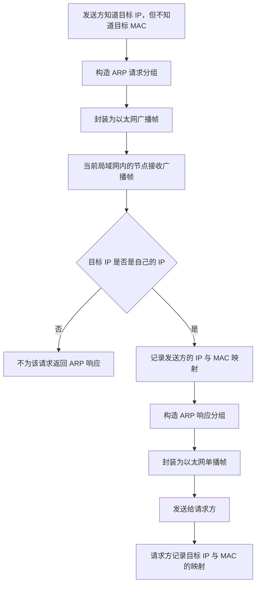
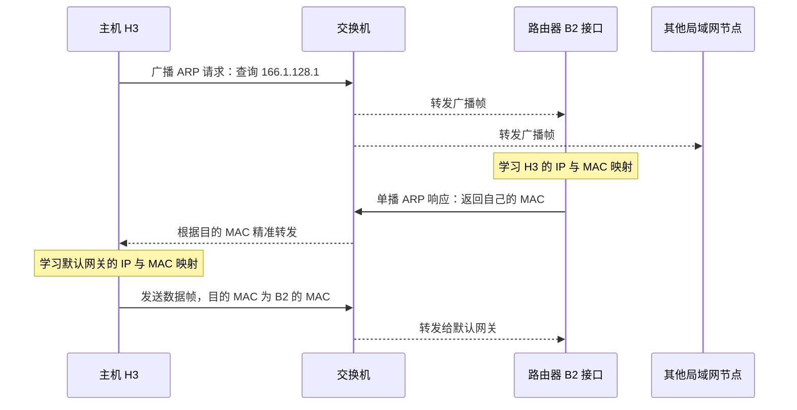
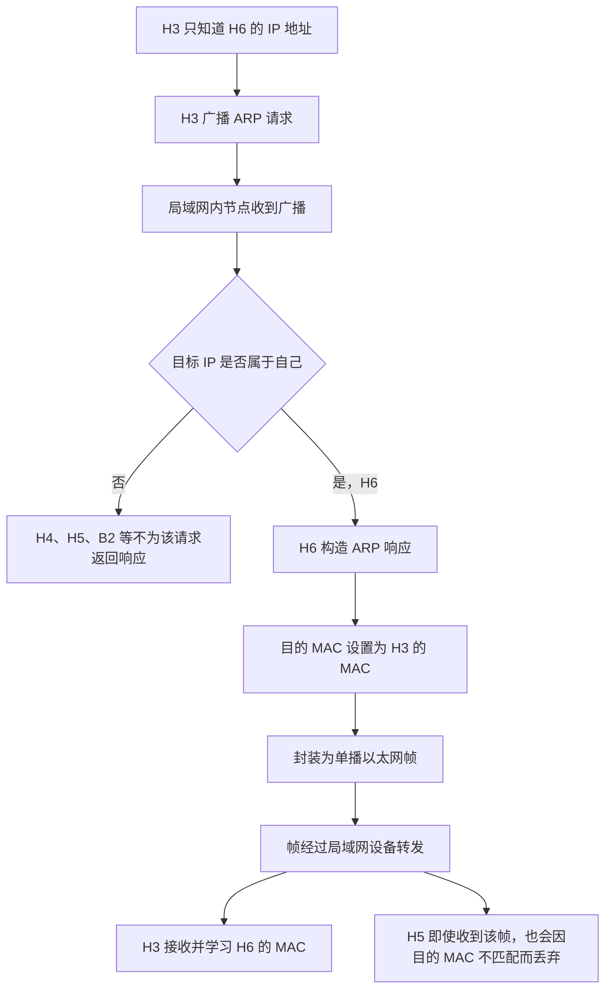

# ARP 地址解析协议学习笔记

> **主题：** 地址解析协议（ARP）  
> **核心作用：** 在同一局域网内，根据已知的 IPv4 地址查询对应的 MAC 地址。  
> **学习主线：** ARP 与以太网帧的关系 → ARP 表 → ARP 请求与响应 → 三个训练案例 → ARP 分组格式与考点。

---

## 一、ARP 协议的作用

### 1. 什么是 ARP

ARP 是 **Address Resolution Protocol（地址解析协议）** 的缩写。

ARP 用于查询同一网络内，某个 IP 地址对应的 MAC 地址。它解决的是 **IP 地址与 MAC 地址之间的映射问题**。

例如：

- 已知目标节点的 IP 地址；
- 但不知道这个节点的 MAC 地址；
- 就可以通过 ARP 请求查询；
- 目标节点收到请求后，通常通过 ARP 响应返回自己的 MAC 地址。

> **注意：** ARP 主要用于解析本地链路上的下一跳 MAC 地址。若目标 IP 位于其他网络，主机通常解析的是默认网关的 MAC 地址，而不是远端主机的 MAC 地址。

### 2. ARP 分组与 IP 分组

ARP 协议定义了 **ARP 分组**；IP 协议定义了 **IP 分组（IP 数据报）**。两者是不同的数据结构，但都可以被交给数据链路层，再封装到以太网 MAC 帧中。

```text
                    数据链路层封装
                           │
           ┌───────────────┴───────────────┐
           │                               │
       ARP 分组                         IP 分组
           │                               │
           ▼                               ▼
    封装成以太网帧                  封装成以太网帧
   类型字段 = 0x0806               类型字段 = 0x0800
```

以太网帧的类型字段用于标识帧的数据部分承载的协议：

| 类型字段（十六进制） | 表示的数据  |
| -------------------- | ----------- |
| `0x0800`             | IPv4 数据报 |
| `0x0806`             | ARP 分组    |

### 3. 以太网 MAC 帧格式回顾

以太网 MAC 帧的基本格式可以表示为：

```text
┌─────────────┬─────────────┬────────┬────────────────┬─────────────┐
│ 目的 MAC 地址│ 源 MAC 地址 │ 类型   │ 数据 / 填充    │ FCS 校验码  │
│   6 字节     │   6 字节    │ 2 字节 │ 46～1500 字节  │   4 字节    │
└─────────────┴─────────────┴────────┴────────────────┴─────────────┘
```

总长度表达式：

\[
6 + 6 + 2 + n + 4 \quad \text{字节}
\]

其中：

- 目的 MAC 地址：6 字节；
- 源 MAC 地址：6 字节；
- 类型字段：2 字节；
- 数据字段：\(n\) 字节，通常为 46～1500 字节；
- FCS 帧检验序列：4 字节。

如果数据字段携带 IPv4 数据报，类型字段设置为 `0x0800`；如果携带 ARP 分组，类型字段设置为 `0x0806`。

**关键考点：** ARP 分组本身只有 28 字节，小于以太网数据字段的最小长度 46 字节，因此封装到以太网帧时，需要填充到至少 46 字节。

---

## 二、MAC 地址与广播帧

### 1. MAC 地址的基本特点

- MAC 地址总长为 **48 比特（6 字节）**。
- 通常由网络适配器（网卡）使用。
- 网络适配器通常在出厂时被分配 MAC 地址。
- 一台主机至少有一个网络适配器，因此通常至少有一个 MAC 地址。
- 路由器具有多个转发接口，每个接口通常都有自己的网络适配器和 MAC 地址，因此路由器可以拥有多个 MAC 地址。

### 2. 广播 MAC 地址

当以太网帧的目的 MAC 地址为全 1 时，表示这是一个广播帧：

```text
FF:FF:FF:FF:FF:FF
```

广播帧会在当前局域网（广播域）内被转发，使该网络内的节点有机会接收到它。

ARP 请求通常封装在广播帧中，因为发起请求的主机还不知道目标节点的 MAC 地址。

### 3. 广播与单播对比

| 方式 | 目的 MAC 地址         | 作用                             |
| ---- | --------------------- | -------------------------------- |
| 广播 | `FF:FF:FF:FF:FF:FF`   | 向当前局域网内广播，寻找目标节点 |
| 单播 | 接收方的具体 MAC 地址 | 将帧发送给指定节点               |

> **记忆口诀：ARP 广播请求，单播响应。**

---

## 三、ARP 表（ARP 缓存）

### 1. ARP 表的作用

ARP 协议还涉及一个重要的数据结构：**ARP 表**，也称为 ARP 缓存。

ARP 表记录 IP 地址与 MAC 地址之间的映射关系。每台主机、每个路由器通常都维护自己的 ARP 表。

| IP 地址        | 对应的 MAC 地址     |
| -------------- | ------------------- |
| 某个 IPv4 地址 | 与其对应的 MAC 地址 |

### 2. ARP 表的维护

- 主机或路由器刚接入网络时，ARP 表可能为空。
- 当节点通过 ARP 请求或响应了解到 IP 地址与 MAC 地址的对应关系时，可以将其记录到 ARP 表中。
- ARP 缓存中的表项会根据实现和配置进行更新、老化或删除，以避免长期保留过时的映射关系。

### 3. 为什么收到 ARP 请求后，也可能更新 ARP 表

当节点收到 ARP 请求时，请求分组中通常已经包含发送方的 IP 地址和 MAC 地址。

因此，接收方可以顺便记录发送方的映射关系。这样以后若需要与发送方通信，就可能直接查 ARP 表，而不必再次发起解析请求。

```text
收到 ARP 请求
      │
      ▼
读取发送方 IP 地址和 MAC 地址
      │
      ▼
更新 / 学习 ARP 表项
      │
      ▼
判断请求中的目标 IP 是否是自己
      │
      ├── 是 → 返回 ARP 响应
      │
      └── 否 → 通常不为该请求返回响应
```

---

## 四、ARP 的工作过程

### 1. 用“在人群中找人”理解 ARP

假设你想在人群中找到“三年二班的咸鱼同学”，但不知道这个人是谁。

1. 你在整个人群中大声询问：“三年二班的咸鱼同学，你在哪儿？”
2. 人群中的所有人都有机会听到这句话。
3. 如果咸鱼同学听到了，就会告诉你：“我就是你要找的人。”
4. 对方在回应中提供能够确认身份的信息。

ARP 的过程类似：

- **ARP 请求分组：** 说明“我是谁”以及“我要找哪个 IP 地址”。
- **ARP 响应分组：** 目标节点确认自己的 IP 地址，并返回自己的 MAC 地址。

### 2. ARP 请求分组包含什么信息

发起查询的节点需要提供两类关键信息：

**我是谁：**

- 发送方 IP 地址；
- 发送方 MAC 地址。

**我想找谁：**

- 目标 IP 地址；
- 请求的目标 MAC 地址在请求中通常未知，因此该字段会以未解析的形式填写。

ARP 请求被封装到以太网帧中时，帧的目的 MAC 地址通常设置为广播地址 `FF:FF:FF:FF:FF:FF`。

### 3. ARP 请求与响应的总体流程



### 4. 请求与响应对照表

| 对比项           | ARP 请求                                                 | ARP 响应                             |
| ---------------- | -------------------------------------------------------- | ------------------------------------ |
| 主要目的         | 查询某个 IP 对应的 MAC 地址                              | 返回查询结果                         |
| 以太网帧目的地址 | 广播 MAC 地址                                            | 请求方的 MAC 地址                    |
| 发送方式         | 通常为广播                                               | 通常为单播                           |
| 主要信息         | 发送方 IP、发送方 MAC、目标 IP                           | 发送方 / 目标方的 IP 与 MAC 映射信息 |
| 谁处理           | 当前局域网内的节点都可能收到；目标 IP 对应的节点作出响应 | 请求方接收并更新自己的 ARP 表        |

---

## 五、训练一：H3 访问 Internet 前，先解析默认网关的 MAC 地址

### 1. 场景与问题

假设主机 H3 要向 Internet 上的某个节点发送 IP 数据报。

H3 已经配置了默认网关的 IP 地址，但还不知道默认网关的 MAC 地址。图中默认网关对应路由器的 B2 接口，示例地址为：

- H3 的 IP 地址：`166.1.128.2`
- B2 接口的 IP 地址：`166.1.128.1`
- H3 的 MAC 地址：示例以 `...:33` 结尾
- B2 接口的 MAC 地址：示例以 `...:B2` 结尾

> 为便于阅读，示例 MAC 地址只突出显示末尾字段；完整 MAC 地址应为 6 个字节（48 比特）。

### 2. 为什么 H3 要找默认网关的 MAC 地址

当目标 IP 位于 Internet 等外部网络时，H3 不会直接通过本地以太网把帧发送给远端主机，而是先把数据帧交给本网络内的默认网关。

因此：

- IP 数据报的目的 IP 地址仍然是 **Internet 上最终目标的 IP 地址**；
- 以太网帧的目的 MAC 地址则是 **默认网关 B2 接口的 MAC 地址**。

但 H3 目前不知道 B2 的 MAC 地址，所以需要先通过 ARP 解析。

### 3. 第一步：H3 广播 ARP 请求

H3 构造 ARP 请求分组，主要内容如下：

| 字段            | 示例内容           |
| --------------- | ------------------ |
| 发送方 IP 地址  | `166.1.128.2`      |
| 发送方 MAC 地址 | `...:33`           |
| 目标 IP 地址    | `166.1.128.1`      |
| 目标 MAC 地址   | 尚不知道，等待解析 |

随后，H3 将 ARP 请求分组封装成以太网帧：

| 以太网帧字段  | 内容                              |
| ------------- | --------------------------------- |
| 目的 MAC 地址 | `FF:FF:FF:FF:FF:FF`（广播）       |
| 源 MAC 地址   | H3 的 MAC 地址（示例末尾为 `33`） |
| 类型字段      | `0x0806`（ARP）                   |
| 数据字段      | ARP 请求分组及必要的填充          |

交换机收到广播帧后，会将其转发到除接收端口之外的其他相关端口。因此，B2、H4、H5、H6 等同一广播域内的节点都可能收到该帧。

只有发现请求中的目标 IP 地址是自己的节点，才会为该请求返回 ARP 响应。

### 4. 第二步：B2 学习 H3 的映射并返回响应

B2 收到 ARP 请求后，可以从请求中读取 H3 的 IP 地址和 MAC 地址，因此可以把这条映射记录到自己的 ARP 表中：

| IP 地址       | MAC 地址                          |
| ------------- | --------------------------------- |
| `166.1.128.2` | H3 的 MAC 地址（示例末尾为 `33`） |

接着，B2 构造 ARP 响应分组，告诉 H3：

- 自己的 IP 地址是 `166.1.128.1`；
- 自己的 MAC 地址是 B2 接口的 MAC 地址（示例末尾为 `B2`）。

B2 将 ARP 响应分组封装成单播以太网帧：

| 以太网帧字段  | 内容                                  |
| ------------- | ------------------------------------- |
| 目的 MAC 地址 | H3 的 MAC 地址（示例末尾为 `33`）     |
| 源 MAC 地址   | B2 接口的 MAC 地址（示例末尾为 `B2`） |
| 类型字段      | `0x0806`（ARP）                       |
| 数据字段      | ARP 响应分组                          |

交换机根据目的 MAC 地址，将该单播帧转发给 H3。

### 5. 第三步：H3 更新 ARP 表并发送数据

H3 收到 ARP 响应后，就知道默认网关的 IP 地址与 MAC 地址之间的映射关系，并将其记录在自己的 ARP 表中。

此后，H3 再向 Internet 发送 IP 数据报时，可以直接查 ARP 表，使用 B2 接口的 MAC 地址作为以太网帧的目的 MAC 地址。

### 6. 训练一流程图



> **训练一结论：** 当 H3 要访问外部网络且还不知道默认网关的 MAC 地址时，先通过 ARP 广播查询默认网关的 MAC 地址；得到响应后，再把发往外部网络的 IP 数据报封装成目的 MAC 地址为网关 MAC 地址的以太网帧。

---

## 六、训练二：Internet 发往 H3 的 IP 数据报

### 1. 场景与问题

基于训练一的结果，假设路由器与 H3 的 ARP 表中已经存在相关表项。现在，有一个 IP 数据报从 Internet 发往 H3。

其目的 IP 地址是 H3 的地址，例如：

`166.1.128.2`

### 2. 路由器如何转发

路由器收到 IP 数据报后，先查询路由转发表，确定应该从哪个接口转发。在本例中，假设最终通过 B2 接口转发到 H3 所在的网络。

准备在下一段链路上发送数据时，路由器需要把 IP 数据报封装成以太网帧。此时：

1. 路由器已知下一跳的 IP 地址；
2. 查询自己的 ARP 表；
3. 如果表中有相应映射，就可以得到 H3 的 MAC 地址；
4. 将 H3 的 MAC 地址填入以太网帧的目的 MAC 地址；
5. 将 B2 接口自己的 MAC 地址填入源 MAC 地址；
6. 发送该帧，由交换机转发给 H3。

### 3. IP 地址与 MAC 地址在转发中的变化

| 项目                 | 本例中的含义                            |
| -------------------- | --------------------------------------- |
| IP 数据报目的 IP     | H3 的 IP 地址 `166.1.128.2`             |
| 以太网帧目的 MAC     | H3 的 MAC 地址                          |
| 以太网帧源 MAC       | 路由器 B2 接口的 MAC 地址               |
| 是否需要再次广播 ARP | 若路由器 ARP 表中已有有效表项，则不需要 |

**关键理解：** ARP 表负责 IP 地址到 MAC 地址的映射查询；路由转发表负责决定 IP 数据报应该从哪个接口转发。两者作用不同，不能混淆。

---

## 七、训练三：H3 向同一局域网中的 H6 发送 IP 数据报

### 1. 场景

假设 H3 想向 H6 发送 IP 数据报，但 H3 只知道 H6 的 IP 地址，不知道 H6 的 MAC 地址。

H3 需要先解析 H6 的 MAC 地址。示例中，H6 的 IP 地址以课程讲解中的 `150.1` 为线索；完整 IP 地址应以题目拓扑或原课件为准。

### 2. ARP 请求过程

1. H3 构造 ARP 请求分组，将自己的 IP 地址和 MAC 地址填入请求中。
2. 将 ARP 请求分组封装到目的 MAC 地址为 `FF:FF:FF:FF:FF:FF` 的广播帧中。
3. 广播帧经交换机 / 集线器所在的局域网传播。
4. 路由器 B2、H4、H5、H6 等节点可能收到该广播帧。
5. 由于只有 H6 的 IP 地址与 ARP 请求中的目标 IP 地址匹配，因此 H6 返回 ARP 响应。

### 3. ARP 响应与集线器、交换机的区别

H6 返回 ARP 响应时，会将其封装为目的 MAC 地址为 H3 的 MAC 地址的单播帧。

但要注意网络设备的转发行为：

- **集线器（Hub）：** 不根据目的 MAC 地址进行智能转发，会把收到的信号向其他端口转发。因此，H5 也可能收到 H6 发出的单播帧。
- **交换机（Switch）：** 根据 MAC 地址表进行转发。如果已知目的 MAC 地址对应的端口，通常会将单播帧转发到对应端口。

即使 H5 收到了这个单播帧，若目的 MAC 地址不是 H5 自己的 MAC 地址，H5 的数据链路层通常会丢弃该帧，不再处理其中的 ARP 响应内容。

### 4. 训练三流程图



> **训练三易错点：**  
> H6 回复的是单播帧，但由于路径中可能存在集线器，其他主机（如 H5）也可能在物理层收到该帧。是否“收到帧”和是否“接收并处理帧”不是一回事。H5 检查发现目的 MAC 地址不是自己后，会丢弃该帧。

---

## 八、ARP 分组格式（拓展）

> 课程说明：这一部分属于拓展内容，考试通常不要求把所有字段都掌握到很深的程度；但理解分组长度以及请求 / 响应字段，有助于分析以太网帧的填充问题。

### 1. ARP 分组的长度

在以太网承载 IPv4 的常见 ARP 格式中，ARP 分组长度为 **28 字节**。

可以按下表理解主要字段：

| 字段                  |        长度 | 说明                          |
| --------------------- | ----------: | ----------------------------- |
| 硬件类型（HTYPE）     |      2 字节 | 指明硬件地址类型              |
| 协议类型（PTYPE）     |      2 字节 | 指明协议地址类型              |
| 硬件地址长度（HLEN）  |      1 字节 | MAC 地址长度，常见为 6        |
| 协议地址长度（PLEN）  |      1 字节 | IPv4 地址长度，常见为 4       |
| 操作码（OPER）        |      2 字节 | 区分请求与响应                |
| 发送方硬件地址（SHA） |      6 字节 | 发送方 MAC 地址               |
| 发送方协议地址（SPA） |      4 字节 | 发送方 IPv4 地址              |
| 目标硬件地址（THA）   |      6 字节 | 目标 MAC 地址                 |
| 目标协议地址（TPA）   |      4 字节 | 目标 IPv4 地址                |
| **合计**              | **28 字节** | 常见 Ethernet / IPv4 ARP 分组 |

### 2. 操作码（OPER）

操作码用于区分 ARP 分组的类型：

| 操作码 | 含义     |
| -----: | -------- |
|    `1` | ARP 请求 |
|    `2` | ARP 响应 |

### 3. 发送方与目标方地址字段

ARP 分组的地址字段可按“谁在询问、想找谁”来理解：

| 字段                  | 含义                                |
| --------------------- | ----------------------------------- |
| SHA（发送方硬件地址） | 发起方的 MAC 地址                   |
| SPA（发送方协议地址） | 发起方的 IP 地址                    |
| THA（目标硬件地址）   | 目标方的 MAC 地址；请求时通常尚未知 |
| TPA（目标协议地址）   | 想查询的目标 IP 地址                |

在 ARP 请求中，发送方的 IP 和 MAC 地址会提供给局域网内的节点；目标 IP 地址用于判断哪个节点应当回应。目标 MAC 地址在请求时通常未知。目标节点返回 ARP 响应时，会在响应中提供自己的 MAC 地址。

### 4. ARP 分组的字段示意

```text
┌──────────────────────────────┐
│ 硬件类型 HTYPE       2 字节   │
├──────────────────────────────┤
│ 协议类型 PTYPE       2 字节   │
├──────────────────────────────┤
│ HLEN  1 字节 │ PLEN  1 字节   │
├──────────────────────────────┤
│ 操作码 OPER          2 字节   │
├──────────────────────────────┤
│ 发送方 MAC 地址 SHA  6 字节   │
├──────────────────────────────┤
│ 发送方 IP 地址 SPA   4 字节   │
├──────────────────────────────┤
│ 目标 MAC 地址 THA    6 字节   │
├──────────────────────────────┤
│ 目标 IP 地址 TPA     4 字节   │
└──────────────────────────────┘
总长度：28 字节
```

---

## 九、重要考点：ARP 分组的填充

### 1. 为什么需要填充

ARP 分组长度为 28 字节，但以太网 MAC 帧的数据字段最短需要达到 46 字节。

因此：

\[
46 - 28 = 18 \text{ 字节}
\]

在常见 Ethernet / IPv4 ARP 场景中，ARP 分组需要补充 **18 字节填充数据**，使以太网帧的数据字段达到 46 字节的最小长度。

### 2. 长度关系

| 项目                     |    长度 |
| ------------------------ | ------: |
| ARP 分组                 | 28 字节 |
| 以太网数据字段的最小长度 | 46 字节 |
| 最少需要填充             | 18 字节 |

```text
以太网帧的数据字段
┌────────────────────────────┬────────────────────┐
│ ARP 分组：28 字节           │ 填充：至少 18 字节 │
└────────────────────────────┴────────────────────┘
                 合计 46 字节
```

### 3. 命题角度

如果题目告诉你：

- 一个 ARP 分组长度为 28 字节；
- 该分组被封装到以太网 MAC 帧中；

那么可以进一步考查：是否需要填充、需要填充多少字节，以及以太网帧各字段的长度。

**本节务必记住：**

- 以太网帧的基本字段长度为：`6 + 6 + 2 + n + 4` 字节；
- 数据字段长度通常为 46～1500 字节；
- Ethernet / IPv4 ARP 分组通常为 28 字节；
- 当 28 字节 ARP 分组放入以太网数据字段时，至少需要填充 18 字节。

---

## 十、考前速记

| 知识点                            | 结论                                                                  |
| --------------------------------- | --------------------------------------------------------------------- |
| ARP 的作用                        | 根据 IPv4 地址解析对应的 MAC 地址                                     |
| ARP 表                            | 缓存 IP 地址与 MAC 地址的映射关系                                     |
| ARP 请求                          | 通常封装在广播帧中                                                    |
| ARP 响应                          | 通常封装在单播帧中                                                    |
| 广播 MAC 地址                     | `FF:FF:FF:FF:FF:FF`                                                   |
| MAC 地址长度                      | 48 比特，即 6 字节                                                    |
| IPv4 以太网类型字段               | `0x0800`                                                              |
| ARP 以太网类型字段                | `0x0806`                                                              |
| ARP 请求操作码                    | `1`                                                                   |
| ARP 响应操作码                    | `2`                                                                   |
| 常见 Ethernet / IPv4 ARP 分组长度 | 28 字节                                                               |
| 以太网数据字段最小长度            | 46 字节                                                               |
| 28 字节 ARP 分组的最少填充量      | 18 字节                                                               |
| 访问外部网络时的目的 MAC          | 通常是默认网关接口的 MAC，而非远端主机的 MAC                          |
| 路由器与交换机                    | 路由器依据路由信息转发 IP 数据报；交换机依据 MAC 地址信息转发以太网帧 |
| 集线器与交换机                    | 集线器向其他端口转发信号；交换机通常按 MAC 地址表转发单播帧           |

### 最后用一句话串起整个过程

**主机知道目标 IP、但不知道下一跳 MAC 时，先用广播 ARP 请求查询；目标节点用单播 ARP 响应返回 MAC；请求方更新 ARP 表后，就能把后续 IP 数据报封装成目的 MAC 正确的以太网帧。**
