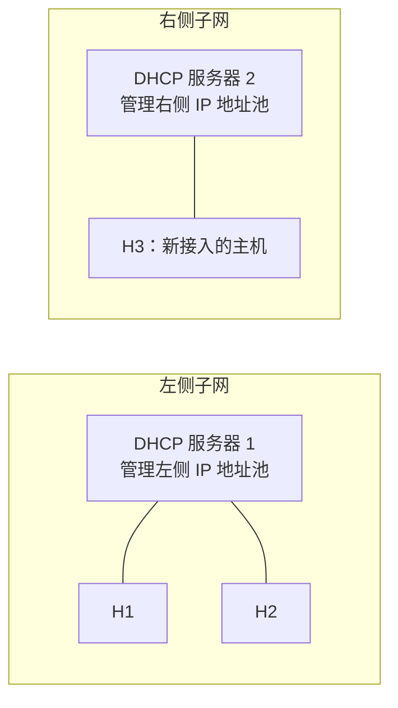
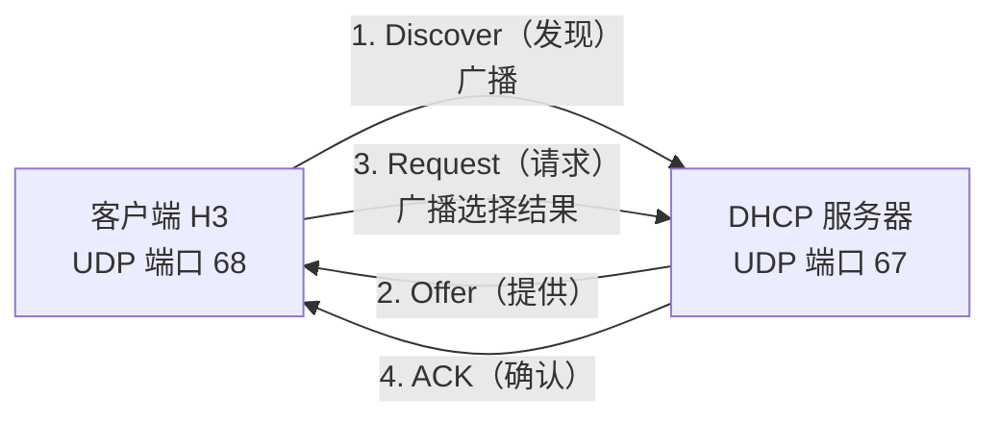
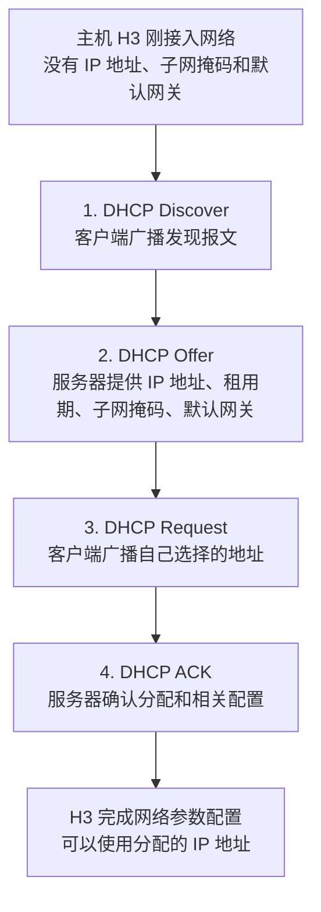

# 动态主机配置协议（DHCP）学习笔记

> **核心考点**
>
> 1. DHCP 的作用、协议层次及其所使用的传输层协议。
> 2. DHCP 的客户—服务器模型，以及客户端与服务器的 UDP 端口号。
> 3. DHCP 动态分配 IP 地址的四个步骤：Discover、Offer、Request、ACK。
> 4. 四个 DHCP 报文在 UDP、IP 和 MAC 帧中的封装方式，尤其是源/目的 IP 地址与源/目的 MAC 地址。
> 5. DHCP 服务器管理 IP 地址池、租用期、子网掩码和默认网关等内容。

---

## 一、DHCP 的作用与协议层次

### 1. DHCP 的作用

DHCP（Dynamic Host Configuration Protocol，动态主机配置协议）用于在主机接入网络时，**自动配置网络通信所需的参数**。

一台主机刚接入网络时，可能还没有 IP 地址，也没有配置子网掩码、默认网关等信息。DHCP 可以自动为主机分配和配置这些参数。

主要包括：

- **IP 地址**：标识主机在网络层的地址。
- **子网掩码**：用于区分网络部分和主机部分。
- **默认网关**：主机访问其他网络时，通常将数据交给默认网关转发。
- **租用期**：主机可以使用所分配 IP 地址的时间期限。

### 2. DHCP 属于哪一层？

DHCP **属于应用层协议**，使用传输层的 UDP 协议提供的服务。

考研大纲通常把 DHCP 放在网络层相关内容中学习，是因为 DHCP 的主要用途是为网络层通信初始化和配置相关参数；但这并不改变 DHCP 的应用层协议属性。

| 协议层次   | 在 DHCP 通信中的作用                    |
| ---------- | --------------------------------------- |
| 应用层     | DHCP 定义 DHCP 报文及其内容             |
| 传输层     | 使用 UDP 传输 DHCP 报文                 |
| 网络层     | 使用 IP 数据报承载 UDP 数据报           |
| 数据链路层 | 使用链路层协议（如以太网）封装成 MAC 帧 |

### 3. DHCP 报文的逐层封装

DHCP 报文从应用层向下传输时，会逐层封装：

```text
DHCP 报文（应用层）
        ↓ 封装到 UDP 中
UDP 数据报（传输层）
        ↓ 封装到 IP 数据报中
IP 数据报（网络层）
        ↓ 封装到 MAC 帧中
MAC 帧（数据链路层）
```

也就是说，DHCP 报文作为一个整体被封装进 UDP 数据报；UDP 数据报再被封装进 IP 数据报；IP 数据报最后被封装进 MAC 帧。

---

## 二、DHCP 服务器与 IP 地址池

### 1. 每个子网的地址资源由谁管理？

可以把学校网络理解为由两个相互独立的局域网（子网）组成。不同子网中的 IP 地址资源不同，通常会为各子网配置 DHCP 服务，由相应的 DHCP 服务器管理该子网的 IP 地址池。



- 左侧 DHCP 服务器负责管理左侧子网的地址资源。
- 右侧 DHCP 服务器负责管理右侧子网的地址资源。
- 不同 DHCP 服务器管理的地址池可以不同，各自负责分配自己管辖范围内的 IP 地址。
- 一个较大的局域网中可以存在多台 DHCP 服务器。
- 在家庭网络中，家用路由器通常会兼任 DHCP 服务器；路由器内部可以运行 DHCP 服务器进程。

### 2. `/17` 子网与可分配地址

在示例中，每个子网的网络前缀占 **17 个比特**，剩余 **15 个比特**为主机部分。

- 左侧子网的第 17 个网络前缀比特为 `0`。
- 右侧子网的第 17 个网络前缀比特为 `1`。
- DHCP 服务器从自己管理的 IP 地址池中选择空闲地址分配给主机。
- 主机部分全为 `0` 和全为 `1` 的两个特殊地址，不能分配给普通主机作为其单播主机地址。

`/17` 对应的子网掩码为：

```text
11111111.11111111.10000000.00000000
   255  .   255  .   128  .    0
```

即：

**255.255.128.0**

原讲解中的示例地址如下：

- 左侧子网：网络前缀前 16 个比特可记为 `116.1`，第 17 个比特为 `0`。示例中，左侧 DHCP 服务器使用 `116.1.0.9`，H1 使用 `116.1.0.1`，H2 使用 `116.1.4.2`；这些地址均由左侧 DHCP 服务器从自己的地址池中管理和分配。
- 右侧子网：第 17 个网络前缀比特为 `1`，由右侧 DHCP 服务器管理自己的地址池。原讲解把准备分配给 H3 的空闲地址口头简写为 `128.2`，把默认网关地址口头简写为 `128.1`；此处保留原讲解的简写，不擅自补全为四段式 IPv4 地址。

---

## 三、DHCP 的客户—服务器模型

DHCP 采用客户—服务器模型（Client/Server，简称 C/S）。

- **DHCP 客户端（Client）**：需要获取 IP 地址等网络配置参数的主机。本例中是新接入网络的 H3。
- **DHCP 服务器（Server）**：负责管理 IP 地址池，并向客户端提供网络配置参数的设备。
- **UDP 端口号**：
  - DHCP 服务器端：**67**
  - DHCP 客户端：**68**

客户端与服务器之间通过 UDP 交换 DHCP 报文，最终完成 IP 地址、子网掩码和默认网关等参数的配置。

---

## 四、DHCP 动态分配地址的四个步骤

DHCP 获取 IP 地址的过程通常概括为 **DORA 四步**：

1. **Discover（发现）**：客户端广播 DHCP 发现报文。
2. **Offer（提供）**：服务器向客户端提供可用的 IP 地址及相关配置。
3. **Request（请求）**：客户端广播请求报文，说明自己选择接受哪一个地址。
4. **ACK（确认）**：服务器返回确认报文，确认配置。



### 第一步：客户端发送 DHCP Discover（发现报文）

H3 刚接入网络时：

- 已经拥有自己的 MAC 地址。
- 尚未获得 IP 地址。
- 尚未配置子网掩码和默认网关。
- 不知道 DHCP 服务器的 IP 地址和 MAC 地址。

因此，H3 需要通过广播方式寻找 DHCP 服务器。DHCP Discover 报文中会包含客户端的 MAC 地址，让服务器知道是哪一台主机正在申请配置。

#### Discover 报文的封装

| 所在层次   | 字段          | 设置方式                                                                          | 原因                                            |
| ---------- | ------------- | --------------------------------------------------------------------------------- | ----------------------------------------------- |
| 应用层     | DHCP 报文     | DHCP Discover（发现报文），包含客户端 MAC 地址等信息（示例：`AA:BB:CC:DD:EE:33`） | 向网络请求 DHCP 配置服务                        |
| 传输层     | UDP 源端口    | `68`                                                                              | 发送方是 DHCP 客户端                            |
| 传输层     | UDP 目的端口  | `67`                                                                              | 接收方是 DHCP 服务器进程                        |
| 网络层     | 源 IP 地址    | `0.0.0.0`                                                                         | 客户端暂时还没有自己的 IP 地址                  |
| 网络层     | 目的 IP 地址  | `255.255.255.255`                                                                 | 广播到本地网络                                  |
| 数据链路层 | 源 MAC 地址   | H3 自己的 MAC 地址                                                                | H3 已经拥有 MAC 地址                            |
| 数据链路层 | 目的 MAC 地址 | `FF:FF:FF:FF:FF:FF`                                                               | 以太网广播地址，客户端还不知道服务器的 MAC 地址 |

其中，`0.0.0.0` 表示本主机当前尚未配置可用的 IP 地址；`255.255.255.255` 是受限广播地址；`FF:FF:FF:FF:FF:FF` 是以太网广播 MAC 地址。

#### 为什么 Discover 要广播？

H3 刚接入网络时，既不知道自己的 IP 地址，也不知道 DHCP 服务器的 IP 地址和 MAC 地址，所以需要通过广播寻找 DHCP 服务器。

#### 网络中的其他主机收到 Discover 后会怎样？

以 H6 为例：

1. H3 发出的广播 MAC 帧会被同一广播域中的主机接收。
2. H6 的数据链路层发现目的 MAC 地址是全 `1`，因此接收该广播帧。
3. H6 拆开 MAC 帧，得到 IP 数据报；目的 IP 地址也是广播地址，因此网络层继续接收并处理。
4. 数据继续到达 UDP 层后，H6 发现 UDP 目的端口为 `67`。
5. 如果 H6 上没有 DHCP 服务器进程监听该端口，这份数据就不会交给普通应用处理，最终被丢弃。

因此，虽然网络中的多个节点都可能收到广播帧，但只有运行 DHCP 服务器服务的节点会处理相应的 DHCP Discover 报文并作出响应。

### 第二步：服务器发送 DHCP Offer（提供报文）

DHCP 服务器收到 Discover 后，会从自己管理的 IP 地址池中选择一个当前空闲的 IP 地址，尝试分配给 H3。

Offer 报文中需要提供的主要信息包括：

- 准备分配给客户端的 IP 地址。
- IP 地址的租用期。
- 客户端所在网络的子网掩码。
- 默认网关的 IP 地址。

例如，原讲解中服务器准备把一个空闲地址（示例中写作 `128.2`）提供给 H3；同时告诉 H3 地址租用期、子网掩码以及默认网关等信息。这里的地址写法沿用原讲解中的口头简写。

#### Offer 报文的封装

| 所在层次   | 字段          | 设置方式                   | 原因                                             |
| ---------- | ------------- | -------------------------- | ------------------------------------------------ |
| 应用层     | DHCP 报文     | DHCP Offer（提供报文）     | 向客户端提供候选 IP 地址和相关配置               |
| 传输层     | UDP 源端口    | `67`                       | 发送方是 DHCP 服务器                             |
| 传输层     | UDP 目的端口  | `68`                       | 接收方是 DHCP 客户端                             |
| 网络层     | 源 IP 地址    | DHCP 服务器自己的 IP 地址  | 服务器已经拥有 IP 地址                           |
| 网络层     | 目的 IP 地址  | `255.255.255.255`          | 客户端尚未完成地址配置，按原讲解使用广播 IP 地址 |
| 数据链路层 | 源 MAC 地址   | DHCP 服务器自己的 MAC 地址 | 标识帧的发送方                                   |
| 数据链路层 | 目的 MAC 地址 | H3 的 MAC 地址             | Discover 已告知服务器客户端的 MAC 地址           |

**注意：Offer 在本例中的封装特点是：网络层使用广播目的 IP 地址，但数据链路层可以使用 H3 的 MAC 地址，因此 MAC 帧是单播帧。**

交换机根据目的 MAC 地址转发该单播帧，使其到达 H3；其他普通节点不会像接收广播帧那样都接收该帧。

#### 什么是 IP 地址租用期？

租用期表示客户端可以使用该 IP 地址的时间期限。租用期快到期时，主机可以向 DHCP 服务器申请续租，以继续使用该地址。

### 第三步：客户端发送 DHCP Request（请求报文）

客户端可能收到多个 DHCP 服务器发送的 Offer。H3 需要明确告诉网络：**自己最终选择接受哪台服务器提供的哪个 IP 地址**。

因此，H3 发送 DHCP Request 请求报文，说明自己选择的 IP 地址。该报文采用广播方式，使网络中其他 DHCP 服务器也能知道客户端最终作出的选择。

#### 为什么 Request 仍然需要广播？

在一个较大的网络中，可能存在多台 DHCP 服务器。客户端广播 Discover 后，多台服务器可能分别返回 Offer。

假设有两台服务器：

- DHCP 服务器 A 提供一个 IP 地址。
- DHCP 服务器 B 也提供一个 IP 地址。

客户端最终只会选择其中一个地址。客户端通过广播 Request 告知网络中的 DHCP 服务器自己的选择，避免其他服务器误以为自己提供的地址已经被客户端接受。

#### Request 报文的封装

| 所在层次   | 字段          | 设置方式                                                 | 原因                                       |
| ---------- | ------------- | -------------------------------------------------------- | ------------------------------------------ |
| 应用层     | DHCP 报文     | DHCP Request（请求报文），包含客户端选择的 IP 地址等信息 | 告知服务器客户端的选择                     |
| 传输层     | UDP 源端口    | `68`                                                     | 发送方是 DHCP 客户端                       |
| 传输层     | UDP 目的端口  | `67`                                                     | 接收方是 DHCP 服务器                       |
| 网络层     | 源 IP 地址    | `0.0.0.0`                                                | 第四步完成之前，客户端仍未完成 IP 地址配置 |
| 网络层     | 目的 IP 地址  | `255.255.255.255`                                        | 广播告知网络中的 DHCP 服务器               |
| 数据链路层 | 源 MAC 地址   | H3 自己的 MAC 地址                                       | 标识帧的发送方                             |
| 数据链路层 | 目的 MAC 地址 | `FF:FF:FF:FF:FF:FF`                                      | 通过广播告知网络中的 DHCP 服务器           |

**注意：第三步仍使用源 IP 地址 `0.0.0.0`、目的 IP 地址 `255.255.255.255`，并使用广播目的 MAC 地址。** 虽然 H3 已经进入地址申请流程，但在确认过程完成之前，仍不能把该 IP 地址视为已经正式配置完成。

### 第四步：服务器发送 DHCP ACK（确认报文）

DHCP 服务器收到 Request 后，发送 DHCP ACK（确认报文），确认所分配的 IP 地址及相关配置。

ACK 报文中的配置信息与 Offer 中提供的信息基本一致，主要包括：

- 分配的 IP 地址。
- 地址租用期。
- 子网掩码。
- 默认网关。

服务器通过 ACK 确认这些配置。H3 收到确认报文后，便完成 DHCP 地址获取过程，可以正式使用分配到的 IP 地址，并应用子网掩码和默认网关等配置。

#### ACK 报文的封装

| 所在层次   | 字段          | 设置方式                   | 原因                                             |
| ---------- | ------------- | -------------------------- | ------------------------------------------------ |
| 应用层     | DHCP 报文     | DHCP ACK（确认报文）       | 确认 IP 地址及相关配置                           |
| 传输层     | UDP 源端口    | `67`                       | 发送方是 DHCP 服务器                             |
| 传输层     | UDP 目的端口  | `68`                       | 接收方是 DHCP 客户端                             |
| 网络层     | 源 IP 地址    | DHCP 服务器自己的 IP 地址  | 服务器已经拥有 IP 地址                           |
| 网络层     | 目的 IP 地址  | `255.255.255.255`          | 按原讲解，客户端尚未完成该过程时使用广播 IP 地址 |
| 数据链路层 | 源 MAC 地址   | DHCP 服务器自己的 MAC 地址 | 标识帧的发送方                                   |
| 数据链路层 | 目的 MAC 地址 | H3 的 MAC 地址             | 服务器已知客户端 MAC 地址，可使用单播帧          |

**注意：本例中的 ACK 与 Offer 类似，网络层的目的 IP 地址是广播地址，而数据链路层目的 MAC 地址是 H3 的 MAC 地址，因此可以封装为单播 MAC 帧。**

---

## 五、四个 DHCP 报文的地址与端口对照表

这是复习和做题时需要重点掌握的部分。

| DHCP 步骤   | 报文方向        | UDP 源端口 | UDP 目的端口 | 源 IP 地址 | 目的 IP 地址      | 源 MAC 地址 | 目的 MAC 地址               |
| ----------- | --------------- | ---------: | -----------: | ---------- | ----------------- | ----------- | --------------------------- |
| 1. Discover | 客户端 → 服务器 |         68 |           67 | `0.0.0.0`  | `255.255.255.255` | 客户端 MAC  | `FF:FF:FF:FF:FF:FF`（广播） |
| 2. Offer    | 服务器 → 客户端 |         67 |           68 | 服务器 IP  | `255.255.255.255` | 服务器 MAC  | 客户端 MAC（单播）          |
| 3. Request  | 客户端 → 服务器 |         68 |           67 | `0.0.0.0`  | `255.255.255.255` | 客户端 MAC  | `FF:FF:FF:FF:FF:FF`（广播） |
| 4. ACK      | 服务器 → 客户端 |         67 |           68 | 服务器 IP  | `255.255.255.255` | 服务器 MAC  | 客户端 MAC（单播）          |

> **记忆重点**
>
> - DHCP 服务器端口：`67`；客户端端口：`68`。
> - 客户端尚未获得可用 IP 地址时，源 IP 地址使用 `0.0.0.0`。
> - 本例中 Discover、Request 的目的 IP 地址和目的 MAC 地址均为广播地址。
> - 按本例的封装方式，Offer、ACK 的目的 IP 地址为广播地址，但目的 MAC 地址可以是客户端 MAC 地址。
> - Offer 和 ACK 中，服务器作为发送方，源 IP 地址和源 MAC 地址使用服务器自己的地址。
> - 租用期、子网掩码、默认网关等配置会由服务器提供给客户端。

---

## 六、DHCP 工作过程回顾



### 一句话记忆

**发现（Discover）→ 提供（Offer）→ 请求（Request）→ 确认（ACK）**。

DHCP 属于应用层，基于 UDP，使用客户—服务器模型；服务器使用 UDP 端口 `67`，客户端使用 UDP 端口 `68`。学习和做题时，尤其要结合四步流程，判断每一步的源/目的 IP 地址、源/目的 MAC 地址以及广播或单播方式。
