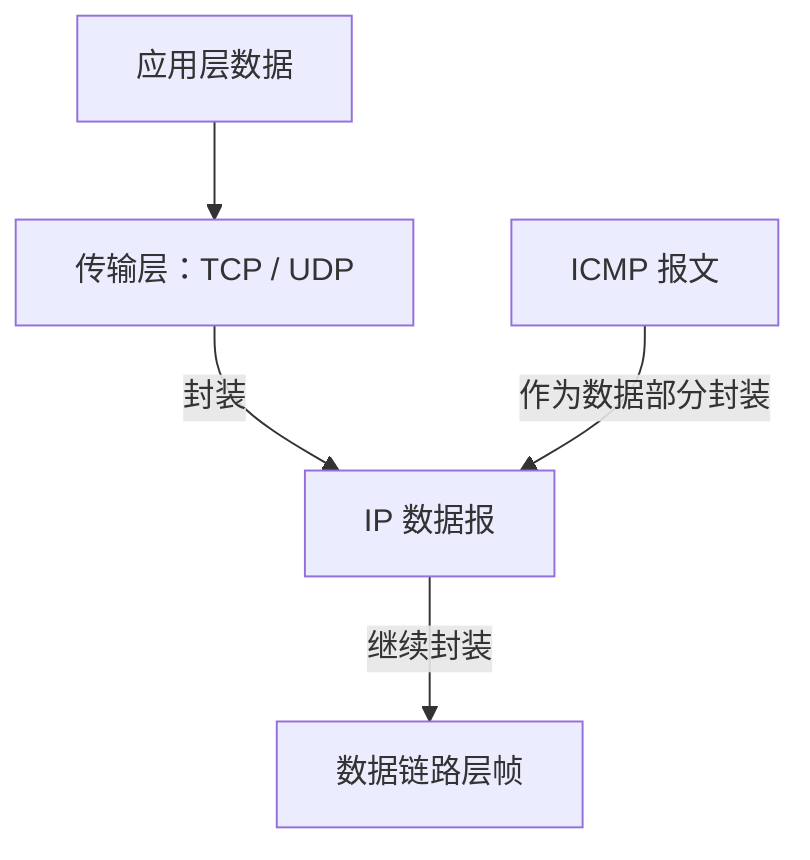
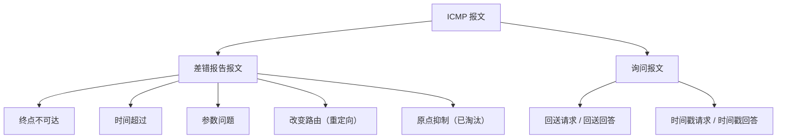
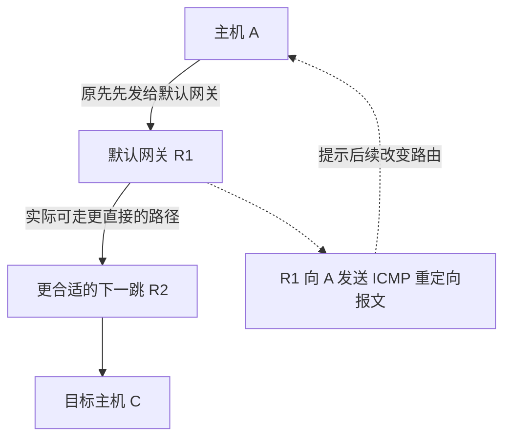
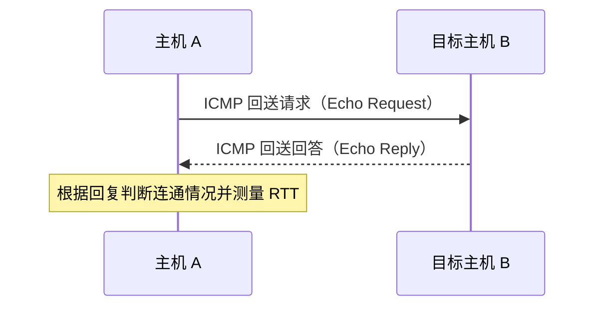

# ICMP 网际控制报文协议

> **复习重点：** ICMP 的协议位置与作用、差错报告报文的常见类型、询问报文的用途、`ping` 与 `traceroute` 的基本原理，以及不发送 ICMP 差错报告报文的特殊情况。

## 一、ICMP 的基本概念

### 1. 名称与协议位置

ICMP 的英文全称是 **Internet Control Message Protocol**，中文通常译为**网际控制报文协议**。考试和技术文献中一般直接使用缩写 **ICMP**。

- **所属层次：** 网络层。
- **封装关系：** ICMP 报文需要封装在 IP 数据报中传输，作为 IP 数据报的数据部分。
- **服务关系：** ICMP 使用 IP 协议提供的服务；换句话说，IP 为 ICMP 报文提供封装和传输服务。



### 2. ICMP 的主要作用

ICMP 主要用于让**主机或路由器报告网络传输过程中出现的差错或异常情况**。

例如，主机 A 向主机 B 发送 IP 数据报时，数据报需要经过多个路由器转发。如果中间的路由器在转发过程中发现异常，或者目的主机收到数据报后发现无法正常处理，就可能通过 ICMP 报文把相关情况反馈给原发送方。

可以把 IP 数据报的传输类比为寄快递：

- 快递在运输过程中破损，运输人员需要向寄件人反馈。
- 快递到达目的地时，发现收件地址或联系方式存在问题，也需要反馈。
- ICMP 就像网络中的异常反馈机制，用于报告这些传输问题。

### 3. ICMP 报文的两大类别

ICMP 报文大体分为两类：

| 类别             | 主要作用                                             | 可以怎样理解                                 |
| ---------------- | ---------------------------------------------------- | -------------------------------------------- |
| **差错报告报文** | 在 IP 数据报传输或处理出现差错时，向原发送方反馈异常 | 先发送数据，发现问题后再报告                 |
| **询问报文**     | 主动询问另一台主机，获取回应或相关信息               | 发送数据前或排查网络时，主动问对方是否有回应 |



### 4. ICMP 报文如何标明类型

ICMP 报文开头有一个 **Type（类型）字段**，占 **1 字节，即 8 bit**，用于标明当前 ICMP 报文属于哪一种类型。

协议会为不同类型的 ICMP 报文定义对应的 Type 值。接收方通过该字段识别报文类别，再按照相应的含义进行处理。

> 讲解中用“类型 1、类型 2、类型 3”等数字举例，是为了说明不同类别可以使用不同编号；理解重点是 **Type 字段负责标识报文类型**。

---

## 二、差错报告报文

差错报告报文用于反馈 IP 数据报在传输或处理过程中发生的异常。可能发现问题的设备既可以是中间路由器，也可以是目的主机。

### 1. 终点不可达（Destination Unreachable）

当 IP 数据报无法到达目的地，或者到达目的主机后无法交付给相应的上层协议或进程时，可能会产生**终点不可达**报文。

#### 情况一：目的主机不存在

假设主机 A 向学校局域网中的地址 `166.1.128.3` 发送 IP 数据报，但该局域网中实际上不存在这台主机。

1. 主机 A 构造 IP 数据报，并将目的 IP 地址设为 `166.1.128.3`。
2. IP 数据报经过多个路由器转发，最终到达学校网络的路由器。
3. 路由器发现目的网络中不存在相应的目的主机，数据报无法继续送达。
4. 路由器构造一个 **ICMP 终点不可达报文**。
5. 该 ICMP 报文被封装在 IP 数据报中，并经过网络转发回主机 A。
6. 主机 A 收到报文后，就能知道目的地址不可达。

#### 情况二：目的端口不存在

IP 数据报可以成功到达主机 B，但主机 B 上没有对应端口的进程，也可能导致无法交付。

例如：

1. 主机 A 向主机 B 发送一个封装了 TCP 或 UDP 数据的 IP 数据报。
2. A 填写的目的端口号为 `666`。
3. IP 数据报经过路由器转发，成功到达主机 B。
4. 主机 B 在处理数据报时，发现没有进程使用端口 `666`，无法将数据交付给相应进程。
5. 主机 B 可以返回 **ICMP 终点不可达报文**，告知主机 A 发生了交付问题。

**记忆重点：** 终点不可达不仅可能表示目的主机或网络不可达，也可能表示数据报到达目的主机后无法交付，例如目的端口不可达。

### 2. 时间超过（Time Exceeded）

时间超过报文主要对应两种情况。

#### 情况一：TTL 减为 0

IP 数据报首部有一个重要字段：**TTL（Time To Live，生存时间）**。按照课程中的讲解，每经过一台路由器转发，TTL 都会减 1。

假设主机 A 发出的 IP 数据报初始 TTL 为 `2`：

1. 数据报经过第一台路由器后，TTL 从 `2` 减为 `1`。
2. 数据报到达第二台路由器，TTL 再减为 `0`。
3. TTL 为 `0` 时，路由器不再继续转发该数据报，而是将其丢弃。
4. 路由器构造 **ICMP 时间超过报文**，反馈给主机 A。
5. 主机 A 收到报文后，可以得知数据报在传输过程中因 TTL 耗尽而被丢弃。


#### 情况二：IP 分片未能在规定时间内到齐

较大的 IP 数据报经过某些链路时，可能因为链路的 **MTU（最大传输单元）** 限制而被分片。

例如，一个 IP 数据报被分成分片 1、分片 2、分片 3，之后各分片可以独立存储转发：

- 分片 1 到达目的主机 B。
- 分片 3 到达目的主机 B。
- 分片 2 在传输过程中丢失或迟迟没有到达。

目的主机 B 不能无限期等待缺失的分片，因此会设置计时器。如果规定时间内分片仍未到齐，就可能：

1. 丢弃已经收到、但尚未完成重组的分片。
2. 构造 **ICMP 时间超过报文**。
3. 将报文发送回原发送方主机 A，告知分片重组等待超时。

**记忆重点：** TTL 耗尽时，中间路由器可能发送时间超过报文；分片重组超时时，目的主机也可能发送时间超过报文。

### 3. 参数问题（Parameter Problem）

参数问题报文用于报告 IP 数据报首部存在异常，例如首部参数不合法或首部校验发现错误。

示例过程：

1. 主机 A 发送 IP 数据报。
2. 某台路由器收到数据报后，检查出 IP 首部存在错误，例如首部校验未通过。
3. 路由器丢弃该 IP 数据报，不再继续转发。
4. 路由器可以构造 **ICMP 参数问题报文**，反馈给主机 A。
5. 主机 A 收到报文后，可以检查自己构造的数据报是否存在首部参数错误。

### 4. 改变路由（重定向，Redirect）

改变路由报文用于向主机提示更合适的转发路径。

假设主机 A 要向主机 C 发送 IP 数据报：

1. 主机 A 当前配置的默认网关是路由器 R1，因此 A 先把数据报发送给 R1。
2. R1 检查目的地址后，发现该数据报实际可以通过同一局域网内的另一台路由器 R2 转发。
3. R1 知道通往目标网络的更合适路径，于是可以向主机 A 发送 **ICMP 改变路由（重定向）报文**。
4. 报文告诉 A：以后若要向相应网络发送数据报，可以改为使用 R2 作为下一跳，而不必继续经过 R1。
5. 主机 A 收到报文后，可以据此调整后续发送该网络数据报时采用的路由。



### 5. 原点抑制（Source Quench）

原点抑制报文曾用于通知数据发送方网络发生拥塞，请求发送方降低发送速率。

例如，网络繁忙时，大量 IP 数据报同时涌向学校的路由器。路由器处理能力有限，可能因负荷过大而丢弃部分数据报。按照原点抑制的设计，路由器可以向发送方返回原点抑制报文，提示网络拥塞，并要求发送方减慢发送速度。

不过，**原点抑制是已经被淘汰的 ICMP 差错类型**。课程中提到，它在 2012 年后已从互联网技术标准中排除；由于 2010 年曾有相关真题，所以仍需了解其基本含义，但不必作为当前重点深入记忆。

现在，网络拥塞控制通常由传输层的 TCP 等机制处理，而不是依靠 ICMP 原点抑制报文。

---

## 三、询问报文

询问报文与差错报告报文的区别在于：询问报文是主动发起的查询，发送方希望对方返回回应或相关信息。

课程重点介绍两组报文：

| 报文对                                                         | 主要用途                                       | 典型应用或理解方式 |
| -------------------------------------------------------------- | ---------------------------------------------- | ------------------ |
| 回送请求（Echo Request）与回送回答（Echo Reply）               | 检查目的主机是否能够回应，辅助判断网络连通情况 | `ping`             |
| 时间戳请求（Timestamp Request）与时间戳回答（Timestamp Reply） | 请求并获取对方记录的时间信息                   | 时间信息查询       |

### 1. 回送请求与回送回答（Echo Request / Echo Reply）

“回送”对应英文 **Echo**，可以理解为回音或回应。

- **回送请求：** 主机 A 请求主机 B 给出回应，相当于询问“你在吗？能收到我的报文吗？”
- **回送回答：** 主机 B 收到请求后，向主机 A 返回回应。

#### 工作过程

1. 主机 A 想测试与主机 B 之间的网络通路是否连通。
2. A 构造 ICMP 回送请求报文，并将其封装在 IP 数据报中；源地址为 A，目的地址为 B。
3. IP 数据报经过路由器转发，到达主机 B。
4. B 识别出该报文是回送请求后，构造 ICMP 回送回答报文。
5. 回送回答报文再次封装在 IP 数据报中，由 B 发回 A。
6. A 收到回应后，可以根据结果判断是否收到了 B 的响应，并测量往返时延。

### 2. `ping` 命令

`ping` 是回送请求和回送回答报文的典型应用。使用者可以在终端中执行类似命令，测试本机与目标主机之间的连通情况：

```bash
ping www.baidu.com
```

基本过程如下：



收到 `ping` 回复后，可以关注以下信息：

- **目标 IP 地址：** 回复来自哪个 IP 地址。
- **TTL：** 回复 IP 数据报到达本机时剩余的 TTL。
- **RTT（往返时延）：** 从发出请求到收到回答所花费的时间。
- **回复情况：** 多次请求的回复情况和 RTT 可能不同，因为网络状态会随时间变化。

#### 根据 TTL 粗略估算经过的路由器跳数

课程中的示例假设目标服务器发送 IP 数据报时，将初始 TTL 设置为 `64`。如果本机收到回应时看到 TTL 为 `52`，则：

\[
64 - 52 = 12
\]

在这个假设下，可以推算该回复数据报在途中经过了约 **12 次路由器转发**。

> **注意：** 这个推算依赖于已知或假设的初始 TTL。不同设备可能采用不同的初始 TTL 值，因此仅凭收到的 TTL，不能在不知道初始值的情况下准确判断跳数。

#### RTT 如何测量

1. 主机 A 发出回送请求时启动计时。
2. 收到主机 B 返回的回送回答时停止计时。
3. 发出请求的时间与收到回答的时间之差，就是此次测得的 RTT。

例如，`ping` 多次发送请求后，会得到多次回复及各自的 RTT。由于网络状况动态变化，各次测量结果可能有上下浮动。

### 3. 时间戳请求与时间戳回答（Timestamp Request / Timestamp Reply）

时间戳请求和时间戳回答也是一对询问报文，其工作流程与回送请求、回送回答类似，但用途不同：**它们用于询问和返回时间信息**。

基本过程：

1. 主机 A 向主机 B 发送时间戳请求报文。
2. B 收到请求后，构造时间戳回答报文。
3. 回答中包含与请求处理有关的时间信息，例如收到请求的时间、发送回答的时间等。
4. A 收到回答后，可以根据这些时间信息进行相关处理。

课程中以联网校准系统时间作为理解示例：主机可以向时间服务器查询时间信息，再据此校准自身时间。

**记忆重点：** 时间戳请求与时间戳回答是一对报文，作用是交换时间信息；回送请求与回送回答则常用于检测网络连通情况。

---

## 四、哪些情况下不发送 ICMP 差错报告报文

并非所有 IP 数据报传输异常都会触发 ICMP 差错报告。课程中需要掌握以下四种特殊情况。

### 1. 对携带 ICMP 差错信息的报文，不再继续反馈新的差错

如果一个 IP 数据报携带的是 ICMP 差错报告信息，那么当它自身又出现差错时，不会再针对这次差错继续生成新的 ICMP 差错报告。

这样可以避免差错报告不断触发新的差错报告，形成重复反馈。

### 2. IP 数据报分片时，避免针对多个分片重复反馈

较大的 IP 数据报可能被分成多个分片。按照课程中的表述，即使相关分片出现问题，也只反馈一次相应的 ICMP 差错，而不是因为多个分片的问题反复发送大量差错报告。

### 3. 目的地址为多播地址时，不反馈 ICMP 差错

多播相当于向一组接收方发送数据，而不是只面向一个接收方。

如果针对多播数据报中的异常，由多个接收方分别返回差错报告，就可能产生大量反馈。因此，目的地址为多播地址的 IP 数据报，不发送相应的 ICMP 差错报告。

可以类比群聊：一个消息发送给整个群组时，如果每个接收者都针对同一消息的问题逐一回复，可能造成大量重复反馈。

### 4. 源地址为特殊地址时，不反馈 ICMP 差错

如果 IP 数据报的源地址是某些特殊地址，例如回环地址或 `0.0.0.0`，即使数据报出现异常，也不发送 ICMP 差错报告。

原因在于：这类源地址不能像普通的、可正常回送的源地址那样可靠地标识外部发送方。

#### 示例：回环地址 `127.0.0.1`

`127.0.0.1` 是回环地址，指向当前计算机自身。

如果主机 A 构造一个数据报，把源地址写成 `127.0.0.1`，再将该数据报发送给同一网络中的另一台主机，那么接收方若要按照这个源地址反馈，`127.0.0.1` 指向的却是接收方自己，而不是实际构造该数据报的主机 A。

因此，这个地址无法作为正常反馈给原始发送方的可靠依据。

#### 示例：源地址 `0.0.0.0`

如果发送方将源地址写成 `0.0.0.0`，接收方也无法通过这个地址正常确定实际发送方，所以不应针对这种数据报生成 ICMP 差错报告。

### 5. 四种特殊情况汇总

| 序号 | 特殊情况                                            | 不发送 ICMP 差错报告的原因或理解方式                     |
| ---- | --------------------------------------------------- | -------------------------------------------------------- |
| 1    | 出错的数据报本身携带 ICMP 差错报告信息              | 避免差错报告继续引发新的差错报告                         |
| 2    | IP 数据报被分片                                     | 避免针对分片问题产生重复的差错反馈；课程表述为只反馈一次 |
| 3    | IP 数据报的目的地址是多播地址                       | 避免多个接收方造成大量反馈                               |
| 4    | IP 数据报的源地址是特殊地址，如回环地址或 `0.0.0.0` | 无法据此可靠地找到原始发送方                             |

---

## 五、典型应用总结：`ping` 与 `traceroute`

### 1. `ping`

- **主要作用：** 测试本机与目标主机之间是否能够通信，并测量往返时延。
- **主要依赖的 ICMP 报文：** 回送请求（Echo Request）和回送回答（Echo Reply）。
- **可观察的信息：** 是否收到回复、目标 IP 地址、TTL、RTT 等。

### 2. `traceroute`

- **主要作用：** 探测到达目的地所经过的路由路径。
- **相关 ICMP 报文：** 时间超过（Time Exceeded）。
- **基本原理：** 通过控制探测 IP 数据报的 TTL，使其在不同的路由器处耗尽；当 TTL 耗尽时，路由器可能返回 ICMP 时间超过报文。分析这些回应，就可以逐步了解传输路径。

> 对于考研复习，先记住 `traceroute` 与 **ICMP 时间超过报文**有关即可。

---

## 六、考前速查表

| ICMP 报文类型           | 关键含义                               | 常见触发场景或作用                        |
| ----------------------- | -------------------------------------- | ----------------------------------------- |
| 终点不可达              | 目的地或交付过程不可达                 | 目的主机不存在、目的端口没有对应进程等    |
| 时间超过                | TTL 耗尽，或分片重组等待超时           | 路由器发现 TTL 为 0；目的主机等待分片超时 |
| 参数问题                | IP 首部参数异常                        | 首部校验错误或参数不合法                  |
| 改变路由（重定向）      | 建议使用更合适的下一跳                 | 路由器提示主机调整后续路由                |
| 原点抑制                | 曾用于通知发送方网络拥塞并要求减慢发送 | 已淘汰，了解含义即可                      |
| 回送请求 / 回送回答     | 请求对方回应 / 对方返回回应            | `ping`，检测连通情况、测量 RTT            |
| 时间戳请求 / 时间戳回答 | 请求并返回时间信息                     | 时间信息查询                              |

## 七、本节核心结论

1. **ICMP 属于网络层**，其报文封装在 IP 数据报中传输，ICMP 使用 IP 提供的服务。
2. ICMP 报文分为**差错报告报文**和**询问报文**两大类。
3. 差错报告报文重点掌握：**终点不可达、时间超过、参数问题、改变路由**；原点抑制属于已经淘汰的类型。
4. 询问报文重点掌握两对：**回送请求与回送回答**、**时间戳请求与时间戳回答**。
5. `ping` 的典型实现依赖**回送请求与回送回答**；`traceroute` 与**时间超过报文**有关。
6. 需要记住不发送 ICMP 差错报告的四种特殊情况：差错报告报文自身相关的差错、IP 分片相关的重复反馈问题、目的地址为多播地址、源地址为特殊地址。
7. 本节在考试中常以选择题形式考查，需要能够区分各类 ICMP 报文的含义、触发条件和典型应用。
