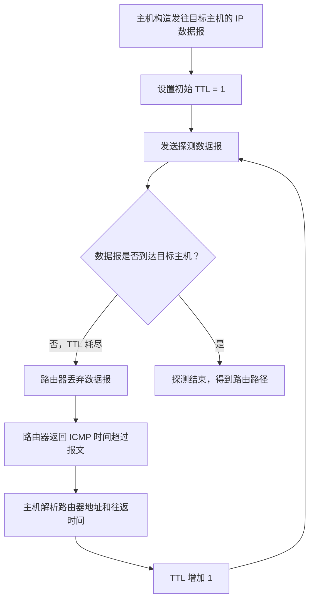

# Traceroute 路由追踪功能的实现原理

## 一、Traceroute 的基本用法

`Traceroute` 用于追踪从本地主机到目标主机之间，数据报经过的路由器路径。

### 1. macOS / Linux

macOS 或 Linux 用户可以在终端中执行：

```bash
traceroute -I www.baidu.com
```

- `-I`：使用 **ICMP 协议**实现路由追踪功能。
- 如果不加 `-I` 参数，`traceroute` 通常会使用 **UDP 协议**进行探测。

### 2. Windows

Windows 用户可以打开命令提示符（CMD），执行：

```cmd
tracert www.baidu.com
```

Windows 下使用 `tracert` 命令，不需要添加 `-I` 参数。

### 3. 命令名称的含义

- `trace`：追踪。
- `route`：路由。

也就是说，`Traceroute` 要追踪的是：**从本机到目标服务器的途中，数据经过了哪些路由器。**

---

## 二、Traceroute 的输出信息

执行路由追踪命令后，程序首先需要把输入的网址解析为服务器的 IP 地址。

### 1. 为什么多次查询得到的 IP 地址可能不同？

例如，之前执行 `ping` 查询百度服务器时，得到的 IP 地址可能是一个地址；这次使用 `traceroute` 查询时，得到的地址又可能发生变化。

这是因为可以把 `www.baidu.com` 理解为一个逻辑地址。这个网址背后可能绑定了多台物理服务器。结合当前的网络负载等情况，访问该网址时，系统可能会分配一台比较合适的服务器。

因此，之前 `ping` 得到的 IP 地址与这次 `traceroute` 得到的服务器 IP 地址可能不同。

### 2. 每一跳代表什么？

Traceroute 的输出通常会显示多行探测结果。例如，输出中的第 1、2、3……13 行，对应探测过程中的不同跳数。

每一跳的结果可以帮助我们了解：

- 途中某一台路由器的 IP 地址；
- 探测数据到达该跳并收到响应所经历的往返时间；
- 路径中哪些节点没有返回可识别的响应。

示例讲解中，数据从本地主机出发，先经过家用路由器，再经过运营商网络中的设备，继续经过中间路由器，最终到达百度服务器。示例总共经过了约 12 台路由器，第 13 跳到达目的节点。

> **注意：** 以上是讲解中的示例现象。实际路径、跳数以及各跳的响应情况会随网络环境而变化。

### 3. 为什么有些跳只显示星号？

某些路由器可能配置了防火墙，或者不返回相应的探测响应，因此 Traceroute 无法显示它们的 IP 地址和往返时间，输出中就可能出现 `*`。

这不一定意味着数据转发失败，也可能只是该设备没有返回探测所需的响应。

---

## 三、Traceroute 的底层原理：利用 ICMP 时间超过报文

Traceroute 的核心原理是：**逐步增大 IP 数据报的 TTL 值，利用路由器返回的 ICMP 时间超过报文，逐跳探测路径。**

### 1. 回顾 TTL 与 ICMP 时间超过报文

IP 数据报中包含 TTL（生存时间）字段。数据报经过路由器时，TTL 会递减。

如果路由器收到一个 IP 数据报，处理后发现其 TTL 已减为 `0`，就会丢弃该数据报，并通常向源主机返回一个 **ICMP 时间超过（Time Exceeded）报文**。

Traceroute 正是利用这一机制，逐步探测沿途路由器。

### 2. 第一步：将 TTL 设置为 1，探测第一跳

本地主机构造一个发往百度服务器的 IP 数据报：

- **源 IP 地址**：本地主机的 IP 地址；
- **目的 IP 地址**：百度服务器的 IP 地址；
- **TTL**：故意设置为 `1`。

当这个数据报到达第一台路由器时，TTL 递减为 `0`。路由器会丢弃该数据报，并向本地主机返回 ICMP 时间超过报文。

本地主机解析该报文后，就可以获知返回响应的路由器 IP 地址，并测得本次探测的往返时间。

```text
本地主机
   |
   | IP 数据报（TTL = 1）
   v
第一台路由器
   |
   | TTL 减为 0，丢弃数据报
   | 返回 ICMP 时间超过报文
   v
本地主机获知第一跳的信息
```

### 3. 为什么每一跳通常会测量多次？

为了获得多次测量结果，主机通常会对同一跳发送多个探测数据报。

例如，输出中可能有三个时间值：

- `4.5 ms`
- `3.5 ms`
- `3.4 ms`

这表示主机进行了三次探测，并分别记录对应的往返时间。具体数值会随网络状态变化。

### 4. 第二步：将 TTL 设置为 2，探测第二跳

当主机获得第一台路由器的信息后，会再次构造发往目标服务器的 IP 数据报，但这次将 TTL 从 `1` 改为 `2`。

数据报经过第一台路由器时，TTL 从 `2` 减为 `1`，因此可以继续转发；当它到达第二台路由器时，TTL 再减为 `0`，第二台路由器就会丢弃数据报，并返回 ICMP 时间超过报文。

主机解析响应后，就能探测到第二台路由器的地址及往返时间。

### 5. 后续步骤：逐渐增大 TTL

后续探测过程与前面相同，只是逐渐增大 TTL：

- TTL 为 `1`：探测第一跳；
- TTL 为 `2`：探测第二跳；
- TTL 为 `3`：探测第三跳；
- 以此类推。

当探测数据最终到达目的主机时，Traceroute 就可以判断探测已经到达目标节点。至此，主机便能逐跳了解从自己到目标主机之间的路由路径。

---

## 四、整体流程图



---

## 五、知识要点总结

| 知识点              | 内容                                             |
| ------------------- | ------------------------------------------------ |
| 功能                | 追踪本地主机到目标主机之间经过的路由器           |
| macOS / Linux 命令  | `traceroute -I www.baidu.com`                    |
| `-I` 参数           | 使用 ICMP 协议进行探测                           |
| 不加 `-I`           | 通常使用 UDP 协议进行探测                        |
| Windows 命令        | `tracert www.baidu.com`                          |
| 核心机制            | 逐步增大 IP 数据报的 TTL                         |
| TTL 耗尽时          | 路由器丢弃数据报，并通常返回 ICMP 时间超过报文   |
| 可获得的信息        | 各跳路由器的地址及探测往返时间                   |
| 出现 `*` 的可能原因 | 路由器未返回探测响应，可能与防火墙或设备配置有关 |

## 六、本节结论

Traceroute 的实现原理可以概括为：

**主机逐步增大探测数据报的 TTL，利用中间路由器返回的 ICMP 时间超过报文，获取每一跳的路由器地址和往返时间，从而追踪到目标主机的路径。**

以上就是 ICMP 时间超过报文在 Traceroute 功能中的应用。
