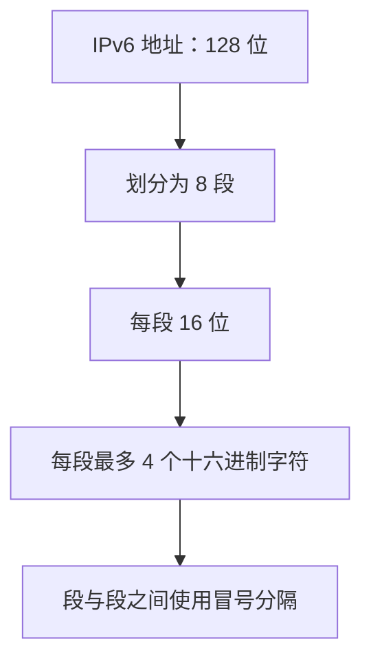
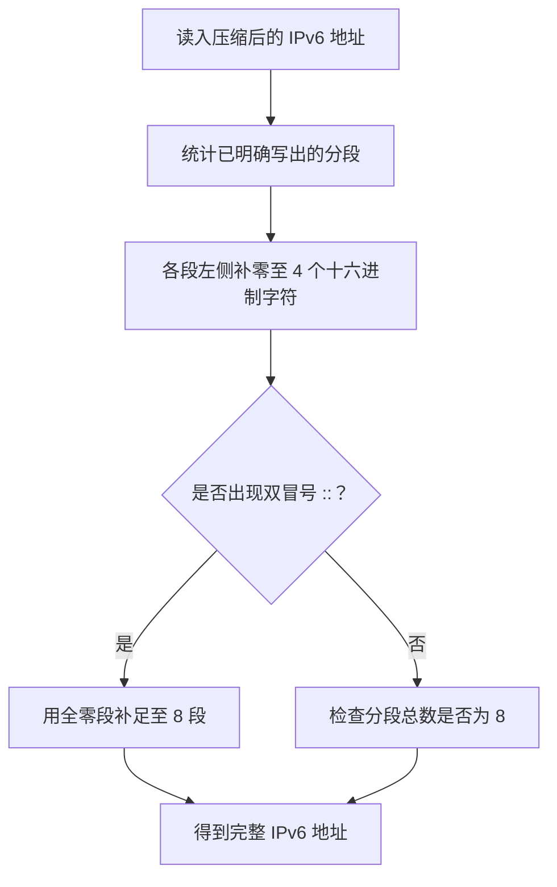
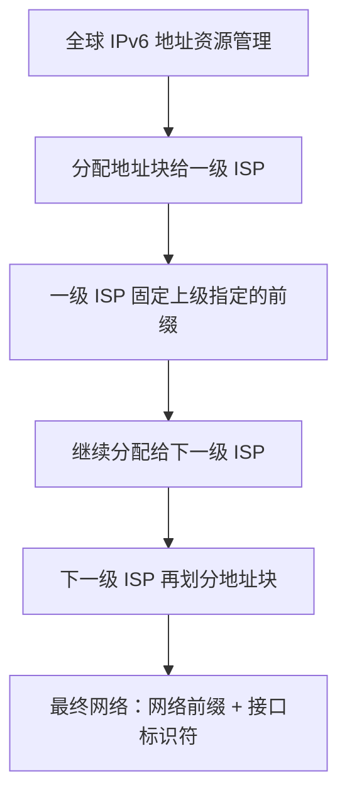
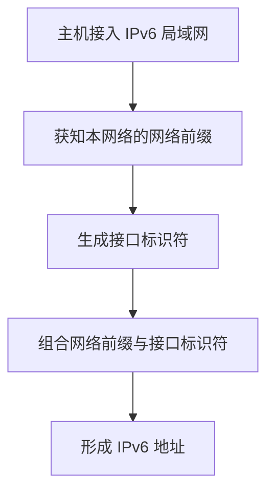
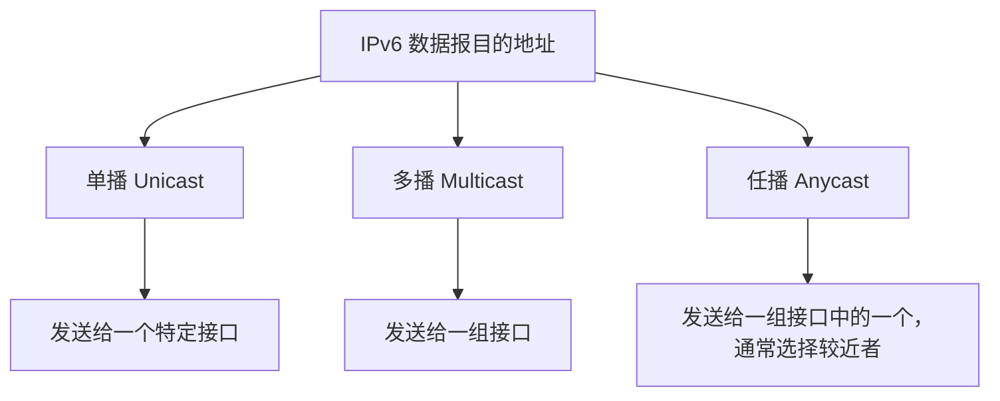

# IPv6 地址学习笔记

> **本节考点：** IPv6 地址的主要特点、地址构成与表示方法、压缩规则、地址分配与自动配置，以及特殊地址和单播/多播/任播的区别。  
> **复习提示：** 本节整体难度不高，但概念较多、容易遗忘；重点掌握 IPv6 地址压缩规则和特殊地址的表示形式。

---

## 一、IPv6 的诞生背景

### 1. IPv4 地址资源不足

- IPv4 是 IP 协议的第四个版本，其中 `V` 是 **Version（版本）** 的意思。
- IPv4 于 **1981 年**诞生。当时计算机和互联网尚未在民间普及，设计者没有预料到之后互联网会如此迅速地发展。
- IPv4 地址长度为 **32 位**，总共可以表示：

  \[
  2^{32}=4\,294\,967\,296
  \]

  即约 **42.9 亿个地址**。

- 随着个人电脑和互联网快速发展，IPv4 地址逐渐面临耗尽问题。以地球人口超过 80 亿为例，IPv4 地址数量甚至不足以保证每个人分配一个独立地址。
- **1994 年出现 NAT（网络地址转换）技术**。NAT 可以让局域网中的多台设备共享一个公网 IPv4 地址，从而缓解地址短缺，但不能从根本上增加 IPv4 地址总量。

### 2. IPv6 的提出

- **1998 年**，科学家提出 IPv6，即 IP 协议的第六个版本。
- IPv6 地址长度为 **128 位**，可表示 \(2^{128}\) 种不同的位组合。
- 按照当时约 80 多亿人口估算，平均每个人可以分到约 \(4.3\times10^{28}\) 个 IPv6 地址，地址空间非常庞大，能够满足大量设备接入互联网的需求。
- 现在进入万物互联时代，电脑、传感器、电器等设备都可能接入互联网，需要 IP 地址；IPv6 的地址空间更适合这种发展需求。
- IPv4 和 IPv6 定义的地址都可以简称为 **IP 地址**。阅读题目时，要结合上下文判断它指的是 IPv4 地址还是 IPv6 地址。本笔记在没有特别说明时，所说的地址均指 IPv6 地址。
- IPv4 之后并不是完全没有出现过 IPv5：IPv5 曾作为实验性协议存在，但不具备在全球范围推广的条件，因此实际普及的是 IPv6。

### 3. IPv4 与 IPv6 对比

| 对比项目         | IPv4                   | IPv6                        |
| ---------------- | ---------------------- | --------------------------- |
| 地址长度         | 32 位                  | 128 位                      |
| 地址数量         | \(2^{32}\)，约 42.9 亿 | \(2^{128}\)，数量极其庞大   |
| 常用表示法       | 点分十进制             | 冒号分隔的十六进制          |
| 地址不足时的应对 | NAT 可缓解地址不足     | 大幅扩展地址空间            |
| 地址自动配置     | 常见方式之一是 DHCP    | 支持自动配置，也支持 DHCPv6 |

---

## 二、IPv6 地址的基本表示方法

### 1. 为什么采用冒号十六进制记法？

计算机处理 128 位二进制地址并不困难，但人类阅读和书写一长串二进制数不方便。因此，IPv6 通常采用 **冒号十六进制记法**。

IPv4 则通常使用点分十进制记法。

| 项目       | IPv4           | IPv6             |
| ---------- | -------------- | ---------------- |
| 地址总长度 | 32 位          | 128 位           |
| 分段方法   | 每 8 位为一段  | 每 16 位为一段   |
| 每段的表示 | 转换为十进制数 | 转换为十六进制数 |
| 分隔符     | 点号 `.`       | 冒号 `:`         |
| 分段数量   | 4 段           | 8 段             |
| 每段位数   | 8 位           | 16 位            |

IPv6 的转换过程如下：

1. 一个 IPv6 地址总共 **128 位**。
2. 每 **16 位**划分为一段，所以共有 \(128\div16=8\) 段。
3. 每 16 位又可以按每 4 位一组转换成十六进制数。
4. 每段最多用 4 个十六进制字符表示，段与段之间用冒号分隔。

---

## 三、IPv6 地址的压缩表示法

IPv6 地址即使转换成冒号十六进制形式，仍可能很长，因此规定了压缩表示法。主要有两条规则：

1. **省略每段的前导零。**
2. **用双冒号 `::` 压缩连续的全零段。**

两种规则可以同时使用，但一个 IPv6 地址中 **最多只能出现一次 `::`**。

### 1. 规则一：省略每段的前导零

在一个 16 位分段中，可以省略最左侧连续的零，但不能省略中间或末尾的零；如果整段都是零，则这一段可以写成 `0`。

| 原始分段 | 压缩后 | 说明                     |
| -------- | ------ | ------------------------ |
| `0db8`   | `db8`  | 省略前导零               |
| `0000`   | `0`    | 省略前导零后保留一个 `0` |
| `0370`   | `370`  | 只能省略前导零           |
| `1000`   | `1000` | 不能省略末尾的零         |
| `0001`   | `1`    | 省略前导零               |

**记忆要点：** 只能省略每段最左侧的零，不能把一个分段中间或末尾的零随意删除。

### 2. 规则二：用 `::` 压缩连续的全零段

如果 IPv6 地址中连续出现多个全零分段，可以用一个双冒号 `::` 替代这些连续的全零段。

- `::` 表示一个或多个连续的 `0000` 分段。
- 这里压缩的是**完整的全零分段**，而不是随意删除某一段中的零。
- 一个 IPv6 地址中只能出现一次 `::`，否则无法唯一确定它省略了多少个分段。

例如，下面展示的是全零段压缩的写法：

| 未压缩部分                                | 压缩表示          | 说明                               |
| ----------------------------------------- | ----------------- | ---------------------------------- |
| `0000:0000:0000:0000`                     | `::`              | 连续的多个全零段用双冒号表示       |
| `2001:0db8:0000:0000:0000:0000:0370:0001` | `2001:db8::370:1` | 先省略各段前导零，再压缩连续全零段 |

> 以上示例展示的是压缩规则。压缩时应先按 8 个分段理解地址，再进行省略。

### 3. 如何把压缩地址还原成完整形式？

一个完整的 IPv6 地址必须包含 **8 个 16 位分段**，每段最多 4 个十六进制字符。

还原时可以按以下步骤进行：

1. 先将每段不足 4 位的部分在左侧补零。
2. 统计当前已经明确写出的分段数量。
3. 如果存在 `::`，用足够数量的 `0000` 分段替换它，使总数补足 8 段。
4. 检查地址是否恰好包含 8 段。

例如：

- `db8` 展开为 `0db8`。
- `370` 展开为 `0370`。
- `1` 展开为 `0001`。
- `::` 需要补入多少个 `0000` 分段，应由地址中其余部分的分段数量决定。

### 4. 例题一：判断非法的压缩形式

**结论：选择 C。**

- C 选项中出现了两次 `::`。
- IPv6 压缩表示法中，一个地址只能出现一次 `::`，否则无法唯一确定每个双冒号代表多少个全零分段。
- A、B、D 选项虽然使用了压缩表示法，但都可以按照规则恢复为完整地址，因此合法。

分析时应注意：

- 分段不足 4 个十六进制字符时，通常是省略了前导零。
- `::` 表示被省略的连续全零分段，必须根据整个地址应有 8 段的规则计算。
- 不能仅凭压缩后字符串的长短判断地址是否合法。

### 5. 例题二：判断合法的 IPv6 地址

**结论：选择 B。**

- B 是合法的 IPv6 地址。先将不足 4 位的分段补齐，再根据 `::` 省略的分段数量补足 8 段，即可还原完整地址。
- A 只用单冒号分隔，且分段总数不足 8 段，不能通过单冒号自动补出缺失分段，因此不合法。
- C 出现了两次 `::`，不合法。
- D 出现了连续三个冒号 `:::`，不符合 IPv6 地址的压缩语法，因此不合法。

### 6. 例题三：写出最简压缩形式

**结论：选择 A。**

- A 同时使用了省略前导零和双冒号压缩连续全零段的规则，表示形式最简。
- B 的语法虽然正确，但仍有可以被 `::` 一并压缩的连续零，因此不是最简形式。
- C 出现了两次 `::`，语法错误。
- D 的语法也正确，但中间的连续全零段可以像 A 一样用双冒号进一步压缩，所以不是最简形式。

> **例题记忆：** 判断是否合法时，重点检查分段数量、双冒号的使用次数，以及是否出现 `:::`；判断是否最简时，还要检查是否存在可以继续压缩的连续全零段。

---

## 四、IPv6 地址的分配

### 1. 分层分配机制

IPv6 地址的资源分配与 IPv4 的基本思路相近：地址管理机构逐级分配地址块，各级 ISP 再按照下级网络的需求继续划分。

- 全球 IPv6 地址资源由相关地址管理机构负责管理。讲解中以 ICANN 作为管理机构的例子。
- 上级机构向一级 ISP 分配一个地址块，并规定一段固定的网络前缀。
- 一级 ISP 可以继续将地址块分配给下一级 ISP。
- 下级 ISP 在不能修改上级指定前缀的前提下，可以继续划分自己的地址块。
- 分配给最终网络或主机时，可以把 IPv6 地址理解为**网络前缀**和**接口标识符**两部分。

假设地址长度为 128 位：

- 上级指定前 \(n\) 位作为网络前缀。
- 下一级机构再指定后续 \(m\) 位作为下一级网络的前缀。
- 剩下的 \(128-n-m\) 位可供更下层继续分配，最终可用作接口标识符。

### 2. IPv6 支持 CIDR

- IPv6 与 IPv4 一样支持 **无分类编址 CIDR**。
- 可以灵活地划分子网，也可以采用定长子网或不定长子网。
- 地址空间扩大后，可以支持更多层次的地址划分。
- 每一级机构只能分配自己有权控制的部分，来自上级的网络前缀不能随意修改。

### 3. 网络前缀与接口标识符

对于一台主机而言，IPv6 地址可以概括为两部分：

| 组成部分   | 含义                                           |
| ---------- | ---------------------------------------------- |
| 网络前缀   | 标识主机所处的网络，由上级或网络配置过程确定   |
| 接口标识符 | 标识该网络中的具体接口，类似于 IPv4 中的主机号 |

两部分合计为 128 位。网络前缀占多少位，需要根据地址块和网络规划来确定；接口标识符占剩余位数。

---

## 五、IPv6 的即插即用与自动配置

### 1. 即插即用的基本原理

IPv6 的一个重要特点是支持地址自动配置，也就是常说的**即插即用**。

假设一所学校从北京电信申请了一个 IPv6 地址块：

- 北京电信规定前 64 位为网络前缀。
- 末尾 64 位留给学校局域网中的接口标识符。
- 一台主机接入该网络后，需要先获知当前网络的前缀。
- 主机获知前缀后，就可以按照自动配置机制形成自己的 IPv6 地址，而不一定需要先向 DHCP 服务器申请地址。

### 2. 接口标识符与 MAC 地址

在讲解的基本机制中，主机可以使用自身的 MAC 地址来构造接口标识符：

- MAC 地址通常为 6 字节，也就是 48 位。
- IPv6 网络中常见的接口标识符长度为 64 位。
- 因为接口标识符空间较充裕，主机可以基于 MAC 地址形成接口标识符，再与网络前缀组合。
- 每台设备的 MAC 地址通常具有唯一性，因此这种方式可以帮助形成不同的地址。

> **理解提示：** 这是讲解中用于理解自动配置的基本思路。实际 IPv6 网络还可能采用其他接口标识符生成方式。

### 3. IPv6 是否需要 DHCP？

- IPv6 支持自动配置，因此在一些网络中，主机不必依赖 DHCP 服务器逐一分配地址。
- IPv6 **也支持 DHCPv6**。在地址管理或安全性要求较高、需要集中管理的网络中，可以设置 DHCPv6 服务器统一管理和分配地址。
- 因此，不能理解为 IPv6 不支持 DHCP；准确的理解是：IPv6 既支持自动配置，也支持 DHCPv6。

### 4. 便于记忆的比喻

- **自动配置：** “出门在外，身份是自己给的。”主机获知网络前缀后，按照自动配置机制生成地址。
- **DHCP 方式：** “出门在外，身份是别人给的。”主机向 DHCP 服务器请求，由服务器统一分配地址。

自动配置能够减少逐台手动配置地址的工作，提高地址分配效率。

---

## 六、IPv6 特殊地址

IPv6 中有一些具有特殊用途的地址，需要重点记忆。

### 1. 常见特殊地址总表

| 地址类型         | 典型表示                         | 识别方法                             | 主要用途                   |
| ---------------- | -------------------------------- | ------------------------------------ | -------------------------- |
| 未指定地址       | `::/128`                         | 128 位全零                           | 主机地址尚未确定时使用     |
| 环回地址         | `::1/128`                        | 前 127 位为零，最后 1 位为 1         | 主机与自身通信             |
| 多播地址         | `ff00::/8`                       | 前 8 位全为 1，通常以 `ff` 开头      | 一对多通信                 |
| 本地链路单播地址 | `fe80::/10`                      | 前 10 位固定；常见地址以 `fe80` 开头 | 本地链路或局域网范围内通信 |
| 全球单播地址     | 例如 `2001:db8::...`（示例形式） | 按地址前缀和分配规则识别             | 面向全球范围的单播通信     |

### 2. 未指定地址

- 128 位全部为 0，写作 `::/128`。
- 作用类似于 IPv4 的 `0.0.0.0`。
- 主机刚开始接入网络、地址尚未确定时，可以使用未指定地址表示“尚未指定地址”。

### 3. 环回地址

- 前 127 位为 0，最后 1 位为 1。
- 简写为 `::1/128`。
- 作用类似于 IPv4 的 `127.0.0.1`。
- 如果一台主机想与自己通信，可以使用环回地址。

### 4. 多播地址

- 多播地址的前 8 位全为 1，因此通常以 `ff` 开头。
- 多播地址可以作为 IP 数据报的目的地址，表示将数据报发送给一组主机。
- 可以将多播地址理解为一个“QQ群号”：相关主机加入同一个多播组后，发送到该多播地址的数据可以传递给组内主机。
- 识别题目时，看到 `ff` 开头的 IPv6 地址，应考虑它是否为多播地址；其后的位用于进一步表示具体的多播地址信息。

### 5. 本地链路单播地址

- 本地链路单播地址用于同一本地链路上的通信，通常不用于跨网络转发。
- 前 10 位固定为 `1111111010`，对应的地址范围是 `fe80::/10`，常见地址以 `fe80` 开头。
- 剩余位用于形成具体地址。
- 如果需要跨网络与其他主机通信，则需要使用适用于相应范围的单播地址，例如全球单播地址。

### 6. 全球单播地址

- 全球单播地址用于向某一台特定主机进行点对点通信。
- 在课程讲解的分类方式中，除前面列出的特殊形式外，其余地址归为全球单播地址。
- 实际进行地址判断时，仍应结合具体地址前缀和相关分配规则。

---

## 七、IPv6 数据报目的地址的三种类型

IPv6 数据报的目的地址可以使用单播、多播或任播地址。

### 1. 单播（Unicast）

- 单播地址对应某一个特定接口。
- 数据报的目的地址是某台主机的单播地址时，表示进行点对点通信。
- 单播可以进一步包括本地链路单播地址和全球单播地址等不同类型。

**比喻：** 单播像个人的 QQ 号，发给某一个明确的对象。

### 2. 多播（Multicast）

- 多播地址对应一组主机。
- 数据报的目的地址为多播地址时，可以把数据发送给加入相应多播组的多个主机。
- 它支持一对多通信。

**比喻：** 多播像一个 QQ 群号，发送给群组后，相关成员都可以接收。

### 3. 任播（Anycast）

- 任播地址可以分配给一组接口，但一个数据报通常只会交付给其中一个接口，通常是路由意义上距离较近的一个。
- 任播常用于需要让用户访问附近服务节点的场景，例如 DNS 服务。
- 由于 DNS 服务器可能分布在不同地点，主机可以向统一的任播地址发送查询请求，网络将请求交付给其中一个合适的服务器，以便更快获得响应。

**比喻：** 任播像在饭店里喊一声“服务员”。不必指定某一位服务员，通常由离你较近、能够响应的服务员来处理。

### 4. 三种通信方式对比

| 类型 | 目的对象         | 通信方式                                         | 记忆方式                 |
| ---- | ---------------- | ------------------------------------------------ | ------------------------ |
| 单播 | 一个特定接口     | 一对一                                           | 指定一个人               |
| 多播 | 一组接口         | 一对多                                           | 指定一个群组             |
| 任播 | 一组接口中的一个 | 发往同一任播地址，由网络交付给其中一个合适的接口 | 呼叫附近可响应的服务节点 |

> **注意：** 任播地址的终点是一组计算机，但一次数据报传送只交付给其中一台计算机，而不是组内所有计算机。

---

## 八、选择题考点与易错点

### 1. 判断未指定地址

如果题目询问“哪个 IPv6 地址表示未指定地址”，应选择 **128 位全零的地址 `::/128`**，其作用类似于 IPv4 的 `0.0.0.0`。

容易混淆的地址：

- `::/128`：未指定地址。
- `::1/128`：环回地址，最后一位为 1。
- `fe80::...`：本地链路单播地址。
- `ff...`：多播地址。

### 2. 识别特殊地址的前缀

| 看到的特征                | 应想到的地址类型               |
| ------------------------- | ------------------------------ |
| `::`，并明确长度为 `/128` | 未指定地址                     |
| `::1`                     | 环回地址                       |
| `ff` 开头                 | 多播地址                       |
| `fe80` 开头               | 常见的本地链路单播地址         |
| 其他地址                  | 继续结合前缀及地址分配规则判断 |

### 3. IPv6 压缩表示法常见错误

- **错误一：** 在一个地址中使用两次 `::`。
- **错误二：** 使用 `:::` 这样的连续三个冒号。
- **错误三：** 认为单冒号可以替代缺失的分段。单冒号只起分隔作用，不能像双冒号那样省略全零分段。
- **错误四：** 删除分段中间或末尾的零。只能省略每段的前导零。
- **错误五：** 展开时没有把地址补齐为 8 个分段。
- **错误六：** 判断最简形式时，没有压缩连续的全零分段。

---

## 九、本节内容总结

### 1. IPv6 地址的基本特点

- IPv6 地址总长度为 **128 位**。
- 为方便阅读，通常采用冒号十六进制记法。
- 一个地址有 8 个分段，每段 16 位，最多用 4 个十六进制字符表示。
- 每个分段可以省略前导零。
- 连续的全零分段可以用 `::` 压缩，但一个地址中只能出现一次 `::`。

### 2. 地址分配与自动配置

- IPv6 地址由地址管理机构逐级分配。
- IPv6 支持 CIDR，可以灵活划分地址块和子网。
- IPv6 地址可理解为**网络前缀 + 接口标识符**。
- IPv6 支持即插即用和自动配置；主机获知网络前缀后，可以通过自动配置机制形成地址。
- IPv6 也支持 DHCPv6，可根据需要集中管理地址资源。

### 3. 特殊地址及目的地址类型

- 未指定地址：`::/128`，128 位全零。
- 环回地址：`::1/128`，前 127 位为零，末位为 1。
- 多播地址：`ff` 开头，前 8 位全为 1。
- 本地链路单播地址：`fe80::/10`，用于本地链路通信。
- 目的地址类型包括**单播、多播和任播**。其中任播是 IPv6 中需要特别留意的考点。

### 4. 考前速记

| 考点             | 速记                           |
| ---------------- | ------------------------------ |
| 地址长度         | IPv6 = 128 位                  |
| 分段数量         | 8 段，每段 16 位               |
| 表示法           | 冒号十六进制                   |
| 压缩规则         | 省略前导零；连续全零段用 `::`  |
| 双冒号次数       | 一个地址中最多一次             |
| CIDR             | IPv6 同样支持                  |
| 自动配置         | 知道网络前缀后，可自动形成地址 |
| 未指定地址       | `::/128`                       |
| 环回地址         | `::1/128`                      |
| 多播地址         | `ff` 开头                      |
| 本地链路单播地址 | `fe80::/10`                    |
| 目的地址类型     | 单播、多播、任播               |

> **复习建议：** IPv6 地址的整体难度不高，重点在于细节容易混淆。考前建议重新练习压缩与展开题，并反复辨认未指定地址、环回地址、多播地址、本地链路单播地址，以及单播、多播、任播之间的区别。
