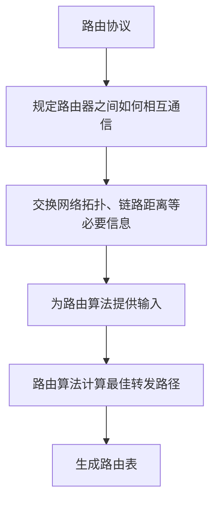
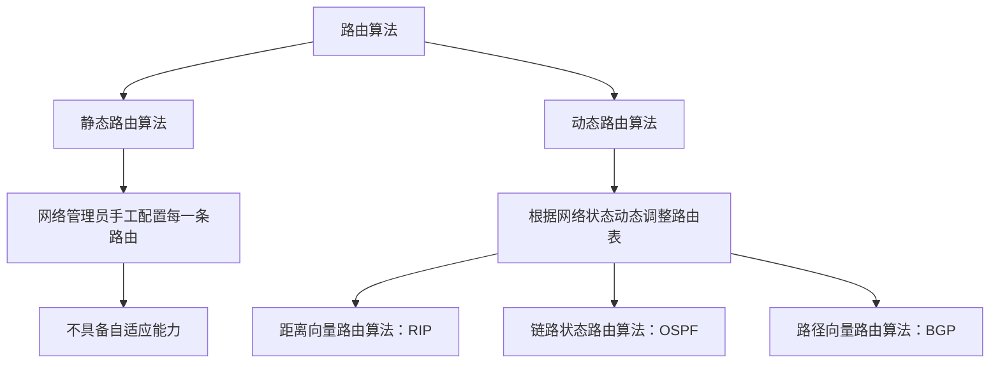
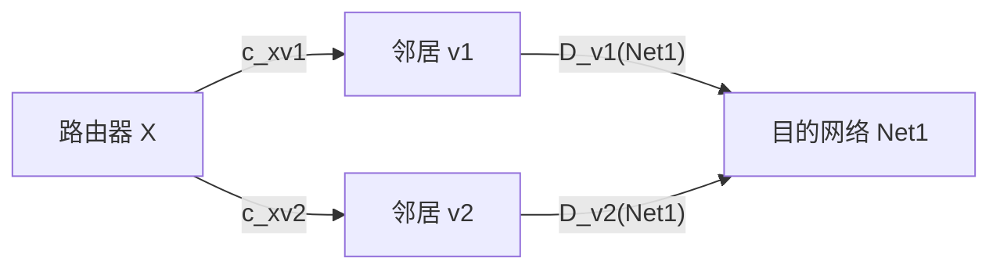
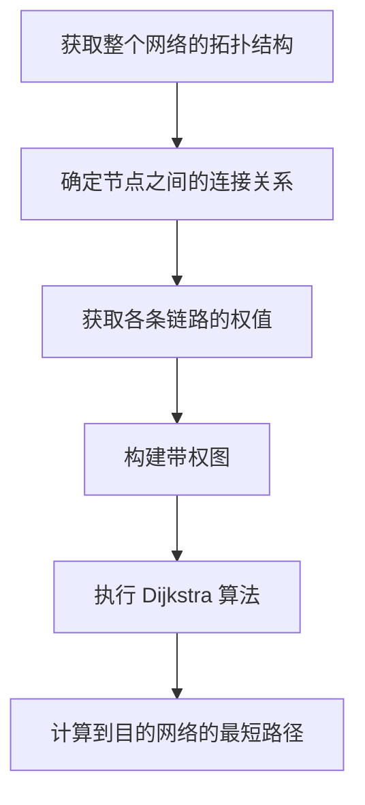

# 路由算法与路由协议

## 一、学习范围与考研大纲要求

从这节课开始，学习**路由算法**和**路由协议**。在考研大纲当中，路由算法和路由协议分别属于两个子标题，但王道书把这两个部分编写在了一起，因为二者之间的联系十分紧密。

本节课主要分为以下几个部分：

1. 梳理路由算法和路由协议之间的关系。
2. 介绍路由算法的分类：静态路由算法和动态路由算法。
3. 学习距离向量路由算法的基本原理。
4. 简要介绍链路状态路由算法的基本原理。

考研大纲要求掌握的动态路由算法包括：

- **距离向量路由算法**：是 **RIP 路由协议**的基础。
- **链路状态路由算法**：是 **OSPF 路由协议**的基础。

RIP 和 OSPF 这两种路由协议也都在大纲中明确要求掌握。此外，考研大纲还要求掌握 **BGP 协议**。BGP 的内部使用了另一种路由算法，叫作**路径向量路由算法**。不过，这种路由算法在目前的考研大纲中并没有被明确要求掌握。

课程中提到，讲解者个人估计，未来三到五年内，路径向量路由算法有可能被加入考研大纲；但在目前这个阶段，暂时不必深入研究，只需对这个术语有印象。

> **术语说明**
>
> - “路由协议”在有些资料中也称为“路由选择协议”。
> - “路由算法”在有些资料中也称为“路由选择算法”。
>
> 这两对术语分别是等价的。

## 二、路由算法与路由协议的关系

### 1. 路由器的功能与路由协议

通过之前的学习，我们知道，路由器最重要的功能之一就是**转发 IP 数据报**。

一台路由器上通常会运行至少一种路由协议，例如考研大纲要求掌握的 RIP、OSPF 或 BGP。

路由协议会定义路由器之间如何交换必要的信息。路由器之间按照路由协议规定的规则相互通信，从而让每一台路由器了解到网络的实际情况。

只要了解了网络的实际情况，就可以把这些信息作为路由算法的输入。路由算法对这些信息进行处理，就可以计算出最佳转发路径。最终的呈现形式就是生成路由表。

在之前的学习中，路由器的路由表、转发表可以由我们手工配置完成；而在实际应用中，路由表通常由路由算法计算得到。

### 2. 路由协议与路由算法分别做什么

由此可见，路由协议需要做两件相互关联的事情：

- 规定路由器之间如何相互通信、如何交换必要的信息。
- 实现某种路由算法，以便根据网络实际情况计算最佳转发路径。

路由协议负责让路由器之间互相交换信息；路由算法则利用这些信息计算最佳转发路径。

### 3. 路由算法为什么与图的最短路径有关

路由算法的最终目标，是找到 IP 数据报的最佳转发路径。这个问题本质上可以抽象为数据结构中的**图的最短路径问题**。

假设某个地区的网络结构由 R1、R2、R3 等路由器组成。现在，R3 这台路由器收到一个 IP 数据报，而该数据报的目的地址指向 Net4，那么这个 IP 数据报应该从哪个接口转发出去？这就是路由算法要解决的问题。

可以把路由器与具体的网络抽象为图中的顶点：

- 路由器和一个具体的网络可以视为图中的一个顶点。
- 路由器之间的连线，以及路由器与网络之间的连线，可以视为图中的**带权边**。
- 路由协议会按照某种规则度量每一条边的权值，可以把权值理解为代价。

例如，可以用两个直接相连节点之间的往返时延（RTT）作为这条边的权值。不同路由协议可以使用各自规定的规则来表示链路代价。

有了各条边的权值信息之后，问题就转变成了图的最短路径问题。假设 R3 要把 IP 数据报转发到 Net4，那么就需要在所有可选路径中找到总代价最小的一条。比如图中上方标记为蓝色的路径，如果它的总路径长度最短，那么就应选择这条路径。

因此，可以理解为：

> **路由算法的最终目的是找到 IP 数据报的最佳转发路径，而这个问题本质上就是图的最短路径问题。**

## 三、路由算法的分类

路由算法可以分为两大类：

1. **静态路由算法**
2. **动态路由算法**

### 1. 静态路由算法

静态路由算法要求**网络管理员手工配置每一条路由**。

这有点类似于之前做过的练习：我们自己充当网络管理员，手工配置某台路由器的路由表或转发表应该是什么样子。

因为路由信息是通过人工手工配置的，所以这种方式不具备自适应能力。一旦网络拓扑结构发生变化，例如增加一台路由器，或者增加一个子网，就需要再次手工配置路由器的路由信息。

因此，静态路由算法只适用于**小型网络**。如果网络非常庞大，路由器和网络的数量都很多，逐台手工配置每一台路由器的路由信息就会非常麻烦。

如果网络中的某些节点或链路发生故障，采用这种方式也需要网络管理员手工调整相关路由信息。

### 2. 动态路由算法

与静态路由算法相对应的是**动态路由算法**。

如果路由器运行动态路由算法，那么路由器就可以根据网络流量负载，以及网络拓扑结构的变化，动态调整自己的路由表。

也就是说，动态路由算法具备**自适应能力**。当网络的运行状态发生变化时，动态路由算法可以根据网络状态动态地调整路由信息，从而计算合适的转发路径。

考研大纲要求掌握的动态路由算法主要有以下两种：

- 距离向量路由算法。
- 链路状态路由算法。

其中：

- 距离向量路由算法是 RIP 路由协议实现的基础。
- 链路状态路由算法是 OSPF 路由协议实现的基础。

此外，考研大纲还要求掌握 BGP 协议。BGP 内部使用路径向量路由算法，不过目前大纲没有明确要求掌握该算法本身。

| 路由算法         | 类型或特点                                   | 对应协议 |
| ---------------- | -------------------------------------------- | -------- |
| 静态路由算法     | 管理员手工配置，不具备自适应能力             | —        |
| 距离向量路由算法 | 根据到邻居的距离和邻居提供的距离信息计算路径 | RIP      |
| 链路状态路由算法 | 通过了解完整的网络拓扑结构来计算路径         | OSPF     |
| 路径向量路由算法 | BGP 内部使用的路由算法                       | BGP      |

## 四、距离向量路由算法

### 1. 用“传递小纸条”的故事理解算法

假设你手里有一笔大生意，想要给苹果公司的 CEO 递一张小纸条，和他谈合作。但是，你并不直接认识对方。

怎么办呢？

你可以通过身边的熟人帮忙，让小纸条经过多层关系传递，最终送到苹果公司的 CEO 手中。

假设左边的节点是你，右边的节点是苹果公司的 CEO。虽然你和 CEO 并不直接认识，但是你身边有 \(k\) 个熟人，也许这些熟人能够帮你把小纸条一层层传递过去。

现在的问题是：

**你应该把小纸条交给哪一个熟人，让他帮你传递？**

于是，你询问这几个熟人，了解他们与 CEO 之间有没有联系，以及他们和 CEO 之间相隔多少层关系。

- 舍友一说，自己和苹果公司 CEO 之间至少隔了两层关系。至于 CEO 到底是舍友一的什么人的什么人，你不需要关心；你只需要知道，如果把小纸条交给舍友一，他最多再经过两层关系，就可以把小纸条递给 CEO。
- 舍友二说，自己和 CEO 之间隔了六层关系。至于 CEO 具体是他的大伯的孙子的女婿的朋友的同学的小舅子的什么人，也无所谓。你只需要知道，舍友二到 CEO 之间的距离比较远。
- 同学三以及一直到第 \(k\) 个熟人，也分别告诉你，他们到 CEO 之间相隔多少层关系。

经过比较之后，你发现舍友一比较靠谱，于是把小纸条交给舍友一，让他继续传递。因为经过舍友一这条路径，纸条可以用更少的层数到达 CEO。

在这个过程中，你不知不觉地使用了距离向量路由算法的核心思想。

### 2. 从故事归纳算法特点

上面的故事体现了距离向量路由算法的一个重要特点：

- 你这台“路由器”不需要知道整个网络的拓扑结构。
- 你只需要知道自己到身边各个熟人的距离。
- 你还需要知道各个熟人到终点的最短距离。
- 将这两段距离相加并进行比较，就可以找到最短的转发路径。

套用到路由问题中，就是路由器不必了解完整的网络拓扑，只需要了解自己与邻居之间的距离，以及邻居到目的网络的最短距离。

### 3. 距离向量路由算法的数学描述

下面使用数学语言描述距离向量路由算法的核心原理。

假设图中的圆柱体表示路由器，云朵 Net1 表示某个目的网络。现在，路由器 X 想通过距离向量路由算法，得知从自身到目的网络 Net1 的最佳转发路径。

路由器 X 首先需要知道自己和每个邻居之间的距离。

假设路由器 X 有 \(k\) 个邻居，分别记作：

\[
v_1,v_2,v_3,\ldots,v_k
\]

其中：

- \(c\_{xv_1}\) 表示路由器 X 与邻居 \(v_1\) 之间的距离。
- \(c\_{xv_2}\) 表示路由器 X 与邻居 \(v_2\) 之间的距离。
- 依此类推，\(c\_{xv_k}\) 表示路由器 X 与邻居 \(v_k\) 之间的距离。

路由器之间的距离到底是多少，由路由协议定义。

例如，对于 RIP 路由协议来说，它规定直接相连的两个路由器节点之间的距离为 1。当然，有的路由协议也可能使用往返时延等指标来定义一段链路的距离。

因此，\(c*{xv_1},c*{xv*2},\ldots,c*{xv_k}\) 表示路由器 X 到各个邻居之间的距离。

此外，假设邻居 \(v_1\) 到目的网络 Net1 的最短距离为：

\[
D\_{v_1}(\text{Net1})
\]

类似地，\(D*{v_2}(\text{Net1})\)、\(D*{v*3}(\text{Net1})\)，一直到 \(D*{v_k}(\text{Net1})\)，分别表示相应邻居到 Net1 的最短距离。

如果路由器 X 把 IP 数据报从邻居 \(v_1\) 这一侧转发出去，那么这个 IP 数据报所需要经过的总路径长度为：

\[
c*{xv_1}+D*{v_1}(\text{Net1})
\]

如果交给第二个邻居 \(v_2\) 转发，那么总路径长度为：

\[
c*{xv_2}+D*{v_2}(\text{Net1})
\]

其他邻居的情况同理。

显然，路由器 X 到目的网络 Net1 的最短路径，就是经由这 \(k\) 个邻居所能形成的路径中，总代价最小的一条。

用数学公式表示：

\[
\boxed{
D*x(\text{Net1})=
\min*{1\leq i\leq k}
\left\{c*{xv_i}+D*{v_i}(\text{Net1})\right\}
}
\]

这就是距离向量路由算法的核心公式。

路径总长度由两部分构成：

\[
\text{X 到目的网络的路径长度}
=
\text{X 到邻居的距离}

- \text{邻居到目的网络的最短距离}
  \]

对每个邻居都进行这样的计算，然后选取最小值，就得到从 X 到目的网络的最短距离。

### 4. 为什么又称为 Bellman-Ford 算法

距离向量路由算法基于 Bellman-Ford 算法。由于 Bellman 和 Ford 两位科学家提出了这种算法，因此这种算法也称为 **Bellman-Ford 算法**。

当 Bellman-Ford 算法被应用在路由器路由转发的领域中时，就可以称为距离向量路由算法。

通过前面的解释可以看到，路由器 X 想要知道自己到目的网络的最短距离，需要掌握：

1. 自己到达每一个邻居的距离。
2. 各个邻居到目的网络的最短距离。

根据这些信息，就可以找出最短路径。

### 5. 邻居路由器如何得到自己的最短距离

可能会觉得奇怪：\(v_1,v_2,v_3\) 这些邻居路由器，是怎么知道自己到目的网络的最短距离到底是多少的？

这个问题先暂时放下。等到真正开始学习 RIP 路由协议时，就会进一步看到这些路由器是如何一步一步得知自己到目的网络的最短距离的。

### 6. “距离向量”中的“向量”是什么意思

假设在某个地区有三个目的网络：Net1、Net2、Net3。

对于路由器 \(v_1\) 来说，从 \(v_1\) 出发到这三个目的网络的最短距离分别是 4、6、3。那么，这三个距离就可以用一个三维向量表示：

\[
\mathbf{D}\_{v_1}=(4,6,3)
\]

其中：

- 第一个分量 4 表示 \(v_1\) 到 Net1 的最短距离。
- 第二个分量 6 表示 \(v_1\) 到 Net2 的最短距离。
- 第三个分量 3 表示 \(v_1\) 到 Net3 的最短距离。

类似地，路由器 \(v_2\) 到这三个目的网络的最短距离可以用另一个向量表示：

\[
\mathbf{D}\_{v_2}=(3,9,10)
\]

一个向量由多个分量组成，每个分量表示当前路由器到某一个目的网络的最短距离。因此，这种算法被称为**距离向量路由算法**。

### 7. 多个目的网络时如何计算

假设 \(v_1\) 到 Net1、Net2、Net3 的最短距离分别为 4、6、3，而 \(v_2\) 到这三个目的网络的最短距离分别为 3、9、10。

现在，假设路由器 X 是新接入网络的路由器，还不知道自己到这三个网络的最短距离分别是多少。

这时，X 的 \(k\) 个邻居路由器可以告诉 X 各自的距离向量。

例如，邻居 \(v_1\) 告诉 X：

- 我到 Net1 的最短距离是 4。
- 我到 Net2 的最短距离是 6。
- 我到 Net3 的最短距离是 3。

于是，路由器 X 就可以计算：如果让 \(v_1\) 帮忙转发 IP 数据报，那么数据报从 X 出发到达 Net1、Net2、Net3 所需要经过的总路径长度，分别是 X 到 \(v_1\) 的距离再加 4、加 6、加 3。

如果让 \(v_2\) 帮忙转发，那么到达 Net1、Net2、Net3 的总路径长度，就分别是 X 到 \(v_2\) 的距离再加 3、加 9、加 10。

本质上，这和只有一个目的网络的例子相同，只不过现在有多个目的网络，所以每个路由器到这些目的网络的最短距离可以用距离向量表示。

## 五、2021 年考研第 37 题：距离向量路由算法

这道题非常经典，可以帮助理解距离向量路由算法的工作过程。

### 1. 题目条件

题目给出：某个网络中的所有路由器都采用距离向量路由算法计算路由。

路由器 E 与邻居路由器 A、B、C、D 之间的链路距离分别为：

| 链路   | 距离 |
| ------ | ---: |
| E 与 A |    8 |
| E 与 B |   10 |
| E 与 C |   12 |
| E 与 D |    6 |

此外，路由器 E 收到了 A、B、C、D 这几个邻居路由器分别发送的距离向量。每个距离向量表示对应路由器到 Net1、Net2、Net3、Net4 这四个目的网络的最短距离。

例如，路由器 A 发给路由器 E 的距离向量为：

\[
\mathbf{D}\_A=(1,12,24,36)
\]

它表示从路由器 A 出发，到 Net1、Net2、Net3、Net4 的最短距离分别是 1、12、24、36。

题目要求：路由器 E 更新后，到达这四个目的网络的最短距离分别是多少？

### 2. 计算方法

因为 E 到 A 的距离为 8，所以，如果让 A 帮忙转发 IP 数据报，那么 E 到四个目的网络的路径长度，就是 A 的距离向量各分量分别加 8。

同理：

- 如果让 B 帮忙转发，就将 B 的距离向量各分量分别加 10。
- 如果让 C 帮忙转发，就将 C 的距离向量各分量分别加 12。
- 如果让 D 帮忙转发，就将 D 的距离向量各分量分别加 6。

对于每一个目的网络，都需要比较经由 A、B、C、D 转发时的路径长度，并选择其中最小的一条。

### 3. E 到 Net1 的最短距离

如果从 A 这边转发，路径长度是 9；从 B 这边转发，路径长度是 33；从 C 这边转发，路径长度是 32；从 D 这边转发，路径长度是 28。

| 转发邻居 | 到 Net1 的路径长度 |
| -------- | -----------------: |
| A        |                  9 |
| B        |                 33 |
| C        |                 32 |
| D        |                 28 |

因此，E 到 Net1 的最短距离为 **9**，应该经由 A 转发。

### 4. E 到 Net2 的最短距离

如果从 A 这边转发，路径长度是 20；从 B 这边转发，路径长度是 45；从 C 这边转发，路径长度是 42；从 D 这边转发，路径长度是 34。

| 转发邻居 | 到 Net2 的路径长度 |
| -------- | -----------------: |
| A        |                 20 |
| B        |                 45 |
| C        |                 42 |
| D        |                 34 |

因此，E 到 Net2 的最短距离为 **20**，仍然应该经由 A 转发。

### 5. E 到 Net3 的最短距离

如果从 A 这边转发，路径长度是 32；从 B 这边转发，路径长度是 28；从 C 这边转发，路径长度是 28；从 D 这边转发，路径长度是 42。

| 转发邻居 | 到 Net3 的路径长度 |
| -------- | -----------------: |
| A        |                 32 |
| B        |                 28 |
| C        |                 28 |
| D        |                 42 |

因此，E 到 Net3 的最短距离为 **28**。经由 B 和经由 C 的路径长度相等，所以可以交给 B 转发，也可以交给 C 转发，都能得到最短路径。

### 6. E 到 Net4 的最短距离

最后计算 E 到 Net4 的最短距离。根据题目中的距离向量进行比较，经由 C 转发的路径最短。

E 到 Net4 的最短距离为 **20**。

### 7. 最终答案

经过以上计算，路由器 E 到 Net1、Net2、Net3、Net4 的最短距离分别为：

\[
\boxed{\mathbf{D}\_E=(9,20,28,20)}
\]

因此，这道题选择 **D 选项**。

这道题非常重要，可以帮助理解距离向量路由算法的具体工作过程。由于 RIP 路由协议也使用了距离向量路由算法，随着后续学习 RIP 协议，会进一步加深对这种算法的理解。

## 六、链路状态路由算法

### 1. 用另一个“传递小纸条”的故事理解算法

还是要给苹果公司的 CEO 传递一张小纸条，希望和他谈合作。哈哈，又在做梦。

这一次，虽然你仍然不直接认识苹果公司的 CEO，但是你可以想办法把身边所有人的人际关系网络都摸清楚。

例如：

- 舍友一的爸爸和苹果公司的 CEO 是结拜兄弟。
- 舍友二有一个外国友人。
- 这个外国友人又认识一个外国狠人。
- 这个外国狠人认识一名苹果公司的员工。
- 这名员工能够联系到苹果公司的 CEO。
- 与此同时，你的同学三也直接认识这位外国狠人。

当你把整个网络的拓扑结构都摸清楚之后，就可以利用 Dijkstra（迪杰斯特拉）算法计算最短路径。

最后，你发现从你到苹果公司 CEO 的最短路径是：先把小纸条交给舍友一，舍友一交给他爸爸，他爸爸再交给结拜兄弟公司的 CEO。

这个过程就可以类比为链路状态路由算法。

### 2. 链路状态路由算法的特点

链路状态路由算法的特点是：首先需要知道整个网络中各个节点之间的拓扑结构，明确哪些节点之间是直接相连的。

我们也可以给每一条边规定一个权值。例如：

- 你和舍友一之间的距离为 1。
- 你和舍友二之间的距离为 6。

这里可以将距离理解为付出的代价：如果请舍友一帮忙，需要请他吃一根烤肠；如果请舍友二帮忙，需要请他吃六根烤肠。

当然，这只是帮助理解的例子。实际应用中，可以设计某种规则，为网络中的每一条边指定具体权值。

只要知道整个网络的拓扑结构，以及每一条边的权值，就可以使用 Dijkstra 算法，找到从当前路由器到目的网络的最短路径。

### 3. 链路状态路由算法的本质

如果用数据结构中的带权图来表示整个网络的拓扑结构，那么可以基于这个带权图执行 Dijkstra 算法。

在数据结构课程中，已经详细介绍过 Dijkstra 算法。因此，链路状态路由算法的关键难点并不是 Dijkstra 算法本身，而是：

**怎样让每一台路由器都了解到整个网络的拓扑结构？**

这才是链路状态路由算法真正需要解决的重点，也是之后学习 OSPF 路由协议时要进一步研究的问题。

OSPF 路由协议内部使用了链路状态路由算法。换句话说，当把 Dijkstra 算法应用在路由路径计算中时，就可以称为链路状态路由算法。

所谓链路状态路由算法，就是根据节点之间的链路状态，找到最优转发路径，也就是计算最短路径。

## 七、距离向量路由算法与链路状态路由算法的对比

| 对比项目               | 距离向量路由算法                                   | 链路状态路由算法                                     |
| ---------------------- | -------------------------------------------------- | ---------------------------------------------------- |
| 需要了解的信息         | 本机到邻居的距离，以及邻居到目的网络的最短距离     | 整个网络的拓扑结构，以及各条链路的权值               |
| 是否需要完整的网络拓扑 | 不需要掌握完整拓扑结构                             | 需要了解完整网络拓扑结构                             |
| 核心计算依据           | 到邻居的距离 + 邻居到目的网络的最短距离            | 网络拓扑与链路权值                                   |
| 本质算法               | Bellman-Ford 算法                                  | Dijkstra（迪杰斯特拉）算法                           |
| 对应路由协议           | RIP                                                | OSPF                                                 |
| 课程复习重点           | 理解距离向量的含义，能计算并比较经各邻居的路径长度 | 理解完整拓扑结构和链路权值的作用，复习 Dijkstra 算法 |

## 八、本节内容总结与复习建议

### 1. 路由算法与路由协议

路由算法与路由协议之间联系十分紧密：

- 路由算法的最终目标是找到转发 IP 分组的最佳路径。
- 一个路由协议中实现了某种路由算法。
- 路由协议还需要规定路由器之间如何相互通信。
- 路由器通过相互通信，获得路由算法所需的信息，例如网络中的节点如何连接、节点之间的距离分别是多少。
- 获得这些信息之后，路由器才能执行路由算法，最终得到最佳转发路径。

### 2. 静态路由算法

静态路由算法主要是让网络管理员手工配置每一台路由器的路由信息。

这部分没有太多需要深入计算的内容，重点是理解静态路由算法的含义：

- 路由信息需要手工配置。
- 不具备自适应能力。
- 只适用于小型网络。
- 一旦网络中的某些节点或链路发生故障，网络管理员就需要手工调整路由信息。

### 3. 动态路由算法

与静态路由算法相对应的是动态路由算法。

动态路由算法可以根据网络流量负载和网络拓扑结构的变化，动态调整路由表，具备自适应能力。

考研大纲明确要求掌握的动态路由算法有：

1. 距离向量路由算法。
2. 链路状态路由算法。

其中，距离向量路由算法的本质是 Bellman-Ford 最短路径算法；链路状态路由算法的本质是 Dijkstra 最短路径算法。这两种算法最终都在解决图的最短路径问题。

### 4. 重点掌握两种算法的区别

距离向量路由算法的特点是：路由器不必关心完整的网络拓扑结构，只需要知道自己到各个邻居的距离，以及邻居到目的网络的最短距离。

链路状态路由算法则要求路由器了解完整的网络拓扑结构，并根据链路权值计算最短路径。

- **距离向量路由算法**：基础为 Bellman-Ford 算法，对应 RIP。
- **链路状态路由算法**：基础为 Dijkstra 算法，对应 OSPF。

Dijkstra 算法如何工作，可以结合数据结构课程的相关内容复习。

对于距离向量路由算法，建议把 **2021 年考研第 37 题**作为核心复习资料。能够通过这道题模拟算法的计算过程，就能更好地理解距离向量路由算法的工作原理。

### 5. 路径向量路由算法

本节开头提到，路径向量路由算法是 BGP 协议的基础之一。不过，大纲目前并没有明确要求掌握该算法，因此暂时不需要深入研究，只需要记住这个术语以及它与 BGP 的联系即可。

---

## 九、考前速查

| 关键词           | 需要记住的内容                                                 |
| ---------------- | -------------------------------------------------------------- |
| 路由协议         | 规定路由器之间如何通信、交换必要信息                           |
| 路由算法         | 根据网络信息计算最佳转发路径                                   |
| 静态路由算法     | 手工配置；不具备自适应能力；适用于小型网络                     |
| 动态路由算法     | 根据网络状态变化动态调整路由表                                 |
| 距离向量路由算法 | 不要求掌握完整网络拓扑；基础是 Bellman-Ford；对应 RIP          |
| 链路状态路由算法 | 需要了解完整网络拓扑；基础是 Dijkstra；对应 OSPF               |
| 路径向量路由算法 | BGP 使用；目前大纲未明确要求掌握                               |
| 2021 年第 37 题  | 练习距离向量算法：逐个邻居计算总代价，并为每个目的网络取最小值 |

**核心记忆：**

> 路由协议负责规定路由器之间如何交换信息；路由算法负责根据这些信息计算最佳转发路径。  
> 距离向量路由算法对应 RIP，基础是 Bellman-Ford 算法；链路状态路由算法对应 OSPF，基础是 Dijkstra 算法。
