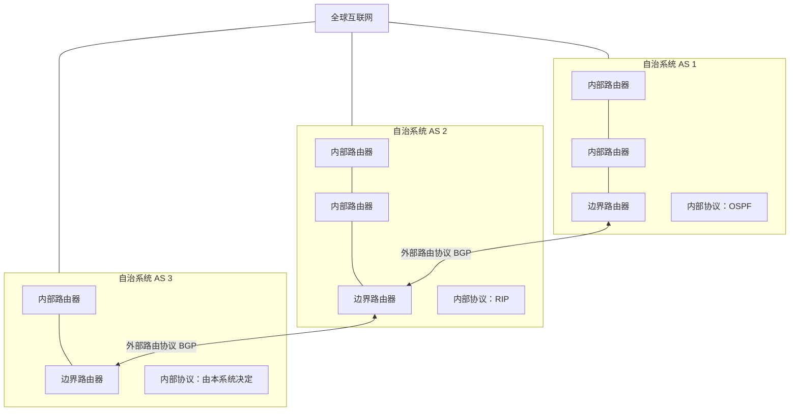
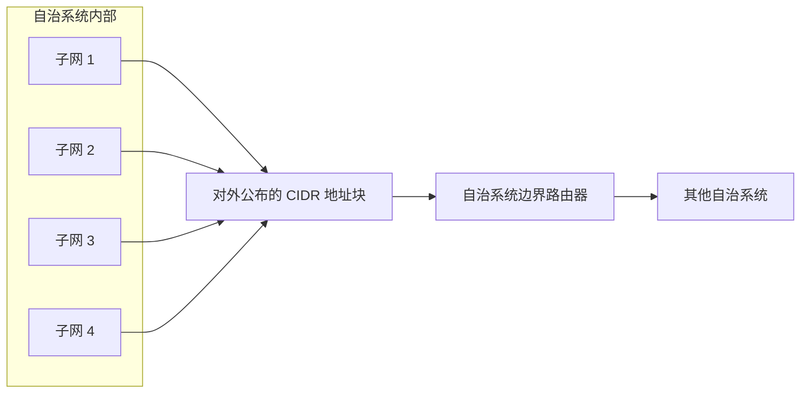
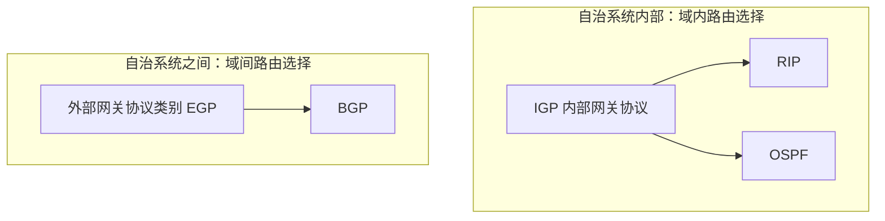

# 分层次的路由协议

## 一、为什么需要分层次的路由协议？

### 1. 能否让全世界的路由器统一运行一种路由协议？

思考一个问题：能不能让全世界的路由器都统一运行 RIP 路由协议，或者 OSPF 协议？

通过之前的学习，我们知道：

- **RIP** 的核心是距离向量路由算法。
- **OSPF** 基于链路状态路由算法。

这两种协议面对全球范围的互联网时，都会遇到规模方面的问题。

### 2. RIP：距离向量可能过于庞大

RIP 使用距离向量路由算法。路由器需要把自己到达各个目的网络的距离，以距离向量的形式告诉相邻路由器。

例如，某片区域内有 8 个细分网络，那么距离向量就可以看作一个 **8 维向量**。

```text
目的网络： N1  N2  N3  N4  N5  N6  N7  N8
距离向量：[ d1, d2, d3, d4, d5, d6, d7, d8 ]
```

显然，一片区域内的网络数量越多，距离向量的维度就越大。

放眼全球，整个互联网中存在数以亿计的网络。如果按照这种思想，让路由器维护并相互传递包含所有目的网络的距离向量，那么向量就可能有数以亿计的分量。

这样的向量过于庞大，不适合让路由器之间相互传递。因此，让全世界的路由器统一运行 RIP 并不现实。

### 3. OSPF：全球拓扑图的复杂度过高

OSPF 基于链路状态路由算法。算法运行时，路由器需要建立整个相关网络的拓扑图。

如果要求全世界的每一台路由器都掌握全球范围内的网络拓扑，那么由于路由器数量和网络数量都非常庞大，维护和计算这种拓扑的复杂度也会非常高。

### 4. 结论：需要分层次的路由协议

仅靠一种路由协议，不足以让全世界的路由器高效地协同工作。因此，需要采用**分层次的路由协议**。

核心思路是：将全球网络划分为多个相互独立的**自治系统（AS，Autonomous System）**，自治系统内部和自治系统之间分别采用不同的路由协议。

---

## 二、自治系统（AS）

### 1. 什么是自治系统？

自治系统是将互联网划分后形成的、由某个管理单位管理的网络范围。

例如，可以把某一片网络视为“咸鱼电信”搭建和管理的网络，并向互联网管理机构申请，使其成为一个独立的自治系统。

除了运营商，大型企业也可以搭建自己的网络，并将其组织成自治系统；各大 ISP（互联网服务提供商）也可以搭建自治系统。

自治系统内部使用哪一种内部路由协议，可以由该自治系统的管理单位自行决定。例如：

- “咸鱼电信”可以选择在内部使用 **OSPF**。
- 另一个企业搭建的自治系统可以选择在内部使用 **RIP**。

不同自治系统之间再相互连接，最终组成全球互联网。

### 2. 自治系统之间的连接

每个自治系统至少会有一台**自治系统边界路由器**，用于与其他自治系统连接。

例如，“咸鱼电信”可以选择路由器 R6 作为边界路由器，再通过它与其他自治系统的边界路由器连接。

在现实网络中，边界路由器通常需要承担自治系统之间的路由交换任务，其性能一般比内部普通路由器更强，价格也可能更高。原课程举例说明：边界路由器便宜的可能几万元，贵的可能达到几百万元。

自治系统边界路由器之间使用统一的外部路由协议交换路由信息，例如 **BGP**。目前课程中介绍的版本是 **BGP-4**。

### 3. 用自治系统限制路由协议的工作范围

通过自治系统，可以限制 RIP、OSPF 等内部路由协议的工作范围：

- 在自治系统内部，使用该系统管理者选择的内部路由协议。
- 在自治系统之间，通过边界路由器使用统一的外部路由协议交换路由信息。

这样，就不需要让全球所有路由器都维护全球范围的距离向量或完整网络拓扑。

### 4. 域内路由选择与域间路由选择

| 概念             | 含义                                       | 典型协议  |
| ---------------- | ------------------------------------------ | --------- |
| **域内路由选择** | 在一个自治系统内部选择 IP 数据报的转发路径 | RIP、OSPF |
| **域间路由选择** | 在不同自治系统之间选择 IP 数据报的转发路径 | BGP       |

课程中提到，当时整个互联网大致被划分为将近 **8 万个自治系统**。

### 5. 自治系统与路由协议的关系图



> **图示理解：** 每个自治系统内部可以选择自己的内部路由协议；自治系统之间通过边界路由器连接，并使用 BGP 等外部路由协议交换路由信息。

---

## 三、自治系统的补充知识

### 1. 每个自治系统都有全球唯一的编号

每个自治系统都有一个全球唯一的**自治系统编号**，英文缩写为 **ASN（Autonomous System Number）**。

该编号需要向互联网管理机构申请。课程举例提到，在中国，如果希望建立自己的自治系统，需要向相关管理机构申请全球唯一的自治系统编号。

### 2. 自治系统之间是平级关系

自治系统之间是**平级关系**，不存在相互包含的关系。

因此，课程所说的“分层次路由协议”主要分为两层：

1. **自治系统内部**：使用内部网关协议。
2. **自治系统之间**：使用外部网关协议。

一个自治系统内部不会再嵌套一个更深层次的自治系统。

### 3. 一个自治系统可以包含一个或多个 CIDR 地址块

一个自治系统内部通常会包含一个或多个 **CIDR 地址块**。

这样做的好处是：无论自治系统内部划分成多少个更小的子网，都可以将对外需要公布的网络范围聚合成一个或多个 CIDR 地址块。

例如，“咸鱼电信”申请了一个 CIDR 地址块，然后把它划分为许多更小的子网。对于外部自治系统而言，可以把“咸鱼电信”对外公布的 CIDR 地址块看作一个整体，而不必了解其内部具体划分了多少个子网。

当需要转发 IP 数据报时，如果目的网络地址与“咸鱼电信”对外公布的 CIDR 地址块相匹配，就可以将数据报转发给相应的边界路由器，例如 R6。

**边界路由器不需要了解另一个自治系统内部的所有子网划分细节**，只需要掌握该自治系统对外公布的一个或多个 CIDR 地址块即可。

如果原有地址块不够用，自治系统也可能再申请另一个 CIDR 地址块。此时，对于外部路由器而言，该自治系统对外公布的地址块就可能是两个或更多个。

#### CIDR 地址块聚合的示意图



> **图示理解：** 内部可以划分出许多子网，但对外可以用一个或多个 CIDR 地址块概括其网络范围。实际能够聚合成几个地址块，取决于地址规划和前缀是否适合聚合。

---

## 四、内部网关协议与外部网关协议

路由协议可以按照使用范围划分为两类。

### 1. 内部网关协议（IGP）

**IGP（Interior Gateway Protocol，内部网关协议）**，用于自治系统内部的路由选择。

典型协议包括：

- **RIP**
- **OSPF**

在早期技术文档中，路由器通常也被称为“网关”。因此，可以把“内部网关协议”理解为“内部路由协议”。

### 2. 外部网关协议（EGP）

**EGP（Exterior Gateway Protocol，外部网关协议）**，用于不同自治系统之间的路由选择。

考研大纲要求掌握的 **BGP** 就属于外部网关协议的范畴。

> 注意：EGP 在这里是“外部网关协议”这一类别的缩写；BGP 是实际使用的边界网关协议，二者不要混淆。

### 3. 类比：方言与普通话

可以把内部网关协议和外部网关协议的关系类比为“方言”和“普通话”：

- 在一个小县城内部，人们可以使用当地的方言进行交流。
- 当需要和其他地区的人交流时，就需要使用更统一的交流标准，例如普通话。

对应到路由协议：

- **自治系统内部**：协议选择可以由本系统管理者决定，类似在本地区使用方言。
- **自治系统之间**：需要使用各个自治系统都能够遵循的外部路由协议，类似使用普通话。

也就是说，自治系统内部通信所采用的标准，与自治系统之间通信所采用的标准并不相同。

### 4. IGP 与 EGP 对比表

| 对比项目 | IGP（内部网关协议）    | EGP（外部网关协议）                          |
| -------- | ---------------------- | -------------------------------------------- |
| 使用范围 | 一个自治系统内部       | 不同自治系统之间                             |
| 主要作用 | 进行域内路由选择       | 进行域间路由选择                             |
| 协议选择 | 可由自治系统管理者决定 | 采用外部路由协议进行自治系统间的路由信息交换 |
| 典型例子 | RIP、OSPF              | BGP                                          |



---

## 五、本节总结

由于全球互联网中的路由器和网络数量极其庞大，因此不适合要求所有路由器统一运行一种路由协议。分层次的路由协议通过自治系统，将路由选择划分为**域内**和**域间**两个层次。

本节需要掌握的要点如下：

1. **自治系统（AS）**：将互联网划分为多个相互独立的网络管理范围。
2. **自治系统内部**：管理者可以自行决定使用哪一种内部网关协议，例如 RIP 或 OSPF。
3. **自治系统之间**：通过边界路由器连接，并使用外部路由协议交换路由信息，例如 BGP。
4. **域内路由选择**：在一个自治系统内部选择 IP 数据报的转发路径。
5. **域间路由选择**：在不同自治系统之间选择 IP 数据报的转发路径。
6. **ASN**：每个自治系统具有全球唯一的自治系统编号。
7. **自治系统之间是平级关系**：自治系统之间不存在包含关系，分层主要分为自治系统内部和自治系统之间两个层次。
8. **CIDR 地址块**：一个自治系统可以包含一个或多个 CIDR 地址块，对外公布这些地址块即可概括其网络范围，无须向外部暴露所有内部子网的划分细节。
9. **协议缩写**：
   - IGP：内部网关协议。
   - EGP：外部网关协议这一类别。
   - BGP：边界网关协议，属于外部路由协议。

后续学习 BGP 等内容时，可以结合本节建立的“自治系统—域内路由—域间路由”框架来理解。
