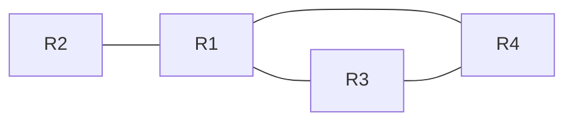

# RIP 路由协议

## 一、RIP 协议概述

RIP 的英文全称是 **Routing Information Protocol**，中文通常翻译为“路由信息协议”。在考研和技术文献中，一般直接使用 **RIP** 这一缩写。

RIP 是需要掌握的一种路由协议。路由协议与路由算法关系紧密：

- **路由协议**规定路由器之间如何交换必要的信息。
- 路由器交换的信息作为**路由算法的输入**。
- 路由算法处理这些信息，最终得到较优的转发路径。
- 转发路径最终通常以**路由表**的形式呈现。

从本质上看，路由协议要解决的是网络拓扑图中的最短路径问题。为此，需要明确网络中每条边的权值，以及路由器之间如何交换算法所需的信息。

本节主要学习：

1. RIP 在协议栈中的位置；
2. RIP 如何定义路径长度；
3. RIP 路由表的格式；
4. 运行 RIP 的路由器之间如何交换信息。

## 二、RIP 在协议栈中的位置

对于考试，重点记住以下内容：

| 项目              | 内容       |
| ----------------- | ---------- |
| 所属层次          | **应用层** |
| 使用的传输层协议  | **UDP**    |
| 使用的 UDP 端口号 | **520**    |

RIP 属于应用层协议，使用 UDP 提供的服务，并使用 UDP **520 端口**。端口号的具体含义可以在学习完传输层后再回顾。

### RIP 报文类型

RIP 定义了两种报文：

- **Request（请求报文）**
- **Response（响应报文）**

国内部分教材对这两种报文的具体格式介绍较少。就本节的考试重点而言，首先记住 RIP 属于应用层、使用 UDP、端口号为 520 即可；两种报文的具体格式可作为拓展内容阅读。

## 三、RIP 的基本规定

RIP 需要明确两个问题：

1. **如何定义一条转发路径的长度？**
2. **路由表采用什么格式？**

### 3.1 使用跳数衡量距离

RIP 使用**跳数（Hop Count）**衡量到达目的网络的距离。

基本规则如下：

- 每经过一个路由器，距离就增加 1。
- 可以把路由器看作图中的顶点，顶点之间每经过一个路由器，距离按跳数计算。
- 路由器到**直连网络**的距离为 1。
- RIP 认为，较好的路径是跳数较少的路径。

#### 示例一：主机 A 到主机 B

假设主机 A 到主机 B 的路径中间经过 4 台路由器，那么从 A 到 B 的距离为 5 跳。

```text
主机 A ── R1 ── R2 ── R3 ── R4 ── 主机 B 所在网络
          1跳   2跳   3跳   4跳   5跳
```

也就是说，**主机 A 到主机 B 的距离为 5**。

#### 示例二：路由器到目的网络的距离

假设路由器 R2 到主机 B 所属网络的路径需要经过 R3、R4，且 B 所属网络与 R4 直连，则：

```text
R2 ── R3 ── R4 ── 目的网络
     第1跳  第2跳  第3跳
```

因此，R2 到该目的网络的距离为 **3**。

每经过一个路由器，距离就加 1；路由器到直连网络的距离为 1。

### 3.2 RIP 的最大距离限制

RIP 对路径长度有明确限制：

- 合法路径的距离不能超过 **15**。
- 距离为 **16** 表示目的网络**不可达**。
- 因此，RIP 只适用于规模较小的自治系统。

例如，假设主机 A 和主机 B 之间需要经过 20 台路由器。如果某个运行 RIP 的路由器 R1 判断到达 B 所在网络的距离已经超过 15，那么 R1 就会认为该网络不可达，并丢弃需要转发到该网络的 IP 数据报。

这意味着，即使网络物理上存在一条路径，只要 RIP 计算出的距离超过 15，RIP 就会将目的网络视为不可达。

因此：

- **RIP：**适用于较小的自治系统。
- **OSPF：**大型自治系统通常可以使用 OSPF，后续再学习。

> **考试易错点：**RIP 中距离为 15 仍然是可达的；距离为 16 则表示不可达。

### 3.3 RIP 路由表的格式

每台路由器都需要维护自己的路由表。RIP 路由表至少包含以下三个关键字段：

| 字段                            | 含义                           |
| ------------------------------- | ------------------------------ |
| 目的网络（Destination Network） | 要到达的目标网络               |
| 距离（Distance）                | 到达目的网络的跳数             |
| 下一跳路由器（Next-hop Router） | 转发数据时应交给的下一台路由器 |

示例：假设某台路由器的名字为 R8，其路由表如下。

| 目的网络 | 距离 | 下一跳路由器 | 含义                          |
| -------- | ---: | ------------ | ----------------------------- |
| Net1     |    1 | 直连         | Net1 与 R8 直接相连           |
| Net2     |   16 | —            | Net2 不可达                   |
| Net3     |    2 | R6           | 经由 R6 到达 Net3，总距离为 2 |
| Net4     |    2 | R9           | 经由 R9 到达 Net4，总距离为 2 |

#### 如何理解这张路由表？

**第一行：Net1，距离为 1**

R8 到 Net1 的距离为 1，说明 Net1 是与 R8 直接相连的网络。

**第二行：Net2，距离为 16**

RIP 规定，距离为 16 表示网络不可达。因此，R8 无法到达 Net2。如果 R8 收到一个目的地址属于 Net2 的 IP 数据报，就会将其丢弃。

**第三行：Net3，距离为 2，下一跳为 R6**

如果要到达 Net3，R8 应先把数据报交给 R6。R8 到 R6 经过一跳，而 R6 到直连的 Net3 的距离为 1，因此总距离为 2。

**第四行：Net4，距离为 2，下一跳为 R9**

其含义与第三行类似：R8 通过下一跳路由器 R9 到达 Net4，总距离为 2。

#### 目的网络和下一跳路由器如何表示？

- 表中的 `Net1`、`Net2` 等只是简写。实际应用中，目的网络通常使用 **CIDR 记法**表示，即通过网络前缀表示某个网络。
- 表中的 `R6`、`R9` 也是简写。实际应用中，下一跳路由器通常用其 **IP 地址**表示，以标识下一台路由器。

### 3.4 路由表与距离向量的关系

RIP 底层使用**距离向量路由算法**。每台路由器需要掌握自己到本自治系统内各个目的网络的距离，这些距离信息包含在路由表中。

例如，R8 的路由表中，各目的网络对应的距离为：

| 目的网络 | 距离 |
| -------- | ---: |
| Net1     |    1 |
| Net2     |   16 |
| Net3     |    2 |
| Net4     |    2 |

其中的距离列就体现了 R8 到各个目的网络的距离向量。路由器会利用这些距离信息，通过距离向量路由算法动态寻找较优的转发路径。

## 四、RIP 路由器之间如何交换信息

可以从三个维度理解路由器之间的信息交换：

| 问题             | 要回答的内容                 |
| ---------------- | ---------------------------- |
| **Who（谁）**    | 一台路由器应该和谁交换信息？ |
| **What（什么）** | 路由器之间交换什么信息？     |
| **When（何时）** | 路由器何时交换信息？         |

### 4.1 Who：与哪些路由器交换信息？

假设某个自治系统内有四台路由器 R1、R2、R3、R4，并且它们运行 RIP。各路由器与邻居之间的关系如下：



根据这个示例：

- R1 的邻居是 R2、R3、R4。
- R2 只有一个邻居 R1。
- R3 的邻居是 R1、R4。
- R4 的邻居是 R1、R3。

RIP 路由器会向自己的**直接邻居**发送路由信息。

### 4.2 What：交换什么信息？

每台路由器都会维护自己的路由表。路由器之间交换的主要信息就是各自的**路由表**，也就是告诉邻居自己到达各个目的网络的距离向量。

这些信息通过 **RIP Response（响应报文）**发送。路由器将路由表封装到 RIP 响应报文中，再把报文发送给直接邻居。

如果一台路由器的路由表项较多，单个 RIP 响应报文无法全部携带，则需要拆分为多个报文。每个 RIP 响应报文最多携带 **25 个路由表项**的信息。

### 4.3 When：何时交换信息？

#### 定期更新

通常情况下，运行 RIP 的路由器会**每隔 30 秒**向自己的直接邻居发送完整路由表。

在上面的示例中：

- R1 每隔 30 秒向 R2、R3、R4 发送自己的路由表。
- R2 每隔 30 秒向 R1 发送自己的路由表。
- R3 每隔 30 秒向 R1、R4 发送自己的路由表。
- R4 每隔 30 秒向 R1、R3 发送自己的路由表。

路由表通过 RIP 响应报文发送。每台路由器持续接收邻居发来的距离向量，再通过距离向量路由算法更新自己的路由表。

路由器的路由表不是一次性形成的，而是**逐步生成、逐步更新**的。

#### 触发更新

有些自治系统还会采用**触发更新（Triggered Update）**机制，以加快 RIP 的收敛速度。

当路由器发现网络拓扑发生变化，或者自己的路由表发生变化时，就会迅速把相关变化发送给邻居，而不必等到下一次定期更新。

#### 定期更新与触发更新的区别

| 对比维度     | 定期更新                       | 触发更新                     |
| ------------ | ------------------------------ | ---------------------------- |
| 发送时机     | 按固定周期发送，通常每隔 30 秒 | 发现相关变化后尽快发送       |
| 发送目的     | 定期向邻居通告路由表           | 尽快传播路由变化             |
| 对收敛的影响 | 可能需要等待下一次更新         | 有助于更快传播变化、加快收敛 |

可以用“朋友之间互通消息”来理解：

- **定期更新：**大家每隔一段固定时间才互相分享新消息。
- **触发更新：**一旦有人得知新消息，就立即告诉身边的人。

触发更新有助于让路由变化更快地在自治系统内传播。不过，考试仍然需要掌握 RIP 的定期交换机制，并根据题意判断是否引入触发更新。

## 五、本节小结

本节主要介绍了 RIP 的位置、基本规定以及路由器之间的信息交换方式。

### 5.1 核心知识回顾

| 知识点                   | 需要记住的内容                               |
| ------------------------ | -------------------------------------------- |
| 协议层次                 | RIP 属于应用层协议                           |
| 传输层协议               | 使用 UDP                                     |
| 端口号                   | UDP 520 端口                                 |
| 报文类型                 | Request 请求报文、Response 响应报文          |
| 距离度量                 | 使用跳数衡量距离                             |
| 直连网络                 | 路由器到直连网络的距离为 1                   |
| 最大合法距离             | 15                                           |
| 不可达标记               | 距离为 16 表示不可达                         |
| 适用范围                 | 适用于较小的自治系统                         |
| 路由表字段               | 目的网络、距离、下一跳路由器                 |
| 目的网络的表示           | 通常使用 CIDR 记法                           |
| 下一跳的表示             | 通常使用下一跳路由器的 IP 地址               |
| 信息交换对象             | 直接邻居                                     |
| 定期更新                 | 通常每隔 30 秒发送完整路由表                 |
| 单个响应报文携带的表项数 | 最多 25 个                                   |
| 触发更新                 | 路由发生变化时尽快向邻居通告，有助于加快收敛 |

### 5.2 快速记忆

```text
RIP
├── 协议位置：应用层
│   └── UDP，端口 520
├── 距离度量：跳数
│   ├── 直连网络：距离为 1
│   ├── 最大合法距离：15
│   └── 距离为 16：不可达
├── 路由表字段
│   ├── 目的网络
│   ├── 距离
│   └── 下一跳路由器
└── 信息交换
    ├── 对象：直接邻居
    ├── 内容：路由表／距离向量
    ├── 周期：通常每隔 30 秒
    ├── 单个响应报文：最多 25 个路由表项
    └── 可采用触发更新加快收敛
```

本节内容以概念和文字性规定为主，可结合课件和教材进行回顾。
