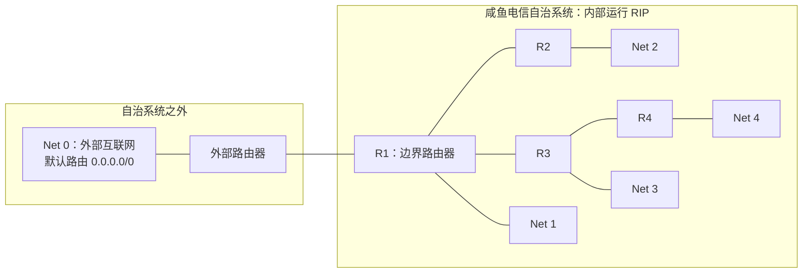
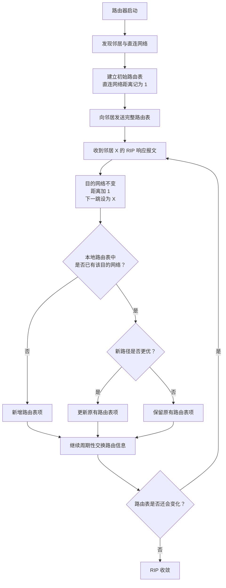

# RIP 路由协议的工作过程：综合实例

> **学习目标：** 结合一个自治系统内的四台路由器，理解 RIP 从路由器启动、初始化路由表、交换路由信息，到最终路由表收敛的完整过程。

## 一、RIP 工作过程的基本思路

RIP（Routing Information Protocol，路由信息协议）底层采用**距离向量路由算法**。在这个例子中，我们重点观察：

1. 路由器刚启动时，如何建立初始路由表。
2. 路由器如何向邻居发送 RIP 响应报文。
3. 收到邻居的路由表后，如何修改其中的距离和下一跳信息。
4. 路由器如何依据收到的信息更新自己的路由表。
5. 经过多轮交换后，为什么所有路由器最终会达到稳定状态，即 **RIP 收敛**。

## 二、案例背景与网络拓扑

假设某地有一家 ISP，名为“咸鱼电信”。它建立了自己的自治系统，并向上级 ISP 购买了一个 CIDR 地址块，再将地址块划分为四个网络。为了便于讲解，分别将四个网络简记为：

- `Net 1`
- `Net 2`
- `Net 3`
- `Net 4`

自治系统内部运行的内部网关协议是 RIP。

### 2.1 Net 0：自治系统外部网络

咸鱼电信的自治系统通过边界路由器 **R1** 与外部互联网连接。为了简化分析，可以把自治系统外部的整个互联网看作一个网络，记为 `Net 0`。

使用 CIDR 记法时，`Net 0` 可以表示为：

```text
0.0.0.0/0
```

它是一条**默认路由**。当 IP 数据报的目的地址无法匹配自治系统内部的 `Net 1`、`Net 2`、`Net 3`、`Net 4` 等网络路由时，就可以通过默认路由转发到自治系统外部。

R1 将数据报交给外部路由器之后，数据报在互联网中的后续转发不再是本例中 RIP 分析的重点。因此，R1 到 `Net 0` 的下一跳在表格中简记为“外部路由器”。

### 2.2 拓扑结构



拓扑关系如下：

| 路由器 | 与其直连的网络 | 本例中的路由器邻居 |
| ------ | -------------- | ------------------ |
| R1     | Net 0、Net 1   | R2、R3             |
| R2     | Net 2          | R1                 |
| R3     | Net 3          | R1、R4             |
| R4     | Net 4          | R3                 |

> **注意：** 上表中的“邻居”是指与该路由器相邻、可以交换 RIP 路由信息的路由器。本例假设所有设备同时开机，以便观察路由表从初始状态逐步变化的过程。

## 三、路由器启动：建立初始路由表

### 3.1 刚启动时，路由器知道什么？

RIP 路由器刚开始工作时，首先只能发现：

- 自己有哪些邻居路由器；
- 自己有哪些直连网络。

因此，每台路由器会先根据直连信息建立自己的初始路由表。

在本例所采用的记法中，**直连网络的距离记为 1**。

### 3.2 初始路由表

| 路由器 | 目的网络 | 距离 | 下一跳路由器 |
| ------ | -------- | ---: | ------------ |
| R1     | Net 0    |    1 | 外部路由器   |
| R1     | Net 1    |    1 | 直接交付     |
| R2     | Net 2    |    1 | 直接交付     |
| R3     | Net 3    |    1 | 直接交付     |
| R4     | Net 4    |    1 | 直接交付     |

说明：

- **直接交付**：目的网络与本路由器直连，数据可以在本地链路上交付，不需要再转发给其他内部路由器。例如，R1 到 `Net 1` 的路由表项。
- **外部路由器**：R1 是自治系统的边界路由器。数据报发往外部互联网时，通常先交给与 R1 相连的外部路由器。实际设备中，这个位置通常会记录外部下一跳路由器的 IP 地址。

此时，各路由器还不知道如何到达其他非直连网络。例如，R1 初始时不知道如何到达 `Net 2`、`Net 3` 和 `Net 4`。

## 四、RIP 如何交换并处理路由信息？

### 4.1 发送 RIP 响应报文

完成初始路由表的构建后，各路由器会立即向自己的邻居发送 RIP 响应报文。

RIP 响应报文中包含发送方的**完整路由表**。例如：

- R1 将自己的路由表发送给 R2 和 R3；
- R2 将自己的路由表发送给 R1；
- R3 将自己的路由表发送给 R1 和 R4；
- R4 将自己的路由表发送给 R3。

从启动时的第一次交换开始，此后各路由器还会**每隔 30 秒**向邻居周期性地发送 RIP 响应报文。

### 4.2 收到邻居 X 的路由表后，如何修改其中的路由表项？

假设路由器收到邻居 **X** 发来的 RIP 响应报文。对于报文中的每一个路由表项，都要先进行以下处理：

1. **目的网络号保持不变。**
2. **距离加 1。** 因为要经由邻居 X 再走一步，才能到达该邻居所通告的目的网络。
3. **下一跳改为邻居 X。** 因为本路由器若采用该条路由，就要先把数据报交给 X。

例如，R2 向 R1 通告自己到达 `Net 2` 的路由信息：

| 项目     | R2 通告的信息     | R1 收到并修改后的信息 |
| -------- | ----------------- | --------------------- |
| 目的网络 | Net 2             | Net 2                 |
| 距离     | 1                 | 2                     |
| 下一跳   | R2 自己的直连网络 | R2                    |

R1 到 `Net 2` 的候选路径距离为：

```text
R1 → R2 → Net 2
距离 = 1 + 1 = 2
```

这里的关键是：R1 根据 R2 通告的距离，加上自己到邻居 R2 的这一步距离，计算经由 R2 到达目的网络的总距离。

再例如，R3 向 R1 通告 `Net 3`，R1 收到后会把距离从 1 加到 2，并把下一跳设置为 R3。

### 4.3 收到修改后的路由信息后，如何更新自己的路由表？

完成上述修改后，路由器再把处理后的路由信息与自己的路由表进行比较。

- **原路由表中没有该目的网络：** 将该目的网络的路由表项添加到路由表中。这表示路由器发现了一个此前未知的目的网络。
- **原路由表中已有该目的网络：** 比较原路径与新路径的距离。若新路径更优，则更新相应表项；若新路径更差，或者本例中距离相同且没有更优路径，则保留原表项。

这一过程就是本例中距离向量路由算法的核心：路由器通过邻居提供的距离信息，逐步判断到达各目的网络的路径。

### 4.4 单轮处理流程



## 五、第一轮交换：启动时刻（0 秒）

### 5.1 各路由器发送初始路由表

在 `0` 秒时，各路由器完成初始路由表的建立，并立即向邻居发送自己的完整路由表。

R1 收到 R2 和 R3 的路由表后：

- R2 通告了 `Net 2`，R1 原先没有该目的网络，因此添加 `Net 2`，距离为 2，下一跳为 R2。
- R3 通告了 `Net 3`，R1 原先没有该目的网络，因此添加 `Net 3`，距离为 2，下一跳为 R3。

其他路由器也做类似处理：

- **R2** 收到 R1 的路由表，发现 `Net 0` 和 `Net 1`，于是添加这两个路由表项。
- **R3** 收到 R1 的路由表，发现 `Net 0` 和 `Net 1`，于是添加这两个路由表项；同时，R3 收到 R4 的路由表，发现 `Net 4`，于是添加该路由表项。
- **R4** 收到 R3 的路由表，发现 `Net 3`，于是添加该路由表项。

### 5.2 0 秒这一轮更新后的路由表

| 路由器 | 目的网络 | 距离 | 下一跳路由器 |
| ------ | -------- | ---: | ------------ |
| R1     | Net 0    |    1 | 外部路由器   |
| R1     | Net 1    |    1 | 直接交付     |
| R1     | Net 2    |    2 | R2           |
| R1     | Net 3    |    2 | R3           |
| R2     | Net 2    |    1 | 直接交付     |
| R2     | Net 0    |    2 | R1           |
| R2     | Net 1    |    2 | R1           |
| R3     | Net 3    |    1 | 直接交付     |
| R3     | Net 0    |    2 | R1           |
| R3     | Net 1    |    2 | R1           |
| R3     | Net 4    |    2 | R4           |
| R4     | Net 4    |    1 | 直接交付     |
| R4     | Net 3    |    2 | R3           |

经过这一轮交换，每台路由器都开始知道如何到达一部分非直连网络。不过，所有路由器还没有掌握整个自治系统内所有网络的路由信息。

## 六、第二轮交换：30 秒

到 `30` 秒时，各路由器再次将当前路由表打包成 RIP 响应报文发送给邻居。处理流程与上一轮相同：先将距离加 1，并将下一跳改成发送报文的邻居，再根据路由表中的目的网络与距离决定是否更新。

### 6.1 R1 新发现 Net 4

R1 收到 R3 通告的路由信息后，发现自己原先没有 `Net 4`。

R3 到 `Net 4` 的距离是 2，因此 R1 经由 R3 到达 `Net 4` 的距离为：

```text
R1 → R3 → R4 → Net 4
距离 = 2 + 1 = 3
```

所以，R1 将 `Net 4` 添加到路由表中：

| 目的网络 | 距离 | 下一跳路由器 |
| -------- | ---: | ------------ |
| Net 4    |    3 | R3           |

R1 从 R2、R3 收到的其他路由信息，要与原有路径进行比较。例如，R1 原本到 `Net 0`、`Net 1` 的距离都是 1；如果改经其他邻居转发，距离会更大，所以不会替换原有路由。对于已经存在且距离没有变得更优的路由，也不需要进行更新。

### 6.2 R2 新发现 Net 3

R2 收到 R1 通告的路由信息后，发现 `Net 3` 是此前未知的目的网络。

R1 到 `Net 3` 的距离为 2，因此 R2 经由 R1 到达 `Net 3` 的距离为 3：

| 目的网络 | 距离 | 下一跳路由器 |
| -------- | ---: | ------------ |
| Net 3    |    3 | R1           |

### 6.3 R3 新发现 Net 2

R3 收到 R1 通告的路由信息后，发现 `Net 2` 是此前未知的目的网络。

R1 到 `Net 2` 的距离为 2，因此 R3 经由 R1 到达 `Net 2` 的距离为 3：

| 目的网络 | 距离 | 下一跳路由器 |
| -------- | ---: | ------------ |
| Net 2    |    3 | R1           |

### 6.4 R4 新发现 Net 0 和 Net 1

R4 收到 R3 通告的路由信息后，发现此前还不知道如何到达 `Net 0` 和 `Net 1`。R3 到这两个网络的距离均为 2，因此 R4 经由 R3 到达它们的距离均为 3：

| 目的网络 | 距离 | 下一跳路由器 |
| -------- | ---: | ------------ |
| Net 0    |    3 | R3           |
| Net 1    |    3 | R3           |

### 6.5 30 秒这一轮更新的新增路由

| 路由器 | 本轮新增的目的网络 | 距离 | 下一跳路由器 |
| ------ | ------------------ | ---: | ------------ |
| R1     | Net 4              |    3 | R3           |
| R2     | Net 3              |    3 | R1           |
| R3     | Net 2              |    3 | R1           |
| R4     | Net 0              |    3 | R3           |
| R4     | Net 1              |    3 | R3           |

经过两轮交换（`0` 秒、`30` 秒），各路由器已经掌握了更多网络的路由信息，但仍有部分网络信息需要进一步传播。例如，R1 在本轮才学会到达 `Net 4`，R2 需要在后续交换中才能收到这条更新后的路由信息。

## 七、第三轮交换：60 秒

到 `60` 秒时，各路由器再次向邻居发送当前路由表。

### 7.1 R2 新发现 Net 4

R1 在上一轮已经学会通过 R3 到达 `Net 4`，距离为 3。现在 R2 从 R1 收到这条路由信息，需要将距离加 1，并把下一跳设置为 R1：

```text
R2 经由 R1 到达 Net 4
距离 = 3 + 1 = 4
```

因此，R2 新增以下路由表项：

| 目的网络 | 距离 | 下一跳路由器 |
| -------- | ---: | ------------ |
| Net 4    |    4 | R1           |

### 7.2 R4 新发现 Net 2

R3 在上一轮已经学会通过 R1 到达 `Net 2`，距离为 3。现在 R4 从 R3 收到这条路由信息，需要将距离加 1，并把下一跳设置为 R3：

```text
R4 经由 R3 到达 Net 2
距离 = 3 + 1 = 4
```

因此，R4 新增以下路由表项：

| 目的网络 | 距离 | 下一跳路由器 |
| -------- | ---: | ------------ |
| Net 2    |    4 | R3           |

### 7.3 60 秒这一轮更新的结果

| 路由器 | 本轮新增的目的网络 | 距离 | 下一跳路由器 |
| ------ | ------------------ | ---: | ------------ |
| R2     | Net 4              |    4 | R1           |
| R4     | Net 2              |    4 | R3           |

R1 和 R3 在本轮收到的路由信息，没有带来需要更新的路由表项。

至此，四台路由器都已经知道如何到达自治系统中的 `Net 0`、`Net 1`、`Net 2`、`Net 3` 和 `Net 4`。路由表进入稳定状态。

## 八、RIP 收敛：60 秒之后

### 8.1 最终路由表

下表汇总了本例中 RIP 收敛后的路由信息。

| 路由器 | 目的网络 | 距离 | 下一跳路由器 |
| ------ | -------- | ---: | ------------ |
| R1     | Net 0    |    1 | 外部路由器   |
| R1     | Net 1    |    1 | 直接交付     |
| R1     | Net 2    |    2 | R2           |
| R1     | Net 3    |    2 | R3           |
| R1     | Net 4    |    3 | R3           |
| R2     | Net 0    |    2 | R1           |
| R2     | Net 1    |    2 | R1           |
| R2     | Net 2    |    1 | 直接交付     |
| R2     | Net 3    |    3 | R1           |
| R2     | Net 4    |    4 | R1           |
| R3     | Net 0    |    2 | R1           |
| R3     | Net 1    |    2 | R1           |
| R3     | Net 2    |    3 | R1           |
| R3     | Net 3    |    1 | 直接交付     |
| R3     | Net 4    |    2 | R4           |
| R4     | Net 0    |    3 | R3           |
| R4     | Net 1    |    3 | R3           |
| R4     | Net 2    |    4 | R3           |
| R4     | Net 3    |    2 | R3           |
| R4     | Net 4    |    1 | 直接交付     |

### 8.2 时间线总结

| 时刻   | 主要变化                                                                            | 路由表状态                                                 |
| ------ | ----------------------------------------------------------------------------------- | ---------------------------------------------------------- |
| 启动时 | 各路由器发现邻居与直连网络，建立初始路由表，并立即交换完整路由表                    | 每台路由器只知道直连网络；第一轮交换后增加部分非直连网络   |
| 30 秒  | R1 学会到达 Net 4；R2 学会到达 Net 3；R3 学会到达 Net 2；R4 学会到达 Net 0 和 Net 1 | 路由信息继续向相邻路由器传播                               |
| 60 秒  | R2 学会到达 Net 4；R4 学会到达 Net 2                                                | 所有路由器均已掌握到达 Net 0 至 Net 4 的路由信息，RIP 收敛 |
| 90 秒  | 路由器继续周期性交换 RIP 响应报文，但没有需要更新的路由表项                         | 路由表保持稳定                                             |

### 8.3 什么是 RIP 收敛？

**RIP 收敛**是指：经过若干次路由信息交换和更新后，自治系统内各路由器的路由表达到稳定状态。此时，每台路由器都已经知道如何到达本自治系统内各个目的网络，以及相应的距离和下一跳路由器。

在本例中，路由表在 `60` 秒这一轮更新后达到稳定状态，因此称为 RIP 已收敛。

即使在 `90` 秒时，各路由器仍然会像之前一样继续发送 RIP 响应报文，但由于已有路由表项不会发生变化，所以路由表仍保持稳定。

## 九、考点回顾

RIP 的工作过程可以归纳为以下步骤：

1. **初始化：** 路由器启动后，先发现邻居与直连网络；初始路由表只包含直连网络，且本例将直连网络的距离记为 1。
2. **发送路由信息：** 路由器立即向邻居发送包含完整路由表的 RIP 响应报文，之后每隔 30 秒再发送一次。
3. **修改收到的报文：** 对邻居 X 通告的每个路由表项，目的网络号不变、距离加 1、下一跳设置为 X。
4. **更新路由表：** 若目的网络此前不在本地路由表中，则新增该路由表项；若已有该网络，则比较新旧路径，只有发现更优路径时才更新。
5. **不断迭代：** 路由器把新学到的路由信息继续通告给邻居，信息逐步传播到自治系统内的其他路由器。
6. **最终收敛：** 经过若干轮交换与更新后，各路由器都掌握到达自治系统内各目的网络的路由信息，路由表不再发生变化。

```text
路由器启动
   ↓
发现邻居与直连网络
   ↓
建立初始路由表
   ↓
发送完整路由表（RIP 响应报文）
   ↓
接收邻居路由表：距离 + 1，下一跳改为邻居
   ↓
比较并更新本地路由表
   ↓
每隔 30 秒继续交换
   ↓
路由表稳定 → RIP 收敛
```

**记忆重点：** RIP 通过与相邻路由器周期性地交换完整路由表，逐步学习到达其他网络的距离和下一跳信息；经过若干轮交换和更新后，路由表最终收敛。
