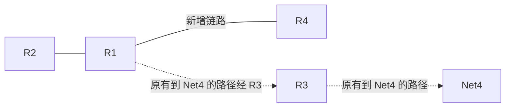
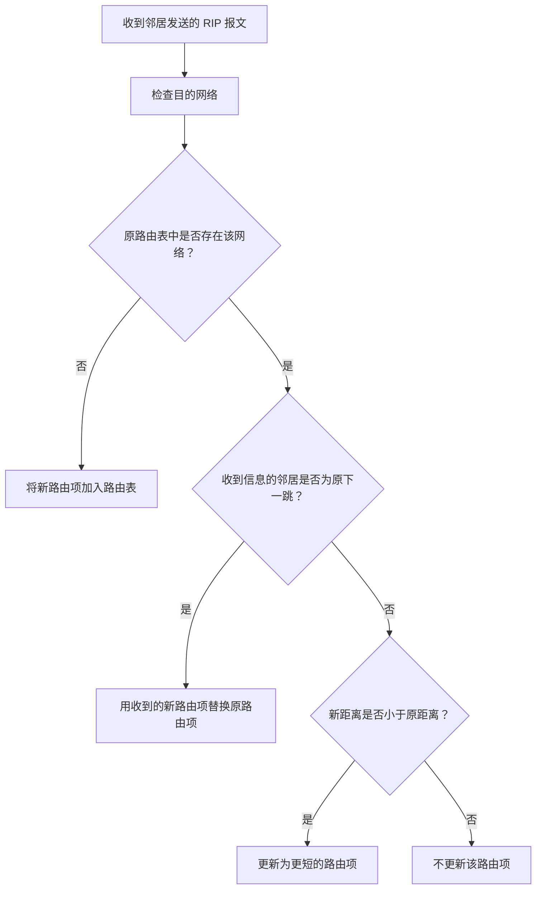

# RIP 协议的工作过程：网络拓扑变化后的路由更新

## 一、学习目标与背景

本节继续通过示例演示 **RIP 协议如何动态适应网络拓扑结构的变化**。

在上一节课中，时间来到 **90 时刻**。各台路由器交换各自的路由表信息后，本轮没有任何路由器需要更新路由表，因为此时 RIP 已经收敛。

接下来，假设网络拓扑发生变化：**在 100 时刻，R1 和 R4 之间新增了一条链路**。

理解本例时，需要关注三个时刻：

| 时刻 | 发生的事情                   | 结果                                   |
| ---- | ---------------------------- | -------------------------------------- |
| 90   | 各路由器交换路由表           | RIP 已经收敛，本轮路由表没有变化       |
| 100  | R1 与 R4 之间新增链路        | 网络拓扑发生变化，但周期性更新尚未到来 |
| 120  | 各路由器进行下一轮周期性更新 | R1、R4 的路由表发生变化                |
| 150  | 进行再下一轮周期性更新       | R2 的路由表发生变化，随后 RIP 再次收敛 |

## 二、100 时刻：网络拓扑发生变化

在 100 时刻，R1 与 R4 之间新增了一条链路。

这意味着：

- R1 和 R4 成为新的邻居。
- 在下一轮更新时，R1 会把自己的路由表发送给 R4。
- 同样，R4 也会把自己的路由表发送给 R1。

本例采用周期性更新的方式，因此新链路虽然在 100 时刻建立，但要等到 **120 时刻**才进行下一轮更新。

### 拓扑变化示意图

以下示意图只突出本例涉及的路由关系，重点是新增的 **R1—R4 链路**，并非完整网络拓扑图。



> **理解重点：** 新增链路后，部分路由器能够找到到达某些目的网络的更短路径。RIP 会通过交换路由信息，让这些变化逐步传播到其他路由器。

## 三、120 时刻：R1 与 R4 更新路由表

在 120 时刻，R1 和 R4 互相发送自己的路由表。收到邻居发送的 RIP 报文后，路由器会检查其中的路由项，并根据新的距离信息和下一跳信息，判断是否需要更新路由表。

本轮重点关注：

- R1 收到 R4 的路由表后，如何更新到 Net4 的路由。
- R4 收到 R1 的路由表后，如何更新到 Net0、Net1、Net2 的路由。

### 3.1 R1 收到 R4 的路由表

R1 逐一检查收到的路由项。当检查到 **Net4** 时，发现经由 R4 到达 Net4 的距离为 **2**。

而 R1 原先已知的到达 Net4 的最短距离是 **3**，原来的路径需要经由 R3 转发。

比较如下：

| 项目         | 原路由信息 | 收到的新路由信息 |
| ------------ | ---------- | ---------------- |
| 目的网络     | Net4       | Net4             |
| 下一跳路由器 | R3         | R4               |
| 距离         | 3          | 2                |

虽然 Net4 是 R1 以前就已经知道如何到达的网络，但现在发现了一条更短的路径。因此，R1 应当用更优的路由信息替换原来的路由信息。

**R1 的更新结果：到达 Net4 的下一跳改为 R4，距离由 3 更新为 2。**

### 3.2 R4 收到 R1 的路由表

R4 收到 R1 发来的报文后，发现经由 R1 到达 Net0、Net1、Net2 的距离分别为 **2、2、3**。

而 R4 原先知道的到达这些网络的最短距离分别为 **3、3、4**，原来需要经由 R3 转发。

比较如下：

| 目的网络 | 原下一跳 | 原距离 | 新下一跳 | 新距离 |
| -------- | -------- | -----: | -------- | -----: |
| Net0     | R3       |      3 | R1       |      2 |
| Net1     | R3       |      3 | R1       |      2 |
| Net2     | R3       |      4 | R1       |      3 |

新路径的距离更短，因此 R4 需要更新这三条路由信息。

**R4 的更新结果：到达 Net0、Net1、Net2 的下一跳改为 R1，距离分别更新为 2、2、3。**

### 3.3 120 时刻更新结果小结

| 路由器 | 目的网络 | 原距离 | 更新后距离 | 更新后的下一跳 |
| ------ | -------- | -----: | ---------: | -------------- |
| R1     | Net4     |      3 |          2 | R4             |
| R4     | Net0     |      3 |          2 | R1             |
| R4     | Net1     |      3 |          2 | R1             |
| R4     | Net2     |      4 |          3 | R1             |

在刚才这一轮更新中，除了 R1 和 R4 的路由表受到影响之外，其他路由器的路由表都没有变化。

> **这一轮的本质：** 目的网络没有变化，但路由器发现了到达已有目的网络的更短路径，因此更新下一跳和距离信息。

## 四、150 时刻：R2 更新到 Net4 的路由

时间来到下一轮更新，即 **150 时刻**。各路由器继续向自己的邻居发送路由表。

这一次，R2 的路由表受到影响。

R2 收到 R1 发来的新报文后，得知经由 R1 到达 Net4 的距离为 **3**。

而 R2 以前认为到达 Net4 的最短路径也是经由 R1，只是原来的距离为 **4**。

| 项目         | 原路由信息 | 收到的新路由信息 |
| ------------ | ---------- | ---------------- |
| 目的网络     | Net4       | Net4             |
| 下一跳路由器 | R1         | R1               |
| 距离         | 4          | 3                |

对于 R2 来说：

- 目的网络没有变化，仍然是 Net4。
- 下一跳路由器没有变化，仍然是 R1。
- 距离发生了变化，由 4 变为 3。

因此，R2 应当采用更新后的距离信息。

从整个网络的角度来看，R1 与 R4 之间新增链路后，R2 到达 Net4 的最短路径也随之缩短。原来需要经过 R1、R3、R4 才能到达 Net4；现在可以经过 R1、R4 到达 Net4。

**R2 的更新结果：到达 Net4 的下一跳仍为 R1，距离由 4 更新为 3。**

### 150 时刻更新结果小结

| 路由器 | 目的网络 | 原距离 | 更新后距离 | 更新后的下一跳 |
| ------ | -------- | -----: | ---------: | -------------- |
| R2     | Net4     |      4 |          3 | R1             |

经过这一轮更新，RIP 再次收敛。每台路由器都已经知晓在新的网络拓扑结构下，相关目的网络的最佳路径应该如何选择。

## 五、收到 RIP 报文后的路由表更新规则

结合前面的例子，可以理解收到邻居发送的 RIP 报文之后，路由器如何判断是否更新路由表。

收到邻居的 RIP 报文后，路由器会根据报文中的信息处理路由项。讲解中重点关注的字段包括：

- **目的网络**
- **距离**
- **下一跳路由器**

在处理收到的路由信息时，需要检查以下几种情况。

### 情况一：发现新的目的网络

如果发现一个新的目的网络，而原来的路由表中没有该网络的路由信息，就把这个新网络的相关路由信息加入自己的路由表。

```text
收到邻居发送的 RIP 路由项
          |
          v
原路由表中没有该目的网络？
          |
         是
          |
          v
将该目的网络的路由信息加入路由表
```

### 情况二：目的网络已存在，且下一跳地址相同

如果原来的路由表中已经有目的网络 N，并且原路由项的下一跳路由器地址就是 X（即收到该路由信息的邻居），那么就用收到的新路由项替换原来的路由项，以更新后的消息为准。

这对应本例 **150 时刻 R2 更新到 Net4 的路由**：

- R2 原先到达 Net4 的下一跳是 R1。
- R2 收到的更新信息仍然来自 R1。
- 下一跳没有变化，但距离从 4 变为 3。
- 因此，R2 按照更新后的距离修改路由表。

### 情况三：目的网络已存在，但下一跳地址不同

如果原来的路由表中已经有目的网络 N，但原路由项的下一跳地址不是 X，那么还需要比较收到的路由信息与原路由信息的距离。

如果收到的项目中的距离 **d 小于**原路由表中的距离，就进行更新，使用更短的路径替换原来的路由项。

这对应本例 **120 时刻 R1 更新到 Net4 的路由**：

- R1 原先到达 Net4 的下一跳是 R3，距离为 3。
- 新收到的路由信息来自 R4，下一跳发生了变化。
- 新路径的距离为 2，小于原来的距离 3。
- 因此，R1 使用新的路由项替换原有路由项。

### 三种情况对照表

| 情况                         | 原路由表中是否有该目的网络 | 下一跳是否相同 | 处理方式                     |
| ---------------------------- | -------------------------- | -------------- | ---------------------------- |
| 发现新网络                   | 没有                       | 不适用         | 将新网络的路由信息加入路由表 |
| 收到来自原下一跳的更新       | 有                         | 相同           | 用收到的新路由项替换原路由项 |
| 收到来自不同下一跳的更短路径 | 有                         | 不同           | 若新距离更小，则更新路由项   |

### 路由表更新判断流程图



> **复习要点：** 收到邻居的 RIP 报文后，先检查目的网络是否为新网络；如果是已有网络，再结合下一跳是否相同以及距离是否更短，判断是否需要更新路由表。

## 六、周期性更新与触发更新

RIP 通常默认采用**周期性更新**的方式交换路由信息。

在本例中：

- R1 与 R4 之间的链路在 100 时刻新增。
- 因为本例采用周期性更新，所以要等到 120 时刻，R1 与 R4 才进行下一轮路由信息交换。
- 因此，拓扑变化并不一定会立刻反映到所有路由器的路由表中，而是随着后续的路由信息交换逐步传播。

在一些自治系统中，为了加快 RIP 的收敛速度，可以采用**触发更新（Triggered Update）**机制。

例如，在 100 时刻，如果 R1 和 R4 检测到一条新链路连接到自己，那么路由器可以在检测到拓扑变化后，立即向相邻路由器发送自己的路由表，也就是发送 RIP 报文，而不必等待 30 秒后的下一轮周期性更新。

采用这种策略，可以加快 RIP 的收敛速度。

不过，本节例子没有引入触发更新机制，而是采用周期性更新的方式。这种方式也更符合历年真题中较常见的考法。

### 两种更新方式对比

| 更新方式   | 触发时机                                 | 特点                                           |
| ---------- | ---------------------------------------- | ---------------------------------------------- |
| 周期性更新 | 到达预定的更新周期时发送路由信息         | 可能需要等待下一轮周期，拓扑变化的传播相对较慢 |
| 触发更新   | 检测到相关网络拓扑变化后立即发送路由信息 | 不必等待下一轮周期，有助于加快收敛             |

## 七、本节总结

本节通过 R1 与 R4 之间新增链路的例子，说明了 RIP 如何动态适应网络拓扑变化。

1. **100 时刻：** R1 与 R4 之间新增链路，形成新的邻居关系。
2. **120 时刻：** R1 发现经由 R4 到达 Net4 的距离更短，因此更新到 Net4 的路由；R4 也发现经由 R1 到达 Net0、Net1、Net2 的距离更短，因此更新相应路由。
3. **150 时刻：** R2 收到 R1 发来的更新信息后，发现到达 Net4 的距离从 4 变为 3。虽然下一跳仍然是 R1，但距离发生变化，因此也需要更新。
4. 经过后续路由信息交换，RIP 再次收敛，各台路由器逐渐获得新网络拓扑下的最佳路径信息。
5. RIP 通常采用周期性更新；某些网络也可以使用触发更新机制，在拓扑变化后立即通告路由信息，以加快收敛。

**核心理解：** RIP 通过路由器之间持续交换路由信息，并根据目的网络、距离和下一跳等信息更新路由表，从而适应网络拓扑结构的变化。
