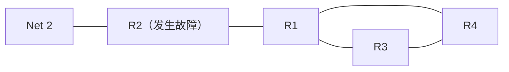
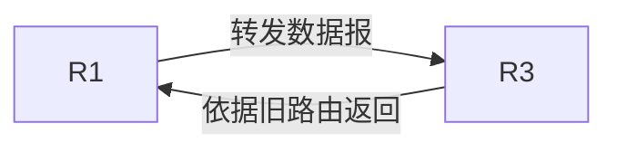
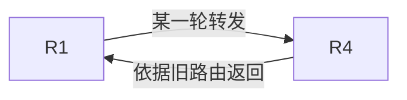
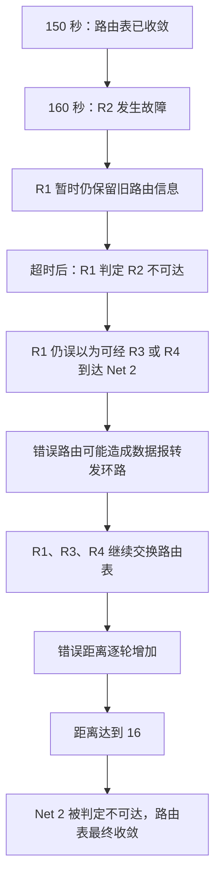

# RIP 协议的缺点：坏消息传播慢与慢收敛现象

## 一、学习重点

本节继续观察 RIP 协议的工作过程，重点理解它的缺点，尤其是**坏消息传播慢**，也就是**慢收敛现象**。

RIP 的主要缺点可以概括为：

1. **限制网络规模**：RIP 规定最大距离为 15，距离 16 表示不可达，因此只适用于较小的自治系统。
2. **交换完整路由表，开销较大**：路由器之间交换的是完整的路由表信息。网络规模越大，路由表越大，交换所带来的开销也越大。
3. **故障后的收敛速度较慢**：网络发生故障时，路由器之间需要反复多次交换信息，才能让所有路由器最终了解故障情况。
4. **可能出现转发环路**：距离向量路由算法在一段时间内可能产生错误的路由信息，使 IP 数据报在路由器之间兜圈子。

本节重点是第 3 点，并通过它进一步理解第 4 点。

---

## 二、RIP 的超时机制

RIP 使用定期交换路由信息的方式维护路由表。讲解中的例子采用每隔 **30 秒**交换一次路由信息的设定。

如果路由器**超过 180 秒仍然没有收到相邻路由器的更新信息**，就会认为该相邻路由器已经不可达，并把到达该路由器的距离设为 **16**。

| 参数    | 含义                               |
| ------- | ---------------------------------- |
| 30 秒   | 示例中相邻路由器交换路由信息的间隔 |
| 180 秒  | 等待邻居更新信息的超时时间         |
| 距离 16 | RIP 中表示目的网络或路径不可达     |

注意：路由器并不是在邻居实际发生故障的那一刻，就立刻知道故障发生了。它要等到超时条件满足后，才会把邻居判定为不可达。

---

## 三、故障场景：R2 路由器损坏

### 3.1 故障前的网络状态

在 **150 秒**这个时刻，各台路由器交换路由信息后，路由表已经达到收敛状态。

随后假设在 **160 秒**时，路由器 **R2** 损坏，导致 R2 失联。网络中的其他路由器并不会立刻知道这一变化。

下面用一个示意拓扑表示讲解中涉及的路由器和 Net 2。该图用于说明关系，不代表完整的物理网络细节。

### 3.2 R1 何时发现 R2 不可达？

R1 上一次收到 R2 的路由信息是在 **150 秒**。即使 R2 在 160 秒时损坏，R1 仍然要从上一次收到更新信息的时刻开始计算超时时间。

因此，按照“180 秒没有收到更新就判定邻居不可达”的规则，R1 会在最近一次更新后的 180 秒超时后，才把 R2 判定为不可达。讲解中以 **330 秒**作为这一判定时刻。

R1 原本认为自己到 R2 的距离为 1；判定 R2 不可达后，就把到 R2 的距离设为 **16**。

**关键点：R2 实际上早已损坏，但 R1 要等到超时后才能确认。**

### 3.3 R1 为什么误以为仍然可以到达 Net 2？

Net 2 原本需要通过 R2 转发。R2 不可达之后，从整个网络的真实情况来看，Net 2 已经不可达。

然而，R1 只依据邻居通告给它的路由信息进行判断，并不了解整个网络的真实拓扑。此前 R1 一直从 R3、R4 收到路由信息，认为它们到达 Net 2 的距离为 3。

R1 根据 RIP 的距离更新规则，将邻居通告的距离加 1，并把下一跳设置为通告该信息的邻居。因此，R1 会误以为：

- 通过 R3 可以到达 Net 2，距离为 4；
- 通过 R4 也可以到达 Net 2，距离为 4。

于是，R1 将这两条距离相等的路径都记录在路由表中。

| 路由器 | R1 对 Net 2 的判断    | 距离 | 下一跳   |
| ------ | --------------------- | ---: | -------- |
| R1     | 误以为 Net 2 仍然可达 |    4 | R3 或 R4 |

从全局视角看，这条路由信息是错误的；但从 R1 的局部视角看，它仍然是根据邻居提供的信息做出的判断。

现实网络中，通过其他路由器绕行到达 Net 2 的情况确实可能存在。因此，R1 不能只凭“R2 不可达”就断定 Net 2 一定不可达。

---

## 四、距离相等的多条路径与负载均衡

RIP 可以保留到达同一目的网络的多条**距离相等**的路径。

在本例中，R1 认为通过 R3 和 R4 到达 Net 2 的距离都为 4，因此可以同时记录这两条路径。

这种做法可以用于负载均衡。例如，采用轮询方式转发数据报：

1. 第一个 IP 数据报转发给 R3；
2. 第二个 IP 数据报转发给 R4；
3. 第三个 IP 数据报再转发给 R3；
4. 第四个 IP 数据报再转发给 R4。

如此轮流转发，可以在多条等距离路径之间分配流量。

但在本例中，R1 保存的路径信息并不符合网络的真实状况，因而这种多路径转发也可能参与形成转发环路。

---

## 五、错误路由信息如何导致 IP 数据报形成环路？

### 5.1 R1 与 R3 之间的转发环路

R1 认为可以通过 R3 到达 Net 2，于是将发往 Net 2 的 IP 数据报转发给 R3。

但 R3 根据自己尚未更新的路由表，又认为到达 Net 2 应该经过 R1，于是把数据报转回 R1。R1 再次查找路由表，又可能将数据报转发给 R3。

这样，数据报就在 R1 与 R3 之间反复转发。

如果 R1 选择转发给 R4，也可能发生类似的情况：

如果同时考虑 R3、R4 两条等距离路径，数据报也可能在 R1、R3、R4 之间来回转发。

### 5.2 TTL 如何限制数据报在环路中无限转发？

IP 数据报头部中的 **TTL（Time To Live，生存时间）**会随着每次路由转发而递减。当 TTL 减到 0 时，数据报就会被丢弃。

因此，即使错误的路由信息导致转发环路，数据报也不会无限期地在网络中转发，而是会在 TTL 耗尽后被丢弃。

需要区分两件事：

- **TTL 机制**：限制单个 IP 数据报在转发环路中持续存在的时间。
- **RIP 的路由收敛过程**：通过不断交换路由信息，让路由器逐步修正错误的路由表。

TTL 能限制数据报兜圈子，却不能立刻修复路由器中的错误路由信息。

---

## 六、RIP 如何逐步发现 Net 2 不可达？

RIP 的问题在于：R1、R3、R4 只依据邻居提供的信息更新自己的路由表。即使 Net 2 实际上已经不可达，错误的路由信息仍然可能在邻居之间传播。

### 6.1 一轮交换后，错误信息继续传播

当 R1 判定 R2 不可达后，它会修改本地路由表。随后，R1、R3、R4 继续交换各自的路由表。

R3 收到 R1 发来的路由表后，会对其中的距离加 1，并把下一跳改为 R1。这样，R3 可能得到一条到达 Net 2、距离为 5 的路由信息。

与此同时，R3 也会收到 R4 发来的路由信息。如果 R4 通告的距离更小，R3 就会采用更小的距离，并将下一跳改为 R4。R4 也会根据 R3 的通告进行类似的更新。

于是，R3 可能误以为通过 R4 能够到达 Net 2，而 R4 又可能误以为通过 R3 能够到达 Net 2。这种现象就像“左脚踩右脚、右脚踩左脚”，彼此依赖对方提供的旧信息。

### 6.2 后续每轮交换，距离继续增加

接下来又进入下一轮路由信息交换。R1 收到 R3、R4 的通告后，发现它们所通告的到达 Net 2 的距离增加了，于是继续更新路由表。

R3、R4 也会根据来自其他邻居的路由表信息进行更新。

在这个例子中，随着错误路由信息反复传播，路由器所认为的到达 Net 2 的距离会逐轮增加。由于示例中的交换间隔是 30 秒，所以每轮交换之间相隔 30 秒。

### 6.3 距离达到 16，最终才收敛

RIP 规定：

- 距离 **1～15** 可以表示可达路径的距离；
- 距离 **16** 表示不可达。

当到达 Net 2 的距离最终增加到 16 时，R1、R3、R4 才会最终认识到 Net 2 不可达，不再继续把它当作可达目的网络。

以讲解中的推算为例，当距离为 5 时，增加到 16 还需要经过：

\[
16 - 5 = 11 \text{ 轮}
\]

每轮间隔 30 秒，因此还需要：

\[
11 \times 30 = 330 \text{ 秒}
\]

讲解中以 **690 秒**作为最终达到稳定收敛状态的时刻。此时，各路由器都已把 Net 2 标记为不可达，距离记为 16；由于下一跳已经没有实际意义，可以不再指定下一跳。

### 6.4 过程总览

> **时间标记说明：**原讲解转写中个别时刻存在前后不一致的表述（例如同时出现 330 秒和 430 秒、360 秒和 460 秒）。上面的过程按讲解中的超时规则、每轮 30 秒的间隔及最终 690 秒的推算整理；具体时间点可结合原课件核对。核心结论不受这些时间标记差异影响。

---

## 七、为什么称为“坏消息传播慢”？

R2 在 **160 秒**时就已经损坏，但其他路由器并没有立即知道这一情况。

R1 要先等待超时，才能确认 R2 不可达。之后，R1、R3、R4 还可能依据彼此保留的旧路由信息，反复更新并传播错误的距离信息。

只有经过多轮路由信息交换，错误距离最终增加到 16，所有相关路由器才会认识到 Net 2 不可达，并达到新的收敛状态。

这就是 RIP 的**坏消息传播慢**，也称为**慢收敛现象**：

> 网络中出现故障后，路由器需要经过较长时间和多轮路由信息交换，才能让故障信息传播到所有相关路由器。

---

## 八、RIP 缺点归纳

| 缺点                 | 原因与影响                                                                   |
| -------------------- | ---------------------------------------------------------------------------- |
| 网络规模受限         | RIP 的最大有效距离为 15，距离 16 表示不可达，因此只适用于小型自治系统。      |
| 路由信息交换开销较大 | 路由器之间交换完整路由表；网络规模越大，路由表越大，交换开销也越大。         |
| 慢收敛               | 故障发生后，路由器需要反复多次交换信息，才能将故障情况传播到所有路由器。     |
| 可能出现转发环路     | 距离向量路由算法可能暂时产生错误路由信息，使 IP 数据报在路由器之间反复转发。 |

### 8.1 距离 16 规则的两面性

将最大距离限制为 15、用 16 表示不可达，是一种相对简单直接的限制方式。

它的作用是：当距离增加到 16 后，RIP 不再继续增加这一距离，避免路由器把更大的距离当作有效路径。

但这一机制也限制了网络规模，因为超过 15 跳的目的网络会被视为不可达。因此，RIP 更适合规模较小的自治系统。

### 8.2 本节结论

- RIP 的路由器依据邻居通告的信息更新自己的路由表，并不直接掌握整个网络的完整拓扑。
- 当网络发生故障时，旧的路由信息可能继续传播。
- 错误的路由信息可能使 IP 数据报发生转发环路；TTL 可以限制单个数据报在环路中持续转发。
- 距离向量路由算法需要经过多轮迭代，才能让路由器最终把不可达距离更新为 16。
- 因此，RIP 存在**坏消息传播慢、慢收敛**的问题。

本节重点讨论 RIP 的缺点；下一节再学习 RIP 的优点。
