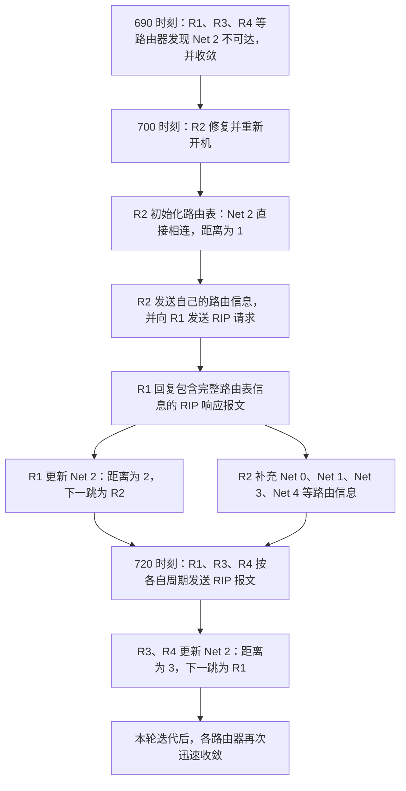

# RIP 协议的优点：好消息传得快

## 一、本节课的学习重点

上节课探讨了 RIP 协议的缺点，本节课继续通过示例理解 RIP 协议的优点，重点体会：

- **好消息传得快**：当路由器发现一条更短的路由时，更新信息能够在较短时间内传播到其他路由器。
- **简单、开销小**：距离向量路由算法的实现并不复杂。
- **收敛过程比较快**：在所有路由器同时开机的示例中，整个自治系统达到收敛状态所用的时间相对较短。

本节主要围绕“好消息传得快”展开。下面接着上节课的故事，观察路由器 R2 修复并重新接入网络后，RIP 路由信息如何快速传播。

## 二、700 时刻：R2 修复并重新接入网络

### 1. 690 时刻的背景

在 **690 时刻**，R1、R3、R4 等路由器经过多轮迭代，终于发现 **Net 2 不可达**。经过多轮更新，这些路由器最终都收敛了。

接下来假设：

- **700 时刻**：路由器 R2 修复完成，并顺利开机、重新接入网络。
- R2 重新启动后，需要重新初始化自己的路由表。

### 2. R2 初始化自己的路由表

一台路由器刚开始工作时，只能先探测到与自己直连的网络。

因此，重新接入网络的 R2 又回到了最初的起点。它重新初始化路由表，此时只能确定：

| 目的网络 | 距离 | 说明           |
| -------- | ---: | -------------- |
| Net 2    |    1 | 与 R2 直接相连 |

构建好初始路由表后，R2 会立即把自己的路由表信息发送给邻居。

与此同时，R2 还会主动向 R1 发送一个 **RIP 请求报文**，请求 R1 将自己所知道的路由信息告诉它。

### 3. R1 回复 R2 的请求

R1 收到 R2 发来的 RIP 请求报文后，会立即构造一个 **RIP 响应报文**。

RIP 响应报文中包含完整的路由表信息。随后，R1 与 R2 交换各自掌握的路由信息。这些事情在 R2 重新加入网络后很快就完成了。

### 4. R1 更新路由表

R1 收到 R2 发来的路由信息后，会根据收到的信息更新相应的距离和下一跳信息，再将新的路由信息与原有的 Net 2 路由表项进行比较。

R1 发现：

- 原先，R1 认为 **Net 2 不可达**。
- 现在，R2 告诉 R1：经由 R2 可以到达 Net 2。
- 更新后，R1 到 Net 2 的距离为 **2**，下一跳为 **R2**。

因此，这条新的路由信息应当替换原先“Net 2 不可达”的路由表项。

**R1 的变化：** 原本不可达的 Net 2，现在变成了可达，距离为 2，下一跳为 R2。

### 5. R2 根据 R1 的信息更新路由表

R2 收到 R1 的路由信息后，可以看到：

- **Net 0、Net 1、Net 3、Net 4** 都是 R2 原有路由表中缺失的目的网络，因此应将这些网络对应的路由信息加入路由表。
- 对于 **Net 2**，R1 通告的距离为 **16**。R2 不需要再将该距离加 1，因为 RIP 中距离 16 已经表示不可达，是距离的上限。

因此，R2 根据收到的信息更新路由表后，已经能够知道到达 Net 0、Net 1、Net 2、Net 3、Net 4 这些网络的最佳路由以及相应的最短距离。

R2 这台重新接入网络的路由器，迅速达到了收敛状态。

与此同时，R1 也迅速获得了“R2 已经恢复、Net 2 可以重新到达”的好消息，并将其反映到自己的路由表中。

## 三、720 时刻：好消息继续传播

### 1. 为什么 R2 没有在 720 时刻发送周期更新？

到 **720 时刻**，R1、R3、R4 又会发送 RIP 报文。

可能会有一个疑问：R2 为什么没有在 720 时刻向 R1 发送 RIP 报文？

原因是各台路由器的周期计时彼此独立：

- R2 在 **700 时刻**才重新开机，因此经过 30 秒后，它下一次周期更新的时刻是 **730**。
- R1、R3、R4 都是在 **0 时刻**开机的，因此到 **720 时刻**，它们刚好到达各自的下一次周期更新时刻。

这说明：**RIP 协议在每一台路由器上独立运行，各台路由器的计时不一定完全一致，但这并不影响 RIP 协议的正常运行。**

### 2. R3、R4 更新 Net 2 的路由信息

在 720 时刻，R1、R3、R4 将自己的路由表发送给各自的邻居。

R3 收到 R1 发来的路由信息后，发现：

- 原先，Net 2 不可达。
- 现在，Net 2 已经可达。
- 经由 R1 到达 Net 2 的距离为 **3**，下一跳为 **R1**。

因此，R3 会更新自己的 Net 2 路由表项。

R4 的情况相同：它也会根据收到的路由信息，更新 Net 2 的路由表项。

本轮迭代之后，所有路由器又迅速收敛。现在，每一台路由器都能够迅速获知 Net 2 已经可达这一信息。

## 四、关键时间线

| 时刻                | 发生的事情                                                                                   | 结果                             |
| ------------------- | -------------------------------------------------------------------------------------------- | -------------------------------- |
| 690                 | R1、R3、R4 等路由器经过多轮迭代，发现 Net 2 不可达并收敛                                     | 网络中相关路由器已收敛           |
| 700                 | R2 修复并重新开机，初始化路由表；发送自己的路由信息，并向 R1 发送 RIP 请求                   | R2 与 R1 很快交换路由信息        |
| 700 时刻之后        | R1 将 Net 2 更新为可达，距离为 2、下一跳为 R2；R2 补充 Net 0、Net 1、Net 3、Net 4 等路由信息 | R1、R2 很快更新路由表            |
| 720                 | R1、R3、R4 按各自的周期发送 RIP 报文                                                         | R3、R4 获知 Net 2 已经可达       |
| 720 本轮迭代之后    | R3、R4 更新 Net 2 路由表项，所有路由器再次迅速收敛                                           | Net 2 可达的好消息快速传播       |
| 730（按本例的计时） | R2 距离上次在 700 时刻开机已过 30 秒，到达下一次周期更新时刻                                 | 体现各台路由器的周期计时相互独立 |

## 五、过程示意图

下面用流程图概括本例中好消息的传播过程。

## 六、RIP 协议的优点总结

### 1. 好消息传得快

如果一个路由器发现了更短的路由，那么这种更新信息会很快传播出去，并能在较短时间内传递到所有路由器。这就是 RIP 的一个优点，俗称 **“好消息传得快”**。

在本例中：

1. R2 在 700 时刻重新接入网络。
2. R1 很快从 R2 获知 Net 2 可以到达，并更新路由表。
3. 到 720 时刻，R3、R4 又通过 R1 的路由信息获知 Net 2 已经可达。
4. 经过本轮迭代，所有路由器再次迅速收敛。

这说明，当网络中出现一条新的、更短的可达路径时，RIP 能够较快地传播这一好消息。

### 2. 简单、开销小

从算法实现的角度看，距离向量路由算法本身并不复杂，因此 RIP 协议具有**简单、开销小**的优点。

### 3. 收敛过程比较快

回顾前面讨论的所有路由器同时开机的情况，可以发现整个自治系统达到收敛状态所用的时间相对较短。因此，RIP 还具有**收敛过程比较快**这一优点。

## 七、复习提示

- 本节重点理解：**RIP 的好消息传播得快**。
- 重点回忆 700 时刻 R2 恢复后，R1、R2 如何交换路由信息并更新路由表。
- 重点回忆 720 时刻 R3、R4 如何通过 R1 获知 Net 2 已经可达。
- 注意各台路由器的周期计时是独立的：R1、R3、R4 在本例中于 720 时刻进行周期更新，而 R2 的下一次周期更新时刻是 730。
- 可以结合前几节课的课件，将 **0 时刻至 820 时刻**发生的事件整体重新梳理一遍。该系列示例用于帮助理解 RIP 协议工作过程中的主要知识点。

至此，本例所讲解的 RIP 协议工作过程结束。结合课件回顾完整时间线，可以进一步巩固 RIP 协议的工作原理，以及它的优点和缺点。
