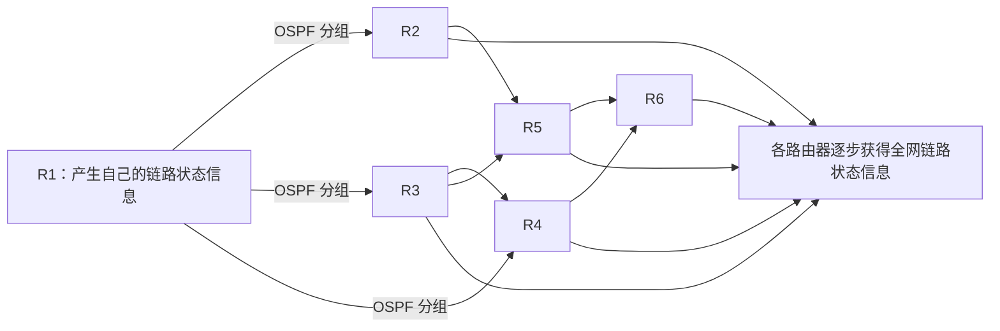
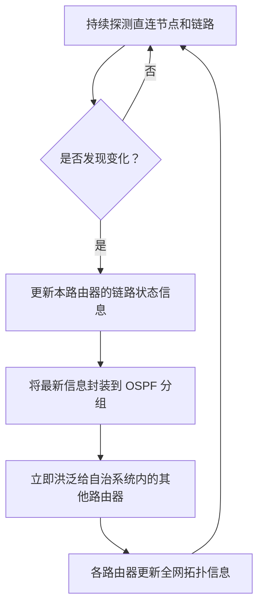
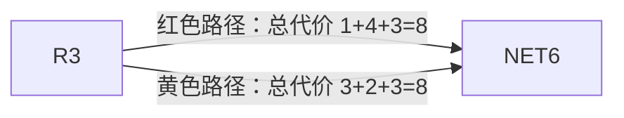
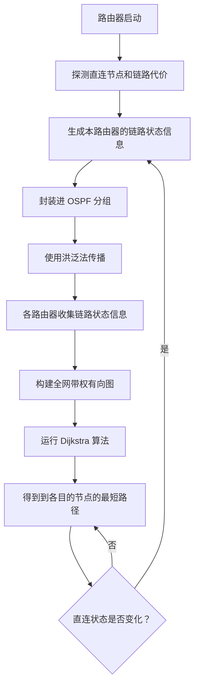

# OSPF 路由协议学习笔记

> **本节主题：** OSPF 的协议位置、分组类型、链路状态信息的洪泛过程，以及 OSPF 的主要特点。  
> **核心思路：** 各路由器先探测本地直连链路，再通过洪泛传播链路状态信息；每台路由器据此构建全网拓扑，并运行 Dijkstra 算法计算最短路径。

---

## 一、OSPF 协议的名称与基本概念

OSPF 的英文全称是 **Open Shortest Path First**，中文译名为**开放最短路径优先协议**。

- **Open（开放）**：表示该协议不归某个私人或私人组织所有，可以类比开源软件的“开放”。
- **Shortest Path First（最短路径优先）**：OSPF 底层使用 **Dijkstra（狄克斯特拉）算法**，尝试找到总代价最低的路径。

OSPF 属于网络层协议，基于**链路状态路由算法**工作。就算法而言，它使用 Dijkstra 算法计算从本路由器到各个目的节点的最短路径。

## 二、OSPF 在协议栈中的位置

### 2.1 OSPF 使用 IP 提供的服务

OSPF 属于网络层协议，使用 IP 协议提供的服务。若一个 IP 分组的数据部分携带的是 OSPF 数据，则 IP 首部中的 **协议字段（Protocol）应为 89**。

IP 首部中的协议字段用于标识 IP 分组的数据部分携带的是哪一种上层协议的数据。

### 2.2 OSPF 分组的组成

OSPF 的协议数据单元（PDU）称为 **OSPF 分组**，有些资料也称其为 OSPF 数据报。英文术语使用 `packet`，与 `IP packet`（IP 分组）中的用词一致；考研及国内主流教材通常称为“OSPF 分组”。

一个 OSPF 分组由两部分组成：

- **首部**
- **数据部分**

OSPF 首部中有一个 `Type` 字段。根据该字段的值，可以判断后续数据属于哪一种 OSPF 分组类型。

### 2.3 OSPF 的五种分组类型

| 类型值 | 中文名称         | 英文名称                                  | 本节需要掌握的内容           |
| -----: | ---------------- | ----------------------------------------- | ---------------------------- |
|      1 | 问候分组         | Hello Packet                              | 用于发现、维护邻居关系等     |
|      2 | 数据库描述分组   | Database Description Packet（DBD）        | 描述链路状态数据库中的信息   |
|      3 | 链路状态请求分组 | Link State Request Packet（LSR）          | 请求所需的链路状态信息       |
|      4 | 链路状态更新分组 | Link State Update Packet（LSU）           | 携带链路状态信息进行更新     |
|      5 | 链路状态确认分组 | Link State Acknowledgment Packet（LSAck） | 对链路状态更新等信息进行确认 |

> 这五种分组分别在什么时候使用，会在后续学习中结合工作过程进一步讨论。本节先对术语建立初步印象。

---

## 三、OSPF 的基本工作原理

### 3.1 示例网络与问题的提出

假设咸鱼电信构建了一个自治系统（AS），系统内有 6 台路由器 `R1` 到 `R6`，以及 `NET1` 到 `NET6` 这 6 个网络。该自治系统还连接外部互联网，可以把外部互联网整体视为 `NET0`。

如果使用 CIDR 记法表示整个外部网络，可以用默认路由 `0.0.0.0/0` 表示。

假设咸鱼电信规定在这个自治系统内部使用 OSPF 路由协议。

OSPF 基于链路状态路由算法，使用 Dijkstra 算法计算最短转发路径。要运行 Dijkstra 算法，路由器首先必须知道整个网络的拓扑结构。

### 3.2 用带权有向图表示网络拓扑

结合数据结构的知识，可以把整个网络抽象成一个**带权有向图**：

- 将每一台路由器、每一个网络视为图中的顶点。
- 将路由器与路由器之间的链路、路由器与网络之间的连接，抽象为带权有向边。
- 边上的权值表示相应方向上的链路代价。

当路由器建立起整个网络的带权有向图后，就可以在该图上运行 Dijkstra 算法，计算从自身出发到达每一个目的节点的最短路径。

在本节的讲解模型中，可以把带权有向图的存储理解为**邻接表**。邻接表的具体实现细节并不是本节的重点，重点是：每台路由器如何获得全网的拓扑信息。

### 3.3 每台路由器首先能探测到什么？

路由器开机运行后，可以直接探测到与自己相连的节点，并计算自己到这些直连邻居的链路代价。

例如，`R1` 可以独立探测到以下信息：

| 与 R1 直接相连的节点 | 示例中的链路代价 |
| -------------------- | ---------------: |
| R2                   |                3 |
| R3                   |                1 |
| R4                   |                3 |
| NET1                 |                1 |
| NET0                 |                2 |

这些信息表示：从 `R1` 这个节点出发，可以到达表中所列的直连节点，并且每条有向边都有相应的代价。

类似地，`R6` 开机后，也可以独立探测到与自己直接相连的节点，例如：

| 与 R6 直接相连的节点 | 示例中的链路代价 |
| -------------------- | ---------------: |
| R4                   |                4 |
| R5                   |                2 |
| NET6                 |                3 |

因此，每台路由器都可以独立知道自己的直连邻居是谁，以及到每个邻居的链路代价是多少。

### 3.4 用邻接表理解一台路由器的本地信息

可以把每台路由器自己探测到的信息理解为一份邻接表：

- 表头对应当前路由器。
- 表中记录当前路由器直接相连的各个节点。
- 每条记录还包含对应链路的代价。
- 由于直连节点既可能是路由器，也可能是网络，可以用不同类型的节点表示它们。

例如，`R1` 的本地邻接信息可概念化地表示为：

```text
R1
├── R2  （代价 3）
├── R3  （代价 1）
├── R4  （代价 3）
├── NET1（代价 1）
└── NET0（代价 2）
```

`R6` 也只能先建立自己的本地邻接信息：

```text
R6
├── R4  （代价 4）
├── R5  （代价 2）
└── NET6（代价 3）
```

**关键问题：** `R1` 只能直接探测到自己的邻居，`R6` 也只能直接探测到自己的邻居。那么，其他路由器各自建立的本地信息，如何才能被全网每台路由器知道？

这正是 OSPF 协议需要解决的问题。

---

## 四、链路状态信息与 LSA

### 4.1 什么是链路状态信息？

一台路由器可以独立探测到的信息，可以概括为：

1. 我是谁。
2. 我的邻居有哪些。
3. 我到每一个邻居的链路代价是多少。

这些信息称为**链路状态信息**。

路由器探测出与自己直连的所有链路状态信息后，需要把它们告诉自治系统中的其他路由器。

### 4.2 LSA 的含义

为了便于讲解，可以把一台路由器的本地链路状态信息理解为一份记录直连邻居及链路代价的列表，并将其称为 **LSA**。

LSA 是 **Link State Advertisement** 的缩写：

- `Link State`：链路状态。
- `Advertisement`：通告、广播告知。

从直观理解上说，路由器需要把自己探测到的链路状态信息“广而告之”，让其他路由器也能知道。

> **术语说明：** 严格来说，LSA 是 OSPF 链路状态通告这一协议数据对象，并不等同于某种特定的“单链表”数据结构。用邻接表或列表来类比，只是为了帮助理解其所描述的链路状态信息。

---

## 五、洪泛法：让链路状态信息传播到全网

### 5.1 洪泛法的基本过程

路由器会把自身的链路状态信息封装到 OSPF 分组中，再通过**洪泛法**（Flooding）将信息传播到自治系统内的其他路由器。

洪泛法可以直观理解为“一传十、十传百”：

1. `R1` 将携带自己链路状态信息的 OSPF 分组发送给直接相邻的路由器，例如 `R2`、`R3` 和 `R4`。
2. 这些路由器收到信息后，再把信息转发给自己的其他邻居。
3. 其他路由器继续转发，链路状态信息便逐步覆盖整个自治系统。
4. 各台路由器最终都能获得全网路由器所通告的链路状态信息。

### 5.2 洪泛法示意图

下面的图展示的是信息传播的概念流程，而不是前述示例网络的精确拓扑。



### 5.3 洪泛法的两个重要特点

#### 特点一：信息不应沿入口原路回流

一台路由器收到需要洪泛的信息后，会将其转发到**除接收该信息的入口之外的其他出口**。

例如：

- `R1` 把信息发送给 `R3`。
- `R3` 收到信息后，不应再把同一份信息从原入口发回 `R1`。
- `R3` 应把信息从其他可用出口继续转发。

同样，`R4` 如果从左上方链路收到信息，就不应沿该入口将信息再发回，而应向其他出口转发。

#### 特点二：重复收到同一条链路状态信息时，不应重复洪泛

例如：

- `R4` 第一次从 `R1` 收到某条链路状态信息，并已将其转发。
- 随后，`R4` 又从 `R3` 收到同一条信息。
- 对于已经处理过的重复信息，`R4` 不应再进行第二次相同的洪泛转发。

这两个特点可以避免信息在网络中无休止地循环转发。

### 5.4 洪泛法带来的结果

通过洪泛法，一台路由器探测到的直连链路状态信息可以迅速被其他路由器获知。

其他路由器也会在开机并构建好自己的链路状态信息后，通过洪泛法向全网传播。因此，各台路由器能够逐步建立整个网络的拓扑信息，并据此形成带权有向图的邻接表表示。

有了全网拓扑信息后，就可以进入下一步：运行 Dijkstra 算法计算最短路径。

---

## 六、网络拓扑发生变化时，OSPF 如何处理？

网络结构可能不断变化，例如：

- 新的路由器加入网络。
- 某条链路发生故障。
- 路由器或其他硬件出现故障。
- 原有链路的连接状态或代价发生变化。

OSPF 对此的处理方式是：

1. 路由器持续探测与自己直连的节点和链路状态。
2. 一旦探测到直连节点或链路发生变化，就更新自己的链路状态信息。
3. 链路状态信息更新后，立即再次通过洪泛法将最新信息传播给全网。



这意味着，无论发生的是好消息还是坏消息，一旦某台路由器探测到直连链路状态发生变化，就会迅速向全网通告。

因此，OSPF 不存在 RIP 那种由坏消息传播缓慢所引起的典型问题。其关键在于：**检测到直连链路状态变化后，立即更新并洪泛最新信息。**

---

## 七、OSPF 的其他主要特点

### 7.1 链路代价可以由自治系统灵活定义

OSPF 允许自治系统根据自身的业务属性和业务类型，灵活地定义链路代价的计算规则。

默认情况下，OSPF 使用带宽作为参考来度量链路代价：

\[
\text{链路代价}=\frac{\text{参考带宽}}{\text{接口实际带宽}}
\]

本例采用的参考带宽为 **100 Mbps**。

| 链路  | 设定的代价 | 参考带宽 | 对应的实际带宽 |
| ----- | ---------: | -------: | -------------: |
| R1—R3 |          1 | 100 Mbps |       100 Mbps |
| R5—R6 |          2 | 100 Mbps |        50 Mbps |

例如：

- `R1` 到 `R3` 的链路代价为 1，按这一默认度量示例，对应实际带宽为 100 Mbps。
- `R5` 到 `R6` 的链路代价为 2，按这一默认度量示例，对应实际带宽为 50 Mbps。

这里的 100 Mbps 是参考带宽常数，50 Mbps 是示例链路的实际带宽。

> **补充说明：** 实际设备中的 OSPF 代价由接口带宽与参考带宽等配置共同决定，具体取值还会受到设备实现和配置方式影响。本节按课件示例理解计算关系即可。

### 7.2 实际上应把双向链路抽象为两条有向边

为了让示意图更简洁，课件有时会把路由器之间的连接画成带权无向边。

但在实际的图模型中，两个节点之间的链路应抽象为**两条带权有向边**，两个方向的边权可以不相等。

本课程中，除非特别说明，否则为了简化示意图，默认相邻路由器之间两个方向的边权相同。历年真题中也可能采用这种简化画法，例如 2014 年相关大题的图示风格。

考试时可以按以下方式理解：

- 如果图中用无向边表示两个路由器相连，通常按题目约定将两个方向的边权视为相同。
- 如果题目明确给出两个方向不同的边权，则必须分别计算，不能擅自认为相同。

### 7.3 路由器到网络、网络到路由器的边权

在 OSPF 的这种图模型中：

- **路由器到直连网络**的有向边具有相应代价。
- **直连网络到路由器**的有向边，通常将代价视为 0。

例如，若 `R1` 到 `NET1` 的代价为 1，且 `R1` 到 `R2` 的代价为 3，则：

\[
d(R1, NET1)=1
\]

在原示例所表达的路径计算关系中，若从 `R1` 经代价为 3 的链路到达另一处，再经过代价为 1 的链路到达目标网络，则总代价按有向边权相加。例如：

\[
3+1=4
\]

如果把路径起点设为 `NET1`，那么“网络到直连路由器”的那一段边权需要按 0 计算。例如：

\[
0+3+1=4
\]

**考试注意：** 路由器到直连网络的边权与网络到路由器的边权不能混淆。按照本节的 OSPF 图模型，后一个方向通常视为 0。

### 7.4 支持多条等价路径共存

OSPF 支持到同一目的地存在多条总代价相同的最短路径，也就是支持等价多路径。

例如，对于 `R3` 到 `NET6`：

- 走红色路径，总代价为 \(1+4+3=8\)。
- 走黄色路径，总代价为 \(3+2+3=8\)。

两条路径的总代价相同，因此 `R3` 可以同时使用这两条路径转发数据。

一种简单的负载均衡策略是轮流使用不同路径：

- 第 1 个 IP 数据报走上面的路径。
- 第 2 个 IP 数据报走下面的路径。
- 第 3 个 IP 数据报再走上面的路径。
- 第 4 个 IP 数据报再走下面的路径。

这样便可以让 IP 数据报从不同的线路转发，实现负载均衡。



> 图中用两条并行关系表示两条等价路径；具体经过哪些中间路由器，以题目给出的网络拓扑为准。

### 7.5 OSPF 分组具有鉴别功能

OSPF 分组具有鉴别功能，目的在于保证只有可信赖的路由器才能交换可被接受的链路状态信息，提升自治系统的安全性。

#### 情形一：防止非法路由器伪造链路状态信息

假设黑客进入咸鱼电信的机房，并把一台未经授权的“黑路由器”接入 `R1` 附近。

这台黑路由器可能伪造链路状态信息，声称从自己出发到达 `NET2`、`NET3`、`NET4`、`NET5`、`NET6` 的距离都为 1。

如果其他路由器相信了这类虚假信息，就可能错误地转发 IP 数据报，严重时甚至影响整个自治系统的正常运行。

OSPF 的鉴别功能可以帮助路由器识别未经授权或不可信赖的信息，并将其丢弃，从而减少这类攻击的影响。

#### 情形二：防止转发过程中出现的错误信息被接受

即使某台路由器原本是合法的，也可能因受到攻击而转发错误的信息。

例如，`R3` 被攻击后，原本应由它转发的链路状态信息可能被恶意修改。如果其他路由器仅因为信息来自合法路由器 `R3` 就完全相信它，仍可能接受错误信息，影响整个自治系统。

因此，OSPF 的鉴别功能不仅与识别外部非法路由器有关，也有助于防范链路状态信息被伪造或篡改的风险。

### 7.6 支持可变长度子网划分与 CIDR

OSPF 支持**可变长度子网掩码（VLSM）**和**无分类编址（CIDR）**。

例如，咸鱼电信拥有一整块地址资源后，可以进一步将其划分为长度不同的子网：

- `NET1`
- `NET2`
- `NET3`
- `NET4`
- `NET5`
- `NET6`

这些子网可以具有不同的前缀长度，并使用 CIDR 记法表示。

### 7.7 链路状态信息带有 32 位序号

每台路由器在洪泛自己的链路状态信息时，会携带一个 **32 位序号**，用于区分链路状态信息的新旧，可以将其理解为信息的版本号。

#### 示例：R5 的链路状态信息发生变化

假设 `R5` 刚开机时，探测到自己与以下节点直接相连：

| 直连节点 | 初始链路代价 |
| -------- | -----------: |
| R3       |            3 |
| R6       |            2 |
| NET5     |            1 |

这可以看作 `R5` 最初始版本的链路状态信息。此时，序号可以从 1 开始；也可以从 0 开始，本质上是通过序号区分信息版本。

随后，假设发生了两个变化：

1. 在 `R5` 与 `R4` 之间新增加了一条链路。
2. `R5` 与 `R3` 之间的链路代价由 3 变为 2。

那么，`R5` 就会更新自己的链路状态信息。此时它与 `R3`、`R4`、`R6`、`NET5` 直接相连，对应代价分别为 2、1、2、1。

由于链路状态信息的版本已经更新，序号也应在原有基础上递增。

| 信息版本 | R5 的直连状态                                            | 序号含义               |
| -------- | -------------------------------------------------------- | ---------------------- |
| 初始版本 | R3（代价 3）、R6（代价 2）、NET5（代价 1）               | 较旧版本               |
| 更新版本 | R3（代价 2）、R4（代价 1）、R6（代价 2）、NET5（代价 1） | 序号递增，表示更新版本 |

当其他路由器在洪泛过程中收到同一来源的不同版本信息时，可以根据序号判断信息的新旧，并以较新的有效版本为准。

**记忆要点：序号用于识别链路状态信息的新旧；在本例的讲解模型中，序号越大，表示版本越新。**

---

## 八、OSPF 工作流程总览

可以把 OSPF 的核心工作过程总结为以下步骤：

1. **发现直连状态：** 每台路由器开机后，探测与自己直接相连的路由器、网络及其链路代价。
2. **形成链路状态信息：** 将“我是谁、我的邻居有哪些、到各邻居的代价是多少”等信息组织起来。
3. **封装并洪泛：** 把链路状态信息封装到 OSPF 分组中，并通过洪泛法传播给自治系统内的其他路由器。
4. **避免重复转发：** 信息不沿接收入口原路回流；已处理过的重复信息不再重复洪泛。
5. **构建全网拓扑：** 各路由器汇集全网链路状态信息，建立整个网络的带权有向图，可用邻接表理解其存储。
6. **计算最短路径：** 每台路由器基于全网拓扑运行 Dijkstra 算法，计算到各目的节点的最短路径。
7. **及时更新：** 一旦探测到直连节点或链路状态变化，就更新自己的链路状态信息，并立即再次洪泛。
8. **识别信息版本：** 链路状态信息携带序号，以区分信息的新旧。



---

## 九、本节重点回顾

### 9.1 OSPF 的基本定位

- OSPF 的英文全称是 **Open Shortest Path First**，中文称为开放最短路径优先协议。
- OSPF 属于网络层协议，使用 IP 提供的服务。
- 携带 OSPF 数据的 IP 分组，其 IP 首部协议字段为 **89**。
- OSPF 基于链路状态路由算法，使用 Dijkstra 算法计算最短路径。

### 9.2 为什么 OSPF 要洪泛链路状态信息？

单台路由器开机后，只能直接探测到自己的直连邻居及对应链路代价。它无法仅凭本地探测就知道全网的完整拓扑。

所以，各路由器需要将自己探测到的链路状态信息传播给其他路由器。通过洪泛，全网路由器都能逐步获得这些信息，并建立全网拓扑的邻接表表示。

### 9.3 洪泛法的关键规则

- 收到信息后，将其转发到除接收入口之外的其他出口。
- 对已经收到并处理过的重复链路状态信息，不再重复洪泛。
- 这两条规则能够防止洪泛信息无休止地循环转发。

### 9.4 网络变化时如何更新？

每台路由器持续探测自己的直连节点和链路。一旦检测到变化，就立即更新自己的链路状态信息，并再次洪泛给全网。这使得 OSPF 能够较快地向全网传播好消息和坏消息。

### 9.5 OSPF 的其他特点

| 特点                       | 含义或作用                                                                       |
| -------------------------- | -------------------------------------------------------------------------------- |
| 链路代价可灵活定义         | 自治系统可根据需要设置代价计算规则；默认情况下参考带宽与接口实际带宽共同影响代价 |
| 双向链路按有向边建模       | 两个方向的代价可以不同；为简化示意图，课程中通常约定两方向代价相同               |
| 路由器到网络的方向有代价   | 网络到直连路由器的反向边通常按代价 0 处理                                        |
| 支持等价多路径             | 多条总代价相等的最短路径可以共存，有助于实现负载均衡                             |
| 分组具有鉴别功能           | 有助于识别未经授权或被伪造、篡改的链路状态信息                                   |
| 支持 VLSM 与 CIDR          | 支持可变长度子网划分和无分类编址                                                 |
| 链路状态信息携带 32 位序号 | 用于区分信息的新旧版本                                                           |

---

## 十、便于考前速记

```text
OSPF
├── 协议定位
│   ├── 网络层协议
│   ├── 使用 IP 服务
│   └── IP 协议字段值：89
├── 最短路径计算
│   ├── 链路状态路由算法
│   ├── 全网拓扑：带权有向图
│   └── 最短路径算法：Dijkstra
├── 链路状态信息传播
│   ├── 每台路由器探测自己的直连状态
│   ├── 形成并通告 LSA
│   ├── 封装进 OSPF 分组
│   ├── 洪泛至自治系统内其他路由器
│   └── 信息变化后立即更新并再次洪泛
└── 其他特点
    ├── 链路代价可灵活定义
    ├── 支持等价多路径与负载均衡
    ├── 分组具有鉴别功能
    ├── 支持 VLSM 和 CIDR
    └── 链路状态信息带有 32 位序号
```

> **最终理解：** OSPF 的关键思路是让各台路由器通过洪泛共享链路状态信息，从而了解整个自治系统的拓扑；在此基础上，每台路由器独立运行 Dijkstra 算法，计算从自己出发到各个目的地的最短路径。
