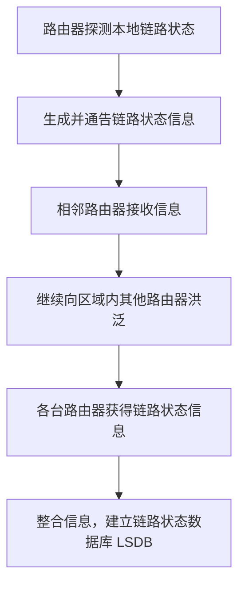
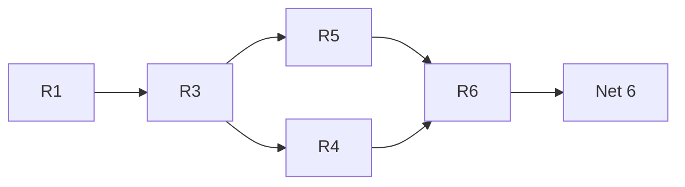
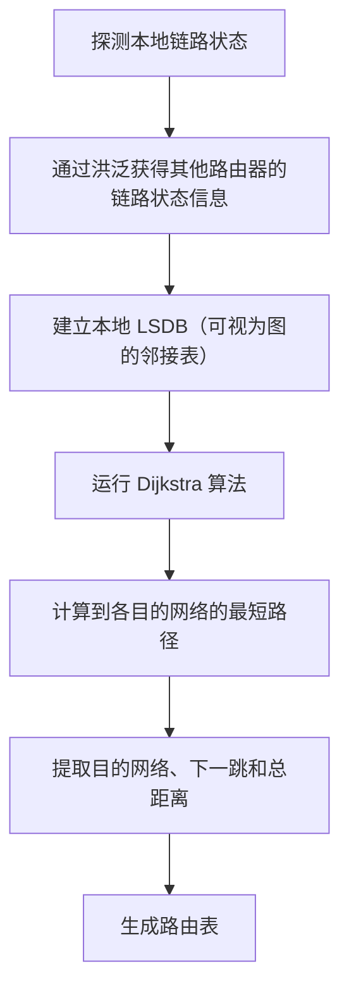
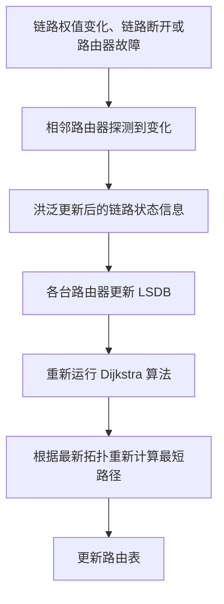
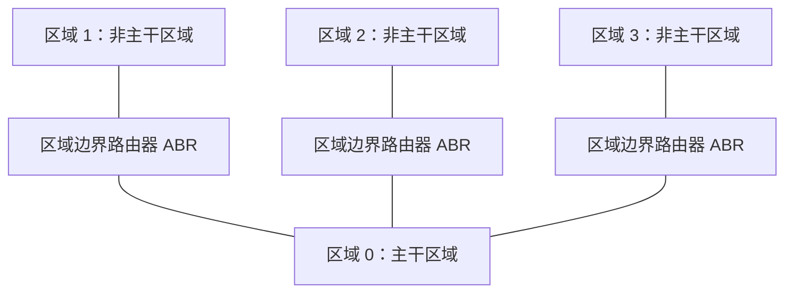
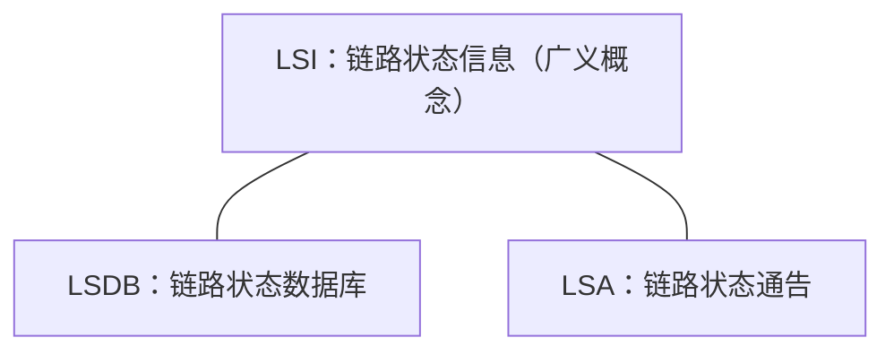
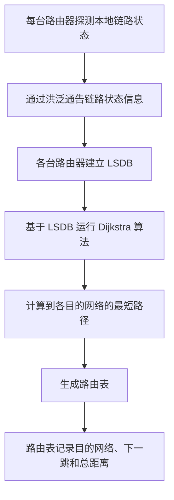

# OSPF 协议基本工作原理（二）：链路状态数据库、最短路径计算与区域划分

> **学习主线：** 链路状态信息洪泛 → 建立链路状态数据库（LSDB）→ 运行 Dijkstra 算法 → 生成路由表。  
> 为了控制大型自治系统中的数据库规模、洪泛流量和算法开销，OSPF 还支持区域划分。

---

## 一、OSPF 路由器如何获得网络拓扑信息

### 1. 每台路由器先探测本地链路状态

对于运行 OSPF 的自治系统，每台路由器都可以直接探测自己与哪些节点相连，以及自己与相邻节点之间的链路权值。

例如，R1 可以探测到自身相邻的节点和链路信息，R6 也可以探测到它自己相邻的节点和链路信息。这些都是各台路由器能够独立探测到的信息。

### 2. 使用洪泛法通告链路状态

每台路由器会把自己探测到的链路状态信息，通过**洪泛法（Flooding）**迅速通告给其他路由器。

洪泛的基本过程可以概括为：

所有路由器都进行这样的操作后，各台路由器就能够迅速收到其他路由器发来的链路状态信息。

### 3. 从邻接表到链路状态数据库 LSDB

把所有路由器探测到的链路状态信息整合起来，就形成了一个完整的网络拓扑表示。

在数据结构课程中，这种图的存储方法可以用**邻接表**来表示。在 OSPF 中，这个完整的链路状态信息集合称为：

- **链路状态数据库**
- 英文：**Link-State Database**
- 缩写：**LSDB**

可以把 LSDB 理解为：把各个路由器探测到的链路状态信息整合到一起，形成对网络拓扑结构的描述。

由于 OSPF 使用洪泛机制，自治系统内的路由器能够较快地建立自己的 LSDB。

---

## 二、基于 LSDB 运行 Dijkstra 算法

### 1. 计算从本路由器出发的最短路径

路由器建立 LSDB 后，就可以把其中的网络拓扑信息视为图，并基于该图运行 **Dijkstra（狄杰斯特拉）算法**，计算从自己出发到各个目的网络的最短路径。

例如，R1 根据自己的 LSDB 进行计算，可以得到以下结果：

- 到达 **Net 0** 的最短路径总长度为 2。
- 到达 **Net 1** 的最短路径是直达，链路权值为 1。
- 到达 **Net 4** 的一条最短路径是：R1 → R3 → R4 → Net 4。
- 到达 **Net 6** 存在两条等价的最短路径：
  1. R1 → R3 → R5 → R6 → Net 6
  2. R1 → R3 → R4 → R6 → Net 6

到达 Net 6 的这两条路径总长度都为 9。虽然完整路径不同，但从 R1 出发，两条路径的**下一跳都是 R3**。

> **注意：** Dijkstra 算法计算的是从起点到各个目的节点的最短路径。对于 OSPF 的这个例子，改进后的算法还可以支持多条等价最短路径。

两条等价路径可用下图表示：

无论 R1 最终选择上述哪一条路径，R1 都只需要把发往 Net 6 的 IP 数据报交给 R3；后续如何转发由后续路由器继续处理。

### 2. Dijkstra 算法与路由表生成流程

从路由器构建路由表的角度看，整体过程如下：

Dijkstra 算法的具体运行过程，可以回顾数据结构课程中的相关内容。这里重点理解 OSPF 如何利用 LSDB 计算最短路径，并据此生成路由表。

### 3. 基础版和改进版 Dijkstra 算法

数据结构课程中介绍的基础版 Dijkstra 算法，通常用于求从起点到终点的一条最短路径。

本例中的 OSPF 使用了改进的 Dijkstra 算法，可以支持发现多条**等价的最短路径**。因此，到达 Net 6 时，可以同时存在两条总长度都为 9 的最短路径。

---

## 三、OSPF 路由表记录什么信息

### 1. 路由表的关键信息

OSPF 路由表至少包含以下三类关键信息：

| 字段               | 含义                                       |
| ------------------ | ------------------------------------------ |
| 目的网络           | IP 数据报希望到达的目的网络                |
| 下一跳路由器       | 本路由器应将 IP 数据报交给哪台下一跳路由器 |
| 到目的网络的总距离 | 从本路由器到目的网络的路径总权值           |

课件中的 `Net 0`、`Net 1`、`Net 2`、`Net 4`、`Net 6` 等，是为了方便说明而使用的简写。实际的目的网络通常用**网络 IP 地址和子网掩码**来表示。

例如，Net 1 可以使用一个 IP 地址及 `/26`（即子网掩码前缀长度为 26 位）来表示。

### 2. 根据例子理解路由表

根据讲解中明确给出的信息，可整理为下表：

| 目的网络 | 下一跳路由器                     | 到目的网络的总距离 | 说明                                          |
| -------- | -------------------------------- | -----------------: | --------------------------------------------- |
| Net 1    | 直接交付，不需要填写下一跳路由器 |                  1 | R1 与 Net 1 直连                              |
| Net 2    | R2                               |                  4 | 示例中的总距离为 3 + 1 = 4                    |
| Net 4    | 根据最短路径转发                 | 原文未给出具体数值 | 最短路径为 R1 → R3 → R4 → Net 4               |
| Net 6    | R3                               |                  9 | 存在两条等价最短路径，且从 R1 看下一跳都是 R3 |
| Net 0    | 与 R1 相连的外部路由器           | 原文未给出具体数值 | 用默认路由映射自治系统外部的整个互联网        |

> 表格仅整理讲解中明确提到的字段和值；原文没有明确给出数值的地方，不额外推算。

### 3. 直连网络与 Net 1

R1 与 Net 1 直连，因此访问 Net 1 属于**直接交付**。此时路由表不需要填写下一跳路由器的地址。

### 4. Net 2 的转发过程

到达 Net 2 时，R1 先把 IP 数据报转发给 R2，再由 R2 转发到 Net 2。示例中的总距离为：

\[
3 + 1 = 4
\]

因此，下一跳路由器是 R2，到 Net 2 的总距离为 4。

### 5. Net 0 与默认路由

在这个例子中，Net 0 用来表示自治系统外部的整个互联网，可以用一条**默认路由**映射。

当 R1 收到一个 IP 数据报时，会根据目的 IP 地址匹配路由表中的目的网络。如果没有匹配到更具体的目的网络，就可以匹配默认路由，将数据报转发到 Net 0 对应的外部方向。

通常，本自治系统的 R1 会与其他自治系统的一台外部路由器直接相连，所以默认路由的下一跳信息通常记录为这台外部路由器的 IP 地址。原图没有画出这台外部路由器，因此示意时直接称为“外部路由器”。

### 6. 路由表只需要记录下一跳，不必记录完整路径

运行 Dijkstra 算法后，路由器可以知道从自身到各个目的网络的完整最短路径，但路由表不需要把完整路径全部存下来。

例如，到达 Net 6 时，R1 可能通过以下任意一条等价路径到达目的网络：

- R1 → R3 → R5 → R6 → Net 6
- R1 → R3 → R4 → R6 → Net 6

对于 R1 来说，两条路径的下一跳都是 R3，路径总长度也都为 9。因此，R1 只需要在路由表中记录下一跳 R3，而不需要记录完整路径。

**核心结论：路由器知道完整的最短路径，但路由表主要记录目的网络、下一跳和到目的网络的总距离。**

---

## 四、网络拓扑变化后，OSPF 如何更新路由表

自治系统内部的网络拓扑可能发生变化，例如：

- 链路权值发生变化；
- 某条链路断开；
- 某台路由器发生故障。

这些变化会先被与变化位置直接相邻的路由器探测到。邻居发现变化后，会重新洪泛相关链路状态信息。

新的链路状态信息传播后，各台路由器的 LSDB 会随之发生变化。LSDB 一旦变化，路由器就会重新运行 Dijkstra 算法，根据最新的网络拓扑重新计算最短路径，并更新路由表。

因此，OSPF 构建和维护路由表的过程可以概括为：

1. 先构建本地 LSDB，也就是获得网络拓扑的图表示；
2. 基于 LSDB 运行 Dijkstra 算法，计算最短路径；
3. 根据最短路径结果生成路由表；
4. 拓扑变化时，通过洪泛更新 LSDB，并重新计算和更新路由表。

---

## 五、为什么大型自治系统需要划分 OSPF 区域

### 1. 自治系统过大时的三个压力

在规模不大的网络中，LSDB 的大小通常比较容易接受。但如果自治系统非常庞大，例如某些公有云服务商的自治系统内部可能包含五万甚至十万台路由器，那么把整个自治系统的拓扑都放进一份统一的拓扑表示中，会带来明显的开销。

主要包括：

1. **LSDB 规模变大：** 每台路由器都要保存一份链路状态数据库，数据库会变得庞大、复杂。
2. **洪泛通信量变大：** 每台路由器探测到的链路状态信息都需要传播到相应范围内的其他路由器。路由器数量巨大时，洪泛消息的数量也会非常多。
3. **Dijkstra 算法运算开销变大：** 网络拓扑规模越大，计算最短路径的开销也会增加。

### 2. OSPF 使用区域划分

为了解决这些问题，OSPF 支持把一个自治系统划分为多个**区域（Area）**。

示例中的自治系统被划分为四个区域：

- 区域 0
- 区域 1
- 区域 2
- 区域 3

每个区域使用一个 **32 位区域标识符**进行标记。

划分区域后，链路状态信息的洪泛范围可以限制在相应区域内部。例如，R2 在区域 1 中洪泛链路状态信息时，区域 1 内的 R1、R3 等路由器可以收到相应信息；但 R3 不会仅仅因为收到区域 1 的这条区域内洪泛信息，就把该信息继续向区域 0 洪泛。这样可以减少洪泛带来的网络通信量。

区域划分也使区域内部路由器的 LSDB 变小。例如，R2 主要需要关心本区域内的网络拓扑，不需要在本地保存其他所有区域的完整拓扑。LSDB 变小后，图的规模也随之减小，从而有助于控制 Dijkstra 算法的运算开销。

### 3. 区域划分的作用

| 问题                        | 区域划分带来的作用                       |
| --------------------------- | ---------------------------------------- |
| 整个自治系统的拓扑过大      | 将拓扑划分到不同区域管理                 |
| 洪泛消息传播范围过大        | 将相应链路状态信息的洪泛限制在区域范围内 |
| 每台路由器的 LSDB 过大      | 区域内部路由器主要维护本区域的拓扑信息   |
| Dijkstra 算法的运算开销增大 | 较小的拓扑数据库有助于控制计算开销       |

---

## 六、主干区域、区域边界路由器与区域内部路由器

### 1. 主干区域 Area 0

在 OSPF 的区域划分中，**区域 0 是主干区域**，也常被称为**骨干区域**。英文术语是 _Backbone Area_。

在一个 OSPF 自治系统中，主干区域只有一个。它处于中心位置，作用是连通其他非主干区域。

### 2. 非主干区域必须与主干区域相连

通常，每个非主干区域都需要与主干区域直接相连，并通过区域边界路由器与主干区域交换跨区域路由信息。

例如，如果一个新划分的区域 4 只通过区域 3 相连，而没有与区域 0 直接相连，那么这种结构不符合这里讲解的 OSPF 区域设计要求。若要新划分区域 4，它也应与主干区域直接相连。

随着区域数量增加，主干区域承担的跨区域转发和互联压力也会增大，因此区域数量并不能无限制地增加。讲解中给出的现实世界拓展例子是：一个大型自治系统内部可能划分为约 30 到 50 个普通区域，再加上一个主干区域。

### 3. 区域边界路由器 ABR

**区域边界路由器**的英文是 _Area Border Router_，缩写为 **ABR**。

例如，图中的 R3、R4、R7 属于区域边界路由器。它们同时连接主干区域和至少一个非主干区域，因此需要了解与自己相连的相关区域的拓扑信息。

对于非主干区域中的普通路由器，如果希望把 IP 数据报转发到其他区域，可以先把数据报交给本区域的区域边界路由器，再由该路由器选择后续的转发路径。

可以把区域边界路由器理解为不同区域之间的连接点。

### 4. 区域内部路由器

区域内部路由器也可以称为**非边界路由器**。示例中的 R1、R2、R5、R8、R9 属于区域内部路由器。

这类路由器主要负责本区域内的 IP 数据报路由转发。需要发往其他区域时，会先转发给本区域的区域边界路由器，再由边界路由器继续向外转发。

区域内部路由器所维护的 LSDB 较小，主要包含本区域的节点及其链路信息。区域边界路由器则需要掌握与自己相连的不同区域的相关拓扑信息，所以其维护的信息范围会更大。

### 5. 自治系统边界路由器 ASBR

**自治系统边界路由器**负责本自治系统与外部自治系统之间的 IP 分组路由转发。

示例中的 R6 是自治系统边界路由器。它与其他自治系统相连，负责本自治系统和外部自治系统之间的网络通信。

如果本自治系统与其他自治系统之间的网络通信量较大，也可以设置第二台、第三台或更多台自治系统边界路由器。

### 6. 三类路由器对比

| 路由器类型         | 英文名称 / 缩写                          | 主要作用                                                 | 示例               |
| ------------------ | ---------------------------------------- | -------------------------------------------------------- | ------------------ |
| 自治系统边界路由器 | Autonomous System Boundary Router / ASBR | 连接本自治系统与其他自治系统，负责自治系统之间的路由转发 | R6                 |
| 区域边界路由器     | Area Border Router / ABR                 | 连接主干区域与非主干区域，承担区域之间的连接作用         | R3、R4、R7         |
| 区域内部路由器     | 区域内部路由器，也称非边界路由器         | 主要负责本区域内的路由转发                               | R1、R2、R5、R8、R9 |

区域关系可用下面的概念图辅助理解。图中仅表达区域之间的逻辑连接关系，不用于表示原例中每条具体链路的完整拓扑。

---

## 七、LSDB、LSA 与 LSI 的区别

这三个缩写都有共同前缀 **LS**，表示链路状态（Link State），但含义不同，阅读教材、做题或查资料时需要区分。

### 1. LSDB：链路状态数据库

- 英文：**Link-State Database**
- 缩写：**LSDB**
- 含义：整合起来的链路状态数据库，可以把它理解为整个网络拓扑的图表示，例如邻接表。

### 2. LSA：链路状态通告

- 英文：**Link-State Advertisement**
- 缩写：**LSA**
- 含义：OSPF 协议定义的一种数据结构，用来描述链路状态信息。
- 例子：R1 探测到自己周围的链路状态后，可以用 LSA 这样的数据结构保存相关信息，再通过 OSPF 分组使用洪泛机制向其他路由器通告。

从逻辑上理解，LSA 是一份具体的链路状态通告。路由器通过 OSPF 分组传播这些通告。

### 3. LSI：链路状态信息

- 英文：**Link-State Information**
- 缩写：**LSI**
- 含义：一个广义概念，泛指链路状态信息。

可以从不同范围使用 LSI 这个术语：

- R1 探测到的信息，可以称为链路状态信息；
- R1、R2、R3 等路由器探测到的信息，也可以称为链路状态信息；
- 整个 LSDB 中包含的内容，也都属于链路状态信息；
- 甚至某一条链路的相关信息，也可以视为链路状态信息。

讲解中提到，2014 年的一道真题就出现过 LSI 这个术语，因此这些缩写值得注意。

### 4. 三者对比

| 缩写 | 英文全称                 | 中文含义       | 理解重点                                        |
| ---- | ------------------------ | -------------- | ----------------------------------------------- |
| LSDB | Link-State Database      | 链路状态数据库 | 整合后的数据库，包含拓扑相关信息                |
| LSA  | Link-State Advertisement | 链路状态通告   | OSPF 定义的具体数据结构，用于描述和通告链路状态 |
| LSI  | Link-State Information   | 链路状态信息   | 广义概念，泛指链路状态信息本身                  |

### 5. 用“书”作类比

可以把 LSDB、LSA、LSI 类比成一本书：

- **LSDB 像一本书**：表示整合后的链路状态数据库。
- **LSA 像书中的某个章节**：表示一份具体的链路状态通告。
- **LSI 像书的内容**：可以指书中的一个字、几个章节，也可以指整本书所包含的内容。

这个类比的重点是：LSI 的范围最宽，LSA 是具体的链路状态通告，而 LSDB 是整合后的链路状态数据库。

> 上图用于辅助记忆术语之间的含义关系，不表示协议内部结构的严格层级。

---

## 八、拓展：更完整的 LSDB 还包含网络节点的信息

### 1. 网络也可以作为图中的节点

在自治系统的拓扑图中，除了路由器节点之外，每一个网络也可以被视为一个节点。

前面为了方便说明，主要描述了从路由器节点出发，到达与它相邻的其他节点的有向边及其权值。但如果要画出更完整的拓扑，还需要补充网络节点到与之相邻的路由器节点之间的有向边权值。

### 2. 网络节点到相邻路由器的边权值

在这个拓展例子中，从 Net 1 到 R1，以及其他相应网络节点到相邻路由器的方向，也会在拓扑图中表示出来。

例如，OSPF 将一个直连网络到达其相邻路由器这一方向的边权值视为 **0**。也就是说：

- 路由器到网络的方向，可以使用相应链路信息中的权值；
- 网络到相邻路由器的反向有向边，在本例的拓展说明中权值为 0。

因此，若将 LSDB 的图表示画得更完整，就需要把网络节点出发的这些有向边及其权值也纳入考虑。

### 3. 为什么前面较简化的邻接表已经够用

虽然完整的 LSDB 还包含更多拓扑信息，但对于一台路由器来说，如果目标是计算从自身出发到各个目的网络的最短路径，前面介绍的那部分链路信息已经足以说明主要过程。路由器可以基于相应拓扑信息运行 Dijkstra 算法，并据此生成路由表。

这一部分属于拓展内容，简要了解即可。

---

## 九、本节总结

### 1. OSPF 生成路由表的基本流程

### 2. 核心知识点回顾

1. 每台 OSPF 路由器能够探测自己相邻的节点以及相应链路的权值。
2. 路由器通过**洪泛法**通告自己探测到的链路状态信息，使其他路由器能够获得这些信息。
3. 整合各路由器的链路状态信息，就形成了**链路状态数据库 LSDB**；可以把它理解为网络拓扑图的一种存储表示，例如邻接表。
4. 每台路由器根据自己的 LSDB 独立运行 Dijkstra 算法，计算从自身出发到各个目的网络的最短路径。
5. 路由表不必保存完整的最短路径，只需记录目的网络、下一跳路由器和到目的网络的总距离等关键信息。
6. 当链路权值变化、链路断开或路由器出现故障时，变化会被相邻路由器探测到，并通过洪泛传播；LSDB 更新后，路由器会重新运行 Dijkstra 算法并更新路由表。
7. 为了控制大型自治系统中的 LSDB 规模、洪泛通信量和 Dijkstra 算法运算开销，OSPF 支持区域划分。
8. OSPF 使用一个主干区域（区域 0）和多个非主干区域。非主干区域通常需要与主干区域直接相连。
9. 常见的三类路由器是**自治系统边界路由器 ASBR、区域边界路由器 ABR、区域内部路由器**。
10. **LSDB** 是链路状态数据库，**LSA** 是链路状态通告，**LSI** 是广义的链路状态信息，三者不要混淆。

### 3. 最简记忆链

> **探测链路状态 → 洪泛通告 → 建立 LSDB → 运行 Dijkstra → 生成路由表；网络规模过大时，通过区域划分控制 LSDB 与洪泛开销。**
