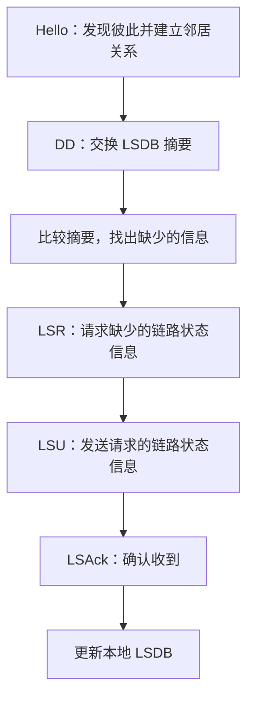
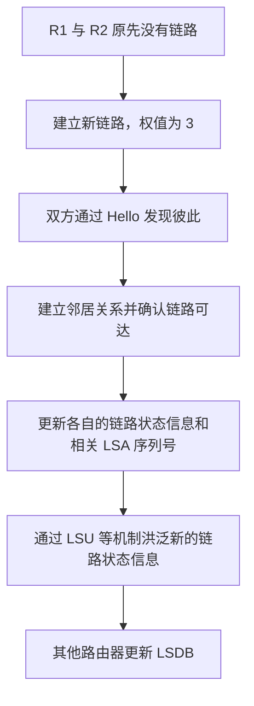
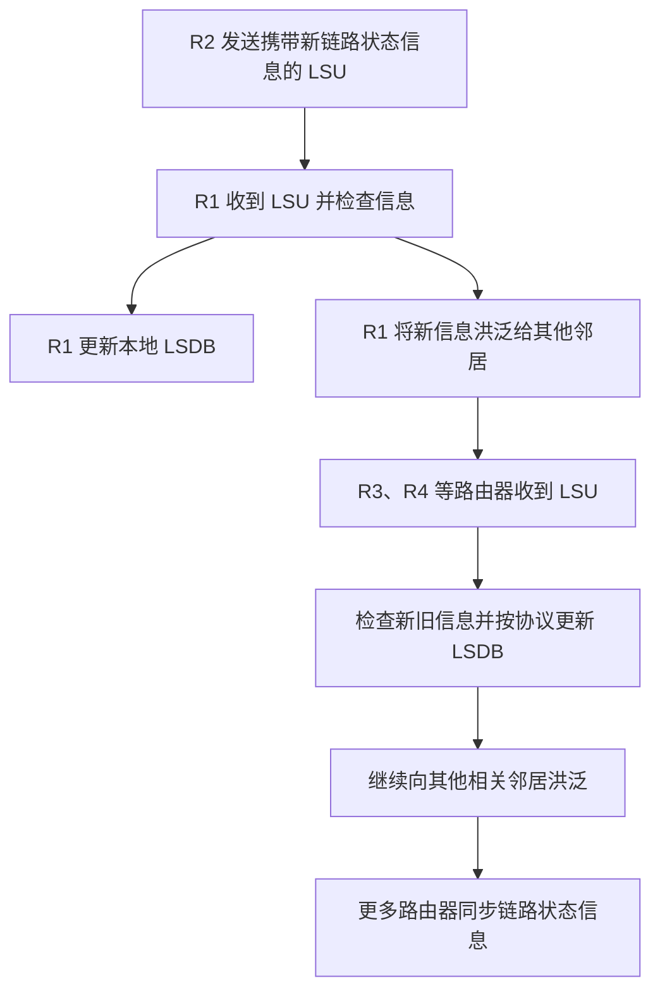
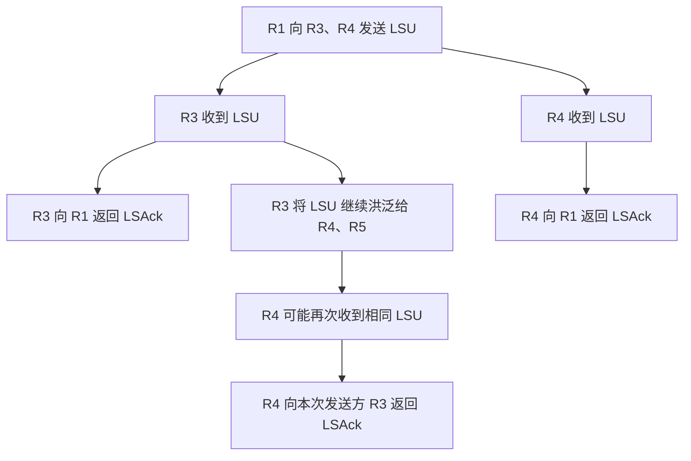
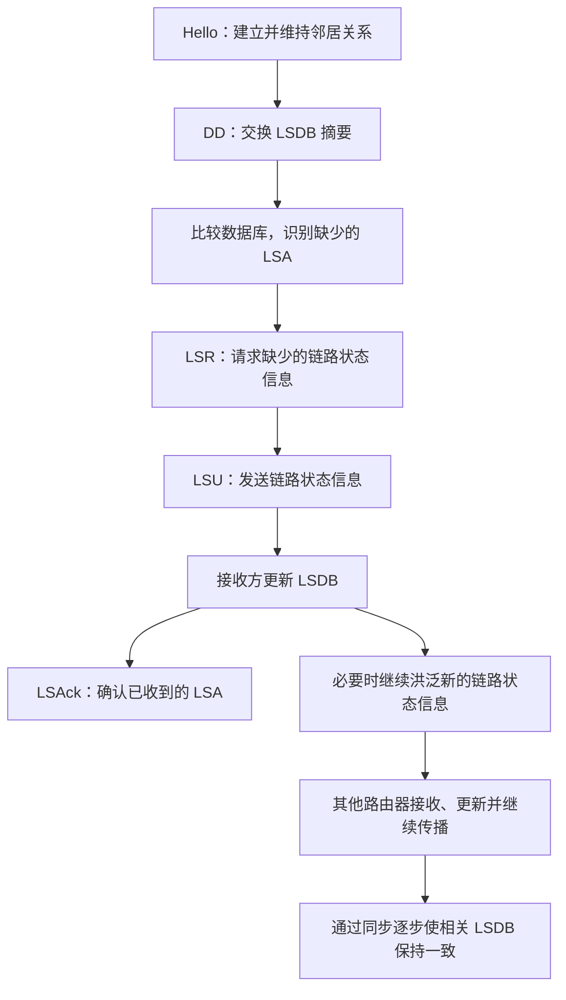

# OSPF 协议的五种分组类型

> **本节主题：** OSPF 的五种分组类型、邻居建立后的数据库同步过程，以及链路状态信息的可靠洪泛。  
> **核心记忆：** Hello 建立并维持邻居关系；DD 交换数据库摘要；LSR 请求链路状态信息；LSU 发送链路状态信息；LSAck 确认收到的链路状态信息。

---

## 一、OSPF 分组类型概览

OSPF（Open Shortest Path First，开放最短路径优先）属于**网络层**协议。OSPF 协议数据单元称为 **OSPF packet（OSPF 分组）**。

OSPF 定义了五种分组类型，通过 OSPF 首部中的 **Type 字段**标记分组类型。

| Type 值 | 分组名称         | 英文名称                  | 常用缩写 | 主要作用                                               |
| ------: | ---------------- | ------------------------- | -------- | ------------------------------------------------------ |
|       1 | 问候分组         | Hello Packet              | Hello    | 建立和维持邻居关系，检测邻居是否可达                   |
|       2 | 数据库描述分组   | Database Description      | DD       | 在邻居之间交换链路状态数据库的摘要信息                 |
|       3 | 链路状态请求分组 | Link State Request        | LSR      | 请求邻居提供自己缺少的链路状态信息                     |
|       4 | 链路状态更新分组 | Link State Update         | LSU      | 携带并发送链路状态信息；也是洪泛链路状态信息的核心分组 |
|       5 | 链路状态确认分组 | Link State Acknowledgment | LSAck    | 确认已收到链路状态更新信息，提高传输可靠性             |

> **注意：** OSPF 的五种分组类型分别是 Hello、DD、LSR、LSU 和 LSAck。不要把它们与 LSA（链路状态通告）这种数据结构混淆。

## 二、理解五种分组：同桌互相对答案的例子

可以把两台刚建立邻居关系的路由器想象成刚刚成为同桌的两位同学。两人需要了解彼此会做哪些题，找出自己不会的题目，再交换完整答案，最后确认答案已经收到。

| 分组  | 类比                     | 实际作用                                     |
| ----- | ------------------------ | -------------------------------------------- |
| Hello | 相互打招呼、签到         | 确认彼此存在以及链路可达，建立和维持邻居关系 |
| DD    | 告诉同桌自己会做哪些题   | 交换 LSDB 的摘要信息                         |
| LSR   | 请求抄某几道题的答案     | 请求缺少的 LSA 信息                          |
| LSU   | 把题目的完整答案发给同桌 | 发送 LSA 等链路状态信息                      |
| LSAck | 告诉同桌答案已经收到     | 确认收到链路状态信息                         |

### 2.1 同步过程示意图

这套“打招呼—交换摘要—请求缺少内容—发送具体内容—确认收到”的过程，可以帮助理解五种分组各自的分工。

---

## 三、先区分三个重要术语：LSDB、LSA 与 LSA Header

在理解各类分组之前，需要先区分以下术语。

### 3.1 LSDB：链路状态数据库

**LSDB（Link-State Database，链路状态数据库）**记录网络拓扑相关的链路状态信息。

在运行 OSPF 的自治系统中，每台路由器都会维护自己的 LSDB。根据 OSPF 的区域划分，一台路由器保存的数据库内容与它所在的区域及其可获得的链路状态信息有关。

### 3.2 LSA：链路状态通告

**LSA（Link-State Advertisement，链路状态通告）**是 OSPF 中描述链路状态信息的数据结构。可以把 LSDB 理解为由多个 LSA 组成的数据库。

### 3.3 LSA Header：LSA 头部信息

每个 LSA 都有头部信息（LSA Header）。头部中包含用于标识和判断 LSA 的信息，例如：

- 该 LSA 的相关标识信息；
- 创建该 LSA 的路由器等信息；
- LSA 的序列号等版本信息。

在后续的说明中，需要特别区分：

- **LSDB：** 链路状态数据库；
- **LSA：** 数据库中的链路状态通告；
- **LSA Header：** LSA 的头部信息。

---

## 四、第一种分组：Hello 问候分组

### 4.1 主要作用

Hello 分组主要用于：

1. 发现并建立邻居关系；
2. 维持已有的邻居关系；
3. 检测邻居是否仍然可达。

可以把 Hello 理解成路由器之间定期进行的“签到打卡”。

### 4.2 周期性发送与邻居失效判断

在本节示例中：

- 每台路由器每隔 **10 秒**向直接邻居发送一次 Hello 分组；
- 如果一台路由器超过 **40 秒**没有收到某个邻居的 Hello 分组，就会认为该邻居不可达。

例如：

- R1 每隔 10 秒向直接邻居 R3、R4 发送 Hello；
- R3 每隔 10 秒向直接邻居 R1、R4、R5 发送 Hello；
- 其他路由器也采用类似方式与自己的直接邻居保持联系。

> 这里的 10 秒发送间隔和 40 秒失效时间是本节示例采用的数值，用来说明 Hello 分组的作用。

### 4.3 邻居不可达会影响 LSDB

假设 R1 超过 40 秒没有收到 R4 的 Hello 分组，那么 R1 会认为与 R4 的邻居关系已经失效，相关链路状态信息也需要随之更新。

当检测到链路断开时：

1. R1 更新本地链路状态信息；
2. 相应的 LSA 内容发生变化，序列号需要更新；
3. R1 通过 LSU 等机制将变化洪泛给其他相关路由器；
4. 其他路由器收到新的链路状态信息后，更新自己的 LSDB。

**重点：** Hello 本身用于发现、维持邻居关系；链路状态发生变化后，还需要通过链路状态信息的更新与洪泛，让其他路由器同步变化。

### 4.4 新链路建立的例子

假设原先 R1 与 R2 之间没有链路，R1、R3、R4、R5、R6 所在部分与 R2 相互隔离。此时，R1 的 LSDB 不包含 R2 的相关拓扑信息；R2 的 LSDB 也只包含它当前已知的链路状态信息。

后来，R1 与 R2 之间新建了一条链路，链路权值为 **3**。

建立连接后，R1 和 R2 通过 Hello 分组相互发现对方，确认新的邻居关系和链路可达性。随后：

- R1 的链路状态信息增加一条“R1 到 R2、权值为 3”的链路信息；
- R2 也记录与新链路有关的链路状态信息；
- 由于链路状态信息发生变化，相关 LSA 的序列号更新；
- R1 将新的链路状态信息洪泛给其他相关路由器，使它们可以更新各自的 LSDB。

---

## 五、第二种分组：DD 数据库描述分组

### 5.1 主要作用

**DD（Database Description，数据库描述）分组**用于在邻居关系建立后，向对方提供本地 LSDB 的**摘要信息**。

这里的“摘要”不是把全部链路状态内容完整发送过去，而是让对方了解自己掌握了哪些 LSA 信息，以便双方比较数据库内容并找出缺少的信息。

### 5.2 继续使用“同桌对答案”的例子

假设 R1 掌握第 1、3、4、5、6 题的答案，而 R2 只掌握第 2 题的答案。

双方可以通过 DD 分组交换各自掌握的信息摘要：

- R1 告诉 R2：自己掌握与第 1、3、4、5、6 题对应的信息；
- R2 告诉 R1：自己掌握与第 2 题对应的信息。

收到摘要后，双方就可以判断自己缺少哪些信息。例如：

- R1 发现自己缺少第 2 题的答案；
- R2 发现自己缺少第 1、3、4、5、6 题的答案。

随后，双方可以通过 LSR 请求缺少的内容。

### 5.3 DD 的关键特征

- **交换的是摘要信息**，不是所有 LSA 的完整内容；
- 用于比较双方的链路状态数据库；
- 帮助路由器确定后续需要请求哪些链路状态信息。

### 5.4 为什么图中可能有多个 DD 分组？

DD 分组需要通过 IP 分组承载，而 IP 分组的数据部分长度有限。因此，单个 DD 分组能够携带的摘要信息也有限。

如果需要描述的摘要信息较多，就可以拆分成多个 DD 分组，使用多个 IP 数据报完成发送。因此，示意图中可能会画出同一方向上的多个 DD 分组。

---

## 六、第三种分组：LSR 链路状态请求分组

### 6.1 主要作用

**LSR（Link State Request，链路状态请求）分组**用于请求邻居提供自己缺少的链路状态信息。

路由器交换 DD 摘要并比较数据库后，可以发现对方掌握了哪些自己尚未拥有的信息。之后，路由器便使用 LSR 请求所需的具体内容。

### 6.2 示例

延续前面的题目例子：

- R1 掌握第 1、3、4、5、6 题的信息；
- R2 掌握第 2 题的信息。

于是：

- R1 通过 LSR 请求 R2 提供第 2 题的完整答案；
- R2 通过 LSR 请求 R1 提供第 1、3、4、5、6 题的完整答案。

**重点：** LSR 表达的是“我需要哪些链路状态信息”，并不负责发送这些信息的完整内容。真正携带相关链路状态信息并发送的是 LSU。

---

## 七、第四种分组：LSU 链路状态更新分组

### 7.1 主要作用

**LSU（Link State Update，链路状态更新）分组**用于发送链路状态信息，是 OSPF 中非常核心的一种分组类型。

当路由器通过 LSR 请求信息后，邻居可以使用 LSU 将相应的链路状态信息发送给它。

### 7.2 示例：发送请求的完整信息

在前面的例子中：

- R1 请求 R2 提供第 2 题的完整答案；
- R2 请求 R1 提供第 1、3、4、5、6 题的完整答案。

接下来：

- R2 构造 LSU，将 R1 请求的链路状态信息发送给 R1；
- R1 构造 LSU，将 R2 请求的链路状态信息发送给 R2；
- 双方接收信息后更新各自的 LSDB。

经过同步后，双方掌握的链路状态信息更加完整，能够进一步获得所在网络（或相关区域）的拓扑信息。

### 7.3 LSU 也用于洪泛新的链路状态信息

LSU 不只用于响应显式的 LSR 请求。当路由器发现新的链路状态信息时，也需要将变化传播给其他相关路由器。

例如，R1 收到 R2 发来的 LSU 后，发现其中有新的链路状态信息，便会把相关信息继续洪泛给其他邻居，如 R3、R4。之后，R3、R4 等路由器在发现信息是新的且需要传播时，也会继续向各自的其他邻居转发。

通过这种方式，链路状态信息能够传播到网络中的其他相关路由器，各台路由器的 LSDB 最终得以同步。

### 7.4 洪泛的核心思路

当路由器收到 LSU 后，会检查其中的链路状态信息：

- 如果信息是自己需要的更新内容，就根据协议更新本地 LSDB；
- 如果该信息需要继续传播，就将其洪泛给相关邻居；
- 通过各台路由器逐步转发，使链路状态变化传播到其他路由器。

洪泛过程使网络拓扑的变化能够较快地传播，但同时还需要确认机制，避免发送方无法判断对方是否已经收到信息。

---

## 八、第五种分组：LSAck 链路状态确认分组

### 8.1 主要作用

**LSAck（Link State Acknowledgment，链路状态确认）分组**用于确认已经收到的链路状态信息。

路由器收到邻居发送的 LSU 后，需要向发送方返回确认信息。可以把它理解为告诉同桌：“你发来的答案我已经收到了。”

### 8.2 LSAck 携带什么信息？

LSAck 中可以携带已成功收到的 LSA 的头部信息（LSA Header），用来表明哪些 LSA 已经被确认收到。

沿用题目例子：

- R1 收到 R2 发来的、包含第 2 题信息的 LSU 后，向 R2 返回 LSAck，确认已经收到相应的 LSA；
- R2 收到 R1 发来的、包含第 1、3、4、5、6 题信息的 LSU 后，也向 R1 返回 LSAck，确认相关信息已经收到。

### 8.3 为什么需要 LSAck？

确认机制可以提高链路状态信息传输的可靠性：

1. 发送方发送 LSU；
2. 接收方收到后返回 LSAck；
3. 发送方根据确认情况判断信息是否已被接收；
4. 如果迟迟没有收到确认，发送方可以尝试重新发送 LSU。

因此，LSAck 的核心作用就是**确认 LSU 携带的链路状态信息已经收到**。

---

## 九、洪泛时的确认与重复 LSU

在洪泛过程中，同一条链路状态信息可能通过不同路径到达同一台路由器。即使路由器重复收到同一个 LSU，也需要对实际发送给自己的邻居进行确认。

### 9.1 示例：R4 重复收到 LSU

假设 R1 将一个包含新链路状态信息的 LSU 发送给 R3 和 R4：

1. R3 收到 LSU 后，向 R1 返回 LSAck；
2. R4 收到 LSU 后，也向 R1 返回 LSAck；
3. R3 继续将需要传播的 LSU 洪泛给 R4 和 R5；
4. R4 因此可能再次收到相同的 LSU，但这次发送方是 R3；
5. R4 仍需要向 R3 返回 LSAck。

即使 R4 已经从 R1 收到过相同的 LSU，这一次也要确认实际向它发送信息的邻居 R3。

### 9.2 这样做有什么意义？

- **保证可靠性：** 发送 LSU 的邻居可以收到相应确认；
- **避免无休止的重复传播：** 路由器能够识别已知的链路状态信息，并根据协议处理重复信息；
- **支持洪泛机制正常工作：** 信息可以继续传播，同时发送方能够获知接收情况。

---

## 十、五种分组的整体工作流程

下面把五种分组放到同一个流程中，回顾邻居建立、数据库同步与确认的主要环节。

> 这张图用于概括本节的教学过程。实际 OSPF 的数据库同步和洪泛细节由协议规则决定，并不意味着所有分组在每种场景中都严格按一条固定、不可变化的顺序各发送一次。

## 十一、考点总结与对比表

| 分组类型 | 核心问题                       | 交换或携带的内容                | 关键记忆               |
| -------- | ------------------------------ | ------------------------------- | ---------------------- |
| Hello    | 邻居还在吗？能否建立邻居关系？ | 邻居发现与维持所需的信息        | 建立、维持邻居关系     |
| DD       | 对方掌握哪些链路状态信息？     | LSDB 摘要                       | 摘要，不是全部详细内容 |
| LSR      | 我还缺少哪些信息？             | 对所需 LSA 的请求               | 请求缺少的信息         |
| LSU      | 把需要的链路状态信息发过来     | LSA 等链路状态信息              | 更新 LSDB，也用于洪泛  |
| LSAck    | 我发的信息对方收到了吗？       | 已收到 LSA 的头部信息等确认内容 | 确认接收，提高可靠性   |

### 速记口诀

> **Hello 打招呼，DD 交换摘要；LSR 发请求，LSU 送信息；LSAck 做确认。**

### 易混点

1. **DD 与 LSR 不同：** DD 是告诉对方自己掌握哪些信息；LSR 是请求对方提供自己缺少的信息。
2. **LSR 与 LSU 不同：** LSR 提出请求；LSU 携带并发送链路状态信息。
3. **LSU 与 LSAck 不同：** LSU 发送链路状态信息；LSAck 确认已收到的信息。
4. **LSA 与 OSPF 分组不同：** LSA 是链路状态通告这种数据结构；Hello、DD、LSR、LSU、LSAck 是 OSPF 定义的五种分组类型。
5. **LSDB 与 LSA 不同：** LSDB 是链路状态数据库，LSA 是其中保存的链路状态通告。
6. **重复收到 LSU 时仍要确认：** 即使 LSU 中的信息重复，接收方也需要对本次发送它的邻居返回确认。

---

## 十二、本节结论

本节主要讨论了 OSPF 协议定义的五种分组类型及其作用：

- **Hello：** 用于建立和维持邻居关系；
- **DD：** 用于交换链路状态数据库的摘要；
- **LSR：** 用于请求缺少的链路状态信息；
- **LSU：** 用于发送链路状态信息，并支持链路状态信息的洪泛；
- **LSAck：** 用于确认已收到的链路状态信息。

路由器建立邻居关系之后，可以通过交换数据库摘要、请求缺少的信息、接收链路状态更新以及确认接收等过程，同步各自的链路状态数据库。链路状态发生变化时，路由器还会通过洪泛机制将新信息传播给其他相关路由器。

最后还要记住：如果摘要信息过多，DD 可以拆分为多个分组发送，因为单个 IP 分组的数据部分长度有限，无法无限量地承载摘要内容。
