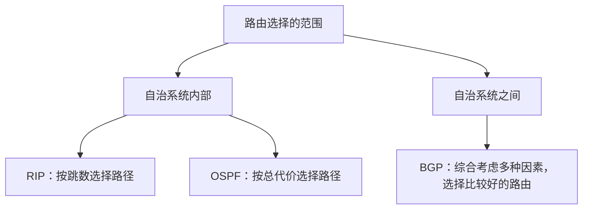
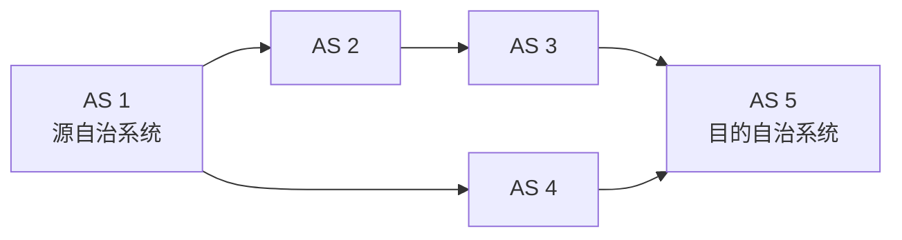
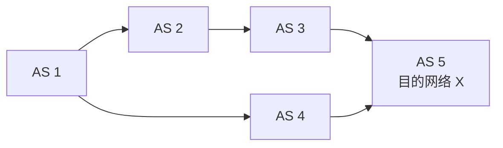
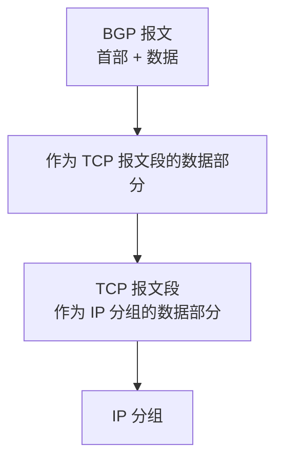
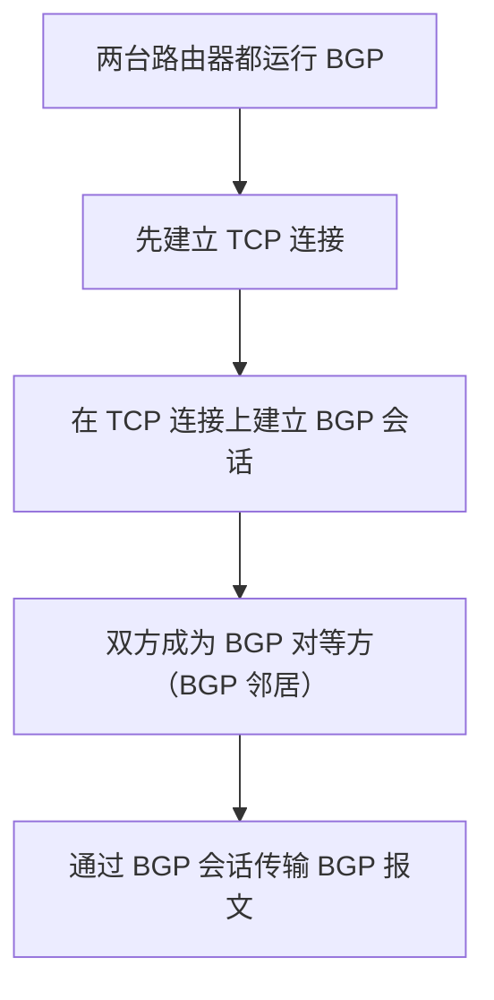
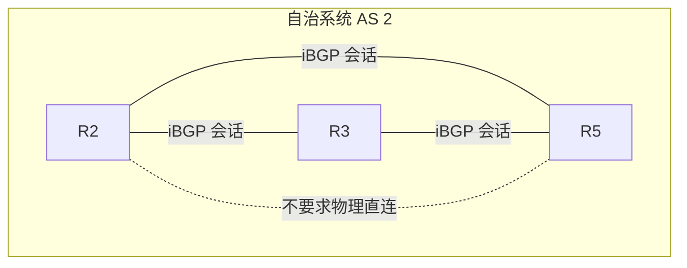
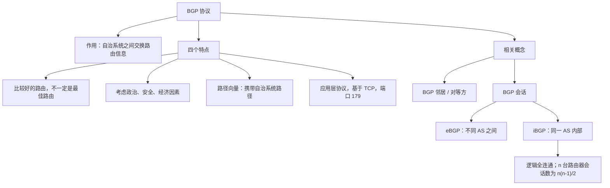

# BGP 协议：特点与相关概念

> **本节内容**
>
> 1. 路由协议的分类与 BGP 的作用
> 2. BGP 协议的四个特点
> 3. BGP 邻居与 BGP 会话
> 4. eBGP 会话与 iBGP 会话的区别

---

## 一、路由协议的分类与 BGP 的作用

### 1. 路由协议的两大分类

路由协议大致可以分为两类：

| 类型                    | 作用范围               | 主要作用                                 | 典型协议  |
| ----------------------- | ---------------------- | ---------------------------------------- | --------- |
| **内部网关协议（IGP）** | 一个自治系统（AS）内部 | 在自治系统内部进行路由选择               | RIP、OSPF |
| **外部网关协议（EGP）** | 不同自治系统之间       | 在自治系统之间交换路由信息并实现路由选择 | BGP       |

本节学习的 **BGP（边界网关协议，Border Gateway Protocol）** 属于外部网关协议，用于在自治系统之间交换路由信息并进行路由选择。

### 2. 什么是自治系统（AS）？

全世界的互联网被划分为许多自治系统。截至课程讲解时，全球已经有接近八万个自治系统。

一个自治系统通常属于某个组织或机构。例如：

- 咸鱼电信可以搭建自己的自治系统；
- 某个企业也可以搭建自己的自治系统。

在一个自治系统内部，具体使用什么内部网关协议，由该自治系统的网络管理员决定。自治系统之间通过**边界路由器**相互连接，边界路由器需要运行 BGP 协议，以交换 BGP 路由信息。

> **理解重点：** IGP 负责自治系统内部的路由选择；BGP 负责自治系统之间的路由信息交换与路由选择。

---

## 二、BGP 协议的四个特点

### 特点一：力求找到自治系统之间比较好的路由，而不是最佳路由

BGP 进行路由选择时，追求的是一条**比较好的路由**，不一定是全局意义上的最佳路由。可以把它理解为：达到“80 分以上”就可以，而不是必须做到“100 分”。

相比之下，RIP 和 OSPF 在自治系统内部进行路由选择时，会依据各自的路由度量寻找最佳路径：

- **RIP：** 根据跳数选择路径，目标是找到跳数最少的路径。
- **OSPF：** 使用 Dijkstra 算法，根据链路代价寻找总代价最小的路径。

#### 为什么 BGP 不追求全世界范围内的最佳路径？

这与网络规模有关。

| 网络范围 / 场景    | 规模示例                   | 路由选择方式与特点                                               |
| ------------------ | -------------------------- | ---------------------------------------------------------------- |
| 小型自治系统       | 路由器可能只有几台到十几台 | 可以使用 RIP，在自治系统内部按跳数选择路径                       |
| 中型或大型自治系统 | 路由器可能有几十到几百台   | 可以使用 OSPF，通过 Dijkstra 算法寻找总代价最小的路径            |
| 全球互联网         | 路由器和网络数量数以亿计   | 若在包含数亿个顶点的图中寻找全局最佳路径，运算时间开销会非常巨大 |

从数据结构的角度看，即使图中有上万个节点，计算机运行 Dijkstra 算法寻找最短路径通常仍然是可行的。因为 RIP 和 OSPF 的工作范围局限于**本自治系统内部**，自治系统内的网络规模相对可控。

但全球互联网包含数以亿计的路由器和网络。如果要求计算机在这样的巨大图中，使用 Dijkstra 算法寻找源到目的地的全局最佳路由，运算时间开销就会非常大。

因此，BGP 在各个自治系统之间选择路由时，力求找到一条比较好的路由，而不是不计代价地寻找全局最佳路由。

### 特点二：自治系统之间的路由选择必须考虑政治、安全、经济等因素

自治系统之间选择路径时，并不是只看路径有多短或经过多少个节点，还可能受到政治、安全和经济等因素的影响。

假设 AS 1 中有一个 IP 分组，需要发送到 AS 5 中的某个目的网络。分组可以选择经过上方路径，也可以选择经过下方路径。

#### （1）政治与安全因素

假设：

- AS 1 属于“汪汪国”；
- AS 4 属于“猫猫国”；
- 两个国家正在交战。

为了保障数据安全，汪汪国不希望 IP 分组经过猫猫国的自治系统转发，以免数据被窃听。因此，管理员可能让分组选择上方的路径，而不选择经过 AS 4 的下方路径。

#### （2）经济因素

再假设两个国家并没有交战，但每个自治系统为其他自治系统转发分组都需要收费。

如果 AS 4 的转发费用更高，那么 AS 1 可能优先选择上方路径，因为经过 AS 2 转发的成本更低。

> **理解重点：** BGP 的路由选择会考虑政治、安全、经济等策略因素，并非单纯追求最短路径。

### 特点三：采用路径向量路由算法

BGP 采用**路径向量路由算法**。路由器通告 BGP 路由信息时，不仅需要告知邻居目的网络，还需要告知到达该目的网络所经过的完整自治系统路径。

#### 1. 目的网络与路径向量

假设最右侧的 AS 5 中存在一个目的网络，其网络前缀用 `X` 表示。实际的网络前缀可以使用 CIDR 记法表示。

当 AS 2 的边界路由器得知到达网络 `X` 的路径后，可以通过 BGP 路由信息告诉 AS 1 的边界路由器：

- 如果要到达网络 `X`，需要经过 `AS 2 → AS 3 → AS 5`。

下方路径也可能被通告为：

- 如果要到达网络 `X`，需要经过 `AS 4 → AS 5`（从 AS 1 的视角看，后续路径会包含相应的 AS 路径信息）。

完整的自治系统路径就是这里所说的**路径向量**。

上图中，两条候选路径可以概括为：

| 候选路径 | 到达目的网络 X 所经过的自治系统 |
| -------- | ------------------------------- |
| 上方路径 | AS 1 → AS 2 → AS 3 → AS 5       |
| 下方路径 | AS 1 → AS 4 → AS 5              |

各自治系统的边界路由器相互配合，通过 BGP 报文传递路由信息，使目的网络的可达信息逐步传播到其他自治系统。关于可达信息如何从 AS 5 逐层传递到 AS 1，后续学习会进一步梳理。

#### 2. 自治系统编号（ASN）

每个自治系统都有一个全球唯一的自治系统编号，称为 **ASN（Autonomous System Number）**，长度为 **32 比特**。

因此，BGP 路由信息中携带的自治系统路径，实际上是用各个自治系统的 ASN 来表示的。为便于讲解，示意图中通常用 AS 1、AS 2、AS 3 等简化标记代替真实的自治系统编号。

> **理解重点：** BGP 路由信息不只告诉邻居“目的网络在哪里”，还要告知“到达该网络会经过哪些自治系统”。

### 特点四：BGP 属于应用层协议，基于 TCP 传输

BGP 是**应用层协议**，基于传输层的 TCP 协议工作。BGP 使用的熟知端口号是 **179**，了解这一端口号即可。

BGP 报文由首部和数据部分组成。封装关系如下：

也可以从封装层次理解：

| 层次   | 本例中的协议 / 数据单元          |
| ------ | -------------------------------- |
| 应用层 | BGP，数据单元称为 **BGP 报文**   |
| 传输层 | TCP，承载 BGP 报文               |
| 网络层 | IP，承载 TCP 报文段              |
| 更低层 | 数据链路层、物理层负责进一步传输 |

普通路由器通常主要处理物理层、数据链路层和网络层相关功能；运行 BGP 的路由器还需要运行传输层和应用层的相关协议功能。

### 四个特点速记表

| 序号 | BGP 的特点                     | 记忆要点                                   |
| ---- | ------------------------------ | ------------------------------------------ |
| 1    | 力求比较好的路由，而非最佳路由 | 全球规模太大，寻找全局最佳路由的时间代价高 |
| 2    | 考虑政治、安全、经济等因素     | 路由选择受到策略影响，不只看路径长度       |
| 3    | 采用路径向量路由算法           | 通告目的网络及到达目的网络的自治系统路径   |
| 4    | 属于应用层协议，基于 TCP       | TCP 端口号为 179                           |

---

## 三、BGP 邻居与 BGP 会话

### 1. 示例网络

为了理解 BGP 邻居与 BGP 会话，假设招财、进宝和咸鱼分别经营自己的电信公司，并建立了各自的自治系统：

- 招财电信；
- 进宝电信；
- 咸鱼电信。

为突出 BGP 的工作方式，可以先不展开各个自治系统内部的网络细节。假设咸鱼电信的 AS 中包含一个网络，其网络前缀用 `X` 表示。

在咸鱼电信的自治系统内部，可能运行 RIP 或 OSPF。无论具体使用哪种 IGP，自治系统内的路由器（包括边界路由器 R1）都需要知道网络 `X` 的存在，以及如何把发往网络 `X` 的 IP 数据报转交给目的网络。

后续学习会进一步介绍：R1 如何把网络 `X` 的可达信息逐层传递，最终让 R6 也能够获知相关信息。

### 2. 哪些路由器需要运行 BGP？

#### （1）边界路由器

自治系统的边界路由器需要运行 BGP。例如，示例中的 R1、R2、R4、R6 等边界路由器。

#### （2）自治系统内部的部分路由器

自治系统内部也可能有一些核心路由器运行 BGP。

在本课程的示例中，为了简化理解，可以认为图中所有路由器（包括内部路由器 R3、R5）都运行 BGP。在现实网络中，一个自治系统内部通常只有部分高性能路由器需要运行 BGP，大部分普通路由器不需要运行 BGP。

为了便于讲解，本课程采用以下简化假设：

> **示例假设：** 图中所有路由器既运行自治系统内部的 IGP，也运行 BGP。

### 3. 什么是 BGP 邻居？

BGP 基于 TCP 工作。如果两台运行 BGP 的路由器希望传输 BGP 报文，需要先建立 TCP 连接，再在 TCP 连接上建立 BGP 会话。BGP 会话建立后，双方就可以通过会话传输 BGP 报文。

建立了 BGP 会话的两台路由器称为 **BGP 对等方（BGP peers）**，在常见教材中也称为 **BGP 邻居**。

BGP 邻居关系既可能存在于两个不同自治系统的边界路由器之间，也可能存在于同一个自治系统内部的路由器之间。

建立过程可以表示为：

### 4. eBGP 会话与 iBGP 会话

BGP 会话按路由器所属的自治系统关系，可分为两类：

| 会话类型      | 全称                 | 建立位置                       | 典型特点                                     |
| ------------- | -------------------- | ------------------------------ | -------------------------------------------- |
| **eBGP 会话** | External BGP Session | 不同自治系统的路由器之间       | 示例中通常是相邻自治系统的边界路由器之间建立 |
| **iBGP 会话** | Internal BGP Session | 同一个自治系统内部的路由器之间 | 按本课程介绍的规则，需要在逻辑上全连通       |

#### （1）eBGP 会话

如果两个路由器分别属于不同的自治系统，它们之间建立的 BGP 会话称为 **eBGP 会话**。

在本课程的示例中，两个自治系统之间的边界路由器通常在物理线路上直连，并建立 eBGP 会话。

#### （2）iBGP 会话

如果两台路由器属于同一个自治系统，它们之间建立的 BGP 会话称为 **iBGP 会话**。

BGP 对同一个自治系统内部的 iBGP 邻居关系有全连通要求。用数据结构中图的概念来描述，相当于每个顶点都与其他顶点相连，在逻辑上形成一个**完全图**。

需要注意：

- iBGP 邻居之间不一定有直接的物理连接；
- 例如，R2 和 R5 之间可能没有物理线路，但仍然可以建立 iBGP 会话；
- 因为 BGP 会话建立在 TCP 连接之上，两台路由器即便没有物理直连，只要网络可达，仍然可能建立 TCP 连接，并进一步建立 BGP 会话。

> **注意：** 图中的实线用于示意 iBGP 会话关系，并不表示路由器之间一定存在直接的物理线路。iBGP 会话可以通过底层网络建立。

### 5. 为什么 iBGP 需要全连通？

本节首先需要掌握的是：按照课程中的介绍，自治系统内部的 iBGP 会话需要形成全连通关系。它的具体作用会在后续学习中进一步说明。

如果自治系统内部有 \(n\) 台路由器，并且任意两台路由器之间都需要建立一条 iBGP 会话，那么总会话数等于从 \(n\) 台路由器中任取两台的组合数：

\[
C_n^2 = \frac{n(n-1)}{2}
\]

因此：

\[
\boxed{\text{iBGP 会话总数} = \frac{n(n-1)}{2}}
\]

例如，若有 4 台路由器需要两两建立 iBGP 会话，则会话总数为：

\[
\frac{4(4-1)}{2} = 6
\]

从图的角度理解：每台路由器是一个顶点，每一条 iBGP 会话是连接两个顶点的一条边。完全图中任意两个不同顶点之间都有一条边，所以总边数就是 \(\frac{n(n-1)}{2}\)。

### 6. eBGP 与 iBGP 对比总结

| 对比项目             | eBGP                            | iBGP                                                   |
| -------------------- | ------------------------------- | ------------------------------------------------------ |
| 路由器所属关系       | 位于不同自治系统                | 位于同一个自治系统                                     |
| 主要用途             | 在自治系统之间交换 BGP 路由信息 | 在自治系统内部传播 BGP 路由信息                        |
| 会话建立基础         | TCP 连接                        | TCP 连接                                               |
| 物理连接要求         | 示例中通常是边界路由器物理直连  | 不要求两台路由器物理直连                               |
| 本课程强调的关系     | 不同 AS 的路由器建立会话        | AS 内部需要逻辑全连通                                  |
| 连接数量（全连通时） | 取决于具体 AS 间连接关系        | 若有 \(n\) 台路由器，两两建立时为 \(\frac{n(n-1)}{2}\) |

课程中还用了一个形象的类比帮助区分：

- **eBGP：** 可以类比为“艺人”和其他圈子的人打交道，即不同自治系统之间建立会话。
- **iBGP：** 可以类比为“爱人”主要和自己熟悉的人交流，即同一个自治系统内部的路由器之间建立会话。

这个类比只是帮助记忆术语；需要真正掌握的仍然是：**eBGP 建立在不同自治系统之间，iBGP 建立在同一个自治系统内部。**

---

## 四、本节重点回顾

### 1. 必须掌握的概念

- **BGP：** 边界网关协议，属于外部网关协议，用于在自治系统之间交换路由信息并进行路由选择。
- **自治系统（AS）：** 通常属于一个组织或机构；自治系统内部使用哪种 IGP，由网络管理员决定。
- **BGP 路径向量：** BGP 路由信息不仅包含目的网络，还包含到达该目的网络所经过的自治系统路径。
- **ASN：** 自治系统编号，全球唯一，长度为 32 比特。
- **BGP 邻居 / 对等方：** 建立了 BGP 会话的两台路由器。
- **BGP 会话：** 先建立 TCP 连接，再基于 TCP 连接建立 BGP 会话。
- **eBGP：** 不同自治系统的路由器之间建立的 BGP 会话。
- **iBGP：** 同一个自治系统内部路由器之间建立的 BGP 会话；本课程强调其逻辑上需要全连通。

### 2. 高频对比

| 比较维度            | RIP / OSPF                                              | BGP                                  |
| ------------------- | ------------------------------------------------------- | ------------------------------------ |
| 主要作用范围        | 自治系统内部                                            | 自治系统之间                         |
| 路由协议分类        | 内部网关协议（IGP）                                     | 外部网关协议（EGP）                  |
| 路由选择考虑        | RIP 按跳数；OSPF 按链路总代价                           | 还需要考虑政治、安全、经济等策略因素 |
| 路由算法 / 路径信息 | RIP 使用距离向量思想；OSPF 使用链路状态与 Dijkstra 算法 | 路径向量路由算法，携带自治系统路径   |
| 协议所在层次        | 视具体协议而定                                          | 应用层协议                           |
| 传输层基础          | 视具体协议而定                                          | 基于 TCP，熟知端口号 179             |

### 3. 一张图串联本节内容

---

## 五、复习检查

可以尝试不看笔记，回答下面的问题：

1. 内部网关协议和外部网关协议分别用于什么范围？RIP、OSPF、BGP 分别属于哪一类？
2. 为什么 BGP 力求寻找比较好的路由，而不是全世界范围内的最佳路由？
3. BGP 在自治系统之间进行路由选择时，除了路径本身，还可能考虑哪些因素？
4. 什么是路径向量？为什么 BGP 路由信息需要包含自治系统路径？
5. ASN 是什么？其长度是多少比特？
6. BGP 位于哪一层？它基于什么传输层协议工作？熟知端口号是多少？
7. 什么是 BGP 邻居？建立 BGP 会话前，需要先建立什么连接？
8. eBGP 和 iBGP 有什么区别？iBGP 为什么不要求邻居之间必须物理直连？
9. 若有 \(n\) 台路由器需要两两建立 iBGP 会话，会话总数如何计算？
