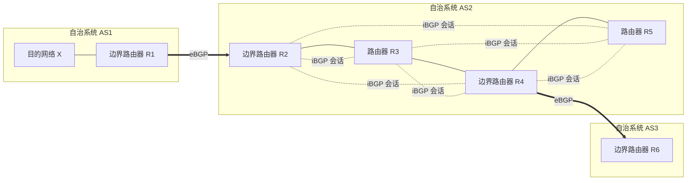
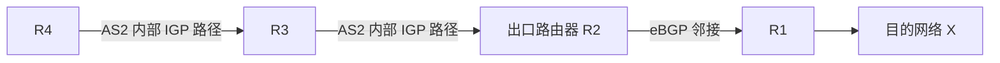
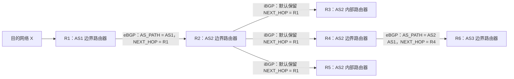

# BGP 路由信息的格式与工作原理

## 一、学习目标

本节主要学习以下内容：

1. **BGP 路由信息的格式**：由 CIDR 前缀和 BGP 属性构成。
2. **BGP 路由信息的传播过程**：理解边界路由器如何通过 eBGP、iBGP 将目的网络的可达信息逐层传播。
3. **NEXT_HOP 的处理规则**：区分 eBGP 与 iBGP 的默认行为，并注意题目可能给出的特殊条件。
4. **iBGP 全连通的原因**：理解 iBGP 学到的路由信息不能再通过 iBGP 继续传播这一规则。

---

## 二、BGP 路由信息的格式

一条 BGP 路由信息主要由 **CIDR 前缀**和 **BGP 属性**两部分组成。

```text
BGP 路由信息
├── CIDR 前缀
│   └── 指明可以到达的目的网络
└── BGP 属性
    ├── AS_PATH（自治系统路径）
    └── NEXT_HOP（下一跳）
```

### 2.1 三个重要信息

| 信息          | 含义                               | 作用                                   |
| ------------- | ---------------------------------- | -------------------------------------- |
| **CIDR 前缀** | 目的网络的前缀                     | 指明这条路由信息描述的是哪个目的网络   |
| **AS_PATH**   | 到达目的网络需要经过的自治系统路径 | 描述路由经过的自治系统，例如 `AS2 AS1` |
| **NEXT_HOP**  | 下一跳路由器的地址                 | 指明这条 BGP 路由信息中的下一跳地址    |

其中，AS_PATH 描述的是**自治系统之间的路径**，NEXT_HOP 描述的是**下一跳路由器地址**。二者含义不同，不要混淆。

---

## 三、示例拓扑：路由信息如何逐层传播

假设自治系统 AS1 内存在一个目的网络，其网络前缀记为 **X**。AS1 的边界路由器 R1 与 AS2 的边界路由器 R2 之间建立了 eBGP 会话；AS2 中还有 R3、R4、R5 等路由器；R4 又通过 eBGP 与 AS3 的边界路由器 R6 相连。

### 3.1 拓扑关系示意



> **图示说明：** 实线表示示意性的网络连接关系；虚线表示 AS2 内部路由器之间的 iBGP 会话。图中重点展示路由信息的传播关系，内部具体链路以题目给定的拓扑为准。

### 3.2 先理解 AS1 内部的可达性

对于 AS1 的边界路由器 R1 来说，AS1 内部运行着某种内部网关协议（IGP），例如 RIP 或 OSPF。

无论采用哪一种 IGP，只要相关路由信息已经收敛，R1 就能够知道：**如何在 AS1 内部将 IP 数据报转发到目的网络 X**。

因此，R1 可以把关于网络 X 的可达信息通告给相邻自治系统。

---

## 四、第一步：R1 通过 eBGP 将路由信息发送给 R2

R1 与 R2 已经建立 eBGP 会话。R1 可以通过该会话发送 BGP 报文，报文中携带关于目的网络 X 的路由信息。

这条路由信息包含：

- **目的网络**：X
- **AS_PATH**：AS1
- **NEXT_HOP**：R1 的地址

可以将 R1 向 R2 通告的信息概括为：

| 字段      | 内容 |
| --------- | ---- |
| CIDR 前缀 | X    |
| AS_PATH   | AS1  |
| NEXT_HOP  | R1   |

其含义是：**如果要到达网络 X，需要经过 AS1，下一跳地址指向 R1。**

R2 收到这条路由信息后，就学到了到达网络 X 的一条 BGP 路由。

---

## 五、第二步：R2 通过 iBGP 将路由信息告知 AS2 内部路由器

R2 还需要把从外部学到的 BGP 路由信息共享给 AS2 内部的其他路由器。

因此，AS2 内的路由器会提前建立 iBGP 会话。R2 可以通过相应的 iBGP 会话，将这条路由信息分别通告给 R3、R4、R5 等路由器。

### 5.1 iBGP 默认不修改 NEXT_HOP

按照本节所讲的 BGP 默认规则，R2 通过 iBGP 向内部邻居通告该路由时：

- 目的网络仍然是 X；
- AS_PATH 仍然是 AS1；
- **NEXT_HOP 默认仍然指向 R1，不会因为改由 R2 通过 iBGP 发送就自动改成 R2。**

| 字段      | R1 通告给 R2（eBGP） | R2 通告给 AS2 内部邻居（iBGP 默认） |
| --------- | -------------------- | ----------------------------------- |
| CIDR 前缀 | X                    | X                                   |
| AS_PATH   | AS1                  | AS1                                 |
| NEXT_HOP  | R1                   | R1（默认保持不变）                  |

这就是本节要记住的一点：

> **iBGP 默认不修改下一跳（NEXT_HOP）。**

### 5.2 内部路由器为什么还需要运行 IGP？

R3、R4、R5 收到这条路由信息后，都知道网络 X 可以通过这条 BGP 路由到达。

但在本例中，BGP 路由信息里的 NEXT_HOP 仍然指向 R1，而 R1 并不是这些内部路由器在 AS2 内部可以直接连接到的路由器。

按照本例的讲解，内部路由器还需要结合本自治系统内部的 IGP，确定如何把 IP 数据报转发到通往外部的出口路由器 R2。

例如，对于 R4：

1. R4 收到了 R2 通过 iBGP 通告的、指向网络 X 的 BGP 路由信息。
2. R4 知道这条路由信息是由 R2 通告的，因而需要通过 AS2 内部的路径到达出口路由器 R2。
3. R4 运行 IGP，寻找从自身到 R2 的最佳转发路径。
4. 假设在示例拓扑中，R4 到 R2 的最佳路径是先经过 R3，那么 R4 转发相关 IP 数据报时，就会先将数据报交给 R3。
5. 数据报再沿着 AS2 内部的路径到达出口路由器 R2，随后由 R2 转发给 R1，最终进入 AS1 并到达网络 X。

示意如下：



因此，要区分两个概念：

- **BGP 路由信息中的 NEXT_HOP 属性**：路由信息携带的下一跳地址。
- **某台路由器实际转发数据报时使用的下一跳**：本机结合路由表和内部路由信息，确定的下一步转发对象。

在本例的说明中，AS2 内部路由器需要借助 IGP，找到通往 AS2 出口路由器 R2 的路径。

---

## 六、第三步：R4 通过 eBGP 将路由信息发送给 R6

现在，R4 已经学习到了关于网络 X 的 BGP 路由信息。接下来，R4 可以把这条路由信息继续通告给另一个自治系统 AS3 中的 R6。

R4 与 R6 之间已经建立 eBGP 会话。

### 6.1 eBGP 会修改 NEXT_HOP

当 R4 通过 eBGP 向 R6 通告这条路由时，按照本节讲解的默认规则：

- 目的网络仍然是 X；
- AS_PATH 中会体现经过的自治系统 AS2 和 AS1；
- **NEXT_HOP 会修改为发送方路由器 R4 自身的地址。**

| 字段      | R4 通告给 R6（eBGP） |
| --------- | -------------------- |
| CIDR 前缀 | X                    |
| AS_PATH   | AS2 AS1              |
| NEXT_HOP  | R4                   |

R4 向 R6 表达的意思是：**要到达网络 X，需要经过 AS2 和 AS1，下一跳地址是 R4。**

这就是本节强调的另一条默认规则：

> **eBGP 通告路由时，NEXT_HOP 默认指向发送方路由器自身。**

### 6.2 R6 如何利用这条路由信息？

R6 收到路由信息后，就知道可以通过 R4 到达网络 X，并且知道到达网络 X 所经过的自治系统路径。

因此，R6 可以在自己的路由信息中记录这条可达路径。在后续转发时，R6 可以将发往网络 X 的 IP 数据报转发给 R4。

如果 AS3 内还有 R7、R8 等路由器，R6 也可以通过与它们建立的 iBGP 会话，将从外部学习到的路由信息告知这些内部路由器。AS3 内的其他路由器再结合本自治系统的 IGP，寻找通往出口路由器 R6 的内部路径。

此后，路由信息还可以继续按照类似的方式向其他自治系统传播。

---

## 七、把整条传播过程串起来



这张图主要展示路由信息的通告关系。要特别注意：

- R1 通过 eBGP 将网络 X 的可达信息通告给 R2。
- R2 通过 iBGP 将路由信息分别告知 AS2 内部的其他路由器。
- R4 再通过 eBGP 向 R6 通告路由信息，并在 AS_PATH 中体现 AS2、AS1 这两个自治系统。
- 按默认规则，iBGP 通告时 NEXT_HOP 保持不变；eBGP 通告时 NEXT_HOP 指向发送方自身。

### 7.1 各阶段的路由信息对照

| 通告过程        | CIDR 前缀 | AS_PATH | NEXT_HOP（默认规则） |
| --------------- | --------- | ------- | -------------------- |
| R1 → R2（eBGP） | X         | AS1     | R1                   |
| R2 → R3（iBGP） | X         | AS1     | R1                   |
| R2 → R4（iBGP） | X         | AS1     | R1                   |
| R2 → R5（iBGP） | X         | AS1     | R1                   |
| R4 → R6（eBGP） | X         | AS2 AS1 | R4                   |

---

## 八、NEXT_HOP 的默认规则与真题中的特殊情况

### 8.1 默认规则

本节依据教材与 BGP 标准讲解的默认行为，可以归纳如下：

| 通告类型 | NEXT_HOP 的默认处理                                  |
| -------- | ---------------------------------------------------- |
| **eBGP** | 通告路由时，将 NEXT_HOP 修改为发送方路由器自身的地址 |
| **iBGP** | 通告路由时，默认不修改 NEXT_HOP，保持原有值          |

例如：

- R1 通过 eBGP 向 R2 通告路由，NEXT_HOP 指向 R1。
- R2 通过 iBGP 向 R5 通告路由，按照默认规则，NEXT_HOP 仍然指向 R1。
- R4 通过 eBGP 向 R6 通告路由，NEXT_HOP 指向 R4。

### 8.2 2024 年考研真题中的情况

课上特别提醒：**2024 年第 47 题第 5 小问**出现了一种与上述默认规则不同的情况——题目中的 iBGP 路由通告将 NEXT_HOP 修改为发送方路由器自身的 IP 地址。

如果结合本节示例理解，也就是 R2 通过 iBGP 将路由信息发送给 R5 时，题目假定 NEXT_HOP 被修改为 R2 自身的地址，而不是继续保持为 R1。

课上指出，现实中的路由器厂商实现或相关配置可能导致这种细节上的差异。实际设备中也可能通过类似 `next-hop-self` 的配置改变下一跳处理方式。

因此，复习和做题时应注意：

1. **掌握默认规则**：eBGP 通告时默认修改 NEXT_HOP；iBGP 通告时默认不修改 NEXT_HOP。
2. **关注题干条件**：如果题目明确说明 iBGP 通告会修改 NEXT_HOP，就按照题目给定的条件分析。
3. **不要把这一细节误认为 BGP 无法正常工作**：课上强调，下一跳的具体处理方式可能因实现或配置而有差异，分析题目时应以明确给出的规则为准。

---

## 九、iBGP 学到的路由信息不能再通过 iBGP 传播

理解下面这条规则，就能够理解为什么传统 iBGP 设计要求自治系统内部的 iBGP 会话**全连通**。

> **BGP 规定：从 iBGP 邻居学到的路由信息，不能再通告给其他 iBGP 邻居。**

### 9.1 用 R2、R3、R5 理解这条规则

假设 R2 从外部通过 eBGP 学到了关于网络 X 的路由信息。

由于 AS2 内部的 iBGP 会话全连通，R2 可以分别通过 iBGP 将这条路由信息通告给 R3、R4、R5 等路由器。

例如：

1. R2 通过 iBGP 将路由信息通告给 R3。
2. R3 学到这条路由信息后，**不需要、也不能再把这条从 iBGP 学到的路由信息通告给另一个 iBGP 邻居 R5**。
3. R5 需要获得这条路由信息时，可以直接通过与 R2 的 iBGP 会话接收 R2 的通告。

### 9.2 为什么 iBGP 会话需要全连通？

原因在于：如果 iBGP 学到的路由信息不能继续通过 iBGP 传播，那么每台需要学习该路由信息的内部路由器，就必须能够直接从合适的 iBGP 邻居处获得它。

例如，R2 从 AS1 学到了新的路由信息后，需要通过与其他内部路由器分别建立的 iBGP 会话，将路由信息直接通告给它们。

因此，传统的 iBGP 设计要求自治系统内部的路由器之间两两建立 iBGP 会话，也就是 **iBGP 全连通（全网状）**。

### 9.3 这条规则的主要目的

这项规定主要用于避免路由信息在自治系统内部通过 iBGP 邻居不断兜圈子、反复传播。

BGP 路由信息包含多个属性，信息量相对较大。如果允许从 iBGP 学到的路由信息继续在 iBGP 邻居之间反复传递，就可能造成不必要的传播并浪费带宽。

因此，BGP 规定：

- 从外部通过 eBGP 学到的路由信息，可以由边界路由器通过 iBGP 通告给内部邻居。
- 从 iBGP 学到的路由信息，不能再通告给其他 iBGP 邻居。
- 为了让所有相关路由器都能获得所需的路由信息，传统 iBGP 设计要求内部 iBGP 会话全连通。

---

## 十、重点总结

### 10.1 BGP 路由信息的三个关键字段

| 字段          | 记忆要点                               |
| ------------- | -------------------------------------- |
| **CIDR 前缀** | 指向目的网络                           |
| **AS_PATH**   | 描述到达目的网络需要经过的自治系统路径 |
| **NEXT_HOP**  | 表示 BGP 路由信息中的下一跳地址        |

### 10.2 eBGP 与 iBGP 的区别

| 比较内容          | eBGP                         | iBGP                                     |
| ----------------- | ---------------------------- | ---------------------------------------- |
| 邻居关系          | 不同自治系统之间             | 同一自治系统内部                         |
| NEXT_HOP 默认处理 | 修改为发送方路由器自身的地址 | 默认不修改，保持原值                     |
| 本节示例          | R1 → R2；R4 → R6             | R2 → R3、R4、R5                          |
| 路由传播特点      | 在自治系统之间传播可达信息   | 在自治系统内部传播从外部学习到的路由信息 |

### 10.3 必须理解的 iBGP 规则

**从 iBGP 学到的路由信息不能再通过 iBGP 传播给其他 iBGP 邻居。**

因此，传统 iBGP 设计需要所有内部路由器之间两两建立 iBGP 会话，以保证内部路由器能够获得相关路由信息。

### 10.4 复习检查清单

- [ ] 能说出 BGP 路由信息由 CIDR 前缀和 BGP 属性构成。
- [ ] 能解释 AS_PATH 和 NEXT_HOP 的含义。
- [ ] 能说明 R1 如何通过 eBGP 将网络 X 的可达信息通告给 R2。
- [ ] 能说明 R2 如何通过 iBGP 将路由信息告知 AS2 内部的其他路由器。
- [ ] 能解释 eBGP 与 iBGP 对 NEXT_HOP 的默认处理差异。
- [ ] 能说明为什么传统 iBGP 设计要求会话全连通。
- [ ] 遇到题目给出的特殊 NEXT_HOP 处理条件时，能按照题干设定分析。

---

## 十一、最后回顾

本节围绕一个目的网络 X，梳理了 BGP 路由信息从 AS1 出发，经过 AS2，再通告到 AS3 的过程。

需要重点记住的结论是：

1. 一条 BGP 路由信息包含 **CIDR 前缀、AS_PATH、NEXT_HOP** 等关键信息。
2. **eBGP 通告路由时，NEXT_HOP 默认指向发送方路由器自身；iBGP 通告时，NEXT_HOP 默认保持不变。**
3. 对于 iBGP 通告 NEXT_HOP 的处理，要区分教材中的默认规则与题目明确给出的特殊条件。
4. **iBGP 学到的路由信息不能再通过 iBGP 传播给其他 iBGP 邻居**，这也是传统 iBGP 设计要求会话全连通的重要原因。

建议复习时重新看一遍示意图，重点梳理路由信息在哪些路由器之间通过 eBGP 或 iBGP 传播，以及每次通告时 AS_PATH 和 NEXT_HOP 分别发生了什么变化。
