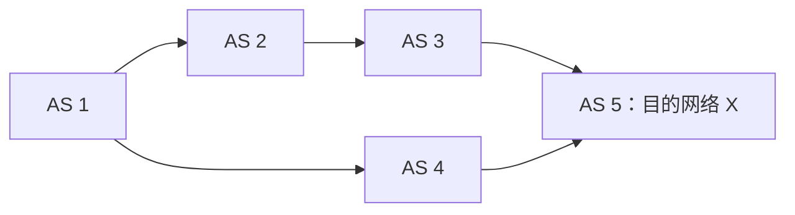
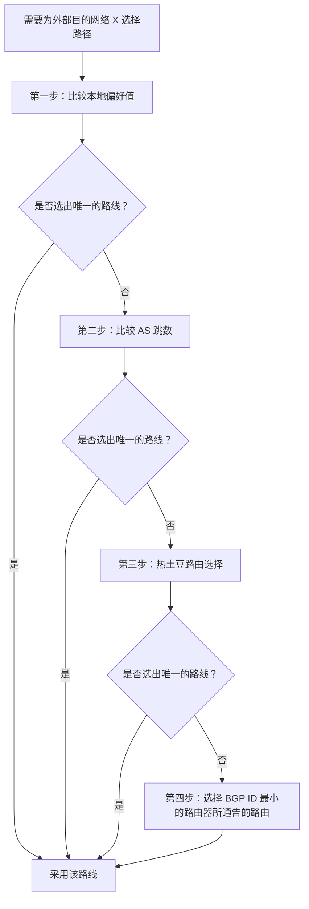
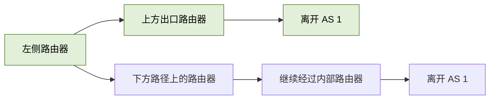
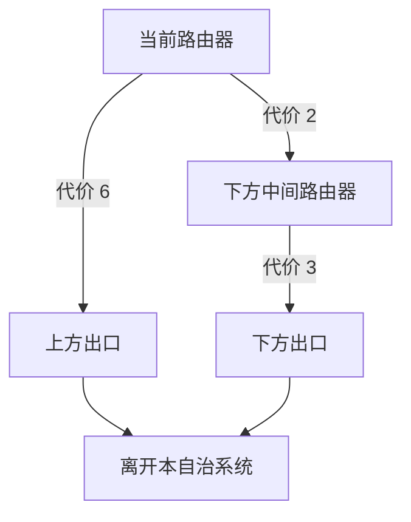
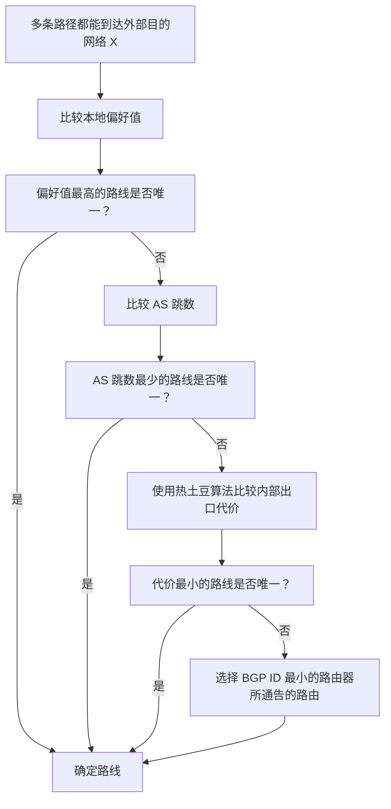

# BGP 路由选择策略

## 一、什么情况下需要进行 BGP 路由选择？

**BGP 路由选择要解决的问题：** 对于一个位于外部自治系统中的目的网络 `X`，如果已知有多条自治系统路径都可以到达它，那么路由器应该选择哪一条路径？

例如，目的网络 `X` 位于 `AS 5`。从 `AS 1` 出发，可以通过两条路径到达 `X`：

- 上方路径：`AS 1 → AS 2 → AS 3 → AS 5`
- 下方路径：`AS 1 → AS 4 → AS 5`

两条路径都可达 `X`，但应当选择哪一条，需要按照 BGP 路由选择策略逐步判断。

> **适用范围：** 这里讨论的是位于外部自治系统中的目的网络，并且存在多条可选路径的情况。若目的网络位于本自治系统内部，通常使用 RIP、OSPF 等内部网关协议确定转发路径，不需要套用这里介绍的 BGP 多路径选择规则。

---

## 二、BGP 路由选择的四个策略

通常按照以下顺序逐步选择。一旦某一步能够选出唯一的路线，后续步骤就不再需要继续。

| 顺序   | 策略                                                  | 核心含义                                          |
| ------ | ----------------------------------------------------- | ------------------------------------------------- |
| 第一步 | 选择**本地偏好值最高**的路线                          | 优先选择管理员配置为更优先的路线                  |
| 第二步 | 选择 **AS 跳数最少**的路线                            | 选择经过自治系统数量更少的路径                    |
| 第三步 | 使用**热土豆路由选择算法**                            | 以尽可能小的代价让 IP 分组离开本自治系统          |
| 第四步 | 选择 **BGP 标识符（BGP ID）最小**的路由器所通告的路由 | 前面仍无法区分时，以 BGP 标识符作为最后的比较依据 |

---

## 三、第一步：选择本地偏好值最高的路线

### 1. 什么是本地偏好值？

**本地偏好值（Local Preference）** 可以理解为不同路由的优先级。通常由自治系统的管理员根据成本、安全性等因素进行设置。

管理员更偏好哪条路线，就可以为对应的路由设置更高的本地偏好值。

### 2. 示例：优先选择费用更低的路径

仍以 `AS 1` 到目的网络 `X` 为例：

- 上方路径：`AS 1 → AS 2 → AS 3 → AS 5`
- 下方路径：`AS 1 → AS 4 → AS 5`

假设上方路径看起来更长，但 `AS 2` 收取的服务费用比 `AS 4` 更低。那么，`AS 1` 的管理员可以把从上方路径学到的路由设置为更高的本地偏好值。

这样一来，`AS 1` 就会优先选择上方路径。只有当上方路径无法使用（例如发生网络故障）时，才会考虑费用更高的下方路径。

**要点：**

- 本地偏好值通常由管理员人为设置。
- 本地偏好值越高，路线的优先级越高。
- 如果本地偏好值已经能够选出唯一的路线，就不必继续执行后续策略。
- 如果多条路线的本地偏好值相同，则进入第二步。

---

## 四、第二步：选择 AS 跳数最少的路线

如果管理员没有通过本地偏好值区分路线，即多条路线的本地偏好值相同，那么就比较 **AS 跳数**，优先选择 AS 跳数最少的路线。

### 1. 示例

假设上方和下方路线的本地偏好值相同：

- 上方：`AS 1 → AS 2 → AS 3 → AS 5`
- 下方：`AS 1 → AS 4 → AS 5`

从 `AS 1` 前往 `AS 5`：

- 上方路线需要经过 `AS 2、AS 3、AS 5`，即经过 3 个后续 AS。
- 下方路线需要经过 `AS 4、AS 5`，即经过 2 个后续 AS。

因此，下方路线的 AS 跳数更少，BGP 会优先选择下方路线。

### 2. AS 跳数少，不代表路由器总跳数少

**AS 跳数最少，不意味着路由器的总跳数最少。**

例如，`AS 4` 内部可能连接了很多路由器，IP 分组在该自治系统内部需要经过许多次转发。即使下方路线经过的 AS 更少，实际经过的路由器数量也可能更多。

### 3. 为什么说 BGP 选择的是“比较好的”路线，而不一定是“最佳”的路线？

BGP 根据一系列策略逐步筛选路线，其中 AS 跳数只是一个比较依据。它不会仅凭 AS 跳数就计算整条端到端路径的所有细节。

因此，BGP 选择的是按照协议策略判断出来的、比较合适的路线，而不一定是从所有可能指标综合来看都绝对最优的路线。

**要点：**

- 只有当本地偏好值无法区分路线时，才比较 AS 跳数。
- AS 跳数越少，越优先。
- AS 跳数衡量的是经过的自治系统数量，不是内部路由器数量。
- 如果多条路线的 AS 跳数仍然相同，则进入第三步。

---

## 五、第三步：使用热土豆路由选择算法

### 1. 热土豆算法的基本思想

热土豆路由选择算法（Hot Potato Routing）的核心思想可以用“烫手的土豆要尽快脱手”来理解。

对于某个自治系统来说，如果一个 IP 分组还没有离开本自治系统，它就像一个烫手的土豆。自治系统希望以尽可能小的内部代价，把这个 IP 分组送到一个可以离开本自治系统的边界路由器，并尽快将它转发出去。

因此，热土豆算法要结合本自治系统内部使用的网关协议，判断从当前路由器出发，走哪条路径能够以较小代价离开本自治系统。

- 如果内部使用 **RIP**，代价主要用路由器跳数衡量。
- 如果内部使用 **OSPF**，代价用路径上的链路代价总和衡量。

> 热土豆算法关注的是：**如何以较小的本自治系统内部代价，把分组送出本自治系统。** 它不是单纯比较到目的网络的整条跨自治系统路径有多长。

### 2. 案例一：AS 内部运行 RIP

假设 `AS 1` 内部采用 RIP。左侧路由器有一个 IP 分组要发送到目的网络 `X`，它有两种选择：

- 把分组转发给右上方路由器，再离开本自治系统。
- 把分组转发给右下方路由器，再离开本自治系统。

从左侧路由器出发：

- 选择上方出口：需要经过 1 跳、2 跳，随后离开本自治系统。
- 选择下方出口：需要经过 1 跳、2 跳、3 跳，随后离开本自治系统。

根据 RIP 的跳数度量方式，上方出口的内部代价更小。因此，左侧路由器会选择上方路径，以更小代价把分组送出本自治系统。

如果右下方路由器自己有一个要发送到 `X` 的 IP 分组，它也可以直接把分组转发给 `AS 4` 的邻居边界路由器，从这里离开本自治系统，而不必先绕到上方再出去。这样可以更快地“脱手”。

### 3. 案例二：AS 内部运行 OSPF

如果 `AS 1` 内部运行 OSPF，则需要依据链路代价总和来比较路径，而不是只数路由器跳数。

假设图中每条链路旁标注的数字代表该链路的代价。从左上角路由器发送 IP 分组到目的网络 `X`：

- 上方路径的转发代价为 **6**。
- 下方路径的转发代价为 **2 + 3 = 5**。

虽然下方路径经过的路由器可能更多，但 OSPF 计算出的代价总和更小，所以应该选择下方路径，把分组送出本自治系统。

这一案例说明：热土豆算法的思想没有变化，变化的是内部代价的度量方式。

| AS 内部使用的协议 | 代价度量方式         | 示例比较                                       |
| ----------------- | -------------------- | ---------------------------------------------- |
| RIP               | 路由器跳数           | 上方 2 跳，下方 3 跳，因此优先上方             |
| OSPF              | 路径上的链路代价总和 | 上方代价 6，下方代价 `2 + 3 = 5`，因此优先下方 |

### 4. 热土豆算法仍无法区分路线时

假设 AS 内部使用 OSPF，并且将上方路径的代价从 6 改为 5：

- 上方路径的代价为 **5**。
- 下方路径的代价为 **2 + 3 = 5**。

两条路线离开本自治系统的内部代价相同，因此热土豆算法也无法选出唯一的路线。此时进入第四步，比较 BGP 标识符。

---

## 六、第四步：选择 BGP 标识符最小的路由器所通告的路由

### 1. 什么是 BGP 标识符？

每台运行 BGP 的路由器都有一个 BGP 标识符（BGP Identifier，BGP ID），可以把它理解为路由器的身份编号。

当路由器之间建立 BGP 会话并发送 BGP 报文时，会向对方通告自己的 BGP 标识符。这样，接收方就能知道相邻 BGP 路由器的标识符。

在前面三种策略仍无法区分路线的情况下，选择 **BGP 标识符更小的路由器所通告的路由**。

### 2. 示例

假设 `AS 1` 右侧的两台路由器，BGP 标识符分别为：

- 上方路由器：`6661`
- 下方路由器：`6662`

如果前面的本地偏好值、AS 跳数和热土豆代价都无法区分这两条路线，那么上方路由器的 BGP 标识符 `6661` 更小，所以优先选择上方路由器所通告的路由。

可以把它类比为员工工号：如果两个人给出的信息都符合条件，可以根据工号大小作最后的区分。在这个例子里，选择 BGP 标识符更小的路由器所通告的路由。

由于 BGP 标识符用于区分 BGP 路由器，这一步为前面仍无法选出唯一路线的情况提供了最后的比较依据。

### 3. BGP 标识符如何确定？

按照本课程讲解的常见配置方式，BGP 标识符通常可以使用路由器各接口 IP 地址中较大的那个地址来定义。路由器可能有多个接口，每个接口的 IP 地址不同。

> 实际网络中的 BGP ID 也可以由管理员显式配置；因此，“取接口中最大的 IP 地址”应理解为常见的确定方式，而不是所有设备都必须如此设置。

---

## 七、四种策略的完整对照

| 步骤 | 比较什么                 | 选择原则                           | 仍无法区分时       |
| ---- | ------------------------ | ---------------------------------- | ------------------ |
| 1    | 本地偏好值               | 选本地偏好值最高的路线             | 继续比较 AS 跳数   |
| 2    | AS 跳数                  | 选 AS 跳数最少的路线               | 继续使用热土豆算法 |
| 3    | 离开本自治系统的内部代价 | 选代价最小的出口路径               | 比较 BGP 标识符    |
| 4    | BGP ID                   | 选 BGP ID 最小的路由器所通告的路由 | 按此规则完成选择   |

### 复习流程

---

## 八、本节重点总结

1. **适用情况：** 目的网络 `X` 位于外部自治系统，并且存在多条可选的 AS 路径时，需要进行 BGP 路由选择。
2. **第一优先级：** 选择本地偏好值最高的路线。本地偏好值通常由管理员根据成本、安全等因素设置。
3. **第二优先级：** 如果本地偏好值相同，则选择 AS 跳数最少的路线。AS 跳数少不代表路由器总跳数少。
4. **第三优先级：** 如果 AS 跳数也相同，则使用热土豆路由选择算法，以较小的内部代价让 IP 分组离开本自治系统。RIP 用路由器跳数衡量代价，OSPF 用链路代价总和衡量代价。
5. **第四优先级：** 如果热土豆算法仍不能区分路线，则选择 BGP ID 最小的路由器所通告的路由。
6. **整体理解：** BGP 按照一系列策略逐步选路，目标是选出符合这些策略的路线，而不是保证找到所有指标下都绝对最优的路径。

### 记忆口诀

> **本地偏好最高 → AS 跳数最少 → 热土豆代价最小 → BGP ID 最小**
