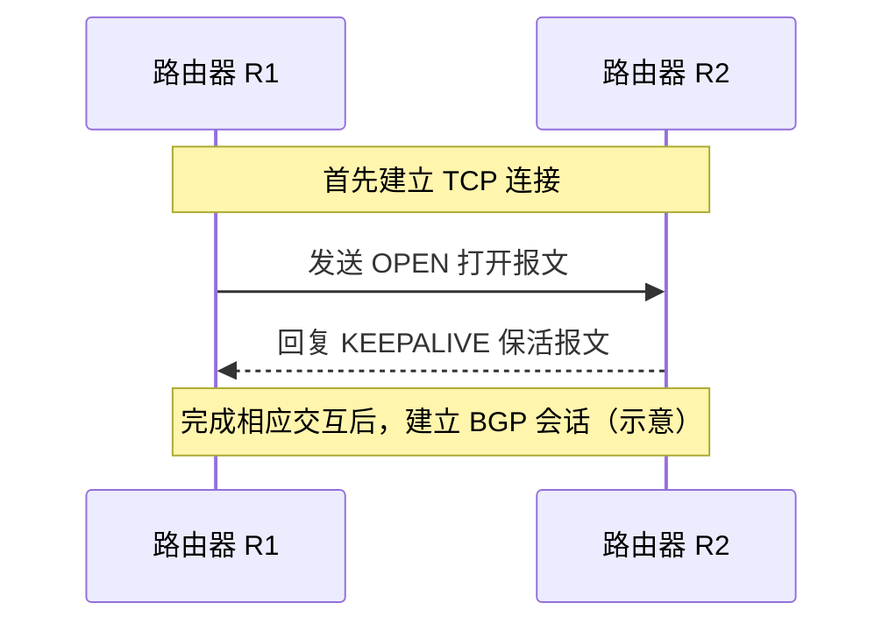
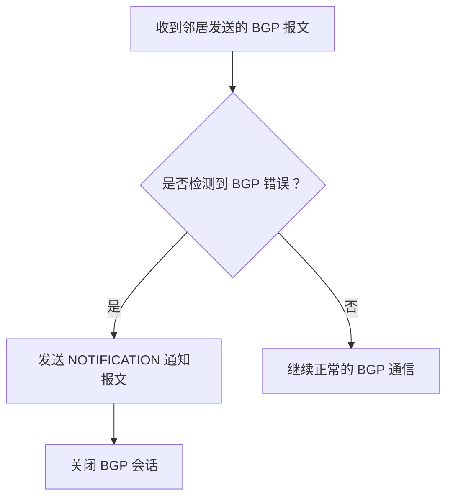
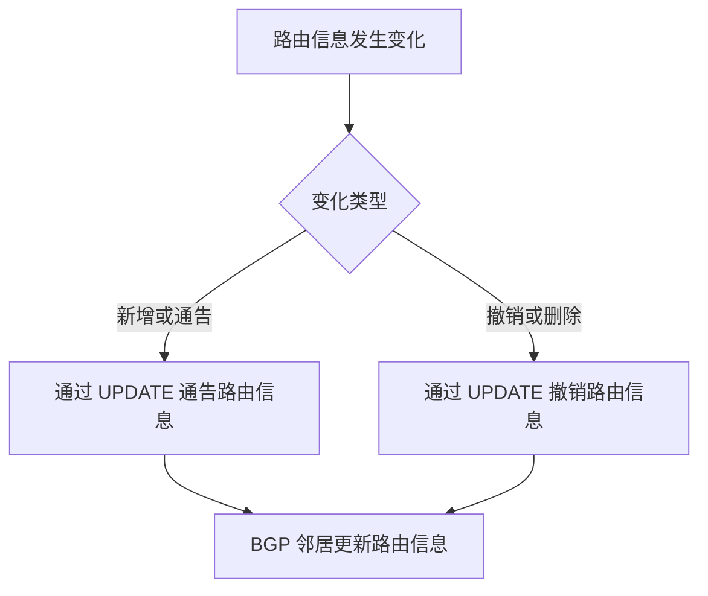
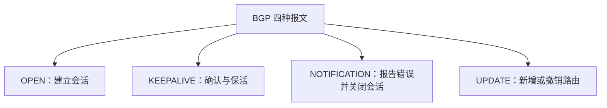

各位同学大家好，在这个视频中，我们要了解一下bgp定义的四种报文，那bgp定义了四种报文，分别是open。打开报文update，更新报文keep a life保活报文。以及notification通知报文。我们只需要简单了解各种报文，它有什么作用以及在什么时候会使用这个报文就可以了。首先open打开报文，它用于呃和相邻的另一个bgp对等方建立bgp会话。使通信初始化是这样的一个作用。我们来看这样的一个例子。r1r2这两个路由器之间刚开始是没有建立bgp会话的。

那我们知道bgp协议，它是基于TCP的，所以在建立bgp会话之前，首先这两台路由器之间需要先建立起TCP连接。建立好TCP连接之后，其中一个路由器就可以基于TCP连接给另一个路由器发送open包文。收到open报文之后，这台路由器又会回复一个keep alive。也就是保活报文。在建立bgp会话的这个过程当中，保活报文的作用类似于ack。open报文的作用类似于请求对方建立bgp会话。如果同意建立bgp会话，那么就返回一个keep a live报文。那这样一来一回。

两个路由器之间就成功的建立了ebgp会话，那类似的道理在一个自治系统内部，如果这两个路由器之间要建立ibgp会话。那同样的也需要先建立TCP连接，然后基于TCP连接去发送呃一个bgp open报文以及回复一个keep alive报文。这样两台路由器的ibgp会话就建立完成了，好，那这是open报文，它的发送时机就是在TCP连接成功之后。bgp发出的第一个报文对open报文的回复需要使用keep alive保活报文。好，那这个保活报文除了回复open报文之外，它还需要周期性的发送，就通知bgp。对等方也就bgp邻居通知对方说，

我还活着。比如说我们可以规定每60秒发送一次bgp保活报文，如果超出三倍规定的时间，也就是超出180秒没有收到对方发来的保活报文。那么就会认为bgp会话出现问题，此时就应该结束bgp会话。好，所以这个keep alive保活报文是bgp绘画的呃，双方都会周期性的发送的。用来确认这个bgp会话，现在还活着好，这是保活报文，接下来我们先跳到第四个报文。notification通知报文，它用来发送检测到的错误，

比如说如果检测到bgp邻居发来的这个呃bgp报文，它的首部参数有错误。那么就会用这个notification报文通知对方，自己检测到的错误与此同时立即关闭bgp会话。好，这是通知报文，最后我们再来看最重磅的update更新报文，这个报文可以用来通知呃bgp邻居。新增呃一些路由信息或者撤销一些路由信息。之前我们只粗略的说r1给r2发送bgp路由信息的时候，是通过bgp报文去携带这个路由信息的，对吧？那通过这节课我们知道了。具体来说呃，携带路由信息的这个bgp报文，

它属于update，这种报文类型。那除了新增的路由信息之外，假如说呃ase这边这个网络它不可达了，那么这种路由信息就需要撤销呃，或者说删除。那撤销一条路由信息，删除一条路由信息，同样也是通过update这种呃报文类型去通知对方的。好，那么在这张图当中，我也结合图示简要的梳理了这四种报文的作用。open报文是用来。建立会话的，不管是ebgp还是ibgp，

都是用open报文来发出建立会话请求的。而keep a live报文是用来维持绘画的。notification报文用来向bgp邻居报告呃bgp错误。并且关闭bgp会话。而最后最重要的update报文，它用于新增或者删除一些路由信息。好的，那么这就是bgp的四种报文类型。# BGP 的四种报文类型

## 一、概述

BGP（边界网关协议）定义了四种报文：

1. **OPEN（打开报文）**
2. **UPDATE（更新报文）**
3. **KEEPALIVE（保活报文）**
4. **NOTIFICATION（通知报文）**

学习时，重点掌握每种报文的**作用**以及**发送时机**即可。

| 报文类型                 | 主要作用                                 | 典型发送时机                                |
| ------------------------ | ---------------------------------------- | ------------------------------------------- |
| OPEN（打开报文）         | 建立 BGP 会话、初始化通信                | TCP 连接建立成功后，发送 BGP 报文时首先使用 |
| UPDATE（更新报文）       | 通告新增路由，或撤销已有路由             | 需要向 BGP 邻居通告或撤销路由信息时         |
| KEEPALIVE（保活报文）    | 回复 OPEN 报文，并周期性确认邻居仍然存活 | 建立会话时回复 OPEN；会话建立后周期性发送   |
| NOTIFICATION（通知报文） | 通知对方检测到的 BGP 错误，并关闭会话    | 检测到 BGP 协议错误时                       |

## 二、OPEN：打开报文

### 1. 作用

**OPEN 报文用于与相邻的另一个 BGP 对等方建立 BGP 会话，并初始化通信。**

无论建立的是外部 BGP（eBGP）会话，还是内部 BGP（iBGP）会话，都需要使用 OPEN 报文。

### 2. 发送时机与建立会话的过程

BGP 基于 TCP，因此建立 BGP 会话之前，两个路由器需要先建立 TCP 连接。TCP 连接建立成功后，才开始进行 BGP 会话的建立过程。

以路由器 R1 和 R2 为例：

- **TCP 连接建立成功后，OPEN 是 BGP 首先发送的报文类型。**
- OPEN 报文用于请求建立 BGP 会话。
- 在本课的示例中，收到 OPEN 报文的一方通过 KEEPALIVE 报文进行回复；其作用可以类比为对建立会话请求的确认。
- eBGP 和 iBGP 会话都需要先建立 TCP 连接，再进行 BGP 会话建立过程。

## 三、KEEPALIVE：保活报文

### 1. 作用

KEEPALIVE 报文主要有两个作用：

1. **在建立 BGP 会话时回复 OPEN 报文。**
2. **在会话建立后周期性发送，确认 BGP 邻居仍然存活。**

因此，BGP 会话双方都会周期性地发送 KEEPALIVE 报文，用来告知对方自己仍然正常工作。

### 2. 周期性发送与超时判断

例如，可以规定每 **60 秒**发送一次 BGP 保活报文。

如果超过规定时间的三倍，即 **180 秒**，仍然没有收到对方发来的保活报文，就认为 BGP 会话可能出现问题，此时应结束 BGP 会话。

| 项目               | 本课示例                          |
| ------------------ | --------------------------------- |
| KEEPALIVE 发送周期 | 60 秒                             |
| 示例超时时间       | 180 秒（发送周期的 3 倍）         |
| 超时后的处理       | 认为 BGP 会话出现问题，并结束会话 |

> **记忆要点：** KEEPALIVE 既能在会话建立过程中回复 OPEN，也能在会话建立后周期性发送，用于维持会话。

## 四、NOTIFICATION：通知报文

### 1. 作用

NOTIFICATION 报文用于向 BGP 邻居报告检测到的错误，并且**立即关闭 BGP 会话**。

### 2. 使用场景

例如，路由器检测到 BGP 邻居发来的报文首部参数存在错误，就可以通过 NOTIFICATION 报文通知对方自己检测到的错误，同时关闭 BGP 会话。

> **记忆要点：** NOTIFICATION = **报告错误 + 关闭会话**。

## 五、UPDATE：更新报文

### 1. 作用

UPDATE 报文用于向 BGP 邻居通告路由信息，包括：

- **新增路由信息**：通知邻居某些目的网络可以通过相应路径到达。
- **撤销路由信息**：通知邻居某些原先通告的路由已经不可用，需要撤销或删除。

### 2. 使用场景

此前学习中，我们知道路由器之间可以通过 BGP 报文传递路由信息。具体来说，**携带新增路由信息或撤销路由信息的 BGP 报文属于 UPDATE 报文**。

例如，当某个网络变得不可达时，相关路由信息需要被撤销。路由器同样可以使用 UPDATE 报文通知 BGP 邻居删除相应的路由信息。

> **记忆要点：** UPDATE 既用于**新增（通告）路由**，也用于**撤销路由**。

## 六、四种报文对比与记忆

| 报文             | 关键词             | 一句话记忆                                |
| ---------------- | ------------------ | ----------------------------------------- |
| **OPEN**         | 建立会话           | TCP 连接建立后，用于发起 BGP 会话建立过程 |
| **KEEPALIVE**    | 确认、保活         | 回复 OPEN，并周期性确认邻居仍然存活       |
| **NOTIFICATION** | 报告错误、关闭会话 | 检测到 BGP 错误后，通知邻居并关闭会话     |
| **UPDATE**       | 新增、撤销路由     | 通告新增路由，或撤销已有路由              |

### 考试记忆提示

- **OPEN：建立会话。**
- **KEEPALIVE：维持会话。**
- **NOTIFICATION：报告错误并关闭会话。**
- **UPDATE：新增或撤销路由信息。**

以上就是 BGP 定义的四种报文类型及其主要作用。
