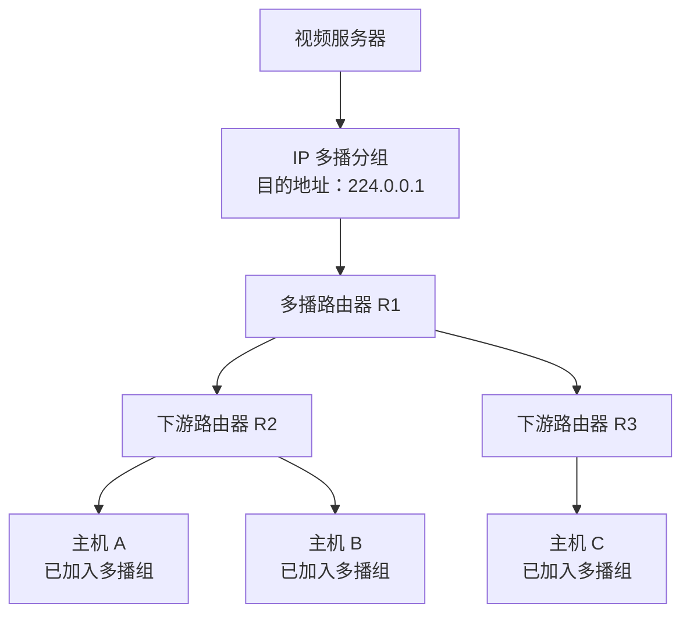

# IP 多播（IP Multicast）学习笔记

## 一、考纲要求与本节重点

408 大纲对 IP 多播的要求相对较低，主要是：

- 了解 IP 多播的相关概念。
- 了解 IP 多播地址的含义与范围。

本节重点是理解 **IP 多播适合一对多通信的原因**，并掌握多播地址、IGMP 协议、多播路由协议以及 IP 多播的几个重要特点。

## 二、从 IP 地址分类理解 IP 多播

### 1. 单播地址与多播地址

IPv4 地址由 **32 比特**组成。按照传统的分类编址方式，A、B、C 类地址通常用于单播。

- **单播地址（Unicast Address）**：可以分配给特定主机，用于向某一台主机发送数据。
- **多播地址（Multicast Address）**：用于标识一个多播组，不能像普通单播地址那样分配给某一台特定主机。

可以用 QQ 账号和 QQ 群来理解：

| 网络概念   | 类比       | 含义                                 |
| ---------- | ---------- | ------------------------------------ |
| 单播地址   | 个人 QQ 号 | 面向一个特定的接收对象               |
| 多播地址   | QQ 群号    | 面向加入同一个组的多个接收对象       |
| 加入多播组 | 加入 QQ 群 | 主机声明自己希望接收某个多播组的数据 |
| 退出多播组 | 退出 QQ 群 | 主机不再需要接收该组的数据           |

一台主机可以加入一个多播组，也可以同时加入多个多播组。

### 2. 多播地址的范围

IPv4 多播地址属于 **D 类地址**，其前 4 个比特固定为 `1110`。

- **D 类地址范围：** `224.0.0.0` ～ `239.255.255.255`
- **地址前缀特征：** 二进制前 4 位为 `1110`

> **记忆重点：** IPv4 多播地址是 D 类地址，前 4 个比特为 `1110`。

## 三、IP 单播与 IP 多播的区别

假设有 90 台主机正在收看同一场视频直播。

### 1. 使用 IP 单播

如果采用 IP 单播，视频服务器需要分别向 90 台主机发送数据。对于相同的视频、音频内容，服务器需要重复发送多份数据。

```text
                    ┌── 单播数据 ──> 主机 1
                    ├── 单播数据 ──> 主机 2
视频服务器 ─────────┼──    ...    ──> ...
                    └── 单播数据 ──> 主机 90

                 相同内容需要分别发送
```

### 2. 使用 IP 多播

如果 90 台主机都加入同一个多播组，例如 `224.0.0.1`，那么视频服务器只需要构建并发送一个 IP 多播分组：

- **源 IP 地址：** 填写视频服务器自己的 IP 地址。
- **目的 IP 地址：** 填写多播地址，例如 `224.0.0.1`。

支持 IP 多播的路由器会根据多播组成员的分布情况，将分组转发到需要接收该组数据的接口。分组在网络中沿着相应的分支转发，而不是由服务器为每一台主机分别发送一份。

```text
视频服务器
    │ 发送一个目的地址为 224.0.0.1 的 IP 多播分组
    ▼
多播路由器
   ├──> 下游路由器 ──> 已加入该组的主机
   ├──> 下游路由器 ──> 已加入该组的主机
   └──> 下游路由器 ──> 已加入该组的主机
```

### 3. 多播分发示意图



### 4. 单播与多播对比

| 对比项                   | IP 单播              | IP 多播                                                        |
| ------------------------ | -------------------- | -------------------------------------------------------------- |
| 通信方式                 | 一对一               | 一对多                                                         |
| 目的 IP 地址             | 单播地址             | 多播地址                                                       |
| 发送相同内容给多台主机时 | 通常需要分别发送     | 源主机可以发送一个多播分组，由网络中的多播路由器进行复制和转发 |
| 适用场景举例             | 向某一台主机传输数据 | 视频直播、视频会议、网络电视等                                 |

**核心理解：** IP 多播适合多个接收者需要接收相同数据的场景。发送端发出多播分组后，由中间的多播路由器根据组成员分布情况进行复制和转发。

## 四、IP 多播涉及的地址与设备

### 1. IP 多播分组

IP 多播分组与普通 IP 分组的一个关键区别是：**目的 IP 地址填写多播地址**。

- 源 IP 地址仍然是发送主机自己的 IP 地址。
- 目的 IP 地址填写某个多播组的多播地址。
- 该分组由支持 IP 多播的路由器按需转发。

### 2. 多播路由器

**多播路由器**是指支持 IP 多播功能的路由器。

多播路由器需要支持：

1. **IGMP 协议**：管理主机与相邻路由器之间的多播组成员关系。
2. **多播路由协议**：让多播路由器之间交换多播组成员分布等相关信息，以便确定多播分组应该从哪些接口转发。

## 五、IGMP 协议与多播路由协议

### 1. IGMP 协议

IGMP 的作用是实现**主机与路由器之间的多播管理**，主要用于管理主机加入或离开多播组。

通俗地说：

- 主机加入多播组，相当于“加入 QQ 群”。
- 主机离开多播组，相当于“退出 QQ 群”。

主机通过 IGMP 向与其相邻的多播路由器表达多播组成员关系。这样，相邻路由器就能够了解本地网络中哪些主机希望接收哪些多播组的数据。

需要记住：

- **IGMP 属于网络层协议。**
- IGMP 报文通过 IP 分组传送。
- 携带 IGMP 报文的 IPv4 分组，其首部中的 **协议字段值为 `2`**。

> **易混点：** IGMP 虽然使用 IP 提供的服务，但它本身仍属于网络层协议。

### 2. 多播路由协议

多播路由协议用于让**多播路由器之间相互交换多播相关信息**，从而得知哪些接口方向存在某个多播组的成员。

例如：

1. 主机通过 IGMP 告诉相邻路由器：“我要加入多播组 `224.0.0.1`。”
2. 相邻路由器据此了解本地网络中的多播组成员情况。
3. 该路由器再通过多播路由协议与其他多播路由器交换相关信息。
4. 当某个目的地址为 `224.0.0.1` 的 IP 多播分组到达路由器时，路由器就能根据已掌握的组成员分布，决定应将分组转发到哪些接口。

### 3. 两种协议的区别

| 协议         | 主要通信双方     | 主要作用                           | 记忆方式             |
| ------------ | ---------------- | ---------------------------------- | -------------------- |
| IGMP         | 主机与相邻路由器 | 管理主机加入、离开多播组           | 主机“加群、退群”     |
| 多播路由协议 | 多播路由器之间   | 交换多播相关信息，帮助确定转发方向 | 路由器之间“互通有无” |

## 六、IP 多播的特点（重点）

### 1. 尽最大努力交付，不提供可靠交付

目的地址为多播地址的 IP 数据报，与普通单播 IP 数据报一样，采用**尽最大努力交付**的方式，不保证可靠交付。

主机收到相关的 IP 多播分组后，不会因此向源主机返回确认应答（ACK）。因此，IP 多播不保证所有接收主机都一定收到数据。

### 2. 多播地址只能作为目的地址，不能作为源地址

这是一个需要特别注意、可能作为选择题考查的知识点。

- **正确：** IP 多播分组的目的 IP 地址可以是多播地址。
- **错误：** 把多播地址填写为 IP 分组的源 IP 地址。

例如：

| IP 首部字段  | 示例                         |
| ------------ | ---------------------------- |
| 源 IP 地址   | 视频服务器自己的单播 IP 地址 |
| 目的 IP 地址 | `224.0.0.1`（多播地址）      |

### 3. 对多播数据报不产生 ICMP 差错报文

普通单播 IP 数据报在转发过程中出现某些错误时，路由器可能向源主机返回 ICMP 差错报文。例如，分组的 TTL 减为 0 时，路由器会丢弃该分组，并通常返回 ICMP 超时报文。

但对于 **IP 多播数据报，不产生 ICMP 差错报文**。例如，多播分组转发过程中 TTL 减为 0 时，路由器会丢弃分组，不向源主机返回 ICMP 差错报文。

### 4. 三个特点速记

| 特点     | 需要记住的内容                           |
| -------- | ---------------------------------------- |
| 可靠性   | 尽最大努力交付，不提供可靠交付           |
| 地址使用 | 多播地址只能作为目的地址，不能作为源地址 |
| ICMP     | 对多播数据报不产生 ICMP 差错报文         |

## 七、生活实例：网络电视如何使用 IP 多播

办理宽带时，套餐可能会包含网络电视服务。运营商提供机顶盒后，用户就可以通过电视收看 CCTV-1、CCTV-2 或地方卫视等频道。

可以把每个电视频道与一个多播地址关联起来。例如：

| 电视频道（示例） | 对应的多播地址（示例） |
| ---------------- | ---------------------- |
| CCTV-1           | `224.0.0.1`            |
| CCTV-2           | `224.0.0.2`            |
| 某个地方卫视     | `224.0.0.3`            |

以上地址用于帮助理解多播原理，是讲解中的示例。

### 1. 多台电视收看同一频道

假设电视 1 和电视 4 都想收看 CCTV-1：

1. 两台电视对应的机顶盒分别通过 IGMP，向相邻的多播路由器表达加入 `224.0.0.1` 多播组的请求。
2. 多播路由器之间通过多播路由协议交换相关信息，了解哪些方向存在该组的成员。
3. CCTV-1 的视频服务器持续发送目的地址为 `224.0.0.1` 的 IP 多播分组。
4. 网络中的多播路由器沿着存在该组成员的相应路径转发分组。
5. 最终，电视 1 和电视 4 都能够接收到 CCTV-1 的视频、音频数据。

### 2. 电视调台的本质

假设电视 6 原本正在收看某个地方卫视，其对应的多播组为 `224.0.0.3`。现在用户希望切换到 CCTV-1，其对应的多播组为 `224.0.0.1`。

从多播组成员关系的角度看，电视对应的机顶盒需要：

1. 离开原来的多播组 `224.0.0.3`。
2. 加入新的多播组 `224.0.0.1`。

机顶盒通过 IGMP 与相邻的多播路由器进行多播组成员管理。加入新组后，网络便可以根据新的组成员分布转发对应频道的多播数据。

因此，可以把网络电视调台理解为：**退出一个多播组，再加入另一个多播组。**

## 八、本节总结

复习 IP 多播时，重点掌握以下内容：

1. **多播地址：** IPv4 D 类地址，范围为 `224.0.0.0` ～ `239.255.255.255`，前 4 个比特为 `1110`。
2. **多播的作用：** 适用于一对多通信，尤其适合多个接收者需要接收相同数据的场景。
3. **多播路由器：** 根据多播组成员分布，对多播分组进行必要的复制与转发。
4. **IGMP：** 管理主机与相邻路由器之间的多播组成员关系，负责主机加入、离开多播组。
5. **多播路由协议：** 让多播路由器之间交换多播相关信息。
6. **多播的三个特点：**
   - 尽最大努力交付，不提供可靠交付。
   - 多播地址只能作为目的地址，不能作为源地址。
   - 对多播数据报不产生 ICMP 差错报文。
7. **生活应用：** 网络电视调台可以理解为退出原多播组并加入新的多播组。

> **考前优先记忆：** D 类多播地址的范围；IGMP 与多播路由协议的区别；多播地址只能作为目的地址；多播数据报不产生 ICMP 差错报文。
