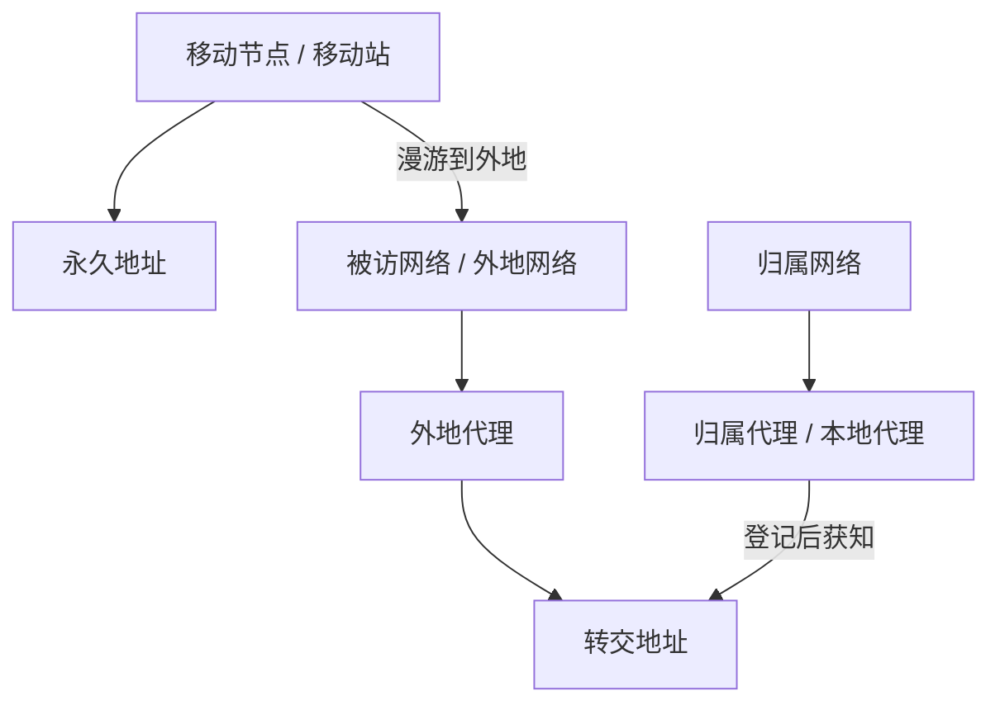
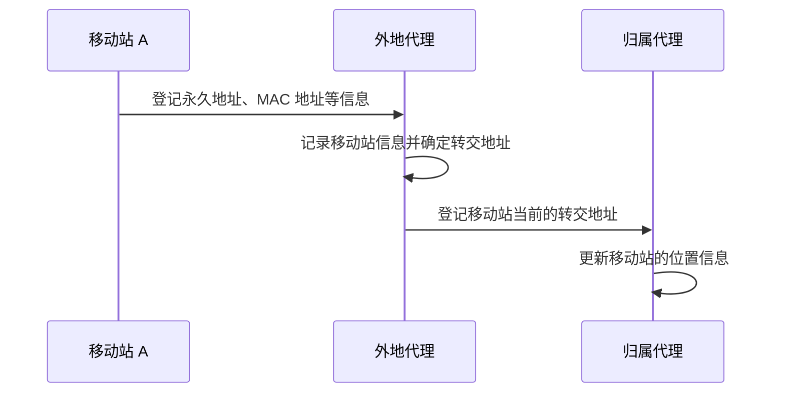
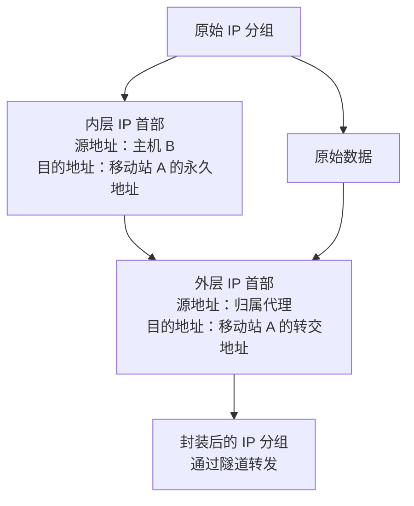
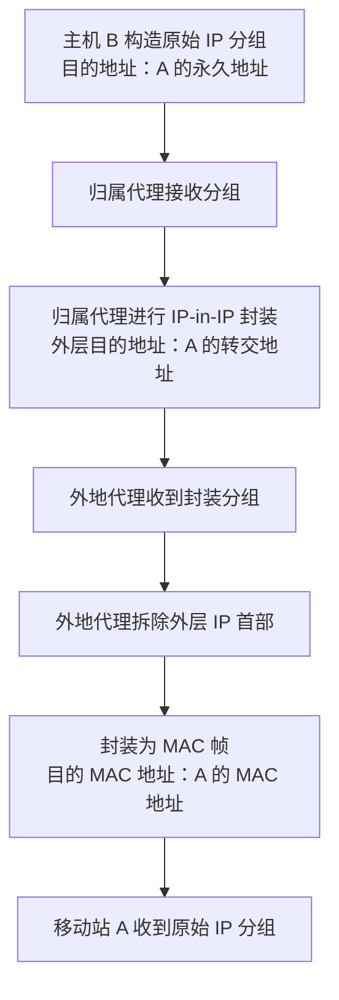
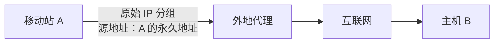
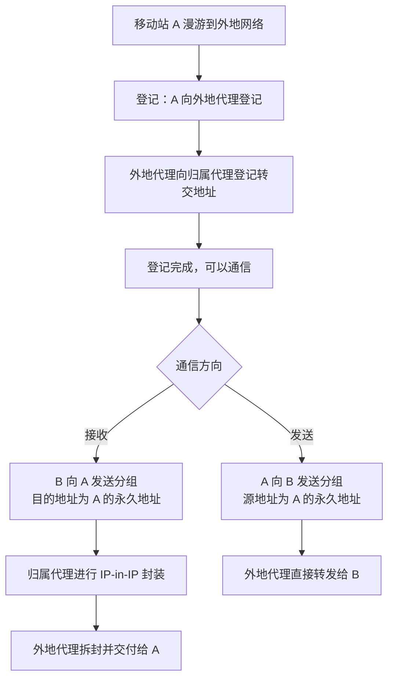
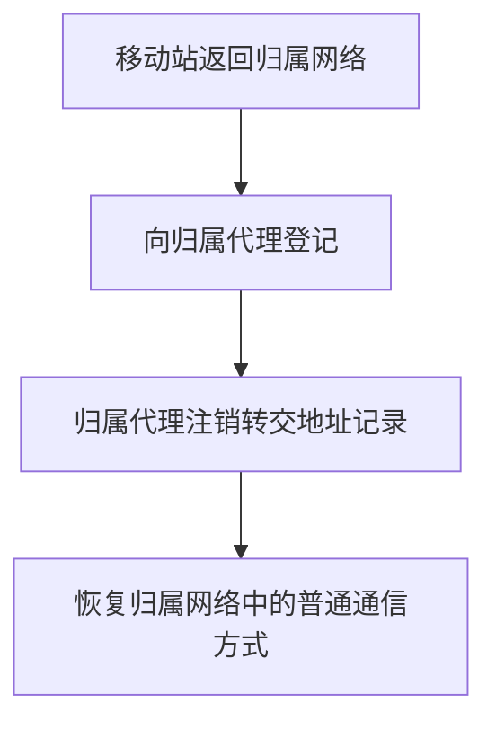
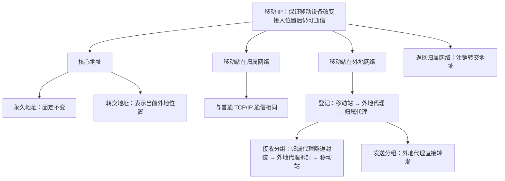

# 移动 IP（Mobile IP）学习笔记

> **考纲要求：** 了解移动 IP 的概念以及移动 IP 的通信过程。  
> **考查情况：** 历年考评较低，复习时重点掌握相关术语，以及移动站在外地网络中接收、发送 IP 分组的过程。

---

## 目录

- [移动 IP（Mobile IP）学习笔记](#移动-ipmobile-ip学习笔记)
  - [目录](#目录)
  - [一、移动 IP 要解决什么问题](#一移动-ip-要解决什么问题)
    - [1. 背景：移动设备的位置会变化](#1-背景移动设备的位置会变化)
    - [2. IP 地址变化可能影响通信](#2-ip-地址变化可能影响通信)
    - [3. 移动 IP 的目标](#3-移动-ip-的目标)
  - [二、移动 IP 的基本概念](#二移动-ip-的基本概念)
    - [1. 核心术语表](#1-核心术语表)
    - [2. 移动节点（移动站）](#2-移动节点移动站)
    - [3. 归属代理（本地代理）](#3-归属代理本地代理)
    - [4. 外地代理](#4-外地代理)
    - [5. 永久地址与转交地址](#5-永久地址与转交地址)
    - [6. 概念关系图](#6-概念关系图)
  - [三、移动站位于归属网络时的通信](#三移动站位于归属网络时的通信)
    - [通信示意图](#通信示意图)
  - [四、移动站漫游到外地网络](#四移动站漫游到外地网络)
    - [1. 登记过程](#1-登记过程)
      - [登记过程图](#登记过程图)
    - [2. 隧道技术与 IP-in-IP 封装](#2-隧道技术与-ip-in-ip-封装)
      - [2.1 为什么需要隧道](#21-为什么需要隧道)
      - [2.2 什么是 IP-in-IP 封装](#22-什么是-ip-in-ip-封装)
      - [2.3 套娃封装示意图](#23-套娃封装示意图)
    - [3. 移动站在外地接收 IP 分组](#3-移动站在外地接收-ip-分组)
      - [具体步骤](#具体步骤)
      - [接收过程图](#接收过程图)
      - [接收过程的首部变化](#接收过程的首部变化)
    - [4. 移动站在外地发送 IP 分组](#4-移动站在外地发送-ip-分组)
      - [发送过程图](#发送过程图)
    - [5. 接收与发送的区别](#5-接收与发送的区别)
    - [6. 外地通信的整体流程图](#6-外地通信的整体流程图)
  - [五、移动站返回归属网络](#五移动站返回归属网络)
  - [六、移动 IP 网络层需要增加的功能](#六移动-ip-网络层需要增加的功能)
  - [七、补充考点与易错点](#七补充考点与易错点)
    - [1. 通信双方使用永久地址，不使用转交地址](#1-通信双方使用永久地址不使用转交地址)
    - [2. 一个转交地址可能被多个移动站共用](#2-一个转交地址可能被多个移动站共用)
    - [3. 易错点清单](#3-易错点清单)
  - [八、移动 IP 的应用背景](#八移动-ip-的应用背景)
  - [九、考前速记](#九考前速记)
    - [1. 术语速记](#1-术语速记)
    - [2. 四种通信状态速记](#2-四种通信状态速记)
    - [3. 最重要的三句话](#3-最重要的三句话)
    - [4. 一页式总览图](#4-一页式总览图)

---

## 一、移动 IP 要解决什么问题

### 1. 背景：移动设备的位置会变化

手机通常通过无线链路与基站通信，基站再通过交换机、路由器等设备接入互联网。

当用户拿着手机从一个地方移动到另一个地方时，手机可能会连接到另一个基站，并接入另一个子网。在普通网络接入方式下，移动设备实际使用的 IP 地址可能随所在网络改变。

### 2. IP 地址变化可能影响通信

假设主机 B 正在向移动设备 A 传输一个大文件。如果 A 在传输过程中移动到了另一个网络，导致 IP 地址发生变化，那么原有的 TCP 连接就可能受到影响，大文件传输也可能中断。

### 3. 移动 IP 的目标

**移动 IP（Mobile IP）要解决的问题：**

当移动设备的位置发生变化、接入的网络发生变化时，如何尽可能保证网络通信不受影响。

核心思路是：

- 为移动设备保留一个固定的**永久地址**；
- 移动设备到外地网络后，使用一个表示当前接入位置的**转交地址**；
- 通过归属代理、外地代理以及隧道封装等机制，把发往移动设备永久地址的 IP 分组转交到移动设备当前所在的位置。

---

## 二、移动 IP 的基本概念

为了便于理解，可以用一个例子贯穿全文：

小咸鱼在北京办理了一张北京联通的电话卡，后来到武汉工作，但仍然使用这张电话卡。这里用北京表示移动站的归属网络，用武汉表示移动站当前接入的外地网络。

> 这个例子用于帮助理解移动 IP 的术语和工作过程。实际网络中的移动接入实现可能更复杂。

### 1. 核心术语表

| 术语 | 也称为 | 含义 |
|---|---|---|
| 移动节点 / 移动站 | — | 可以移动位置的设备，例如手机。 |
| 归属代理 | 本地代理 | 位于移动站归属网络中的路由器，负责代收发往移动站的数据，并在移动站位于外地时通过隧道将数据转发到其当前位置。 |
| 外地代理 | — | 通常是连接在被访网络上的路由器。移动站到达外地网络后，会通过它接入互联网，并由它协助接收转交来的数据。 |
| 归属网络 | 本地网络 | 移动站的归属网络，也就是移动站的“老家”。 |
| 被访网络 | 外地网络 | 移动站离开归属网络后，当前接入的网络。 |
| 漫游 | — | 移动站离开归属网络，到外地网络接入网络并进行通信的过程。 |
| 永久地址 | 归属地址 | 与移动站绑定、在移动过程中保持不变的 IP 地址。 |
| 转交地址 | — | 用于表示移动站当前位于外地网络时的可达位置，通常是临时地址，会随移动站所在的外地网络而变化。 |

### 2. 移动节点（移动站）

移动节点就是可以移动位置的设备，例如手机。

在移动 IP 的模型中，移动站拥有一个永久 IP 地址。无论移动站处于归属网络，还是移动到了外地网络，这个永久地址都保持不变。

### 3. 归属代理（本地代理）

归属代理是移动站归属网络中的路由器。

它的主要作用是：

1. 记录移动站当前的转交地址；
2. 截获发往移动站永久地址、但需要转交到外地的数据报；
3. 对原始 IP 分组进行隧道封装，再转发给移动站当前所在网络的外地代理。

### 4. 外地代理

外地代理通常是连接在被访网络上的路由器。

移动站到达外地网络后，需要与外地代理进行通信和登记。外地代理会记录移动站的相关信息，并协助把转交来的 IP 分组交付给移动站。

### 5. 永久地址与转交地址

这两个概念尤其重要。

| 对比项 | 永久地址 | 转交地址 |
|---|---|---|
| 作用 | 标识移动站固定的网络层地址 | 表示移动站当前在外地网络中的可达位置 |
| 是否变化 | 在移动过程中保持不变 | 通常会随移动站漫游到的外地网络而变化 |
| 类比 | 一个人的老家地址 | 一个人当前的住址 |
| 谁需要知道 | 通信主机使用永久地址与移动站通信 | 归属代理、外地代理等移动 IP 相关实体需要使用转交地址 |
| 主机间原始 IP 分组是否使用 | **使用** | **不使用** |

例如：

- 移动站 A 的永久地址可以理解为它固定的“老家地址”；
- 当 A 漫游到武汉的被访网络时，外地网络为其提供一个转交地址；
- A 回到归属网络后，归属代理会注销原来的转交地址记录。

**记忆重点：永久地址不变，转交地址随外地网络而变。**

### 6. 概念关系图



---

## 三、移动站位于归属网络时的通信

当移动站仍然处于自己的归属网络、没有漫游到外地网络时，它与其他主机的通信和普通 TCP/IP 通信没有本质区别。

假设移动站 A 要与主机 B 通信：

- A 发给 B 的 IP 分组：源 IP 地址是 A 的永久地址，目的 IP 地址是 B 的 IP 地址；
- B 发给 A 的 IP 分组：源 IP 地址是 B 的 IP 地址，目的 IP 地址是 A 的永久地址；
- 发往 A 的分组经互联网转发后，可以到达 A 所属网络，并交付给 A。

### 通信示意图


**结论：移动站位于归属网络时，通信过程与普通 TCP/IP 通信没有区别。**

---

## 四、移动站漫游到外地网络

当移动站从归属网络移动到外地网络时，需要完成登记，并通过移动 IP 机制继续进行通信。

### 1. 登记过程

移动站 A 漫游到外地网络后，大体上需要进行以下操作：

1. **移动站向外地代理登记。**  
   移动站告知外地代理自己的永久地址、MAC 地址等信息。

2. **外地代理记录移动站信息。**  
   外地代理登记移动站的永久地址、转交地址、MAC 地址等相关信息，并为移动站提供当前可使用的转交地址。

3. **外地代理向归属代理登记。**  
   外地代理将移动站当前的转交地址等信息通知归属代理。

4. **归属代理更新记录。**  
   归属代理由此知道移动站已经离开归属网络，以及移动站当前的转交地址。

登记完成后，归属代理就能够把发往移动站永久地址的分组转交到移动站当前所在的外地网络。

> 复习时重点记住信息流向：**移动站 → 外地代理 → 归属代理**。归属代理需要知道移动站当前的转交地址。

#### 登记过程图



### 2. 隧道技术与 IP-in-IP 封装

#### 2.1 为什么需要隧道

假设主机 B 并不知道移动站 A 已经漫游到武汉，它只知道 A 的永久地址。

因此，B 发给 A 的原始 IP 分组仍然使用：

- **源 IP 地址：** B 的 IP 地址；
- **目的 IP 地址：** A 的永久地址。

这个原始分组会按照普通 IP 路由转发，最终到达 A 的归属代理。归属代理查询记录后，发现 A 已经位于外地，并且知道 A 当前的转交地址，于是把原始 IP 分组转交到该地址。

#### 2.2 什么是 IP-in-IP 封装

移动 IP 可以使用 **IP-in-IP（IP 之上的 IP）** 实现隧道技术：在原始 IP 分组的外面，再封装一个新的 IP 首部。

封装后包含两层 IP 首部：

- **内层 IP 首部：** 保留原始分组的信息。源地址仍为 B，目的地址仍为 A 的永久地址。
- **外层 IP 首部：** 用于把整个分组送到外地代理。源地址通常填写归属代理的地址，目的地址填写移动站当前的转交地址。

这样，互联网中的路由器会根据外层目的地址，将封装后的分组转发到外地代理。外地代理拆除外层 IP 首部后，就能取出原始 IP 分组，再将它交付给移动站 A。

#### 2.3 套娃封装示意图



也可以用下面的结构理解双层首部：

```text
┌───────────────────────────────────────┐
│ 外层 IP 首部                           │
│ 源地址：归属代理                       │
│ 目的地址：移动站当前的转交地址         │
├───────────────────────────────────────┤
│ 内层 IP 首部（原始 IP 首部）           │
│ 源地址：主机 B                         │
│ 目的地址：移动站 A 的永久地址          │
├───────────────────────────────────────┤
│ 原始数据                               │
└───────────────────────────────────────┘
```

**关键点：隧道封装改变的是外层 IP 首部；内层原始分组的永久地址不变。**

### 3. 移动站在外地接收 IP 分组

这是移动 IP 通信过程中较重要的部分。

假设主机 B 要向已经漫游到外地网络的移动站 A 发送一个 IP 分组。

#### 具体步骤

1. **主机 B 构造原始 IP 分组。**  
   源 IP 地址填写 B 的地址，目的 IP 地址填写 A 的永久地址。

2. **原始分组到达归属代理。**  
   互联网中的路由器根据目的地址转发该分组，使其到达 A 的归属代理。

3. **归属代理查询 A 的转交地址。**  
   归属代理知道 A 已经位于外地，并查到 A 当前的转交地址。

4. **归属代理进行隧道封装。**  
   归属代理在原始 IP 分组外面增加一层 IP 首部。外层源地址为归属代理地址，外层目的地址为 A 的转交地址；内层仍保留 B 发给 A 的原始 IP 分组。

5. **封装后的分组被转发到外地代理。**  
   外层目的地址指向 A 当前的转交地址，因此封装后的分组会被送往外地代理。

6. **外地代理拆除外层首部并交付分组。**  
   外地代理去掉外层 IP 首部，取出原始 IP 分组，再把它封装成 MAC 帧。MAC 帧的目的 MAC 地址填写移动站 A 的 MAC 地址，最后发送给 A。

7. **移动站 A 收到原始 IP 分组。**  
   A 去掉链路层的 MAC 帧首部后，得到 B 发来的原始 IP 分组。

#### 接收过程图



#### 接收过程的首部变化

| 阶段 | 源 IP 地址 | 目的 IP 地址 |
|---|---|---|
| B 构造的原始 IP 分组 | B 的 IP 地址 | A 的永久地址 |
| 归属代理增加外层首部后 | 外层：归属代理地址；内层：B 的 IP 地址 | 外层：A 的转交地址；内层：A 的永久地址 |
| 外地代理拆除外层首部后 | B 的 IP 地址 | A 的永久地址 |

注意：**原始 IP 分组的目的地址从头到尾都是 A 的永久地址。** 转交地址只出现在隧道封装的外层 IP 首部中。

### 4. 移动站在外地发送 IP 分组

移动站在外地网络中向其他主机发送 IP 分组，过程相对简单。

假设移动站 A 要向主机 B 发送 IP 分组：

1. A 构造原始 IP 分组；
2. **源 IP 地址填写 A 的永久地址**，而不是临时的转交地址；
3. 目的 IP 地址填写主机 B 的 IP 地址；
4. 分组先交给外地代理，再由外地代理经过互联网转发给 B；
5. 发送过程不需要先返回归属代理中转。

#### 发送过程图



### 5. 接收与发送的区别

移动站在外地网络时，接收和发送 IP 分组的路径并不相同。

| 比较项 | 移动站接收 IP 分组 | 移动站发送 IP 分组 |
|---|---|---|
| 原始分组中的移动站地址 | 目的地址是移动站的永久地址 | 源地址是移动站的永久地址 |
| 是否需要归属代理转发 | **需要**。归属代理截获分组后进行隧道封装 | **不需要**。可以由外地代理直接转发 |
| 是否使用隧道封装 | 归属代理到外地代理的转发过程使用 IP-in-IP 封装 | 按讲解中的基本流程，不需要经过归属代理建立的这段隧道 |
| 需要重点记住的内容 | 归属代理封装，外地代理拆封并交付 | 使用永久地址作为源地址，外地代理直接转发 |

> **高频记忆点：** 移动站在外地接收分组，需要经过归属代理的中转和隧道封装；移动站在外地发送分组，可以由外地代理直接转发，不需要经过归属代理。

### 6. 外地通信的整体流程图



---

## 五、移动站返回归属网络

当移动站从外地网络返回自己的归属网络后，需要向归属代理登记，注销原先的转交地址。

可以把这个过程理解为：移动站回到“老家”后，向归属代理报告自己已经回来。归属代理更新记录后，之后发往该移动站永久地址的分组就不再需要按照之前的外地转交方式处理。



---

## 六、移动 IP 网络层需要增加的功能

为了支持移动性，移动 IP 需要在网络层增加一些功能。讲解中归纳为以下几项：

| 新增功能 | 需要规定的内容 |
|---|---|
| 移动站到外地代理的登记协议 | 移动站与外地代理如何通信、需要交换哪些信息，以及如何完成登记 |
| 外地代理到归属代理的登记协议 | 外地代理和归属代理之间如何登记、发送哪些信息、如何进行回复 |
| 归属代理的数据报封装协议 | 归属代理如何把原始 IP 分组封装成用于隧道转发的分组，即 IP-in-IP 封装格式 |
| 外地代理对封装数据报的处理 | 外地代理收到归属代理发送来的封装 IP 数据报之后，如何拆除外层首部并交付原始分组 |

这部分不需要过度深究，有基本印象即可。

---

## 七、补充考点与易错点

### 1. 通信双方使用永久地址，不使用转交地址

移动站和其他主机之间的普通主机间通信，始终使用移动站的永久地址：

- 移动站 A 向 B 发送 IP 分组时，源 IP 地址使用 A 的永久地址；
- B 向 A 发送 IP 分组时，目的 IP 地址使用 A 的永久地址；
- 转交地址供移动 IP 相关实体使用，用于把分组转交到移动站的当前位置。

因此，转交地址对于主机和主机之间的通信是**透明的**。其他主机不需要知道移动站当前的转交地址是多少。

### 2. 一个转交地址可能被多个移动站共用

在讲解所采用的情形中，一个转交地址可以由多个移动站共用。例如，外地代理所在的子网中，移动站 A、C 可以同时使用同一个转交地址。

这不会必然导致分组混乱，因为外地代理还会登记每个移动站的永久地址、MAC 地址等信息。

当外地代理拆除隧道封装的外层首部后，它得到的是原始 IP 分组。原始 IP 分组的目的地址是对应移动站的永久地址。外地代理可以依据登记信息查找该永久地址对应的移动站及其 MAC 地址，再将原始 IP 分组封装成目的 MAC 地址正确的 MAC 帧，交付给相应移动站。

因此，虽然转交地址可能被多个移动站共用，但在被访网络内部，外地代理仍然可以依据移动站登记的信息完成正确交付。

### 3. 易错点清单

| 易错点 | 正确理解 |
|---|---|
| 以为移动站一漫游，永久地址就会改变 | 永久地址保持不变，改变的是当前接入网络以及相应的转交地址 |
| 以为主机 B 需要知道 A 的转交地址 | B 只需向 A 的永久地址发送原始 IP 分组；转交地址由移动 IP 相关实体使用 |
| 以为隧道封装会改变原始 IP 分组的目的地址 | 内层原始 IP 分组的目的地址仍然是 A 的永久地址，转交地址用于外层首部 |
| 以为移动站在外地发送和接收分组的路径相同 | 接收时通常需要归属代理进行隧道转发；发送时可以由外地代理直接转发 |
| 以为移动站回到归属网络后不需要处理 | 移动站需要向归属代理登记，归属代理注销原来的转交地址记录 |
| 以为一个转交地址只能被一个移动站使用 | 在讲解所述机制中，多个移动站可以共用转交地址；外地代理通过登记信息区分移动站 |

---

## 八、移动 IP 的应用背景

移动 IP 技术诞生于 20 世纪 90 年代中期。

当时，IPv4 地址不足的问题已经逐渐显现，但移动设备还不像今天这样普及。设计移动 IP 时，一种设想是给每台移动设备分配一个全球唯一的永久地址。

后来，随着互联网快速发展，IPv4 地址资源日益紧张，为每台移动设备都分配一个永久 IPv4 地址的设想难以大规模应用。按照讲解中的介绍，移动 IP 在现实中的应用较少，更多出现在实验性网络科研以及理论教学场景中。

这也与该考点在 408 考试中历年考查较少相呼应。复习时应把握大纲要求，重点理解概念和通信过程，不必过度深究背景内容。

---

## 九、考前速记

### 1. 术语速记

- **移动站：** 可以移动的设备。
- **归属代理 / 本地代理：** 位于归属网络，负责记录移动站的转交地址，并在必要时截获和转发分组。
- **外地代理：** 位于被访网络，协助移动站接入网络，并接收、拆封归属代理转交来的分组。
- **永久地址：** 移动站固定不变的地址，主机间通信使用它。
- **转交地址：** 表示移动站在外地网络中的当前位置，供移动 IP 相关实体使用。
- **漫游：** 移动站离开归属网络，到外地网络接入网络。

### 2. 四种通信状态速记

| 场景 | 记忆要点 |
|---|---|
| 移动站在归属网络 | 与普通 TCP/IP 通信没有区别 |
| 移动站到达外地网络 | 移动站向外地代理登记，外地代理再向归属代理登记转交地址 |
| 移动站在外地接收分组 | 分组先到归属代理；归属代理进行 IP-in-IP 封装；外地代理拆封后交给移动站 |
| 移动站在外地发送分组 | 源地址仍是永久地址；外地代理可以直接转发，不必经归属代理中转 |
| 移动站回到归属网络 | 向归属代理登记并注销转交地址 |

### 3. 最重要的三句话

1. **永久地址不变，转交地址随外地网络而变化。**
2. **外地接收：归属代理封装，外地代理拆封，再交付给移动站。**
3. **外地发送：源地址使用永久地址，外地代理可直接转发，不需要归属代理中转。**

### 4. 一页式总览图



> **复习建议：** 考前优先回顾术语表、外地接收分组的封装流程，以及外地发送分组为什么不需要经过归属代理中转。
