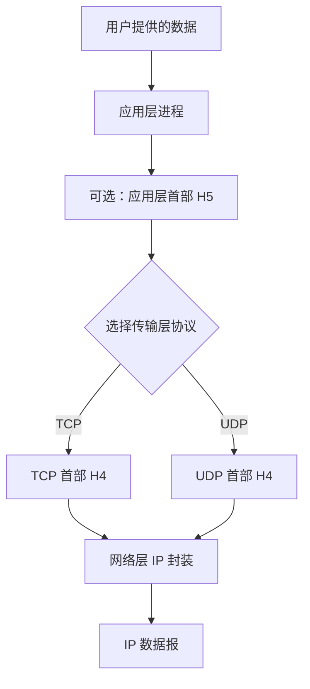
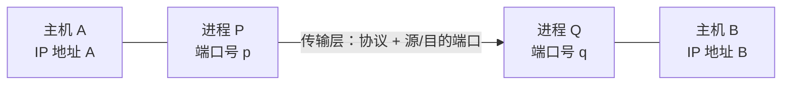
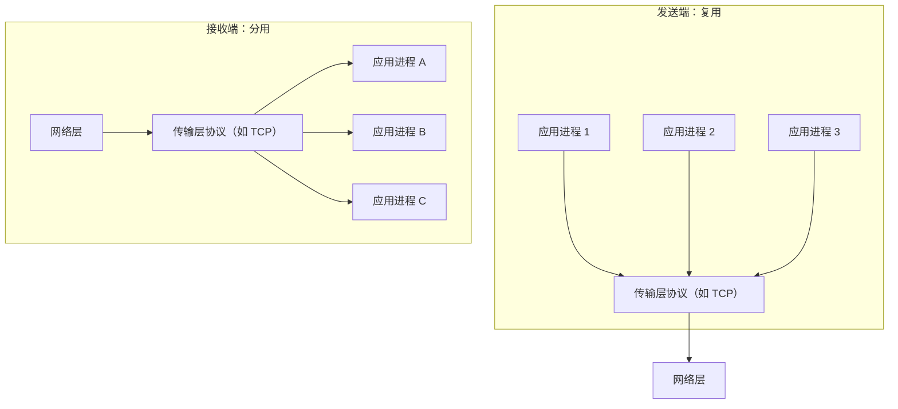
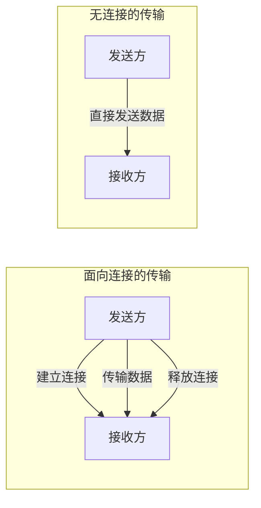
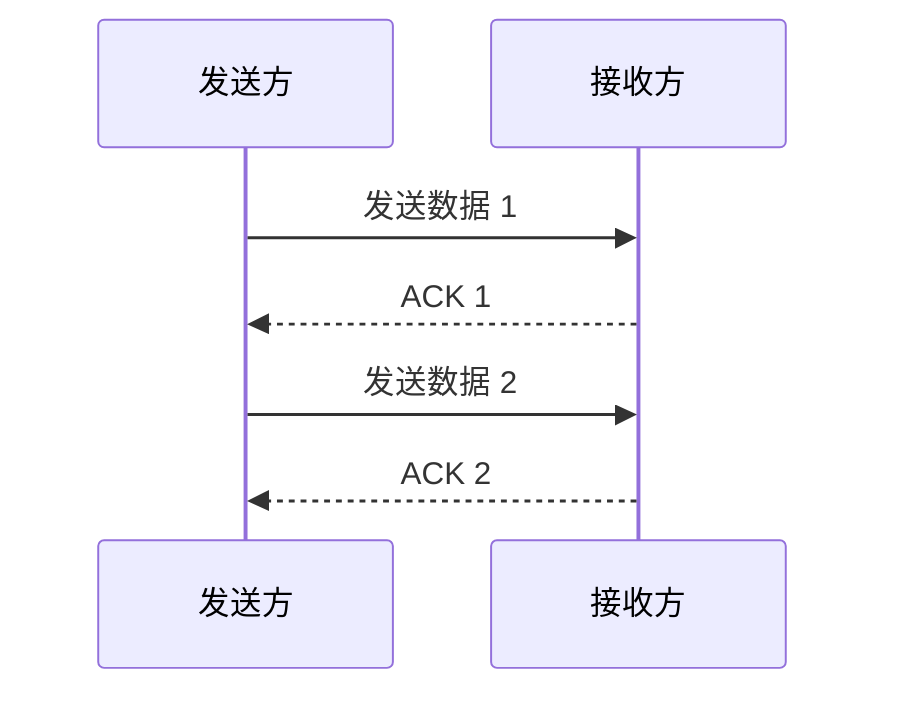
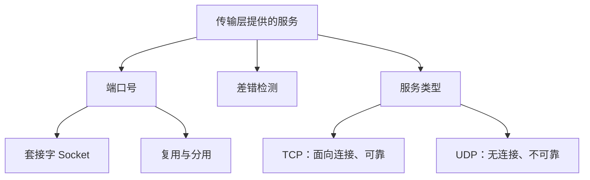

# 第五章 传输层：传输层提供的服务

> **对应王道书：** 5.1 小节  
> **本节主题：** 传输层的基本概念、端口号、套接字、复用与分用、差错检测，以及 TCP 与 UDP 提供的服务。

---

## 一、传输层考点概览

第五章学习传输层，主要涉及以下内容：

1. **传输层提供的服务**：介绍传输层的基本概念，通常不会单独考查，一般结合 UDP 或 TCP 协议考查。
2. **UDP 协议**：相对简单，历年考查过 3 道小题。其中，2024 年考查过一道 UDP 校验相关的题目，其他年份主要考查 UDP 数据报及相关基础概念。
3. **TCP 协议**：重点内容，有史以来考查过 20 道小题以及 2 道大题，考查频率较高。相比 UDP，TCP 背后的实现原理和工作过程更复杂。

本节先学习**传输层提供的服务**，后续再分别学习 UDP 和 TCP 协议。

---

## 二、传输层在协议栈中的位置

### 2.1 从应用程序到网络层的数据封装

用户通过应用程序提供需要传输的数据。例如：

- 使用微信发送一张图片；
- 使用 QQ 发送一串字符。

用户数据交给应用层的某个进程后，应用程序可以根据自身的实现逻辑，在用户数据前面添加应用层首部 `H5`。应用层首部可能存在，也可能不存在。

例如，微信的开发者可能认为有必要在照片数据前添加发送时间、照片大小、照片格式等信息；而另一个应用程序也可能认为没有必要添加这些信息，可以直接将用户数据交给传输层。

传输层使用不同协议时，会添加对应的传输层首部：

- 使用 **TCP** 时，添加 TCP 首部；
- 使用 **UDP** 时，添加 UDP 首部。

随后，传输层会将封装后的数据交给网络层。网络层的 IP 协议再将其封装成 IP 数据报。

### 2.2 数据封装示意图

> 图示用于说明封装层次：应用层首部是否存在，取决于应用程序的实现；TCP 和 UDP 分别使用各自定义的首部格式。

### 2.3 传输层的地位

传输层位于应用层之下、网络层之上：

- **向上为应用层提供服务**；
- **向下使用网络层 IP 协议提供的服务**。

网络层依靠源 IP 地址和目的 IP 地址，实现 IP 数据报在主机与主机之间的传输。

但是，数据到达目标主机后，还需要交给该主机上的某个应用进程。此时就需要传输层的**端口号**。

---

## 三、端口号：实现进程到进程的通信

### 3.1 为什么需要端口号？

一个 IP 地址可以标识网络中的一台特定主机。因此，网络层可以利用源 IP 地址和目的 IP 地址，实现主机与主机之间的通信。

但一台主机上通常运行着多个进程。IP 数据报到达主机后，还需要确定数据应当交给哪个进程。

传输层通过端口号区分数据来自哪个进程、应当交给哪个进程。

可以用以下组合来定位网络中的某个进程：

- 主机的 IP 地址；
- 该主机上进程使用的传输层协议；
- 该进程对应的端口号。

因此，传输层在网络层提供的主机到主机通信基础上，实现了**端到端通信，也就是进程到进程的通信**。

### 3.2 端口号的几个重要特点

#### 特点一：不同主机的端口号相互独立

端口号是每台主机自己的资源。

例如：

- 主机 A 上的进程使用端口 `777`；
- 主机 B 上的另一个进程也可以使用端口 `777`。

只要同一主机内不存在相应的端口冲突，不同主机使用相同的端口号是允许的。

#### 特点二：TCP 和 UDP 的端口号相互独立

同一台主机上，TCP 和 UDP 的端口号空间彼此独立。

例如，同一台主机上可以同时存在：

- 一个使用 TCP 端口 `886` 的进程；
- 一个使用 UDP 端口 `886` 的进程。

二者不会仅仅因为端口号相同而发生冲突，因为它们使用的传输层协议不同。

接收数据时，传输层会根据使用的是 TCP 还是 UDP，以及相应的目的端口号，将数据交给对应的协议处理，再递交给相应进程。

### 3.3 进程通信示例

假设主机 A 和主机 B 分别运行若干进程，通信关系如下：

| 通信双方        | 传输层协议 | 主机 A 的端口号 | 主机 B 的端口号 |
| --------------- | ---------- | --------------: | --------------: |
| 进程 1 ↔ 进程 5 | TCP        |             250 |             886 |
| 进程 2 ↔ 进程 6 | TCP        |             777 |             113 |
| 进程 3 ↔ 进程 7 | UDP        |              32 |             777 |
| 进程 4 ↔ 进程 8 | UDP        |             113 |             886 |

这个例子说明：

1. 主机 A 与主机 B 可以使用相同的端口号。
2. 同一台主机上的 TCP 与 UDP 可以使用相同的端口号。
3. 进程通信时，需要明确使用的传输层协议，以及通信双方对应的 IP 地址和端口号。

例如，进程 1 要通过 TCP 与进程 5 通信时，需要使用 TCP 协议，并指定自己的端口号 `250`，以及对方主机的 IP 地址和 TCP 端口号 `886`。数据进入对方主机后，会交给 TCP 处理，再根据目的端口号递交给相应进程。即使该主机上有另一个进程使用 UDP 端口 `886`，也不会因此与 TCP 端口 `886` 冲突。

---

## 四、套接字（Socket）

### 4.1 为什么需要套接字？

两个进程之间可能会传输一系列数据。如果每次发送数据，都要在代码中重复写明：

- 使用什么传输层协议；
- 对方的 IP 地址；
- 对方的端口号；

那么编程会比较繁琐。

为使网络编程更方便，C 语言、C++ 等环境中提供了**套接字（Socket）**这一概念。常见的有 TCP 套接字和 UDP 套接字。

### 4.2 套接字的作用

以两个进程使用 TCP 通信为例，程序可以创建 TCP 套接字，并在相关数据结构中记录通信所需的信息，例如对方的 IP 地址和端口号等。

之后，程序就可以通过套接字表示通信端点，不必每次都重复写出所有通信参数。

可以把套接字简单理解为一个“网络指针”：它指向网络通信中与本进程关联的通信端点。

> **注意：** 套接字不只包含 IP 地址和端口号，实际使用时还可能包含其他信息。本节侧重计算机网络理论，不展开具体编程细节。

---

## 五、端口号的分类

### 5.1 端口号的范围

传输层端口号使用 **16 比特**表示，因此取值范围是：

\[
0 \sim 2^{16}-1 = 0 \sim 65535
\]

端口号可以从用途上分为服务器使用的端口号和客户端使用的端口号。

- **服务器：** 通常是被动等待、响应通信的一方。
- **客户端：** 通常是主动发起通信的一方。

例如，启动手机上的网络游戏客户端后，客户端会主动与游戏服务器建立通信。

早期互联网标准文档曾约定：大于 `49125` 的端口号一般供客户端进程使用，小于 `49125` 的端口号一般供服务器进程使用。不过，这种标准如今已不流行，而且属于建议性的约定，并非强制要求。实际复习时，更需要关注熟知端口号的范围。

### 5.2 熟知端口号

**熟知端口号（Well-known ports）的范围是 `0～1023`。**

这些端口通常预留给广泛使用的重要应用程序或协议。常见例子如下：

| 协议 |             常见端口号 | 用途                     |
| ---- | ---------------------: | ------------------------ |
| FTP  | 21（控制连接常用端口） | 文件传输                 |
| SMTP |                     25 | 电子邮件发送             |
| DNS  |                     53 | 域名与 IP 地址之间的解析 |

例如：

- FTP 用于文件传输；
- SMTP 用于发送电子邮件；
- DNS 可以将便于记忆的域名（如 `www.baidu.com`）解析为相应的 IP 地址。

由于这些应用或协议广泛使用，互联网管理机构会为它们保留相应的端口号。开发普通应用程序时，通常不会自行占用 `0～1023` 范围内的熟知端口号。

端口号的使用约定还会涉及其他范围；本节复习时，重点记住：**熟知端口号范围为 `0～1023`。**

---

## 六、传输层的复用与分用

端口号使传输层能够区分不同的应用进程。在此基础上，传输层还可以实现**复用**和**分用**。

### 6.1 复用（Multiplexing）

复用描述的是数据从上层向下层传递的过程。

一台主机的应用层可能同时运行多个进程，这些进程可能都需要使用传输层的同一个协议。例如，多个应用进程都通过 TCP 发送数据。

这些进程可以共同使用传输层的 TCP 协议，这就是复用。

### 6.2 分用（Demultiplexing）

分用描述的是数据从下层向上层传递的过程。

当主机上的 TCP 接收到数据时，可以根据数据中的目的端口号等信息，判断应当将数据递交给哪一个应用进程。

同一个传输层协议接收到的数据，会被正确地分派给相应的上层进程，这就是分用。

### 6.3 复用与分用对比

| 对比项       | 复用                                 | 分用                             |
| ------------ | ------------------------------------ | -------------------------------- |
| 数据传递方向 | 从应用层向传输层                     | 从传输层向应用层                 |
| 核心含义     | 多个应用进程可以使用同一个传输层协议 | 将收到的数据递交给正确的应用进程 |
| 关键依据     | 上层数据交给传输层处理               | 目的端口号等信息                 |

---

## 七、传输层的差错检测功能

无论使用 TCP 还是 UDP，接收方都会对收到的数据进行差错检测，检查数据是否发生比特错误。

- 如果检测出差错，数据会被丢弃。
- **TCP：** 丢弃出错数据后，会通过相应机制通知发送方并促使其重传。
- **UDP：** 检测出差错并丢弃数据，但不会像 TCP 那样通知发送方进行重传。

因此，两种协议在差错检测之后的处理方式不同：

| 对比项             | TCP                                  | UDP                                   |
| ------------------ | ------------------------------------ | ------------------------------------- |
| 是否进行差错检测   | 是                                   | 是                                    |
| 检测到错误后       | 丢弃出错数据，并通过可靠传输机制处理 | 丢弃出错数据，不提供 TCP 式的重传保障 |
| 对应用层提供的服务 | 可靠传输                             | 不可靠传输                            |

TCP 的可靠传输机制会在后续 TCP 章节进一步学习。

---

## 八、面向连接与无连接

传输层可以向应用层提供不同类型的服务。理解 TCP 与 UDP 的区别，需要先理解“面向连接”和“无连接”。

### 8.1 面向连接

**面向连接**意味着正式传输数据之前，需要先建立连接；数据传输结束后，还要释放连接。

可以用小帅给小美发送信息的例子理解：

1. 小帅先问：“在吗？说点事情。”
2. 小美回复：“在的，请讲。”
3. 小帅回复：“好的，那我要说了。”
4. 小帅发送真正的数据：“V我50，我去解救肯塔基老爷爷。”
5. 数据发送结束后，小帅说：“说完了，拜拜。”
6. 小美回复：“拜拜。”

其中：

- 传输数据前，双方进行准备和确认的过程，可以帮助理解**建立连接**；
- 数据传输完毕后，通知对方传输结束的过程，可以帮助理解**释放连接**。

### 8.2 无连接

采用无连接的传输方式时，发送方不需要提前与接收方进行上述打招呼、建立连接的过程，可以直接发送数据。

在这个例子中，小帅真正想说的只有两句话：

- “V我50”；
- “我去解救肯塔基老爷爷”。

采用无连接方式时，发送方会直接发送这些数据，不需要事先建立连接，也不需要在传输结束时执行 TCP 式的连接释放过程。

### 8.3 面向连接与无连接对比

| 对比项                 | 面向连接 | 无连接                         |
| ---------------------- | -------- | ------------------------------ |
| 传输前是否建立连接     | 是       | 否                             |
| 传输结束后是否释放连接 | 是       | 不需要执行面向连接式的释放过程 |
| 本节对应协议           | TCP      | UDP                            |

---

## 九、可靠传输与不可靠传输

### 9.1 可靠传输

可靠传输通常借助确认机制（ACK）等机制，让发送方能够了解接收方是否正确收到了数据。

例如，发送方依次发送两条数据：

1. 第一句：“V我50。”
2. 第二句：“我去解救肯塔基老爷爷。”

接收方正确接收数据后，向发送方返回确认消息。发送方获得相应确认后，就可以知道哪些数据已经被正确接收。

在数据链路层中也学习过类似的确认机制，即 ACK。通过接收方反馈确认信息，发送方可以了解数据的接收情况，从而支持可靠传输。

### 9.2 不可靠传输

不可靠传输不向发送方提供上述确认保障。

发送方虽然发送了数据，但接收方不对收到或未收到的数据提供相应确认。这样，发送方就无法仅凭接收方的确认来确定数据是否已经正确送达。

这里的“不可靠”并不意味着数据一定出错或丢失，而是指协议本身不提供同等程度的可靠传输保障。

### 9.3 可靠与不可靠传输对比

| 对比项                         | 可靠传输                   | 不可靠传输               |
| ------------------------------ | -------------------------- | ------------------------ |
| 是否通过确认机制反馈接收情况   | 是，利用确认等机制         | 不提供相同的确认保障     |
| 发送方能否确认数据已被正确接收 | 可以根据确认和协议机制判断 | 无法依靠接收方确认来保证 |
| 本节对应协议                   | TCP                        | UDP                      |

上图用简化过程说明确认机制如何帮助发送方了解数据接收情况。实际 TCP 的可靠传输机制还包括后续课程将讲到的其他内容。

---

## 十、TCP 与 UDP 提供的服务

### 10.1 核心结论

- **TCP：** 向应用层提供面向连接、可靠的端到端传输服务。
- **UDP：** 向应用层提供无连接、不可靠的端到端传输服务。

这里的“端到端”强调的是进程到进程的通信。

| 特性         | TCP                                    | UDP                                        |
| ------------ | -------------------------------------- | ------------------------------------------ |
| 连接方式     | 面向连接                               | 无连接                                     |
| 可靠性       | 可靠传输                               | 不可靠传输                                 |
| 差错检测     | 有                                     | 有                                         |
| 出错后的处理 | 通过可靠传输机制处理，包括必要时的重传 | 不提供 TCP 式的重传保障                    |
| 常见适用倾向 | 对数据准确性要求高的场景               | 对实时性要求高、能够容忍部分数据丢失的场景 |

### 10.2 TCP 的典型应用场景

TCP 通常用于对数据准确性要求较高的场景。

例如，两个进程之间传输文件时，不能容忍文件内容出现差错或缺失，因此通常会采用 TCP。

### 10.3 UDP 的典型应用场景

UDP 通常适用于对实时性要求较高、能够容忍部分数据丢失或画面质量波动的场景。

例如：

- **视频通话：** 画面偶尔不清晰或出现马赛克，通常比长时间等待数据更容易接受；实时性很重要。
- **直播：** 服务器需要向大量用户发送视频和音频数据。观看过程中，用户可能能够忍受短暂的画面模糊或少量画面丢失，但希望内容尽可能实时。

因此，TCP 和 UDP 各有优势与局限。应用程序开发时，应结合业务对数据准确性、可靠性和实时性的要求，选择适合的传输层协议。

> 以上是典型应用倾向，用于帮助理解两种协议的服务特点；具体应用也可能结合其他协议或机制来满足需求。

---

## 十一、本节总结

本节主要学习了传输层的基本概念，以及传输层向应用层提供的服务。

### 11.1 重点知识回顾

1. **传输层的位置：** 位于应用层与网络层之间，向上为应用层提供服务，向下使用 IP 协议提供的服务。
2. **端口号的作用：** 与 IP 地址结合，用于区分主机上的不同进程，实现进程到进程的通信。
3. **端口号的独立性：** 不同主机之间可以使用相同端口号；同一主机上的 TCP 和 UDP 端口号也相互独立。
4. **套接字（Socket）：** 网络编程中用于表示通信端点的数据结构，常见的有 TCP 套接字和 UDP 套接字。
5. **熟知端口号：** 范围为 `0～1023`。
6. **复用与分用：**
   - 复用：数据从应用层向传输层传递，多个应用进程可以使用同一个传输层协议；
   - 分用：数据从传输层向应用层传递，传输层根据目的端口号等信息将数据递交给正确的进程。
7. **差错检测：** TCP 和 UDP 都进行差错检测；TCP 通过可靠传输机制处理错误和丢失，UDP 不提供 TCP 式的重传保障。
8. **TCP 的服务：** 面向连接、可靠的端到端传输服务。
9. **UDP 的服务：** 无连接、不可靠的端到端传输服务。

### 11.2 适合快速记忆的对比

| 知识点     | 记忆要点                                 |
| ---------- | ---------------------------------------- |
| 网络层     | 通过 IP 地址实现主机到主机的通信         |
| 传输层     | 通过端口号区分进程，实现进程到进程的通信 |
| 复用       | 自上而下                                 |
| 分用       | 自下而上                                 |
| TCP        | 面向连接、可靠                           |
| UDP        | 无连接、不可靠                           |
| 熟知端口号 | `0～1023`                                |

### 11.3 一张图串联本节内容

本节先建立整体概念；端口、差错检测、可靠性等机制的具体实现，会在后续 TCP 和 UDP 协议的学习中继续展开。
