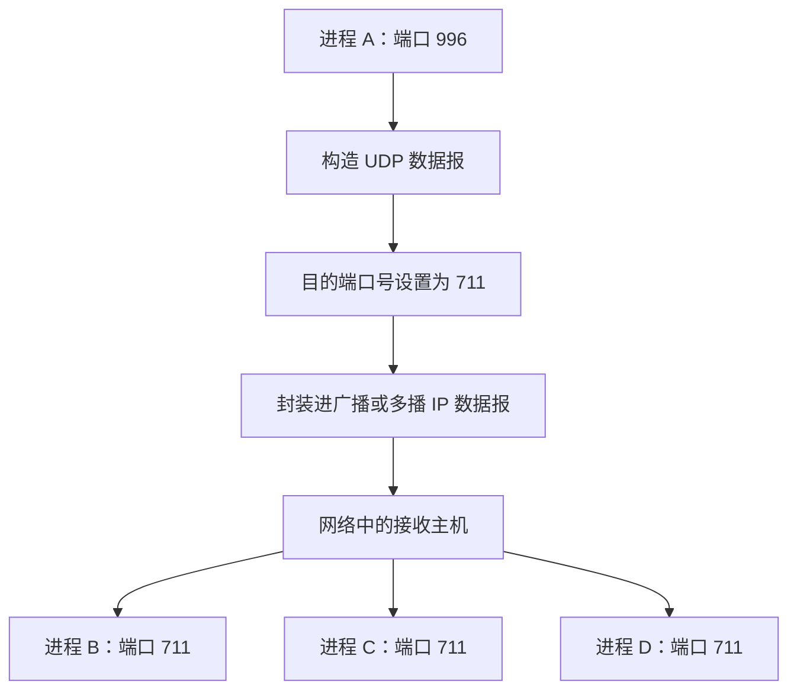
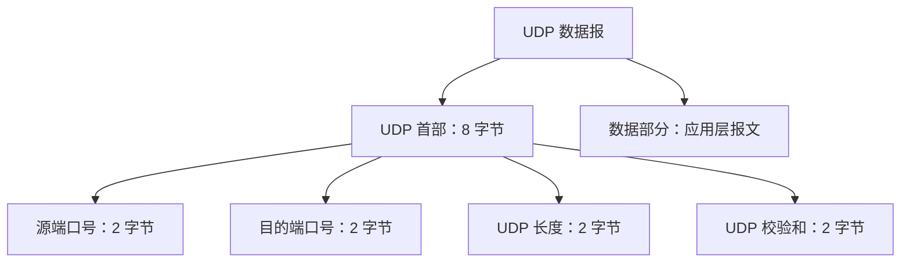
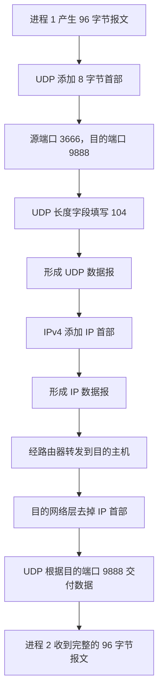

# UDP 数据报

## 一、考纲定位与学习重点

UDP（User Datagram Protocol，用户数据报协议）是传输层的重要协议。相关考题通常难度不高，但经常与 TCP 协议进行对比，因此复习时应重点掌握：

- UDP 与 TCP 在首部大小、长报文处理、连接方式、可靠性、拥塞控制和通信方式上的区别。
- UDP 数据报的格式，以及各首部字段的含义。
- UDP 数据报的长度计算方法。
- UDP 如何支持一对一和一对多的数据传输。

---

## 二、UDP 报文、UDP 首部与 UDP 数据报

### 2.1 三个概念的关系

假设主机 A 上的进程 1，需要向主机 B 上的进程 2 发送一块数据。

- **报文**：应用层进程之间需要传送的数据单元。
- **UDP 首部**：UDP 协议在应用层报文前添加的首部，长度固定为 **8 字节**。
- **UDP 数据报**：由 UDP 首部和应用层报文组成的完整数据单元。

发送过程中，UDP 数据报还会交给网络层处理。IPv4 协议会在 UDP 数据报前添加 IPv4 首部，从而形成 IP 数据报。IP 数据报经过路由器转发后到达目的主机。


### 2.2 接收方如何把数据交给正确的进程

目的主机收到 IP 数据报后，网络层会检查其中承载的上层协议类型。如果承载的是 UDP 数据报，网络层便去掉 IP 首部，并将剩余内容交给 UDP 协议处理。

UDP 再根据 UDP 首部中的端口号等信息，确定应该把数据交给应用层的哪个进程。尤其是**目的端口号**，用于指明接收数据的应用进程所对应的端口。

### 2.3 UDP 首部开销较小

UDP 首部固定为 **8 字节**。相比之下，TCP 首部的最小长度为 **20 字节**，因此 TCP 首部带来的额外开销更大。

### 2.4 UDP 不负责长报文的自动拆分与重装

UDP 每次传输的是一个完整的应用层报文。**UDP 协议本身不提供对应用层报文的自动拆分和重装功能。**

如果应用层交给 UDP 的报文过大，超过了 UDP 数据报及其下层 IP 封装所能承载的范围，UDP 无法像 TCP 那样自动把应用层报文拆分为多个传输层报文段；应用程序需要自行设计拆分、发送与重组机制。

相比之下，TCP 支持长报文的自动拆分和重装：

1. 发送方 TCP 可以把较长的数据拆分成多个 TCP 报文段。
2. 每个报文段都带有 TCP 首部。
3. 接收方 TCP 对收到的报文段进行排序和重装。
4. 最终向目的进程交付完整的数据。

> 注意：这里比较的是 UDP 与 TCP 在传输层对应用数据的处理能力，即 UDP 本身不提供 TCP 那样的自动拆分与重装机制。

---

## 三、UDP 与 TCP 的主要区别

| 对比项目   | UDP                                                                | TCP                                       |
| ---------- | ------------------------------------------------------------------ | ----------------------------------------- |
| 首部长度   | 固定为 8 字节                                                      | 最小为 20 字节                            |
| 长报文处理 | UDP 本身不提供应用层报文的自动拆分与重装；需要时由应用程序自行处理 | 支持自动拆分成 TCP 报文段，并在接收端重装 |
| 连接方式   | 无连接                                                             | 面向连接                                  |
| 可靠性     | 不可靠，尽最大努力交付，不提供 TCP 式的确认机制                    | 可靠，采用确认等机制保障可靠传输          |
| 拥塞控制   | 不支持                                                             | 支持                                      |
| 通信方式   | 支持一对一，也支持一对多（例如借助广播或多播 IP 数据报）           | 每条 TCP 连接只支持一对一通信             |

### 3.1 无连接与面向连接

**TCP 是面向连接的。** 在正式传输数据之前，通信双方需要先建立连接，让双方做好通信准备。数据传输完成后，双方还需要释放连接，明确通知对方传输已经结束。

**UDP 是无连接的。** 发送方不需要在发送每个 UDP 数据报之前与接收方建立连接，也不需要先确认接收方是否已准备好。发送方可以直接把报文封装进 UDP 数据报，并交给下层发送。

### 3.2 可靠与不可靠

TCP 采用确认等机制来保障数据传输的可靠性。

UDP 不提供 TCP 式的确认机制，只尽最大努力传输数据。因此，UDP 本身不保证数据一定到达，也不保证数据没有残缺或错误。

如果应用采用 UDP，但业务又要求可靠传输，可以由**应用层自行实现**确认、差错检测、重传等机制。也就是说，可靠性可以由应用程序负责，而不由 UDP 传输层协议来保证。

### 3.3 拥塞控制

TCP 支持拥塞控制。当通信过程检测到网络拥塞时，可以通过相应机制调节发送速率，减少网络中的数据量，以缓解拥塞。

UDP 本身不提供拥塞控制机制。关于 TCP 拥塞控制的具体实现，需要结合 TCP 协议进一步学习。

---

## 四、UDP 为什么支持一对一和一对多传输

### 4.1 TCP：每条连接只支持一对一通信

假设同一网络中有 A、B、C、D 四台主机，每台主机上都运行着一个进程。

如果 A 上的进程希望通过 TCP 与 D 上的进程通信，就需要先建立 A 与 D 之间的 TCP 连接。建立连接后，双方可以互相发送数据，但这条连接只服务于 A 和 D 之间的通信，并不能直接用于 A 与 B 或其他节点之间的通信。

如果 A 还要与其他主机进行 TCP 通信，就需要分别建立相应的 TCP 连接。因此，TCP 的每条连接只支持一对一通信。

### 4.2 UDP：一对一传输

UDP 实现一对一传输时，可以把 UDP 数据报封装进一个单播 IP 数据报。

发送方在 UDP 首部中指明接收进程的目的端口号，并在 IP 首部中指明接收方的 IP 地址，即可把数据发送给指定主机上的指定进程。

### 4.3 UDP：一对多传输

UDP 也可以实现一对多传输。方法是把 UDP 数据报封装到**广播 IP 数据报**或**多播 IP 数据报**中。

对于 IPv4，如果目的 IP 地址设置为 32 位全 1，即 `255.255.255.255`，就表示向同一网络内的所有节点进行有限广播。广播 IP 数据报中如果封装了 UDP 数据报，同一网络内符合接收条件的主机便有机会收到这个数据报。

假设 A、B、C、D 是四台主机上的四个进程：

- A 进程的端口号为 `996`。
- B、C、D 进程的端口号均为 `711`。
- A 希望向 B、C、D 发送数据。

A 可以把 UDP 首部中的目的端口号设置为 `711`，再在网络层把目的 IP 地址设置为广播地址。这样，B、C、D 的网络层都能接收到相应的广播 IP 数据报；由于 UDP 数据报的目的端口号为 `711`，对应端口上的进程就可以接收该数据。



这种方式也可以用于说明直播服务器向多台客户端推送音视频数据的思路：服务器把画面、声音等数据封装到 UDP 数据报中，再利用广播或多播 IP 数据报实现一对多传输。

> UDP 一对多传输的关键在于：UDP 数据报可以封装在广播或多播 IP 数据报中；而 TCP 的每条连接只支持一对一通信。

---

## 五、UDP 数据报的格式

UDP 数据报由两部分组成：

1. **UDP 首部：固定 8 字节。**
2. **数据部分：承载一个完整的应用层报文。**



### 5.1 首部字段

| 字段       |            长度 | 含义与作用                                                                                         |
| ---------- | --------------: | -------------------------------------------------------------------------------------------------- |
| 源端口号   | 2 字节（16 位） | 指明发送方进程对应的端口。若不需要对方根据源端口号回复数据，在本课讲解的情境中可以将其设置为全 0。 |
| 目的端口号 | 2 字节（16 位） | 指明接收数据的进程对应的端口，是接收端进行进程交付的重要信息。                                     |
| UDP 长度   | 2 字节（16 位） | 表示整个 UDP 数据报的长度，即 UDP 首部长度与数据部分长度之和，单位为字节。                         |
| UDP 校验和 | 2 字节（16 位） | 由发送方计算并填入，用于接收方检测数据报中的比特错误。                                             |

### 5.2 源端口号与目的端口号

假设 A 向 B 发送 UDP 数据报：

- 如果 B 需要根据收到的数据报回复 A，A 就需要提供自己的源端口号，便于对方确定回复目标。
- 目的端口号用于指明 B 上接收数据的进程所对应的端口。

### 5.3 UDP 长度字段与长度限制

UDP 长度字段占 16 位，因此该字段可以表示的最大数值为：

\[
2^{16}-1=65535
\]

所以，**从 UDP 长度字段本身来看，UDP 数据报的理论最大长度为 65535 字节**。

但 UDP 数据报需要封装在 IP 数据报中。IPv4 的总长度字段也有长度限制，整个 IPv4 数据报的最大总长度为 65535 字节；在 IPv4 首部至少占 20 字节的情况下，留给 IP 数据部分的空间最多为 65515 字节。因此，在本课讨论的 IPv4 情境下，UDP 数据报的实际最大长度不能超过 **65515 字节**。

### 5.4 UDP 校验和

UDP 校验和字段长 16 位，由发送方的传输层在发送前按照相应算法计算，并写入 UDP 首部。接收方收到数据后，可以利用校验和检查数据报中的比特错误。

校验和的具体生成与检验方法属于后续内容。按照本课讲解的 IPv4 使用情境，如果发送方选择不使用 UDP 校验和，可以将该字段设置为全 0。

### 5.5 UDP 数据部分

UDP 首部后面紧接着就是数据部分，其中承载的是一个完整的应用层报文。

---

## 六、UDP 数据报封装示例

假设进程 1 要向进程 2 发送一个报文，并且：

- 应用层报文长度为 **96 字节**。
- 进程 1 绑定的端口号为 **3666**。
- 进程 2 绑定的端口号为 **9888**。

### 6.1 计算 UDP 数据报长度

UDP 首部固定为 8 字节，因此：

\[
\text{UDP 数据报总长度}
=\text{UDP 首部长度}+\text{数据部分长度}
=8+96=104\text{ 字节}
\]

### 6.2 填写 UDP 首部

| 字段       | 本例中的值 | 说明                                           |
| ---------- | ---------: | ---------------------------------------------- |
| 源端口号   |     `3666` | 对应发送进程 1                                 |
| 目的端口号 |     `9888` | 对应接收进程 2                                 |
| UDP 长度   |      `104` | 8 字节首部 + 96 字节数据                       |
| UDP 校验和 | 按算法计算 | 用于检测数据报中的比特错误；本例不展开具体计算 |

### 6.3 完整封装流程



在这个例子中，最重要的是理解 UDP 首部各字段如何填写，以及 UDP 长度字段统计的是**整个 UDP 数据报的长度**，而不只是数据部分的长度。

---

## 七、考前回顾

### 7.1 UDP 与 TCP 对比速记

| 记忆点   | UDP                          | TCP                  |
| -------- | ---------------------------- | -------------------- |
| 首部     | 固定 8 字节                  | 最小 20 字节         |
| 连接     | 无连接                       | 面向连接             |
| 可靠性   | 不可靠，尽最大努力交付       | 可靠，采用确认等机制 |
| 长报文   | UDP 本身不负责自动拆分与重装 | 支持自动拆分与重装   |
| 拥塞控制 | 不支持                       | 支持                 |
| 通信方式 | 一对一、一对多               | 每条连接一对一       |

### 7.2 UDP 首部速记

```text
0               15 16              31
+-----------------+-----------------+
|     源端口号     |    目的端口号    |
+-----------------+-----------------+
|       UDP 长度   |    UDP 校验和    |
+-----------------+-----------------+
|                                   |
|             数据部分              |
|                                   |
+-----------------------------------+
```

- 源端口号：2 字节。
- 目的端口号：2 字节。
- UDP 长度：2 字节，统计首部与数据部分的总长度。
- UDP 校验和：2 字节，用于检测比特错误。
- UDP 首部合计：**8 字节**。

### 7.3 长度计算速记

若应用层报文长度为 \(L\) 字节，则：

\[
\text{UDP 数据报长度}=L+8
\]

例如，应用层报文为 96 字节时：

\[
96+8=104\text{ 字节}
\]

### 7.4 高频考点

1. UDP 首部固定为 8 字节，TCP 首部最小为 20 字节。
2. UDP 无连接、不可靠，不提供 TCP 式的确认机制，也不支持拥塞控制。
3. UDP 本身不提供长报文的自动拆分与重装；TCP 支持。
4. UDP 既支持一对一传输，也可以通过广播或多播 IP 数据报实现一对多传输；TCP 的每条连接只支持一对一通信。
5. UDP 长度字段统计的是首部和数据部分的总长度。
6. 在本课讨论的 IPv4 情境下，UDP 数据报理论最大长度受 UDP 长度字段限制为 65535 字节，但实际最大长度还受 IPv4 数据报最大长度限制，不能超过 65515 字节。
