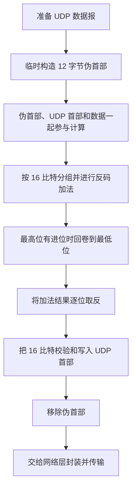
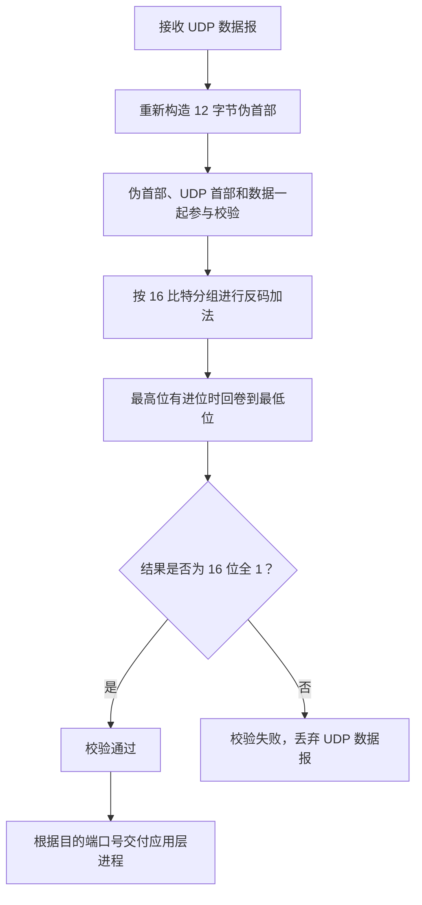

# UDP 校验和（UDP 检验）

## 一、考点定位与核心思想

UDP 校验的核心问题是：**发送方把 UDP 数据报发送给接收方之后，接收方如何检查数据报在传输过程中是否发生了比特错误？**

这本质上是 UDP 协议的**差错检测**。发送方根据原始数据计算校验信息，并把校验信息放入 UDP 首部；接收方收到数据报后，使用相同的规则进行检查。

整体思路如下：

1. 发送方把需要参与校验的内容按 **16 比特（16 位）为一组**进行划分。
2. 将各组进行二进制反码加法。
3. 如果最高位产生进位，就将进位回卷到最低位。
4. 将最终加法结果逐位取反，得到 16 比特校验和。
5. 接收方把收到的内容（包括校验和）按同样的方法相加。
6. 如果最终结果为 **16 位全 1**，则校验通过；否则，说明检测到了差错。

> **记忆主线：16 位分组 → 反码加法 → 进位回卷 → 逐位取反 → 接收方验证全 1。**

## 二、16 位校验和的基本计算方法

### 2.1 发送方如何生成校验和

假设发送方要发送 **32 比特**的原始数据，并且最终生成的校验信息为 16 比特。

首先，将 32 比特的原始数据拆成两组，每组 16 比特：

- 第 1 组：16 比特
- 第 2 组：16 比特

然后对这两个 16 位数进行二进制加法。加法过程中需要正常处理每一位的进位。

例如，某一位上两个 `1` 相加：

- 本位和为 `0`
- 向更高位产生进位 `1`

完成加法后，将得到的 16 位结果**逐位取反**：

- `1` 变为 `0`
- `0` 变为 `1`

取反后得到的 16 比特，就是校验和。

### 2.2 接收方如何检查

发送方将原始数据和 16 比特校验和一起发送给接收方。

如果传输过程中没有发生能够被该校验方法检测出的比特错误，接收方将这三组 16 位数据依次进行反码加法：

1. 原始数据第 1 组；
2. 原始数据第 2 组；
3. 16 比特校验和。

由于校验和是原始数据加法结果的逐位取反，因此相加后的最终结果应为 **16 位全 1**。

- **结果为 16 位全 1：**校验通过，未检测到差错。
- **结果不是 16 位全 1：**校验失败，检测到差错。

## 三、特殊情况：最高位进位需要回卷

当原始数据较长时，除了将多组 16 位数据依次相加，还必须注意最高位产生的进位。

### 3.1 以 48 比特原始数据为例

假设原始数据有 48 比特，可以拆分成三组：

- 第 1 组：16 比特
- 第 2 组：16 比特
- 第 3 组：16 比特

计算过程：

1. 先将第 1 组和第 2 组进行二进制加法。
2. 再把前一步的结果与第 3 组相加。
3. 如果最高位产生了进位，就将该进位加回最低位。
4. 得到最终的 16 位加法结果后，再逐位取反，得到校验和。

### 3.2 什么是回卷

**回卷（回卷进位）**：当 16 位加法的最高位产生进位时，不直接丢弃该进位，而是将它加回到最低位。

例如，最高位产生了一个进位 `1`，就把这个 `1` 加到当前 16 位结果的最低位。最低位如果因此再次产生进位，也按照相同的反码加法规则继续处理。

因此，计算 UDP 校验和时，不能简单地丢弃最高位之外的进位。

### 3.3 多组数据的校验规则

无论原始数据有 32 比特、48 比特，还是更多比特，基本方法都相同：

- 将参与校验的内容按 16 比特分组；
- 依次进行反码加法；
- 最高位产生进位时进行回卷；
- 最后对加法结果逐位取反，得到 16 比特校验和。

接收方也使用相同的分组、加法和回卷规则。将所有参与校验的内容（包括校验和）相加后，结果应为 16 位全 1。

## 四、UDP 校验和的具体实现

UDP 校验采用上述反码加法思想，但实际计算时还需要特别处理一个内容：**伪首部**。

UDP 首部末尾的两个字节用于存放校验和：

- 2 字节 = 16 比特。
- 校验和最终写入 UDP 首部的校验和字段。

### 4.1 伪首部包含什么

在计算 UDP 校验和之前，发送方会临时构造一个 **12 字节的伪首部**。其组成如下：

| 字段         |        长度 | 内容                             |
| ------------ | ----------: | -------------------------------- |
| 源 IP 地址   |      4 字节 | 发送方的 IP 地址                 |
| 目的 IP 地址 |      4 字节 | 接收方的 IP 地址                 |
| 全 0 字段    |      1 字节 | 该字段全部为 0                   |
| 协议号       |      1 字节 | UDP 的协议号为 `17`              |
| UDP 长度     |      2 字节 | 与 UDP 首部中的 UDP 长度字段相同 |
| **合计**     | **12 字节** | —                                |

源 IP 地址和目的 IP 地址分别填写发送方与接收方的 IP 地址。伪首部中的 UDP 长度字段，与真正 UDP 首部中的 UDP 长度字段相同。

> **注意：伪首部只用于计算校验和，并不是 UDP 数据报中实际传输的首部内容。**发送方计算完成后会移除伪首部；接收方校验时再根据相应信息重新构造伪首部。

### 4.2 发送方的计算过程

发送方计算 UDP 校验和的流程如下：

1. 根据发送方和接收方的 IP 地址等信息，构造 12 字节伪首部。
2. 将伪首部、UDP 首部和 UDP 数据部分放在一起参与计算。
3. 将需要校验的内容按 16 比特为一组，依次进行二进制反码加法。
4. 如果最高位产生进位，将进位回卷到最低位。
5. 将最终加法结果逐位取反，得到 16 比特校验和。
6. 把校验和填入 UDP 首部末尾的校验和字段。
7. 移除临时构造的伪首部，将 UDP 数据报交给网络层，由网络层封装成 IP 数据报并进行传输。

**发送方流程图：**

### 4.3 为什么要临时添加伪首部

伪首部的作用是参与 UDP 校验和的计算。它包含源 IP 地址、目的 IP 地址、协议号和 UDP 长度等信息。

计算完成后，发送方会把伪首部拆除，因此伪首部本身**不会作为 UDP 数据报的一部分交给网络层传输**。

接收方在进行 UDP 差错检测时，也需要重新构造与发送方计算时相同的伪首部，使伪首部、UDP 首部和数据部分一起参与校验。

## 五、接收方的 UDP 校验过程

接收方的传输层收到完整的 UDP 数据报，其中包含 UDP 首部和数据部分，UDP 首部末尾的 16 比特保存着发送方计算出的校验和。

接收方的检查过程如下：

1. 根据相关信息重新构造 12 字节伪首部。
2. 将伪首部、UDP 首部和 UDP 数据部分放在一起。
3. 按 16 比特为一组进行二进制反码加法。
4. 如果最高位产生进位，将进位回卷到最低位。
5. 检查最终的加法结果是否为 16 位全 1。

根据检查结果进行处理：

| 检查结果               | 接收方的处理                                                            |
| ---------------------- | ----------------------------------------------------------------------- |
| 加法结果为 16 位全 1   | 校验通过，接收 UDP 数据报，并根据目的端口号将数据交付给相应的应用层进程 |
| 加法结果不是 16 位全 1 | 校验失败，直接丢弃 UDP 数据报，不再将其中的数据交付给应用层             |

**接收方流程图：**

## 六、UDP 校验的核心规则汇总

| 比较项目           | 规则                                                     |
| ------------------ | -------------------------------------------------------- |
| 校验和长度         | 16 比特，即 2 字节                                       |
| 分组方式           | 按 16 比特为一组                                         |
| 加法方式           | 二进制反码加法                                           |
| 最高位产生进位     | 将进位回卷到最低位                                       |
| 校验和生成         | 加法完成后逐位取反                                       |
| 发送方的校验范围   | 伪首部 + UDP 首部 + UDP 数据部分                         |
| 接收方的校验方法   | 重新构造伪首部，将伪首部、UDP 首部、数据和校验和一起相加 |
| 校验通过的判断     | 最终结果为 16 位全 1                                     |
| 校验失败的处理     | 丢弃 UDP 数据报，不向应用层交付其数据                    |
| 伪首部是否实际传输 | 否；它只临时参与校验和计算                               |

## 七、与 IP 数据报首部校验和的对比

在网络层学习 IP 数据报时，也介绍过首部校验和。它与 UDP 校验使用的基本计算思想相同：按 16 比特分组进行反码加法，处理最高位进位回卷，并对结果逐位取反。

二者的主要区别在于**校验范围**以及**是否使用伪首部**。

| 对比项目             | UDP 校验和                          | IP 数据报首部校验和                     |
| -------------------- | ----------------------------------- | --------------------------------------- |
| 校验和长度           | 16 比特                             | 16 比特                                 |
| 基本算法             | 16 比特反码加法、进位回卷、逐位取反 | 16 比特反码加法、进位回卷、逐位取反     |
| 校验范围             | 伪首部、UDP 首部和 UDP 数据部分     | 仅 IP 数据报首部                        |
| 是否添加伪首部       | 计算时临时添加，计算完成后移除      | 不需要添加伪首部                        |
| 数据部分是否参与校验 | UDP 数据部分参与                    | IP 数据报的数据部分不参与首部校验和计算 |

> **易混淆点：**UDP 校验和覆盖伪首部、UDP 首部和 UDP 数据部分；IP 首部校验和只检查 IP 首部。

## 八、2024 年真题提示

原讲解提到，**2024 年考研真题第 39 题**考查了 UDP 校验和的计算，讲解给出的答案为 **C 选项**。

这类题目的关键是严格按照计算规则逐位运算：

1. 将参与校验的内容按 16 比特分组。
2. 依次进行二进制反码加法。
3. 遇到最高位进位时，回卷到最低位。
4. 发送方生成校验和时，对最终加法结果逐位取反。
5. 接收方验证时，将校验和也纳入加法；结果为 16 位全 1 时，校验通过。

计算时要特别留意最高位产生的进位是否正确回卷，避免遗漏。

## 九、考前速记

- **UDP 校验和：**16 比特，位于 UDP 首部末尾。
- **计算前：**发送方临时添加 12 字节伪首部。
- **校验范围：**伪首部 + UDP 首部 + UDP 数据部分。
- **运算规则：**每 16 比特一组，进行反码加法；最高位进位要回卷。
- **生成校验和：**将最终加法结果逐位取反。
- **计算完成后：**发送方移除伪首部，再交给网络层传输。
- **接收方校验：**重新构造伪首部，将所有参与校验的内容（包括校验和）相加。
- **结果判断：**16 位全 1 表示校验通过；否则丢弃 UDP 数据报。
- **与 IP 首部校验和的区别：**IP 首部校验和只检查 IP 首部，不检查 IP 数据部分，也不需要伪首部。
