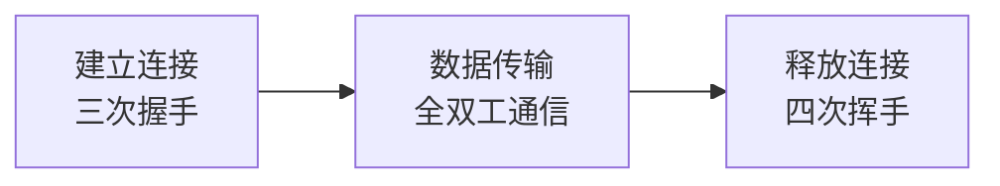
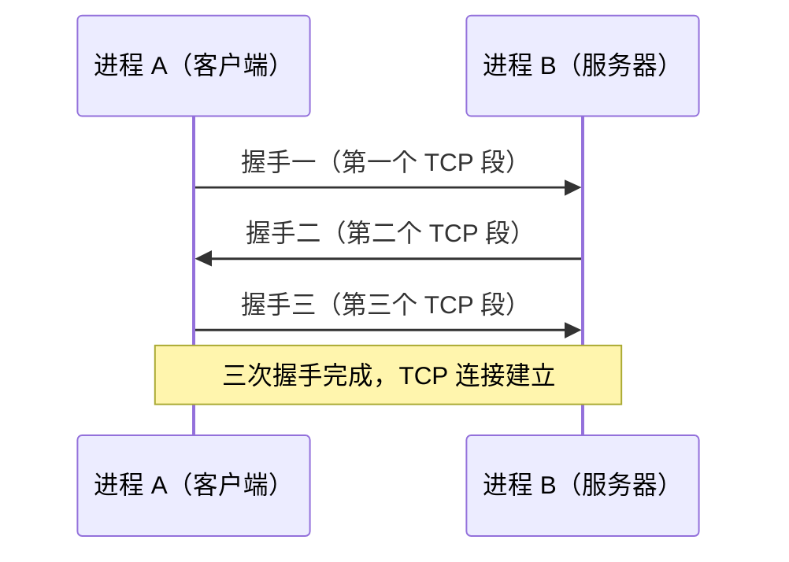
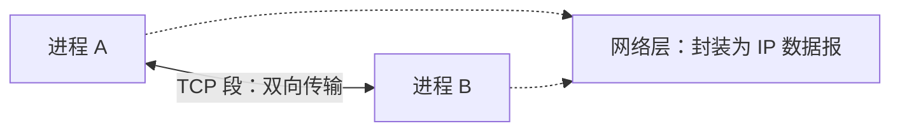
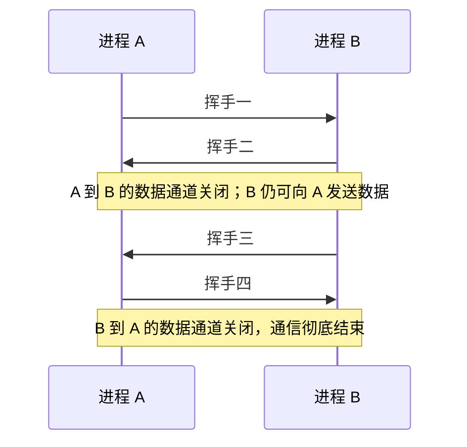
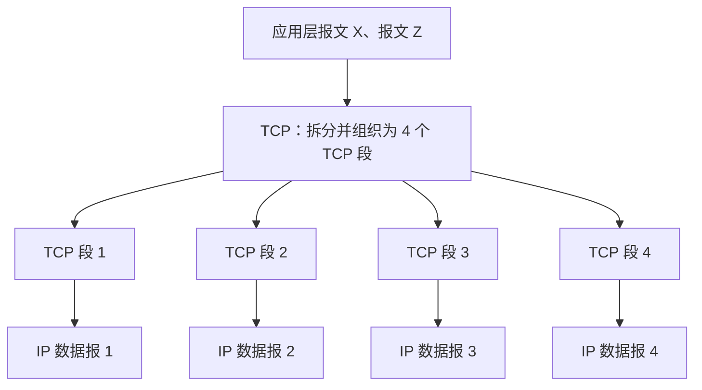
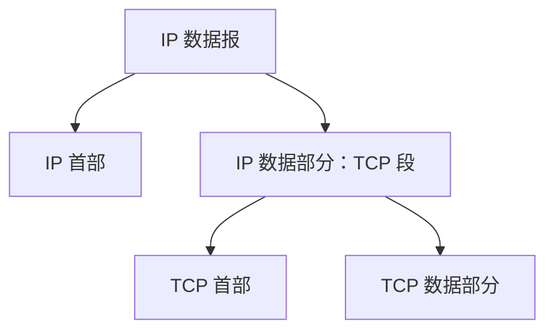

# TCP 段格式与 TCP 通信流程

## 一、TCP 段与 TCP 报文段

在 408 大纲中，本节对应 TCP 报文段格式这一考点。

- **TCP 段**和**TCP 报文段**是教材中常见的两种翻译，指的是同一个概念。
- “TCP 报文段”主要强调：TCP 协议会对应用层交付的较长报文进行分段。
- “TCP 段”更接近英文原文 **TCP segment**，属于较直接的翻译。

阅读教材和做题时，这两种说法都可能出现，理解为同一个概念即可。

## 二、TCP 协议工作的三个阶段

两个进程可以使用传输层的 TCP 协议进行通信。由于 TCP 是**面向连接的协议**，因此 TCP 通信通常分为三个阶段：

1. **建立连接**：通过三次握手建立 TCP 连接。
2. **数据传输**：连接建立后，双方可以进行双向数据传输。
3. **释放连接**：数据传输结束后，通过四次挥手释放连接。



### 2.1 客户端与服务器

两个进程使用 TCP 通信时：

- **客户端**：主动发起连接的一方。
- **服务器**：被动等待连接、响应连接请求的一方。

这里假设进程 A 是客户端，进程 B 是服务器。

### 2.2 建立连接：三次握手

建立连接需要双方相互传输三个 TCP 段，这三个 TCP 段称为**三次握手**。



本节暂时不深入讨论三个 TCP 段分别需要携带哪些信息，先理解整体流程：

- 第一次握手由客户端主动发起。
- 第二次握手由服务器响应。
- 第三次握手由客户端再次发送。
- 三次握手结束后，双方的连接建立完成。

### 2.3 数据传输：全双工通信

连接建立后，进程 A 和进程 B 可以进行双向 TCP 段传输，也就是支持**全双工通信**：

- A 可以给 B 发送数据。
- B 也可以给 A 发送数据。

所有数据都通过 TCP 段携带；在网络层，TCP 段会被封装成 IP 数据报。



### 2.4 释放连接：四次挥手

假设某一时刻，进程 A 已经没有数据需要继续发送给进程 B，A 就可以主动发起释放连接的过程。

#### 前两次挥手：断开 A 到 B 的数据通道

1. A 向 B 发送**挥手一**。
2. B 向 A 回复**挥手二**。

经过这两次挥手，A 已经单方面与 B 告别，A 到 B 的数据通道关闭。此后，A 不能再向 B 发送数据。

但此时 B 还没有与 A 告别，因此 B 仍然可以继续向 A 发送数据。

#### 后两次挥手：断开 B 到 A 的数据通道

当 B 也没有数据需要继续发送给 A 时，B 再主动发起释放连接的过程：

3. B 向 A 发送**挥手三**。
4. A 向 B 发送**挥手四**。

经过后两次挥手，B 到 A 的数据通道也关闭，双方的通信彻底结束。



四次挥手可以理解为 **2 + 2**：

- 前两次挥手只断开一个方向的连接。
- 该方向关闭后，另一个方向的数据传输仍然可以正常进行。
- 后两次挥手再关闭另一个方向，双方通信才彻底结束。

### 2.5 谁先发起释放连接？

上面的例子是客户端 A 先发起挥手，然后服务器 B 再发起挥手。

不过，**释放连接的先后顺序可以颠倒**：

- 如果客户端 A 先发送完数据，可以由 A 先发起挥手。
- 如果服务器 B 先发送完数据，也可以由 B 先发起挥手。

需要注意：

- **建立连接**时，第一次握手一定由主动发起连接的客户端发出。
- **释放连接**时，可以由客户端先发起，也可以由服务器先发起。

## 三、一次 TCP 连接可以传输多个报文

初学者可能会疑惑：两个进程建立一次 TCP 连接，到底可以传输多少数据？是不是每传输一个报文，都需要重新建立连接、再释放连接？

答案是否定的。**一次 TCP 连接建立后，可以连续传输多个报文**。而且，双方都可以在同一次 TCP 连接中向对方传输多个报文。

### 3.1 MSS：最大报文段长度

假设进程 1 要通过 TCP 向进程 2 发送两个应用层报文，分别称为**报文 X**和**报文 Z**。

假设双方协商的 MSS 为 **1000 字节**。

**MSS（Maximum Segment Size，最大报文段长度）**表示一个 TCP 段中最多可以携带多少字节的**有效数据**。

- MSS 限制的是 TCP 段中的有效数据长度。
- TCP 首部不计入 MSS 指定的有效数据长度。
- TCP 段携带的数据可以少于 MSS，不要求每个 TCP 段都必须满载；只要不超过 MSS 即可。

### 3.2 两个应用层报文如何拆分为 TCP 段

假设：

- 报文 X 长 **1600 字节**。
- 报文 Z 长 **1800 字节**。
- MSS 为 **1000 字节**。

这两个应用层报文可以被拆分并组合为以下四个 TCP 段：

| TCP 段   | 携带的数据                                  |  数据长度 |
| -------- | ------------------------------------------- | --------: |
| TCP 段 1 | 报文 X 的前 1000 字节                       | 1000 字节 |
| TCP 段 2 | 报文 X 的后 600 字节 + 报文 Z 的前 400 字节 | 1000 字节 |
| TCP 段 3 | 报文 Z 中间的 1000 字节                     | 1000 字节 |
| TCP 段 4 | 报文 Z 最后的 400 字节                      |  400 字节 |

示意如下：

```text
应用层报文 X（1600 字节）
├── 前 1000 字节 ────────────────> TCP 段 1
└── 后  600 字节 ──┐
                   ├─────────────> TCP 段 2（共 1000 字节）
报文 Z 的前 400 字节┘

应用层报文 Z（1800 字节）
├── 前  400 字节 ──┘（已放入 TCP 段 2）
├── 中间 1000 字节 ──────────────> TCP 段 3
└── 最后 400 字节 ───────────────> TCP 段 4
```

TCP 不会强制每个 TCP 段都装满 MSS 允许的最大数据量。例如，原本可以放在一个 1000 字节 TCP 段中的数据，也可以拆成两个 TCP 段分别携带 600 字节和 400 字节。只要每个 TCP 段携带的有效数据不超过 MSS 即可。

### 3.3 TCP 段与 IP 数据报的关系

上例中的四个 TCP 段，在网络层会分别被封装成四个相互独立的 IP 数据报。



这四个 IP 数据报经过网络转发后，到达主机 B 网络层的顺序可能是乱序的，因为每个 IP 数据报可能选择不同的路由转发路径。

但 TCP 会通过相应机制，确保这四个 TCP 段携带的数据能够按顺序交付给主机 B 上的应用层进程 2。

## 四、TCP 面向字节流，UDP 面向报文

从上面的例子，尤其是 TCP 段 2 可以看出：TCP 可以把报文 X 的一部分数据和报文 Z 的一部分数据放入同一个 TCP 段。

这是因为 TCP **面向字节流**。

### 4.1 TCP 面向字节流

对于 TCP 来说，应用层交付的数据是一连串连续的字节流。TCP 不关心哪些字节原本属于报文 X，哪些字节原本属于报文 Z。

TCP 的任务是：

1. 接收应用层交付的字节流。
2. 按照 MSS 等条件，将字节流拆分为大小合适的 TCP 段。
3. 将这些数据传输给对端的 TCP 协议。
4. 通过 TCP 的相关机制，按顺序将数据交付给对端应用层进程。

因此，**TCP 面向字节流，而不是面向应用层报文边界**。

### 4.2 UDP 面向报文

UDP 与 TCP 不同，UDP 是**面向报文**的：

1. 应用层将一个完整的报文交给 UDP。
2. UDP 将整个报文封装为一个 UDP 数据报。
3. 一个 UDP 数据报承载一个完整的应用层报文。

因此，选择题中经常考查以下区别：

| 对比项                 | TCP                                         | UDP                                           |
| ---------------------- | ------------------------------------------- | --------------------------------------------- |
| 数据传输方式           | 面向字节流                                  | 面向报文                                      |
| 应用层数据的处理       | 将数据视为连续字节流，可按需要拆分为 TCP 段 | 将应用层交付的完整报文封装为 UDP 数据报       |
| 是否保留应用层报文边界 | 不以应用层报文边界为依据                    | 保留报文边界，一个 UDP 数据报承载一个完整报文 |

## 五、本节总结

### 5.1 TCP 通信流程

- TCP 是面向连接的协议，通信分为建立连接、数据传输、释放连接三个阶段。
- 建立连接需要**三次握手**。
- 释放连接通常需要**四次挥手**，可以理解为先关闭一个方向，再关闭另一个方向。
- 建立连接时，第一次握手由主动发起连接的客户端发出；释放连接时，客户端和服务器任何一方都可以先发起。

### 5.2 TCP 数据传输的特点

- 一次 TCP 连接可以连续传输多个应用层报文。
- TCP 连接是双向的，双方都可以通过同一次连接向对方传输多个报文。
- TCP 段会在网络层被封装成 IP 数据报，多个 IP 数据报可能乱序到达；TCP 会通过相应机制按顺序向应用层交付数据。
- TCP 是**面向字节流**的，TCP 不关心应用层报文之间的边界。
- UDP 是**面向报文**的，一个 UDP 数据报承载一个完整的应用层报文。
- MSS 表示一个 TCP 段最多可以携带的有效数据长度，**不包括 TCP 首部**。
- TCP 段携带的数据不必达到 MSS，只要不超过 MSS 即可。

## 六、引出下一节：TCP 段格式

一个 TCP 段由两大部分组成：

1. **TCP 首部**
2. **TCP 数据部分**

整个 TCP 段又会作为 IP 协议的数据部分，被封装成 IP 数据报。



TCP 首部的构成比较复杂。考试时通常会提供首部格式示意图，因此不要求死记各字段的具体位置，但需要理解并记住每个字段的含义和作用。

下一节将继续学习 TCP 首部中各个字段的作用。
