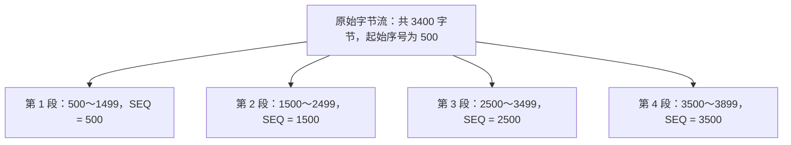
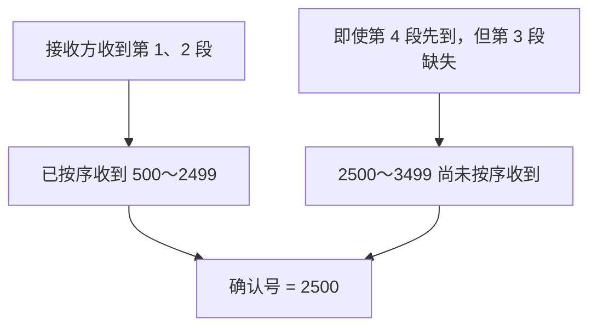
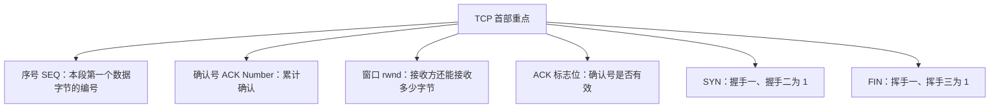

# TCP 报文段格式

> 计算机考研 408 · 传输层  
> 本节重点：**序号（SEQ）、确认号（ACK）、窗口（rwnd），以及 ACK、SYN、FIN 三个标志位。**

## 一、TCP 报文段首部的整体结构

TCP 报文段首部由**固定部分**和**可变部分**组成：

- 固定部分：20 字节。
- 可变部分：最多 40 字节。
- TCP 首部长度：最小 20 字节，最大 60 字节。

这一点与 IPv4 数据报首部类似：IPv4 首部的固定部分也是 20 字节，可变部分最多 40 字节，因此 IPv4 首部长度也是 20～60 字节。

| 协议 | 首部最小长度 | 首部最大长度 | 长度单位特点                |
| ---- | -----------: | -----------: | --------------------------- |
| IPv4 |      20 字节 |      60 字节 | 首部长度字段以 4 字节为单位 |
| TCP  |      20 字节 |      60 字节 | 数据偏移字段以 4 字节为单位 |

TCP 首部图中，**每一行对应 32 位，也就是 4 字节**；行内的小刻度表示比特。下面按首部字段的顺序逐一理解。

```text
TCP 首部（示意，非按比例绘制）

 0                 15 16                31
+--------------------+--------------------+
|      源端口        |      目的端口      |
+--------------------+--------------------+
|                 序号（SEQ）             |
+-----------------------------------------+
|                 确认号（ACK）           |
+--------+------+-------------------------+
|数据偏移|保留位|       标志位            |
+--------------------+--------------------+
|                 接收窗口                |
+-----------------------------------------+
|                 校验和                  |
+-----------------------------------------+
|                 紧急指针                |
+-----------------------------------------+
|              选项（可变长度）           |
+-----------------------------------------+
|              填充（如需要）             |
+-----------------------------------------+
|                  数据                   |
+-----------------------------------------+
```

## 二、源端口和目的端口

首部第一行包含两个字段：

- **源端口（Source Port）**：发送方进程对应的端口号。
- **目的端口（Destination Port）**：接收方进程对应的端口号。

例如，进程一要给进程二发送 TCP 报文段：

| 字段     | 示例值 | 含义           |
| -------- | -----: | -------------- |
| 源端口   |   3666 | 进程一的端口号 |
| 目的端口 |   9888 | 进程二的端口号 |

如果通信方向反过来，由进程二给进程一发送 TCP 报文段，那么源端口和目的端口也要倒过来：

| 字段     | 示例值 |
| -------- | -----: |
| 源端口   |   9888 |
| 目的端口 |   3666 |

源端口和目的端口字段各占 **16 位**，因此端口号的取值范围为 **0～65535**。

记忆要点：**源对应发送方，目的对应接收方。**

## 三、序号（Sequence Number，SEQ）

### 3.1 序号的作用

序号字段用于标记：**当前 TCP 报文段的数据部分中，第一个字节在原始字节流中的序号**。

TCP 看到的是一连串连续的字节流，并不关心应用程序原本把数据分成了几个报文。TCP 将字节流拆分成多个 TCP 段进行传输，接收方再根据序号信息把这些数据重新组合成原始字节流。

注意：

- 序号标记的是当前 TCP 段**数据部分第一个字节**的编号。
- 起始序号由发送方设置，不一定从 0 开始。
- 序号字段长度为 **32 位**。
- 真题中常将序号简写为小写的 `seq`。

### 3.2 示例：将 3400 字节拆分成多个 TCP 段

假设进程一要向进程二发送两个应用层报文。对 TCP 来说，这些内容会被视为一连串字节流：

- 第一个应用层报文：1600 字节。
- 第二个应用层报文：1800 字节。
- 合计：3400 字节。

受 MSS（最大报文段长度）限制，这 3400 字节至少需要拆分成四个 TCP 段。假设发送方规定整个字节流的第一个字节序号为 500，并按每段最多携带 1000 字节数据进行拆分：

| TCP 段  | 携带的数据字节序号范围 | 首部中的序号字段（SEQ） |
| ------- | ---------------------- | ----------------------: |
| 第 1 段 | 500～1499              |                     500 |
| 第 2 段 | 1500～2499             |                    1500 |
| 第 3 段 | 2500～3499             |                    2500 |
| 第 4 段 | 3500～3899             |                    3500 |

因此，TCP 首部的序号字段填写的是**本段第一个数据字节的序号**，而不是本段最后一个字节的序号。



## 四、确认号（Acknowledgment Number）与 ACK 标志位

确认号与 ACK 标志位关系密切，但它们是两个不同的东西，考试时要特别注意大小写。

### 4.1 两种 ACK 记法不要混淆

| 写法                         | 对应字段   |  长度 | 含义                                 |
| ---------------------------- | ---------- | ----: | ------------------------------------ |
| 小写 `ack` 或 `ack sequence` | 确认号字段 | 32 位 | 表示接收方已经按序正确收到的数据范围 |
| 大写 `ACK`                   | ACK 标志位 |  1 位 | 表示确认号字段是否有效               |

### 4.2 大写 ACK 标志位的作用

大写 `ACK` 标志位用于表示当前 TCP 报文段中的确认号字段是否有效：

- `ACK = 0`：确认号字段无效。
- `ACK = 1`：确认号字段有效。

在 TCP 连接建立的三次握手中：

- 握手一：`ACK = 0`。
- 握手二：`ACK = 1`。
- 握手三：`ACK = 1`。

除握手一外，其他 TCP 报文段的 `ACK` 标志位均为 1，确认号字段有效。

### 4.3 确认号字段的作用

确认号用于让接收方告诉发送方：**在该确认号之前的所有字节，都已经被正确接收。**

确认号通常采用**累计确认**的方式。确认号表示接收方下一步期望收到的字节序号，也就是说，序号小于该确认号的字节都已经按序接收。

继续使用前面的例子：

- 第 1 段的字节序号是 500～1499。
- 第 2 段的字节序号是 1500～2499。
- 第 3 段的字节序号是 2500～3499。
- 第 4 段的字节序号是 3500～3899。

如果主机 B 已经顺利接收前两个 TCP 段，那么主机 B 返回的确认信息可以是：

- `ACK = 1`：确认号字段有效。
- `ack = 2500`：序号小于 2500 的所有字节都已正确接收。

发送方收到该确认信息后，就能够确定前两个 TCP 段对应的数据已经被接收；至于后面的数据是否收到，还需要结合后续确认信息判断。

### 4.4 累计确认示例：收到第 1、2、4 段，但第 3 段缺失

假设接收方收到了第 1、2、4 段，但没有收到第 3 段：

- 第 1、2 段覆盖字节序号 500～2499。
- 第 3 段应携带字节序号 2500～3499，但目前未收到。
- 虽然第 4 段已经到达，但缺失的第 3 段仍使字节流中出现空缺。

因此，接收方返回的确认号仍应为 **2500**，而不是根据已经到达的第 4 段把确认号直接推进到 3900。因为确认号之前的数据必须是已经按序接收的连续字节。

| 接收情况                         | 返回的确认号 | 原因                                    |
| -------------------------------- | -----------: | --------------------------------------- |
| 收到第 1、2 段                   |         2500 | 500～2499 已按序收到，下一步期望 2500   |
| 收到第 1、2、4 段，但第 3 段缺失 |         2500 | 2500～3499 仍未收到，按序字节流存在缺口 |



**高频考点：序号、确认号和 ACK 标志位三者非常重要，大题和小题中都可能出现。**

## 五、数据偏移（Data Offset）与填充

### 5.1 数据偏移表示首部长度

`Data Offset` 通常翻译为“数据偏移”，但这个名称容易造成误解。它**并不是指数据部分在原始数据中的偏移量**，而是表示 **TCP 首部的长度**。

数据偏移字段以 **4 字节为单位**：

- 数据偏移字段占 4 位。
- 4 位能够表示的值为 0～15。
- TCP 首部长度最长为 \(15 \times 4 = 60\) 字节。
- TCP 首部长度最小为 20 字节。
- TCP 首部长度一定是 4 字节的整数倍。

### 5.2 填充字段的作用

TCP 首部可变部分的末尾可能出现**填充（Padding）**字段。填充用于把 TCP 首部补齐到 4 字节的整数倍，以便数据偏移字段能够准确表示首部长度。

数据偏移与填充需要结合起来理解。

### 5.3 与 IPv4 首部字段对照记忆

IPv4 首部中也有表示首部长度的字段，它同样以 4 字节为单位。IPv4 首部可变部分也可能需要填充，使首部长度符合 4 字节对齐要求。

可以结合记忆：

- IPv4 首部长度字段：以 4 字节为单位。
- TCP 数据偏移字段：以 4 字节为单位。
- 两者都可能需要填充，以满足 4 字节对齐要求。

IPv4 首部相关口诀“**四一八首总篇**”中，“首”表示首部长度，“总”表示总长度，“篇”表示片偏移。这里要特别注意首部长度字段的单位是 4 字节，而总长度字段的单位是 1 字节。

## 六、TCP 报文段总长度和数据长度如何确定

TCP 首部中没有专门的字段直接表示：

- TCP 报文段的总长度；
- TCP 报文段数据部分的长度。

这些信息可以结合 IPv4 首部中的字段推算。

已知：

1. IPv4 数据报的总长度；
2. IPv4 首部长度；
3. TCP 首部长度（由 TCP 数据偏移字段得出）。

那么：

\[
\text{TCP 报文段总长度}
=
\text{IP 数据报总长度}

- \text{IP 首部长度}
  \]

进一步可以计算 TCP 数据部分的长度：

\[
\text{TCP 数据长度}
=
\text{TCP 报文段总长度}

- \text{TCP 首部长度}
  \]

也可以合并写成：

\[
\text{TCP 数据长度}
=
\text{IP 数据报总长度}

- \text{IP 首部长度}
- \text{TCP 首部长度}
  \]

因此，TCP 首部虽然没有直接记录 TCP 报文段总长度或数据长度的字段，但可以结合 IP 数据报的总长度和两个首部的长度进行计算。

## 七、保留字段

TCP 首部中有一个 **6 位的保留字段**。在本节介绍的首部格式中，该字段通常全部置为 0。

这一字段的考查优先级较低，了解即可。

## 八、标志位

本节介绍六个标志位：

- `URG`：紧急标志位；
- `ACK`：确认标志位；
- `PSH`：推送标志位；
- `RST`：复位标志位；
- `SYN`：同步标志位；
- `FIN`：终止标志位。

其中，考研复习的重点是 **ACK、SYN、FIN**；其他标志位及紧急指针的考查优先级相对较低。

### 8.1 URG：紧急标志位

`URG` 来自英文单词 _urgent_，通常翻译为“紧急位”。

当 `URG = 1` 时：

1. 表示当前 TCP 报文段携带紧急数据，紧急数据需要尽快处理；
2. 表示紧急指针字段有效。

#### 紧急数据的例子

假设微信进程之间正在传输两个文件，文件对应的数据已经进入 TCP 的待发送字节流。在文件传输过程中，用户又输入了一段即时聊天文字。

如果文字也只能等到前面的文件数据全部发送完成后才能发送，交互体验就会很差。因此，讲解中用这个例子说明：某些数据可能不那么紧急，而有些数据需要优先处理。

当 `URG = 1` 时，紧急指针字段有效。紧急指针与紧急数据有关；普通数据的编号由序号字段表示，而紧急数据可以结合紧急指针理解。

示例中，假设一段紧急文字共 100 字节，其紧急数据编号从 100 开始，那么编号范围为 100～199；下一段紧急文字可以从 200 开始。对应的紧急指针示例值分别为 100、200。

> 复习提示：`URG` 与紧急指针需要联合记忆；该部分优先级低于 ACK、SYN、FIN。

### 8.2 PSH：推送标志位

`PSH` 来自英文单词 _push_，通常翻译为“推送位”。

当 `PSH = 1` 时，表示希望接收方尽快处理当前数据，常用于交互式通信。

例如在游戏中，用户按下某个按键后，操作会被封装进 TCP 报文段并发送给游戏服务器。用户希望服务器尽快处理操作并返回结果，例如判断技能是否命中、造成多少伤害等。这类交互式通信可以用来理解推送标志位的用途。

### 8.3 RST：复位标志位

`RST` 通常翻译为“复位位”。

当 `RST = 1` 时，表示需要复位 TCP 连接。例如：

- 通信过程中出现严重异常；
- 对端主机崩溃或进程被强制终止等情况；
- 接收方检测到非法 TCP 报文段，需要拒绝该报文段并复位连接。

这一字段在本节中的考查优先级较低，知道基本作用即可。

### 8.4 SYN：同步标志位

`SYN` 来自英文单词 _synchronize_，通常翻译为“同步位”。

当 `SYN = 1` 时，表示这是连接请求或连接接受相关的报文段。

**考研重点结论：只有三次握手中的握手一和握手二，`SYN = 1`；其他 TCP 报文段的 `SYN = 0`。**

- 握手一：客户端发起连接请求，`SYN = 1`。
- 握手二：服务器同意连接请求，`SYN = 1`。
- 握手三及其他后续报文段：`SYN = 0`。

### 8.5 FIN：终止标志位

`FIN` 来自英文单词 _finish_，通常翻译为“终止位”。

当 `FIN = 1` 时，表示报文段发送方已经没有更多数据要发送，并请求释放传输连接。

**考研重点结论：只有四次挥手中的挥手一和挥手三，`FIN = 1`；其他 TCP 报文段的 `FIN = 0`。**

- 挥手一：进程 A 告诉进程 B，自己已经没有更多数据要发送，`FIN = 1`。
- 挥手三：进程 B 告诉进程 A，自己已经没有更多数据要发送，`FIN = 1`。
- 挥手二和挥手四：`FIN = 0`。

### 8.6 ACK、SYN、FIN 的考点速记

| 标志位 | 值为 1 的含义                    | 必须记住的结论                            |
| ------ | -------------------------------- | ----------------------------------------- |
| `ACK`  | 确认号字段有效                   | 除握手一外，其他 TCP 报文段通常 `ACK = 1` |
| `SYN`  | 连接请求或连接接受相关报文段     | 只有握手一、握手二 `SYN = 1`              |
| `FIN`  | 发送方已发送完数据并请求释放连接 | 只有挥手一、挥手三 `FIN = 1`              |

### 8.7 真题术语：SYN 段、FIN 段、ACK 段

在真题中，可能直接用标志位名称来称呼 TCP 报文段：

- **SYN 段**：`SYN = 1` 的 TCP 报文段，对应握手一或握手二。
- **FIN 段**：`FIN = 1` 的 TCP 报文段，对应挥手一或挥手三。
- **ACK 段**：`ACK = 1` 的 TCP 报文段。

这些标志位并不互斥，一个 TCP 报文段可以同时满足多个条件。例如，握手二的 `SYN = 1` 且 `ACK = 1`，因此它既是 SYN 段，也可以称为 ACK 段。

## 九、接收窗口（Window / rwnd / rcvwnd）

窗口字段非常重要，也是常考字段。

真题中，窗口字段常写作：

- `rwnd`
- `rcvwnd`

这些写法来自 _receive window_，表示**接收窗口**。

窗口字段表示接收方通过 TCP 报文段告诉发送方：**接收方当前还可以接收多少字节的数据**。它是实现**流量控制**的关键字段。

### 9.1 窗口字段示例

假设进程二的 TCP 接收缓冲区大小为 2500 字节。现在第 1、2 段已经到达接收方，二者分别携带 1000 字节数据，总共占用 2000 字节。假设这些数据还没有交付给上层应用程序，那么接收缓冲区只剩下：

\[
2500 - 1000 - 1000 = 500 \text{ 字节}
\]

接收方可以在返回的 TCP 报文段中填写：

- 确认号：2500，表示序号小于 2500 的数据已按序收到；
- 接收窗口：500 字节，表示当前接收缓冲区剩余 500 字节空间。

这样，发送方就可以据此限制后续发送的数据量：在这个例子中，发送方不能再一次发送 1000 字节数据，而只能考虑发送接收方当前能够接收的 500 字节数据。

### 9.2 流量控制的含义

**流量控制**是指接收方利用一定机制限制发送方发送数据的速度，避免接收方来不及接收。

接收窗口字段是实现 TCP 流量控制的关键。具体实现细节在后续流量控制部分进一步学习。

## 十、校验和（Checksum）

TCP 首部中的校验和字段占 **16 位**。TCP 校验和的计算逻辑与 UDP 校验和基本相同。

计算 TCP 校验和之前，需要添加 **12 字节的伪首部（尾首部）**。伪首部包括：

| 字段         |        长度 |
| ------------ | ----------: |
| 源 IP 地址   |      4 字节 |
| 目的 IP 地址 |      4 字节 |
| 全零字段     |      1 字节 |
| 协议字段     |      1 字节 |
| TCP 长度     |      2 字节 |
| **合计**     | **12 字节** |

需要注意：

- UDP 的协议字段值为 17。
- TCP 的协议字段值为 6。
- 计算 TCP 校验和时，伪首部中的协议字段填 6。
- 伪首部最后的 2 字节用于表示 TCP 的长度，即 TCP 首部和数据部分的总长度。
- 添加伪首部后，校验和的计算方法与 UDP 相同；接收方进行校验的基本逻辑也相同。

考研大纲明确要求掌握 UDP 检验，而 TCP 校验和在本节中优先级较低。这里主要记住：**TCP 与 UDP 的校验和逻辑相似，TCP 伪首部中的协议字段值为 6，UDP 为 17。**

## 十一、紧急指针（Urgent Pointer）

紧急指针字段与 `URG` 标志位相关：

- 当 `URG = 1` 时，紧急指针字段有效。
- 它用于标识紧急数据相关的位置或序号信息。
- 该字段需要和 URG 标志位一起理解。

在前面的紧急数据示例中，普通数据通过序号字段进行编号；紧急数据则结合紧急指针字段理解。

此字段的考查优先级不高，知道它与 `URG` 的关系即可。

## 十二、选项（Options）与 MSS

### 12.1 选项字段

TCP 首部的选项部分长度可变，可以为空，也可以非空。选项字段本身并非本节最核心的记忆重点，但通过它协商的 **MSS（Maximum Segment Size，最大报文段长度）** 是常考内容。

### 12.2 MSS 的含义与协商

MSS 表示 TCP 段中**最大数据部分的长度**。建立 TCP 连接时，双方可以通过握手一和握手二的选项字段协商 MSS。

例如：

- 客户端在握手一中告知服务器，自己接收方向对应的 MSS 为 1000 字节。
- 此后，对端发送给它的 TCP 段中，数据部分的长度不应超过协商出的相应 MSS。
- 通过提前协商 MSS，接收方可以据此规划接收缓冲区，避免缓冲区设置得过大或过小。

MSS 的例子：

- 如果 MSS 为 1000 字节，单个 TCP 段的数据部分最多可为 1000 字节。
- 讲解中举例，接收缓冲区可以按 `64 × MSS` 的方式估算。例如 MSS 为 1000 字节时，示例缓冲区大小为 64 × 1000 字节。
- 如果 MSS 为 800 字节，同样按示例方法估算，则缓冲区为 `64 × 800` 字节。

这里的 64 只是举例，用来说明可以根据 MSS 估算预留的缓冲区大小，并非固定要求。

### 12.3 双方 MSS 可以不同

通信双方通告的 MSS 可以不相等。例如：

- 进程 A 通告一个 MSS 值；
- 进程 B 也可以通告另一个不同的 MSS 值。

双方通告的值分别影响对端向自己发送的数据段大小。现实中，双方设置的 MSS 可以不同；为降低考题难度，考试中常把 MSS 设置为相同的值，常见示例是 **1 KB**。

现实应用中，MSS 通常不会设置得过大，以减少 IP 数据报发生分片的可能性。

### 12.4 MSS 考点总结

- MSS 是 TCP 段中最大数据部分的长度。
- MSS 通过 TCP 首部的选项字段协商。
- 协商发生在三次握手的握手一、握手二报文段中。
- 双方通告的 MSS 可以不同。
- 考试示例中常取 1 KB。
- 选项字段本身不是本节最需要花时间抠细节的内容，重点是理解 MSS 的含义和协商过程。

## 十三、TCP 首部字段总表

| 字段                 | 作用                                 | 长度或特点                 | 复习优先级   |
| -------------------- | ------------------------------------ | -------------------------- | ------------ |
| 源端口               | 发送方进程的端口号                   | 16 位，范围 0～65535       | 基础         |
| 目的端口             | 接收方进程的端口号                   | 16 位，范围 0～65535       | 基础         |
| 序号（SEQ）          | 本段数据第一个字节的序号             | 32 位                      | **重点**     |
| 确认号（ACK Number） | 累计确认已按序收到的数据             | 32 位                      | **重点**     |
| 数据偏移             | TCP 首部长度                         | 4 位，以 4 字节为单位      | 需要掌握     |
| 保留字段             | 保留用途                             | 本节格式中通常置 0         | 低           |
| URG                  | 紧急指针字段是否有效、是否有紧急数据 | 1 位                       | 相对较低     |
| ACK                  | 确认号字段是否有效                   | 1 位                       | **重点**     |
| PSH                  | 推送相关控制                         | 1 位                       | 相对较低     |
| RST                  | 复位连接                             | 1 位                       | 相对较低     |
| SYN                  | 连接建立相关控制                     | 1 位                       | **重点**     |
| FIN                  | 释放连接相关控制                     | 1 位                       | **重点**     |
| 窗口（rwnd/rcvwnd）  | 通告接收窗口大小，进行流量控制       | 表示接收方还能接收多少字节 | **重点**     |
| 校验和               | 检查 TCP 段中的比特差错              | 16 位；计算逻辑与 UDP 类似 | 相对较低     |
| 紧急指针             | 与紧急数据相关                       | `URG = 1` 时有效           | 相对较低     |
| 选项                 | 携带可选参数，例如 MSS               | 长度可变                   | 重点关注 MSS |
| 填充                 | 使首部长度满足 4 字节对齐            | 长度可变                   | 了解即可     |

## 十四、考研重点速记

### 14.1 最重要的三个字段

1. **序号（SEQ）**：当前 TCP 段数据部分的第一个字节的序号。
2. **确认号（ACK Number）**：表示确认号之前的所有字节都已按序正确接收，具有累计确认特性。
3. **窗口（rwnd / rcvwnd）**：接收方向发送方通告当前还能接收多少字节，是实现流量控制的关键。

### 14.2 最重要的三个标志位

- **大写 `ACK`**：确认号字段是否有效。握手一 `ACK = 0`；握手二、握手三以及其他后续报文段 `ACK = 1`。
- **`SYN`**：只有握手一和握手二 `SYN = 1`。
- **`FIN`**：只有挥手一和挥手三 `FIN = 1`。



### 14.3 其他字段怎么复习

- 源端口、目的端口：理解发送方与接收方的对应关系即可。
- 数据偏移：重点记住它表示 TCP 首部长度，单位是 4 字节。
- URG、PSH、RST、紧急指针：了解基本含义，复习优先级相对较低。
- 校验和：记住 TCP 与 UDP 的校验和逻辑相似，TCP 伪首部中的协议字段为 6。
- 保留字段：本节格式中通常置 0。
- 选项字段：重点掌握通过选项字段协商 MSS。
- 填充字段：用于将首部补齐到 4 字节的整数倍。

## 十五、最后回顾

本节围绕 TCP 报文段首部，介绍了各字段的含义。复习时可以像背单词一样，对照首部结构逐个回忆字段名称和作用。

优先掌握以下内容：

1. 序号、确认号、窗口三个字段及其常见简写；
2. 大写 `ACK`、`SYN`、`FIN` 三个重点标志位；
3. `ACK` 标志位与确认号字段的区别；
4. 确认号的累计确认特性；
5. 数据偏移表示首部长度，单位为 4 字节；
6. MSS 的含义，以及 MSS 通过握手一和握手二的选项字段协商。

其他考查优先级较低的字段，可以在考前集中回顾。后续学习 TCP 的通信过程、流量控制等内容时，还会结合实例进一步理解序号、确认号和窗口的具体用法。
