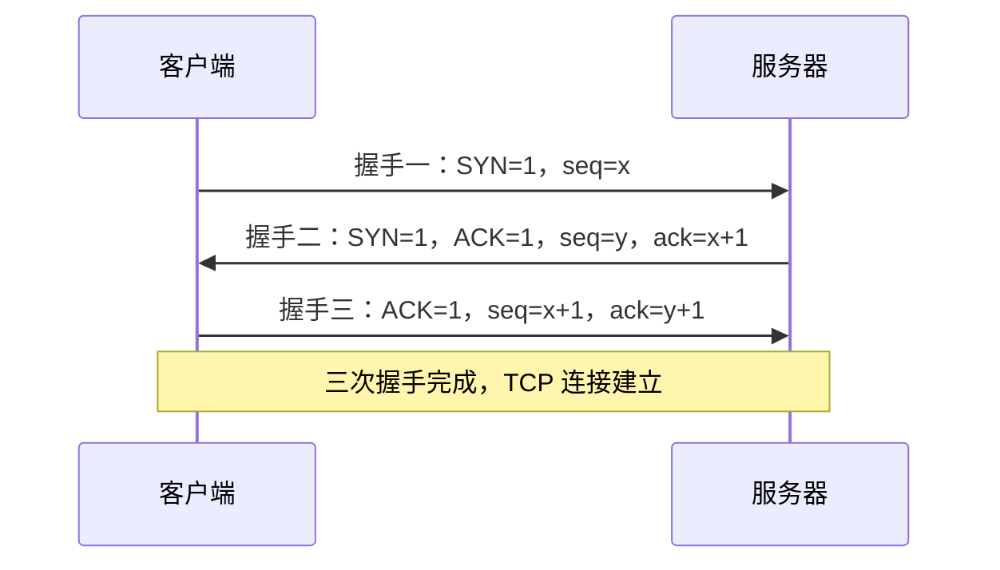
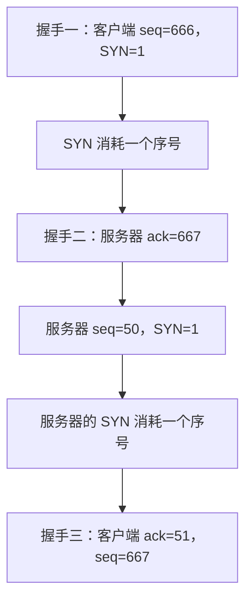
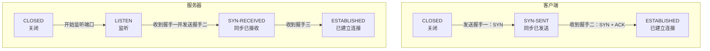
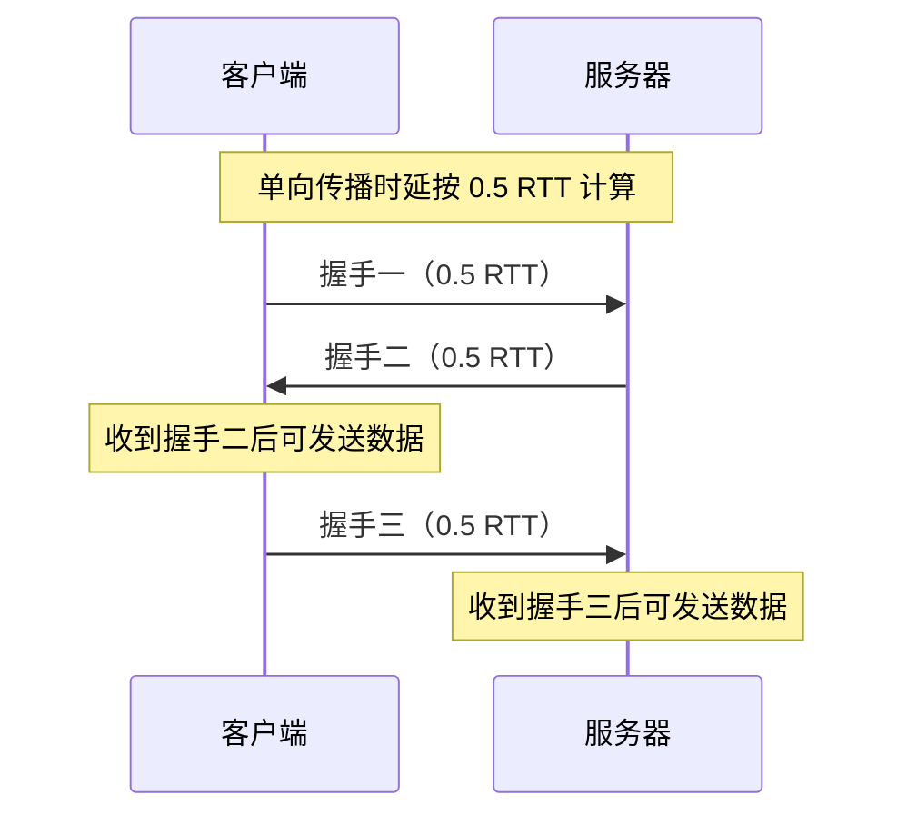

# TCP 连接管理：三次握手

> **408 计算机网络复习笔记**
>
> 本节重点：TCP 建立连接时的三次握手，包括标志位、序号与确认号的变化、TCP 状态转换，以及建立连接阶段的最短耗时分析。

---

## 一、TCP 连接管理概述

TCP 提供**面向连接**的服务。一次 TCP 通信通常经历三个阶段：

1. **建立连接**：通信双方通过三次握手建立 TCP 连接。
2. **数据传输**：连接建立后，双方可以进行双向数据传输。
3. **释放连接**：一方传输完数据后可以发起挥手，关闭一个方向的数据传输通道；另一个方向仍可继续传输，直到另一方也发起挥手。通常经过四次挥手后，双方通信结束，TCP 连接释放。

本笔记重点整理连接建立阶段；**四次挥手与连接释放阶段的详细内容放在下一部分学习**。

### 1. 三次握手与四次挥手

| 阶段     | 主要过程     | 目的                                 |
| -------- | ------------ | ------------------------------------ |
| 建立连接 | 三次握手     | 确认双方的发送、接收能力，并建立连接 |
| 数据传输 | 双向传输数据 | 通过 TCP 进行可靠的数据传输          |
| 释放连接 | 通常四次挥手 | 分别关闭两个方向的数据传输通道       |

### 2. 本节涉及的 TCP 首部字段

TCP 报文段由 **TCP 首部**和**数据部分**组成。本节尤其关注以下三个标志位和两个字段：

- **SYN**：用于请求建立连接、同步序号。
- **ACK**：表示确认号字段有效。
- **FIN**：用于请求释放连接。
- **序号（Sequence Number，seq）**：表示本报文段数据部分第一个字节的序号；在连接建立时，SYN 本身也会消耗一个序号。
- **确认号（Acknowledgment Number，ack）**：表示接收方期望收到的下一个字节的序号。

> 注意：**ACK 标志位**和**确认号字段**不是同一个概念。ACK 标志位用于说明确认号字段是否有效；确认号字段本身才存放具体的确认序号。

---

## 二、TCP 连接管理的三种常见考法

| 考法            | 主要考查内容                                               | 复习重点                                        |
| --------------- | ---------------------------------------------------------- | ----------------------------------------------- |
| 1. 字段取值     | 三次握手、四次挥手中 SYN、ACK、FIN，以及序号和确认号的值   | 根据题目给定的初始序号和数据长度逐步推算        |
| 2. TCP 状态转换 | 每发送或接收一个握手、挥手报文段后，进程状态如何变化       | 记清各状态的英文名称和转换时机                  |
| 3. 最短耗时分析 | 从某个报文段发出到客户端或服务器可以开始发送数据，需要多久 | 理解 RTT 与单向传播时延之间的关系，不要死记结论 |

三次握手的字段计算既可能出现在选择题中，也可能出现在大题中。状态转换通常偏向记忆，而耗时分析的关键是理解报文段到达的先后顺序。

---

## 三、三次握手：基本过程

### 1. 三次握手的参与方

- **客户端（主动打开方）**：主动发起第一次握手。
- **服务器（被动打开方）**：监听端口，并响应客户端的连接请求。

### 2. 三次握手时序图

其中：

- 第一次握手：客户端向服务器发送连接请求。
- 第二次握手：服务器确认客户端的连接请求，同时发送自己的连接请求。
- 第三次握手：客户端确认服务器的连接请求。
- 连接建立后，双方可以进行双向数据传输。

### 3. SYN、ACK、FIN 标志位在各报文段中的取值

对于本节讨论的正常连接建立与释放过程，三个标志位的规律如下：

| 报文段 | SYN | ACK | FIN |
| ------ | --: | --: | --: |
| 握手一 |   1 |   0 |   0 |
| 握手二 |   1 |   1 |   0 |
| 握手三 |   0 |   1 |   0 |
| 挥手一 |   0 |   1 |   1 |
| 挥手二 |   0 |   1 |   0 |
| 挥手三 |   0 |   1 |   1 |
| 挥手四 |   0 |   1 |   0 |

**记忆规律：**

- **SYN=1**：三次握手中只有握手一和握手二。
- **ACK=0**：正常情况下只有握手一；其他握手、挥手报文段的 ACK 标志位置为 1。
- **FIN=1**：四次挥手中，主动关闭方的挥手一和另一方的挥手三。
- 建立连接阶段不使用 FIN 来释放连接，因此三次握手中的 FIN 均为 0。

> 本节重点讲解三次握手；挥手阶段的字段和状态细节会在下一部分进一步展开。

---

## 四、三次握手中的序号与确认号

### 1. 握手一：客户端发送连接请求

假设客户端选择的初始序号为 **666**。

| 字段 |               取值 | 含义                                 |
| ---- | -----------------: | ------------------------------------ |
| SYN  |                  1 | 请求建立连接                         |
| ACK  |                  0 | 确认号字段无效                       |
| seq  |                666 | 客户端选择的初始序号                 |
| ack  | 不具备有效确认意义 | 客户端尚未收到服务器的数据或连接确认 |

握手一中，客户端规定自己后续发送的数据从初始序号 666 开始编号。

由于客户端此时还没有收到服务器发来的报文段，因此握手一中的确认号字段不具备有效的确认意义，ACK 标志位置为 0。

### 2. 为什么握手一虽然不携带数据，却会消耗一个序号？

握手一通常不携带应用层数据，但 TCP 规定：**SYN 会消耗一个序号**。

因此，假设客户端的初始序号为 666：

- 握手一的 `seq = 666`。
- 握手一消耗一个序号。
- 客户端后续真正发送的数据，将从序号 **667** 开始。

服务器收到握手一后，确认号应为 `666 + 1 = 667`。

### 3. 握手二：服务器确认客户端并发送自己的初始序号

假设服务器自己选择的初始序号为 **50**。

| 字段 | 取值 | 含义                                    |
| ---- | ---: | --------------------------------------- |
| SYN  |    1 | 服务器也发起同步序号的请求              |
| ACK  |    1 | 确认号字段有效                          |
| seq  |   50 | 服务器自己选择的初始序号                |
| ack  |  667 | 期望客户端后续发送的数据从序号 667 开始 |

这里必须区分两个序号：

- 握手一中的序号 666，是**客户端**为自己的发送数据选择的初始序号。
- 握手二中的序号 50，是**服务器**为自己的发送数据选择的初始序号。

服务器的初始序号由服务器自行选择，所以不必等于某个固定值。真正需要根据握手一推算的是握手二中的确认号：`666 + 1 = 667`。

握手二同样不携带数据，但由于它带有 SYN，也会消耗一个序号。因此客户端收到握手二后，应确认服务器的初始序号加一，即 `50 + 1 = 51`。

### 4. 握手三：客户端确认服务器

客户端收到握手二之后，发送握手三。

| 字段 | 取值 | 含义                                         |
| ---- | ---: | -------------------------------------------- |
| SYN  |    0 | 不再请求同步序号                             |
| ACK  |    1 | 确认号字段有效                               |
| seq  |  667 | 客户端后续数据的起始序号                     |
| ack  |   51 | 确认服务器的初始序号 50，且 SYN 消耗一个序号 |

此时：

- 客户端初始序号是 666。
- 握手一中的 SYN 消耗一个序号，所以客户端数据从 667 开始。
- 服务器初始序号是 50。
- 握手二中的 SYN 消耗一个序号，所以客户端在握手三中确认 `ack = 51`。

### 5. 三次握手字段汇总示例

假设客户端初始序号为 666，服务器初始序号为 50：

| 握手   | 方向            | SYN | ACK | seq |            ack |
| ------ | --------------- | --: | --: | --: | -------------: |
| 握手一 | 客户端 → 服务器 |   1 |   0 | 666 | 无有效确认意义 |
| 握手二 | 服务器 → 客户端 |   1 |   1 |  50 |            667 |
| 握手三 | 客户端 → 服务器 |   0 |   1 | 667 |             51 |

**核心规则：SYN 会消耗一个序号。** 因此，不能因为握手一、握手二没有携带数据，就认为确认号应保持不变。

---

## 五、握手三是否携带数据，对序号有什么影响？

握手一和握手二即使不携带数据，也会因为 SYN 而消耗一个序号。握手三则不同：握手三的 SYN=0，因此其序号消耗取决于它是否携带数据。

### 情况一：握手三不携带数据

假设握手三只有 TCP 首部，没有携带数据：

- 握手三的 `seq = 667`。
- 它不携带数据，也没有 SYN，因此**不消耗新的序号**。
- 服务器收到后，对客户端的确认号仍为 **667**。

### 情况二：握手三携带 100 字节数据

假设握手三携带 100 字节数据：

- 客户端数据的起始序号为 667。
- 100 字节数据占用序号 667 至 766。
- 服务器接收这 100 字节后，期望收到的下一个字节序号是 **767**。
- 因此服务器返回的确认号为 **767**。

| 握手三的情况 | 起始序号 | 数据长度 | 服务器确认号 |
| ------------ | -------: | -------: | -----------: |
| 不携带数据   |      667 |   0 字节 |          667 |
| 携带数据     |      667 | 100 字节 |          767 |

**计算公式：**

- 不携带数据：确认号 = 当前期望接收的下一个序号，不因该报文段的数据而增加。
- 携带数据：确认号 = 数据起始序号 + 数据长度。

这里的关键区别是：**握手一、握手二因 SYN 各消耗一个序号；握手三若不携带数据，则不消耗序号，若携带数据，则按数据字节数消耗序号。**

---

## 六、真题：2011 年第 39 题

### 1. 题目考查点

主机甲向主机乙发送一个 TCP 报文段，希望与主机乙建立 TCP 连接。假设主机乙接受连接请求，问主机乙向主机甲发送的正确 TCP 报文段可能是什么。

这道题重点考查：**根据 SYN 标志位判断握手阶段，并根据客户端初始序号计算服务器的确认号。**

### 2. 解题步骤

**第一步：根据 SYN 判断报文段类型。**

TCP 连接管理中，SYN=1 的报文段对应握手一或握手二。

**第二步：判断甲、乙的角色。**

题目说主机甲主动希望建立连接，因此甲是客户端，甲发送的是握手一。

**第三步：判断乙应该回复什么。**

主机乙接受连接请求，就会向甲发送握手二。握手二必须满足：

- `SYN = 1`
- `ACK = 1`

所以，SYN=0 的选项可以排除。

**第四步：根据握手一的初始序号计算确认号。**

题目给出的主机甲初始序号为 **11220**。握手一中的 SYN 会消耗一个序号，因此乙在握手二中应发送：

\[
ack = 11220 + 1 = 11221
\]

服务器自己的 `seq` 由服务器自行选择，不是这道题的关键。

### 3. 答案与易错点

**正确选项：C。**

容易被干扰的是服务器握手二中的序号字段。这个值由服务器自己选择；题目真正要求考生根据握手一推算的是确认号字段。

> **做题提醒：** 看见一个字段，不要只凭数值是否“看起来合理”来判断。先明确它表示谁的数据，再判断它应该由谁决定、根据哪个报文段计算。

---

## 七、三次握手中的 TCP 状态转换

建立连接时，客户端和服务器的 TCP 状态并不完全相同。

### 1. 客户端的状态转换

客户端主动发起连接：

1. 初始状态：`CLOSED`（关闭）。
2. 发送握手一后：进入 `SYN-SENT`（同步已发送）。
3. 收到握手二后：进入 `ESTABLISHED`（已建立连接）。
4. 之后可以开始发送数据。

### 2. 服务器的状态转换

服务器被动等待客户端连接：

1. 初始状态：`CLOSED`（关闭）。
2. 开始监听端口后：进入 `LISTEN`（监听）。
3. 收到握手一并发出握手二后：进入 `SYN-RECEIVED`（同步已接收）。
4. 收到握手三后：进入 `ESTABLISHED`（已建立连接）。
5. 之后可以开始发送数据。

### 3. 状态转换图

### 4. 状态转换考题

状态转换可能在选择题或大题中作为一个小问出现。例如：

- 客户端发送握手一后，进入什么状态？  
  **`SYN-SENT`，同步已发送。**
- 服务器收到握手一并响应后，处于什么状态？  
  **`SYN-RECEIVED`，同步已接收。**
- 客户端收到握手二后，进入什么状态？  
  **`ESTABLISHED`，已建立连接。**
- 服务器收到握手三后，进入什么状态？  
  **`ESTABLISHED`，已建立连接。**

状态转换题主要依靠记忆。可以在考前几天集中复习状态名称和转换时机。类似的真题也会考查释放连接阶段的状态转换，例如 2021 年第 38 题考查了四次挥手期间客户端的 TCP 状态变化。

---

## 八、建立连接阶段的最短耗时分析

这类题目通常给出 RTT（往返时延），要求计算从某个时间点开始，到客户端或服务器可以发送数据为止的最短耗时。

### 1. 关键前提

- **客户端**收到握手二后，已经可以进入 `ESTABLISHED` 状态，因此可以开始发送数据。
- **服务器**需要收到握手三后，才能进入 `ESTABLISHED` 状态并开始发送数据。
- 若题目没有给出其他额外延迟，按报文段在链路上单向传输需要 `0.5 RTT` 计算。

### 2. 从客户端发出握手一开始计算

#### 客户端何时可以发送数据？

时间线如下：

1. 客户端发出握手一。
2. 握手一到达服务器。
3. 服务器发出握手二。
4. 握手二到达客户端，客户端可以开始发送数据。

从客户端发出握手一，到握手二返回客户端，经历一个往返时延。

因此：

\[
T\_{\text{客户端可发送}} = 1 RTT
\]

#### 服务器何时可以发送数据？

时间线如下：

1. 客户端发出握手一，经过 `0.5 RTT` 到达服务器。
2. 服务器发出握手二，再经过 `0.5 RTT` 到达客户端。
3. 客户端发出握手三，再经过 `0.5 RTT` 到达服务器。
4. 服务器收到握手三后，可以开始发送数据。

从客户端发出握手一，到服务器收到握手三，总共需要：

\[
T\_{\text{服务器可发送}} = 1.5 RTT
\]

### 3. 常见问法汇总

| 题目问法                                         |  最短耗时 | 原因                                           |
| ------------------------------------------------ | --------: | ---------------------------------------------- |
| 客户端发出握手一后，客户端最早何时可以发送数据？ |   `1 RTT` | 客户端收到握手二后即可进入 `ESTABLISHED`       |
| 客户端发出握手一后，服务器最早何时可以发送数据？ | `1.5 RTT` | 服务器还需要等待握手三到达                     |
| 服务器发出握手二后，服务器最早何时可以发送数据？ |   `1 RTT` | 握手二到客户端、握手三返回服务器，合计一个 RTT |

第三种问法的时间线是：服务器发出握手二后，握手二单向到达客户端需要 `0.5 RTT`；客户端收到后发出握手三，握手三再单向到达服务器需要 `0.5 RTT`。因此总计为 `1 RTT`。

### 4. 耗时分析图

### 5. 不要死记结论，要理解时间线

最核心的区别是：

- 客户端在**收到握手二**时，就可以开始发送数据。
- 服务器在**收到握手三**时，才可以开始发送数据。

因此，只要确定题目指定的起点，以及哪个进程在收到哪个报文段后才可以开始发送数据，就能沿着报文段传播的时间线计算耗时。题目给出 RTT 的具体数值后，代入公式即可。

---

## 九、本节考点总结

### 1. 三次握手字段规律

| 项目         | 必须掌握的结论                                             |
| ------------ | ---------------------------------------------------------- |
| 握手一       | 客户端发起连接请求，`SYN=1`、`ACK=0`                       |
| 握手二       | 服务器确认客户端，并发送自己的初始序号，`SYN=1`、`ACK=1`   |
| 握手三       | 客户端确认服务器，`SYN=0`、`ACK=1`                         |
| 初始序号     | 客户端和服务器分别选择自己的初始序号，二者不必相同         |
| 确认号       | 确认对方已经接收的内容，表示期望收到的下一个字节序号       |
| SYN 消耗序号 | 握手一和握手二即使不携带数据，也各消耗一个序号             |
| 握手三的数据 | 不携带数据时不消耗数据序号；携带数据时按数据字节数消耗序号 |

### 2. TCP 状态转换

| 角色   | 状态变化                                             |
| ------ | ---------------------------------------------------- |
| 客户端 | `CLOSED` → `SYN-SENT` → `ESTABLISHED`                |
| 服务器 | `CLOSED` → `LISTEN` → `SYN-RECEIVED` → `ESTABLISHED` |

### 3. 最短耗时

| 起点与目标                            |  最短耗时 |
| ------------------------------------- | --------: |
| 客户端发出握手一 → 客户端可以发送数据 |   `1 RTT` |
| 客户端发出握手一 → 服务器可以发送数据 | `1.5 RTT` |
| 服务器发出握手二 → 服务器可以发送数据 |   `1 RTT` |

### 4. 复习时最容易混淆的地方

1. **序号和确认号的含义不同。** `seq` 是本方向的数据编号；`ack` 是对对方数据的确认，表示期望接收的下一个字节序号。
2. **ACK 标志位不等于确认号字段。** ACK=1 说明确认号字段有效。
3. **客户端和服务器的初始序号由各自决定。** 握手二的 `seq` 不需要由握手一推导，但握手二的 `ack` 必须根据握手一的序号计算。
4. **SYN 会消耗一个序号。** 握手一、握手二即使没有数据也各消耗一个序号。
5. **握手三不一定消耗序号。** 是否消耗取决于它是否携带数据；若携带 100 字节数据，确认号会相应增加 100。
6. **计算耗时要明确“谁在什么时候可以发送数据”。** 客户端等待握手二，服务器等待握手三。

---

**本节范围：** TCP 连接管理中，三次握手的字段取值、状态转换和最短耗时分析。四次挥手与连接释放阶段将在下一部分继续整理。
