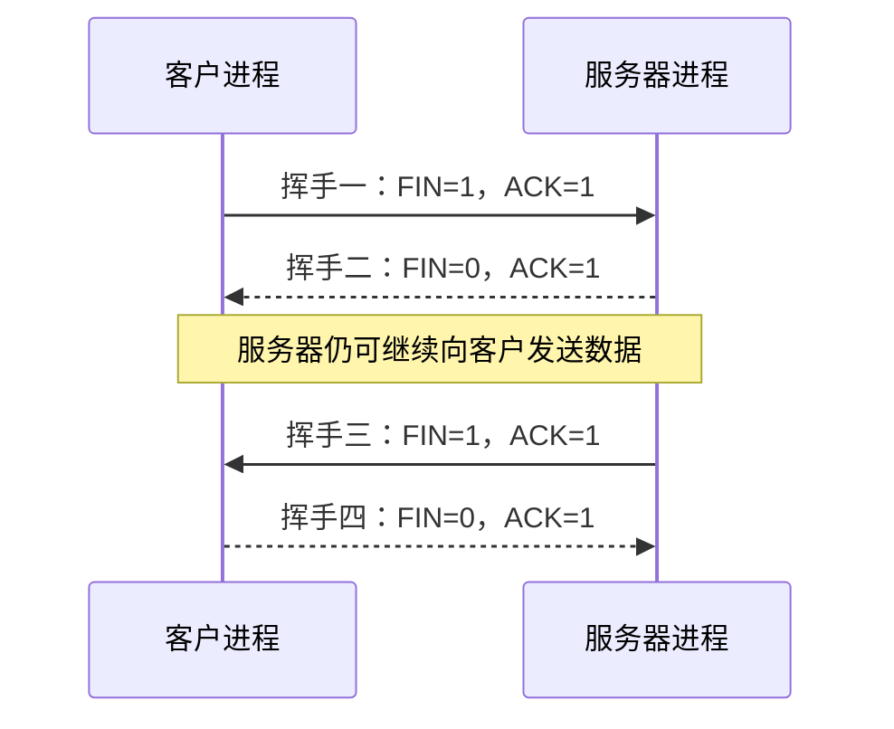
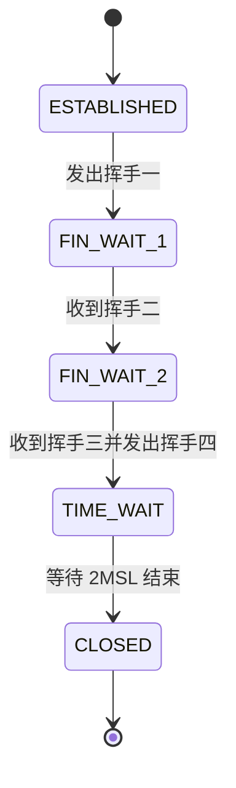
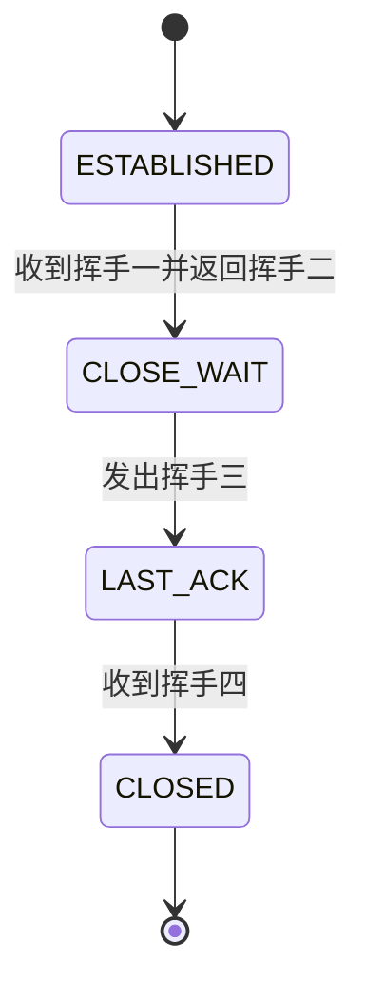
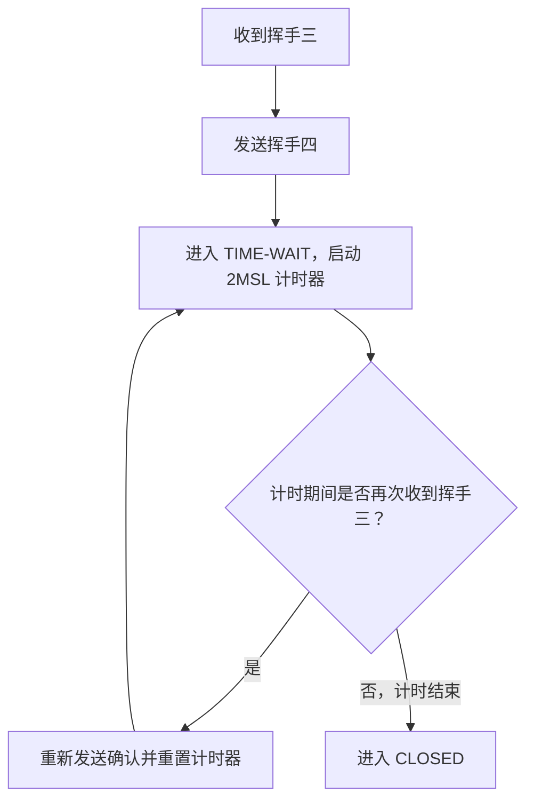

# TCP 连接管理：释放连接（四次挥手）

> **考点重点**
>
> 1. 四次挥手中 `FIN`、`ACK` 等标志位，以及序号字段、确认号字段的取值。
> 2. 每发出或收到一个挥手报文段后，TCP 状态如何转换。
> 3. 释放连接阶段的最短耗时，以及 `RTT`、`MSL` 在计算中的作用。

---

## 一、四次挥手的基本过程

TCP 是面向连接的协议。释放连接时，通常需要通过四次挥手完成双方两个方向的数据传输通道的关闭。

假设**客户进程首先发起挥手**：

四次挥手的核心含义如下：

- **挥手一**：客户进程发出 `FIN`，表示客户到服务器方向的数据已经发送完毕，请求关闭这一方向的连接。
- **挥手二**：服务器确认收到了客户的关闭请求。
- **挥手三**：服务器也完成数据发送后，发出 `FIN`，请求关闭服务器到客户方向的连接。
- **挥手四**：客户确认收到了服务器的关闭请求。

需要注意：客户发出挥手一后，**客户向服务器发送数据的通道关闭，但服务器向客户发送数据的通道还没有关闭**。因此，服务器在挥手二之后仍然可以继续向客户单向传输数据。

## 二、四次挥手中的标志位

### 2.1 SYN、ACK、FIN 的取值

| 报文段 | SYN | ACK | FIN | 说明                     |
| ------ | --: | --: | --: | ------------------------ |
| 握手一 |   1 |   0 |   0 | 主动建立连接             |
| 握手二 |   1 |   1 |   0 | 确认并同步连接           |
| 握手三 |   0 |   1 |   0 | 确认握手二，可携带数据   |
| 挥手一 |   0 |   1 |   1 | 客户请求关闭一个方向     |
| 挥手二 |   0 |   1 |   0 | 确认挥手一               |
| 挥手三 |   0 |   1 |   1 | 服务器请求关闭另一个方向 |
| 挥手四 |   0 |   1 |   0 | 确认挥手三               |

记忆要点：

- **只有握手一的 `ACK=0`**；其他这里讨论的报文段中，`ACK=1`。
- **只有握手一和握手二的 `SYN=1`**；其他报文段中，`SYN=0`。
- **只有挥手一和挥手三的 `FIN=1`**；挥手二和挥手四的 `FIN=0`。
- 当 `ACK=1` 时，同一报文段中的确认号字段有效。

### 2.2 FIN 段与 ACK 段

当 `FIN=1` 时，表示该进程已经完成当前方向的数据发送，并请求关闭连接的这一方向。

- 挥手一和挥手三是 `FIN` 段，也可以称为 **FIN 段**。
- 挥手二和挥手四是确认报文段，均设置 `ACK=1`。

## 三、四次挥手中的序号与确认号

### 3.1 FIN 段即使不携带数据，也要消耗一个序号

挥手一和挥手三即使不携带数据，也要消耗一个序号。这一点与握手一、握手二类似。

例如：

- 假设挥手一的序号字段为 `999`，且不携带数据。
- 因为挥手一的 `FIN=1`，它仍然消耗一个序号。
- 因此服务器在挥手二中的确认号为 `1000`。

同理：

- 假设挥手三的序号字段为 `7800`，且不携带数据。
- 挥手三仍然消耗一个序号。
- 因此客户在挥手四中的确认号为 `7801`。

可以概括为：

> **FIN 段即使没有数据，也会因为 FIN 标志占用一个序号。**

### 3.2 挥手一、挥手三之间的序号差值

挥手一和挥手三都可以携带数据，但在实际应用中，通常不会让它们携带数据；考试一般也默认这两个报文段不携带数据。

如果服务器在挥手二和挥手三之间继续向客户发送了数据，那么服务器的序号会随着已发送的数据字节数增加。

例如，假设服务器在挥手二及挥手二之后，陆续向客户传输了 **2200 字节**的数据：

- 某一时刻服务器的序号为 `5600`。
- 传输 2200 字节后，序号变为 `5600 + 2200 = 7800`。
- 因而挥手三中的序号字段可以为 `7800`。
- 如果挥手三不携带数据，客户仍会因 `FIN=1` 而确认到 `7801`。

所以，挥手一和挥手三之间的序号差值，取决于这段时间内实际传输的数据量以及报文段对序号的消耗。

### 3.3 哪些挥手报文段可以携带数据？

| 报文段 | 是否可以携带数据 | 原因或说明                                                                   |
| ------ | ---------------- | ---------------------------------------------------------------------------- |
| 挥手一 | 可以             | 实际应用中通常不携带；题目一般默认不携带                                     |
| 挥手二 | 可以             | 客户到服务器方向虽已关闭，但服务器到客户方向仍可继续传输数据                 |
| 挥手三 | 可以             | 实际应用中通常不携带；题目一般默认不携带                                     |
| 挥手四 | 不可以           | 客户在挥手一之后，向服务器发送数据的方向已经关闭；挥手四只用于确认和释放连接 |

**注意：挥手二和挥手四不能混为一谈。**挥手二发出时，服务器仍可能有数据要发给客户；挥手四则是在客户已经发出挥手一、关闭客户到服务器方向的数据发送后，用于确认服务器的关闭请求。

## 四、四次挥手期间的 TCP 状态转换

### 4.1 客户进程的状态变化

客户进程发出挥手一之前，一直处于 `ESTABLISHED`（已建立连接）状态。

状态转换过程如下：

1. 发出挥手一后，进入 `FIN-WAIT-1`（终止等待 1）。
2. 收到挥手二后，进入 `FIN-WAIT-2`（终止等待 2）。
3. 收到挥手三并发出挥手四后，进入 `TIME-WAIT`（时间等待）。
4. 等待 `2 × MSL` 结束后，进入 `CLOSED`（关闭）。

客户收到挥手三时，会启动计时器，等待两倍的 `MSL`。计时结束后，客户进程才真正进入 `CLOSED` 状态。

### 4.2 服务器进程的状态变化

服务器进程与客户进程的状态变化不同：

1. 收到挥手一后，进入 `CLOSE-WAIT`（关闭等待）。
2. 发出挥手三后，进入 `LAST-ACK`（最后确认）。
3. 收到挥手四后，直接进入 `CLOSED`（关闭）。

如果客户和服务器的角色互换，状态转换也会随之互换。分析题目时，必须先确认**哪一方首先发出 FIN 段**，再判断各自的状态。

### 4.3 状态转换速查表

| 时机                                         | 客户进程状态                          | 服务器进程状态                 |
| -------------------------------------------- | ------------------------------------- | ------------------------------ |
| TCP 连接建立后                               | `ESTABLISHED`                         | `ESTABLISHED`                  |
| 客户发出挥手一，服务器收到挥手一并返回挥手二 | `FIN-WAIT-1`（客户发出后）            | `CLOSE-WAIT`（服务器收到后）   |
| 客户收到挥手二                               | `FIN-WAIT-2`                          | `CLOSE-WAIT`                   |
| 服务器发出挥手三                             | 通常仍为 `FIN-WAIT-2`，直到收到挥手三 | `LAST-ACK`                     |
| 客户收到挥手三并发出挥手四                   | `TIME-WAIT`                           | `LAST-ACK`，等待挥手四到达     |
| 服务器收到挥手四                             | `TIME-WAIT`                           | `CLOSED`                       |
| 客户等待 `2 × MSL` 结束                      | `CLOSED`                              | `CLOSED`（若此前已收到挥手四） |

> **答题提醒：**题目问“收到某段并发送 ACK 段之后”的状态时，先确定这个 ACK 段到底对应挥手二还是挥手四，再结合主动发起挥手的一方判断状态。

## 五、真题分析：2021 年统考第 38 题

### 5.1 客户首先发起挥手

题意：客户首先向服务器发送 `FIN` 段，请求断开 TCP 连接。当客户收到服务器发送的 `FIN` 段，并向服务器发送 `ACK` 段之后，客户的 TCP 状态转换为什么？

分析：

1. `FIN=1` 的报文段对应挥手一或挥手三。
2. 题目明确说客户首先发出 `FIN` 段，因此客户发出的是挥手一。
3. 客户随后收到服务器的 `FIN` 段，对应挥手三。
4. 客户向服务器发送 `ACK` 段，对应挥手四。
5. 客户发出挥手四后进入 `TIME-WAIT` 状态。

因此，答案为 **B：`TIME-WAIT`**。

### 5.2 如果改成服务器首先发起挥手

如果题目改为服务器首先向客户发送 `FIN` 段：

1. 服务器首先发出的 `FIN` 段对应挥手一。
2. 客户返回的 `ACK` 段对应挥手二。
3. 客户收到挥手一并返回挥手二后，进入 `CLOSE-WAIT` 状态。

因此，若改成服务器首先发起挥手，同样的问题就应回答 **`CLOSE-WAIT`**，对应原题选项中的 A。

> 这道题的关键不是只记住一个状态名称，而是先识别谁发起挥手，再对应四次挥手的顺序。

## 六、MSL 与 TIME-WAIT

### 6.1 MSL 的含义

`MSL` 是 **Maximum Segment Lifetime** 的缩写，表示**最长报文段寿命**，是 TCP 协议规定的一个时间长度。

例如，假设：

\[
MSL = 800\text{ ms}
\]

客户收到挥手三并发出挥手四后，需要等待：

\[
2 \times MSL = 2 \times 800 = 1600\text{ ms}
\]

等待计时结束后，客户才进入 `CLOSED` 状态。

### 6.2 为什么要等待两倍 MSL？

客户发出挥手四后，挥手四不一定能成功到达服务器。

如果挥手四丢失，服务器迟迟没有收到确认，就可能重新发送挥手三，因为服务器可能认为客户没有收到自己的挥手三。

因此，客户需要在 `TIME-WAIT` 状态中保留足够长的等待时间：

- 如果客户在这段时间内再次收到服务器重传的挥手三，就重新发送确认，并**重置计时器**。
- 如果整个等待期间都没有再次收到挥手三，客户就可以推测服务器已经收到了挥手四，从而放心地关闭连接。

### 6.3 再次收到挥手三时的处理

假设：

\[
MSL = 800\text{ ms}, \qquad 2MSL = 1600\text{ ms}
\]

客户进入 `TIME-WAIT` 后开始倒计时 1600 ms。若等待过程中再次收到挥手三，则重新开始倒计时 1600 ms；如果之后不再收到重复的挥手三，倒计时结束后客户即可进入 `CLOSED`。

### 6.4 不要混淆 MSL 与 MSS

| 名称  | 英文全称                 | 含义                                                | 单位             |
| ----- | ------------------------ | --------------------------------------------------- | ---------------- |
| `MSL` | Maximum Segment Lifetime | 最长报文段寿命                                      | 时间，如秒、毫秒 |
| `MSS` | Maximum Segment Size     | 最大报文段长度，即一个 TCP 报文段最多可携带的数据量 | 字节             |

两者虽然都包含 `Maximum Segment`，但含义不同：**MSL 说的是时间，MSS 说的是数据长度。**

## 七、释放连接的最短耗时

以下耗时分析以**客户进程首先发出挥手一**为前提，并讨论最短耗时。

### 7.1 最短耗时出现的条件

如果服务器收到挥手一时，已经没有更多数据需要发送，那么服务器可以连续发出挥手二和挥手三，两者几乎同时发出。

在这种情况下：

- 服务器处于 `CLOSE-WAIT` 的时间极短，接近于 0。
- 客户收到挥手二后进入 `FIN-WAIT-2`，随后收到挥手三并进入 `TIME-WAIT`，这两步之间的时间也极短，接近于 0。

因此，最短耗时分析可以忽略这两个阶段中接近于零的时间。

### 7.2 客户进程进入 CLOSED 的最短耗时

从客户进程发出挥手一开始计时，到客户进入 `CLOSED`：

1. 四次挥手所涉及的往返传播部分，按题设的 `RTT` 计算。
2. 客户进入 `TIME-WAIT` 后，还需要等待 `2 × MSL`。

所以：

\[
\boxed{T\_{\text{客户}} = RTT + 2MSL}
\]

### 7.3 服务器进程进入 CLOSED 的最短耗时

仍然从客户进程发出挥手一开始计时：

1. 挥手一从客户到服务器，单向传播时延为 `0.5 RTT`。
2. 服务器收到挥手一后，若已没有数据需要发送，可连续发出挥手二和挥手三。
3. 客户收到挥手三后立即发出挥手四；挥手四再经过单向传播时延 `0.5 RTT` 到达服务器。
4. 服务器收到挥手四后进入 `CLOSED`。

因此：

\[
T\_{\text{服务器}} = 0.5RTT + 0.5RTT + 0.5RTT
\]

即：

\[
\boxed{T\_{\text{服务器}} = 1.5RTT}
\]

### 7.4 常见起点与终点变式

在服务器收到挥手一、服务器很快发出挥手二和挥手三的最短耗时条件下：

| 计时起点                                   | 计时终点            |          最短耗时 |
| ------------------------------------------ | ------------------- | ----------------: |
| 客户发出挥手一                             | 客户进入 `CLOSED`   |    \(RTT + 2MSL\) |
| 客户发出挥手一                             | 服务器进入 `CLOSED` |        \(1.5RTT\) |
| 服务器收到挥手一                           | 服务器进入 `CLOSED` |           \(RTT\) |
| 服务器发出挥手二（挥手二、三几乎同时发出） | 客户进入 `CLOSED`   | \(0.5RTT + 2MSL\) |

> **耗时题不要死记公式。**先明确计时起点和终点，再判断经历了几个单向传播时延、是否需要加上客户的 `2MSL` 等待时间。

## 八、真题分析：2022 年统考第 39 题

题目条件：

- 客户 C 和服务器 S 已经建立 TCP 连接。
- 往返时延：\(RTT = 50\text{ ms}\)。
- 最长报文段寿命：\(MSL = 800\text{ ms}\)。
- 数据传输结束后，客户进程主动请求断开连接，即客户发出挥手一。
- 求从客户发出挥手一开始，到客户进入 `CLOSED`、服务器进入 `CLOSED` 分别需要多长时间。

### 8.1 客户进程进入 CLOSED

使用公式：

\[
T\_{\text{客户}} = RTT + 2MSL
\]

代入数据：

\[
T\_{\text{客户}} = 50 + 2 \times 800
= 1650\text{ ms}
\]

因此，客户进入 `CLOSED` 需要 **1650 ms**。

### 8.2 服务器进程进入 CLOSED

使用公式：

\[
T\_{\text{服务器}} = 1.5RTT
\]

代入数据：

\[
T\_{\text{服务器}} = 1.5 \times 50
= 75\text{ ms}
\]

因此，服务器进入 `CLOSED` 需要 **75 ms**。

本题对应的计算关系为：

| 进程       | 计算式                             |    结果 |
| ---------- | ---------------------------------- | ------: |
| 客户进程   | \(RTT + 2MSL = 50 + 2 \times 800\) | 1650 ms |
| 服务器进程 | \(1.5RTT = 1.5 \times 50\)         |   75 ms |

### 8.3 题目改变计时范围时如何分析？

例如：

- 如果问“从服务器收到挥手一开始，到服务器关闭连接需要多久”，最短耗时为 **\(RTT\)**。
- 如果问“从服务器发出挥手二开始，到客户进入 `CLOSED` 需要多久”，在挥手二、挥手三几乎同时发出的条件下，最短耗时为 **\(0.5RTT + 2MSL\)**。

理解 `RTT` 对应传播时间、`2MSL` 对应客户在 `TIME-WAIT` 中的等待时间，就能应对计时起点和终点变化的题目。

## 九、TCP 连接管理考前总结

### 9.1 建立连接阶段

- 握手一和握手二的 `SYN=1`，因此也常称为 **SYN 段**。
- 握手一的 `ACK=0`；握手二、握手三的 `ACK=1`。
- 握手一和握手二不能携带数据，但都要消耗一个序号。
- 客户收到握手二后即可开始向服务器发送数据。
- 握手三可以携带数据，也可以不携带数据；如果不携带数据，且没有其他占用序号的控制信息，则不因数据而消耗序号。
- 建立连接的耗时题，关键是理解客户从何时可以开始传送数据、服务器从何时可以开始传送数据。

### 9.2 释放连接阶段

- 挥手一和挥手三的 `FIN=1`，因此也常称为 **FIN 段**。
- 挥手一和挥手三即使不携带数据，也要消耗一个序号。
- 挥手一和挥手三可以携带数据，但实际应用和通常的考试题目一般默认它们不携带数据。
- 挥手二可以携带数据；挥手四不可以携带数据。
- 客户主动发起挥手时，状态转换为：

  `ESTABLISHED → FIN-WAIT-1 → FIN-WAIT-2 → TIME-WAIT → CLOSED`

- 服务器收到挥手一后，状态转换为：

  `ESTABLISHED → CLOSE-WAIT → LAST-ACK → CLOSED`

### 9.3 耗时题的两个关键点

1. **MSL：**客户收到挥手三并发出挥手四后，需要等待 `2MSL` 才能进入 `CLOSED`。
2. **最短耗时条件：**服务器收到挥手一时已经没有待发送数据，可以连续发出挥手二和挥手三。

在客户首先发起挥手、且满足最短耗时条件时：

\[
\boxed{T\_{\text{客户}} = RTT + 2MSL}
\]

\[
\boxed{T\_{\text{服务器}} = 1.5RTT}
\]

考试前尤其要快速回顾释放连接阶段的状态变化，因为这类状态名称容易遗忘；耗时题则应先画出时间线，再确定传播时延和 `2MSL` 等待时间。
