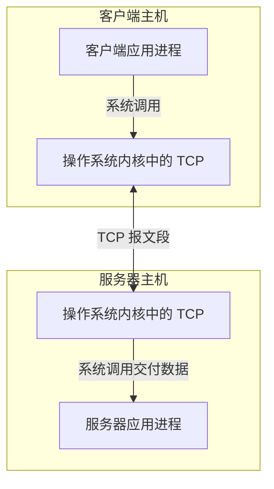
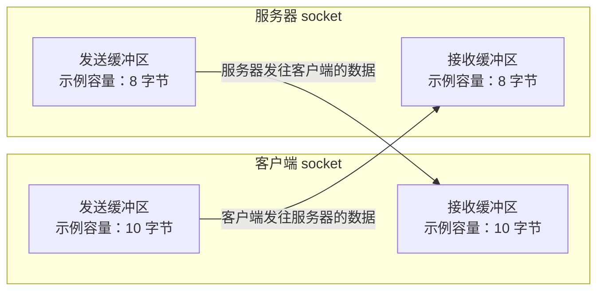
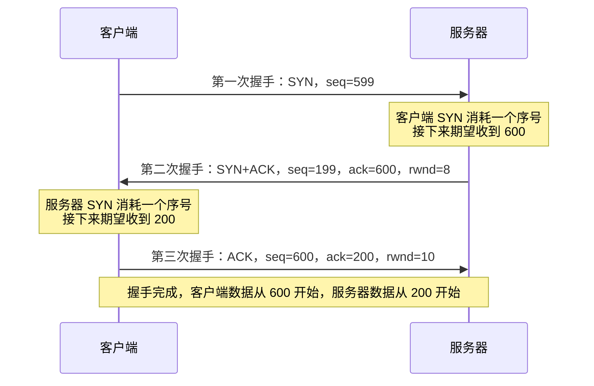
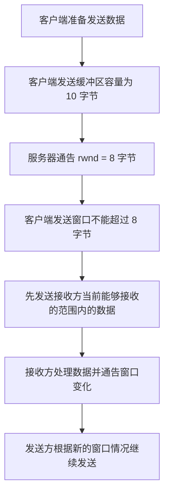
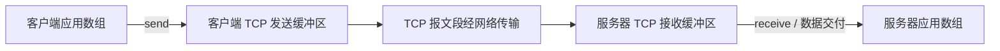

# TCP 可靠传输与流量控制

> **复习定位：** 传输层 · TCP 协议  
> **考查特点：** 大题、小题的高频考点。建议重点理解序号、确认机制、重传机制、接收窗口、发送窗口，以及 TCP 发送缓冲区和接收缓冲区之间的关系。

## 目录

- [一、可靠传输与流量控制的整体思路](#一可靠传输与流量控制的整体思路)
- [二、相关 TCP 首部字段](#二相关-tcp-首部字段)
- [三、示例中的连接参数](#三示例中的连接参数)
- [四、从进程和操作系统内存的视角理解 TCP](#四从进程和操作系统内存的视角理解-tcp)
- [五、三次握手与初始序号、确认号](#五三次握手与初始序号确认号)
- [六、发送窗口与接收窗口](#六发送窗口与接收窗口)
- [七、应用程序如何通过 send 和 receive 传输数据](#七应用程序如何通过-send-和-receive-传输数据)
- [八、一个端口与多个 TCP 连接](#八一个端口与多个-tcp-连接)
- [九、本节要点总结](#九本节要点总结)

---

## 一、可靠传输与流量控制的整体思路

本节讨论 TCP 协议如何实现**可靠传输**和**流量控制**。之所以把二者放在一起讲，是因为它们都需要数据接收方和数据发送方相互配合。

### 1. 可靠传输

可靠传输要解决的问题是：

- 数据发送方需要知道：**哪些数据已经被接收方正确接收？**
- 数据发送方和接收方通过确认机制、重传机制等配合，确保数据可靠地传输。

可靠传输离不开**序号**。TCP 建立连接时会设置初始序号；在数据传输过程中，每个字节都有对应的序号。发送方和接收方以此为基础进行确认与重传。

这与数据链路层中讲过的确认机制和重传机制有相似之处，但二者的确认和重传单位不同：

| 对比项                 | 数据链路层         | TCP 传输层                              |
| ---------------------- | ------------------ | --------------------------------------- |
| 所处层次               | 数据链路层         | 传输层                                  |
| 确认、重传所针对的对象 | 以数据帧为单位     | 以 TCP 报文段为单位                     |
| 相关机制               | 确认机制、重传机制 | 确认机制、重传机制，并结合 TCP 序号工作 |

### 2. 流量控制

流量控制要解决的问题是：

> **接收方告诉发送方，发送数据的速度和数量应该控制在什么范围。**

TCP 通过**滑动窗口机制**实现流量控制：

1. 接收方维护一个接收窗口，通常记作 `rcvwnd` 或 `rwnd`。
2. 接收窗口大小反映接收方当前能够接收多少数据。
3. 接收方在返回 ACK 报文段时，会顺带告知发送方自己的接收窗口大小。
4. 发送方根据接收方通告的窗口调整自己的发送窗口，不能超过对方接收窗口所允许的范围。

接收窗口越大，通常表示接收方当前能够接收的数据越多。

### 3. 流量控制与拥塞控制的区别

| 对比项             | 流量控制                                       | 拥塞控制                           |
| ------------------ | ---------------------------------------------- | ---------------------------------- |
| 主要关注的问题     | 接收方是否有能力接收数据                       | 网络是否出现拥塞                   |
| 主要反馈或判断依据 | 接收方通告的接收窗口                           | 发送方对网络状况的监测与判断       |
| 主要目标           | 避免发送方发送过多数据，导致接收方缓冲区不够用 | 根据网络拥塞情况调整发送数据的速度 |

**注意：** 本节重点讨论可靠传输和流量控制。拥塞控制并不是由接收方直接反馈接收窗口来完成的；它主要由发送方监测网络状况，并根据网络是否拥塞调整发送速度。

---

## 二、相关 TCP 首部字段

本节重点关注三个字段：**序号、确认号和窗口**。为了方便阅读，后文用小写 `ack` 表示确认号字段的数值，用 `rwnd` 表示窗口字段的数值。

### 1. 序号字段（Sequence Number）

序号通常简记为 `seq`，用于标记：

> **当前 TCP 报文段所携带的数据部分中，第一个字节在原始字节流中的位置。**

TCP 连接建立时，通信双方会各自设置初始序号。TCP 数据传输时，每个字节都对应一个序号。

即使 SYN 报文段不携带数据，它也会消耗一个序号。因此，后续的序号或确认号需要考虑 SYN 对序号的消耗。

### 2. 确认号字段（Acknowledgment Number）

确认号字段需要和 TCP 首部中的 `ACK` 标志位配合使用。

- 当大写的 `ACK = 0` 时，确认号字段无效。
- 当大写的 `ACK = 1` 时，确认号字段有效。
- 在本节讨论的连接建立和数据传输过程中，除第一次握手报文段外，其余报文段的 `ACK` 标志位均为 `1`。

当确认号有效时，接收方通过确认号告诉发送方：

> **确认号之前的所有字节都已经正确收到；接收方接下来期望收到的字节序号，就是这个确认号。**

例如，确认号为 `600`，表示序号小于 `600` 的相关字节已经被正确接收，接收方接下来期望收到序号为 `600` 的字节。

为了简化后文的示例，图中只记录确认号的数值 `ack`，不再单独标注大写的 `ACK` 标志位。理解时记住：除第一次握手外，此处其余 TCP 报文段的 `ACK` 标志位均为 `1`。

### 3. 窗口字段（Window）

窗口字段用于告知发送方：**从确认号所指示的下一个字节开始，接收方还可以接收多少个字节的数据。**

本节用 `rwnd` 简记窗口字段。

例如：

- `ack = 600`
- `rwnd = 8`

这表示接收方接下来期望收到序号为 `600` 的字节，并且当前通告的接收窗口大小为 8 字节，也就是从序号 `600` 开始可接收 8 个字节的数据。

**窗口字段以字节为单位。** 现实应用中的接收窗口通常可能以 KB 等更大的量级表示；为了便于演示，本节将窗口设置得比较小。

### 4. 字段速查表

| 字段或标志 | 本节记法 | 作用                                   | 阅读示例时要注意                           |
| ---------- | -------- | -------------------------------------- | ------------------------------------------ |
| 序号字段   | `seq`    | 标记当前报文段数据部分第一个字节的序号 | SYN 即使不携带数据，也会消耗一个序号       |
| 确认号字段 | `ack`    | 告知对方确认号之前的字节已正确收到     | 确认号表示接下来期望收到的字节序号         |
| ACK 标志位 | `ACK`    | 指示确认号字段是否有效                 | `ACK=0` 时确认号无效；`ACK=1` 时确认号有效 |
| 窗口字段   | `rwnd`   | 通告接收方当前的接收窗口大小           | 以字节为单位，接收方在 ACK 中通告给发送方  |

---

## 三、示例中的连接参数

接下来通过一个从建立 TCP 连接开始、逐步传送数据的例子，理解序号、确认号、接收窗口和发送窗口如何配合工作。

例子中的主要参数如下。这里的小窗口和缓冲区大小只是为了方便讲解，不代表现实应用中的典型配置。

| 项目                   |     客户端 |    服务器 |
| ---------------------- | ---------: | --------: |
| 初始序号               |      `599` |     `199` |
| 接收窗口通告值         |  `10` 字节 |  `8` 字节 |
| 示例中的接收缓冲区容量 |  `10` 字节 |  `8` 字节 |
| 示例中的发送缓冲区容量 |  `10` 字节 |  `8` 字节 |
| 应用层准备发送的数据   | `100` 字节 | `50` 字节 |

示例还假设：

- 客户端进程绑定的端口号为 `111`。
- 服务器进程绑定的端口号为 `996`。
- 客户端准备向服务器发送 100 字节数据。
- 服务器准备向客户端发送 50 字节数据。
- 为了便于理解，双方提前知道对方准备发送的数据量，并为接收数据准备了足够大的应用层数组。

实际应用中，两个进程最终会传输多少数据往往不可预知，不能总是提前分配一个恰好足够大的数组；可以通过动态扩容等方法处理数据量变化。

---

## 四、从进程和操作系统内存的视角理解 TCP

### 1. 应用层进程与 TCP 协议的位置

假设客户端主机运行着客户端进程，服务器主机运行着服务器进程。它们是应用层程序，通过 TCP 进行通信。

从不同视角理解这套结构：

- **网络协议栈的视角：** 应用层位于上方，传输层 TCP 位于下方。
- **操作系统内存的视角：** 应用程序运行在用户区；TCP 协议的相关处理运行在操作系统内核区。

可以把这个关系概括为：

### 2. Socket 与端口号

要通过网络通信，客户端和服务器进程需要通过系统调用建立相应的 socket（套接字）对象，并使用端口号标识通信端点。

在这个例子中：

- 客户端进程绑定端口 `111`。
- 服务器进程绑定端口 `996`。
- 客户端发起连接时，需要提供目标服务器的 IP 地址和端口号等信息。
- socket 对象会记录本端和通信对端的相关信息，包括本机端口号、对方 IP 地址和端口号等。
- 服务器接收到客户端发来的第一次握手报文段后，也会为这条连接建立相应的 socket 对象，并记录对端和本端的相关信息。

可以把 socket 暂时理解成一个包含通信信息和缓冲区的数据结构。

### 3. Socket 中的发送缓冲区和接收缓冲区

每个 TCP 连接对应的 socket 对象中，包含两个缓冲区：

- **发送缓冲区：** 应用程序准备发送的数据先交给操作系统，暂存在发送缓冲区中，再由 TCP 处理并发送。
- **接收缓冲区：** TCP 接收到对方发来的数据后，先将数据放入接收缓冲区，再由操作系统根据应用程序的接收请求，把数据交付给应用程序。

在本例中，假设操作系统为：

- 服务器的发送缓冲区和接收缓冲区各分配 8 字节。
- 客户端的发送缓冲区和接收缓冲区各分配 10 字节。

这里不必被“缓冲区”这个名称吓到。为了帮助理解，可以把这些缓冲区想象成操作系统为这条 TCP 连接分配的 `char` 型数组。例如，8 字节缓冲区就可以类比为一个长度为 8 的 `char` 型数组，10 字节缓冲区就可以类比为一个长度为 10 的 `char` 型数组。实际的内核实现并不一定就是这样简单的数组，这只是本例的直观化理解。

> **区分两类缓冲区：** 应用程序自己定义的数组用于保存应用层要发送或接收的数据；socket 中的发送缓冲区和接收缓冲区则由操作系统内核管理。它们不是同一个东西。

---

## 五、三次握手与初始序号、确认号

### 1. 第一次握手：客户端发起连接

假设客户端给自己设置的初始序号为 `599`。

第一次握手的 SYN 报文段不携带应用数据，但会消耗一个序号。因此，服务器接下来期望收到的序号为：

\[
599 + 1 = 600
\]

于是服务器在第二次握手中，将确认号设置为 `600`。

### 2. 第二次握手：服务器返回确认和自己的窗口

假设服务器设置的初始序号为 `199`，并向客户端通告接收窗口大小为 `8`。

第二次握手中的关键信息如下：

| 字段   |  数值 | 含义                                                    |
| ------ | ----: | ------------------------------------------------------- |
| `seq`  | `199` | 服务器的初始序号                                        |
| `ack`  | `600` | 确认客户端的 SYN，并表示接下来期望接收序号为 600 的字节 |
| `rwnd` |   `8` | 服务器当前通告的接收窗口为 8 字节                       |

服务器的 SYN 同样会消耗一个序号。因此，客户端收到第二次握手后，就知道服务器接下来期望接收的第一个数据字节序号为：

\[
199 + 1 = 200
\]

这个值将作为第三次握手中的确认号。

### 3. 第三次握手：客户端返回确认和自己的窗口

第三次握手中，客户端确认服务器的 SYN，因此确认号为 `200`。客户端也向服务器通告自己的接收窗口大小为 `10` 字节。

| 字段   |  数值 | 含义                                                    |
| ------ | ----: | ------------------------------------------------------- |
| `seq`  | `600` | 客户端的 SYN 消耗一个序号后，后续数据的起始序号         |
| `ack`  | `200` | 确认服务器的 SYN，并表示接下来期望接收序号为 200 的字节 |
| `rwnd` |  `10` | 客户端当前通告的接收窗口为 10 字节                      |

### 4. 三次握手后的序号状态

握手完成后，双方真正开始传输数据时，序号从以下位置开始：

- 客户端接下来发送的数据：从序号 `600` 开始。
- 服务器接下来发送的数据：从序号 `200` 开始。

三次握手中 SYN 消耗序号的过程，可以用下图概括：

---

## 六、发送窗口与接收窗口

### 1. 接收窗口反映接收能力

服务器在第二次握手中通告：

- `ack = 600`
- `rwnd = 8`

这意味着服务器接下来期望接收序号为 `600` 的字节，并且当前接收窗口能够容纳从序号 `600` 开始的 8 个字节。

客户端虽然有 10 字节的发送缓冲区，但不能因此就一次向服务器发送 10 个字节。因为服务器通告的接收窗口只有 8 字节；如果客户端超过接收方当前能够接收的范围，服务器的接收缓冲区就可能不够用，进而导致数据无法按预期接收。

所以，在这个例子的初始状态下，客户端的发送窗口最多只能覆盖对方允许接收的 8 个字节。

### 2. 发送窗口受哪些因素限制

发送窗口既受到**本端发送缓冲区容量**的限制，也受到**对方通告的接收窗口**的限制。

从本例的直观模型来看：

- 客户端发送缓冲区容量为 10 字节。
- 服务器通告的接收窗口为 8 字节。
- 因此，客户端发送窗口不能超过 8 字节。

反过来看服务器：

- 服务器发送缓冲区容量为 8 字节。
- 客户端通告的接收窗口为 10 字节。
- 因此，服务器发送窗口可以覆盖自己的整个 8 字节发送缓冲区，因为客户端通告的接收窗口足以容纳这些数据。

| 方向            | 本端发送缓冲区容量 | 对端通告的接收窗口 | 本例中的发送窗口上限 |
| --------------- | -----------------: | -----------------: | -------------------: |
| 客户端 → 服务器 |            10 字节 |             8 字节 |               8 字节 |
| 服务器 → 客户端 |             8 字节 |            10 字节 |               8 字节 |

以上是本例初始状态下的简化分析。实际通信过程中，随着数据被接收、应用程序读取数据以及接收方通告窗口变化，发送窗口也会相应移动或调整。

### 3. 用图理解窗口限制

**本节的核心逻辑：** 接收方在 ACK 报文段中通告自己的接收窗口大小，发送方据此调整发送窗口。发送窗口不能超过发送方自己的发送缓冲区容量，也不能超过对方通告的接收窗口所允许的范围。

---

## 七、应用程序如何通过 `send` 和 `receive` 传输数据

### 1. 应用程序调用 `send` 发送数据

假设客户端应用程序准备向服务器发送 100 字节数据。本质上，可以把这 100 字节理解成客户端程序准备好的一个长度为 100 的 `char` 型数组，数组中存放着应用程序定义的数据内容。

客户端可以调用 `send` 函数，并告诉操作系统：

- 要发送的数据位于哪个数组中；
- 从哪里开始发送、要发送多少数据；
- 数据要发送到哪个 socket 对象。

由于 socket 已经记录了这条连接的相关信息，操作系统的 TCP 协议部分就可以据此构建 TCP 报文段，并将数据发送给对方。

在调用 `send` 后，操作系统会把应用程序交来的数据按顺序放入 TCP 发送缓冲区。由于本例客户端的发送缓冲区只有 10 字节，因此初始时只能容纳数据数组中下标为 `0` 到 `9` 的 10 个字节。随着缓冲区中出现可用空间，后续数据才可以继续进入发送缓冲区。

对应用程序来说，主要任务是通过系统调用提供要发送的数据以及目标 socket；具体由操作系统完成的缓冲、组装 TCP 报文段和发送等工作，属于内核的处理过程。

### 2. 应用数组下标与 TCP 字节序号

为了便于演示，客户端把准备发送的 100 个字节用数组下标 `0` 到 `99` 标记。

客户端下一段数据的 TCP 序号从 `600` 开始，因此数组下标与 TCP 字节序号的对应关系是：

| 应用数组下标 | 对应的 TCP 字节序号 |
| -----------: | ------------------: |
|          `0` |     `600 + 0 = 600` |
|          `1` |     `600 + 1 = 601` |
|          `2` |     `600 + 2 = 602` |
|            … |                   … |
|         `99` |    `600 + 99 = 699` |

也就是说，这 100 个字节在 TCP 序号空间中对应 `600` 到 `699`。

注意：**数组下标**是应用程序用来定位数组元素的编号；**TCP 序号**是 TCP 用来标记字节流位置的编号。这两种编号的含义不同，但可以在本例中建立上述对应关系。

### 3. 接收方如何通过 `receive` 取得数据

服务器应用程序需要接收客户端发送的 100 字节数据。为了方便理解，假设服务器应用程序预先定义了一个长度为 100 的空数组，然后调用 `receive` 函数，并向操作系统提供：

- 接收数据的目标数组或其指针；
- 用来接收数据的 socket 对象。

当对应 socket 的接收缓冲区中有新数据到达时，操作系统就可以按照应用程序提出的接收请求，将数据从接收缓冲区交付到应用程序提供的数组中。

整个过程可以概括为：

反方向的数据传输过程也是一样的：服务器应用程序通过 `send` 把数据交给操作系统，数据进入服务器的发送缓冲区，再传输到客户端的接收缓冲区，最后由客户端应用程序通过 `receive` 等接收操作取得数据。

### 4. 应用层预分配数组与内核缓冲区不要混淆

本例中存在两类容易混淆的空间：

| 空间                | 由谁准备或管理 | 用途                                 |
| ------------------- | -------------- | ------------------------------------ |
| 应用程序自己的数组  | 应用程序       | 保存应用层要发送或接收的数据         |
| socket 的发送缓冲区 | 操作系统内核   | 暂存等待发送的数据                   |
| socket 的接收缓冲区 | 操作系统内核   | 暂存已经接收、等待应用程序读取的数据 |

示例假设双方事先商议好了要发送的数据量，因此可以提前准备长度合适的应用层数组：

- 客户端准备一个长度为 100 的数组，用于发送 100 字节数据。
- 服务器准备一个长度为 100 的空数组，用于接收客户端的数据。
- 服务器准备一个长度为 50 的数组，用于发送 50 字节数据。
- 客户端准备一个空数组，用于接收服务器发送的数据。

现实应用中，两个进程之间最终会传输多少数据往往无法预先确定。如果预分配的应用层数组已经填满，可以使用动态扩容等数据结构方法来解决容量不足的问题。

**应用层数组预先准备得足够大，并不意味着 TCP 发送缓冲区和接收缓冲区也同样大。** 本例服务器的接收缓冲区只有 8 字节，客户端的接收缓冲区只有 10 字节；TCP 仍然需要依靠窗口、确认和后续传输过程逐步完成数据交换。

---

## 八、一个端口与多个 TCP 连接

一个端口可以参与多个 TCP 连接。

例如，假设服务器进程绑定的端口号为 `996`：

- 服务器可以使用一个 socket 对象，与客户端进程一建立 TCP 连接。
- 服务器也可以使用另一个 socket 对象，与客户端进程二建立 TCP 连接。
- 这两条连接都可以使用服务器主机上的端口 `996`。

因此，**一个端口可以支持多个 TCP 连接**；但每一条 TCP 连接仍然只支持通信双方之间的**一对一全双工通信**。

另外，同一个 TCP 连接中的发送缓冲区和接收缓冲区大小不一定相等。具体分配多少空间，由操作系统内核根据实际情况决定。发送数据时，服务器程序只需要把数据提交给目标连接对应的 socket 对象，操作系统就会根据这个 socket 对象所记录的信息进行后续处理。

---

## 九、本节要点总结

### 1. 可靠传输的关键

- TCP 连接建立过程中，通信双方各自设置初始序号。
- TCP 数据部分以字节为单位编号，每个字节对应一个序号。
- `seq` 标记当前 TCP 报文段数据部分第一个字节的序号。
- `ack` 是确认号字段的数值；确认号之前的字节已被正确接收，确认号表示接下来期望接收的字节序号。
- TCP 通过确认机制、重传机制等配合实现可靠传输。
- SYN 即使不携带应用数据，也会消耗一个序号。

### 2. 流量控制的关键

- 接收方维护接收窗口，通常记作 `rwnd` 或 `rcvwnd`。
- 接收方在 ACK 报文段中通告接收窗口大小。
- 窗口字段以字节为单位，表示接收方从确认号开始还能接收多少字节。
- 发送方根据对方通告的接收窗口调整发送窗口。
- 发送窗口不能超过本端发送缓冲区可用容量，也不能超过对方通告的接收窗口所允许的范围。

### 3. 缓冲区与应用程序的关系

- 应用程序通过 `send` 等系统调用把数据交给操作系统。
- 待发送的数据由 TCP 发送缓冲区暂存，随后由 TCP 处理并发送。
- 收到的数据先进入 TCP 接收缓冲区，再由操作系统交付给应用程序。
- 应用程序自行定义的数组与 socket 中的内核缓冲区不是同一个空间。
- TCP 支持双向数据传输，因此连接两端都具有发送缓冲区和接收缓冲区。

### 4. 示例参数速记

| 项目                     |    客户端 |   服务器 |
| ------------------------ | --------: | -------: |
| 初始序号                 |     `599` |    `199` |
| 握手完成后的数据起始序号 |     `600` |    `200` |
| 本例接收窗口通告值       | `10` 字节 | `8` 字节 |
| 本例发送缓冲区容量       | `10` 字节 | `8` 字节 |
| 本例接收缓冲区容量       | `10` 字节 | `8` 字节 |

### 5. 建议的理解顺序

1. 先理解 `seq`、`ack` 和 `rwnd` 三个字段分别表示什么。
2. 再根据三次握手计算双方真正开始发送数据时的起始序号。
3. 将 socket 视为包含发送缓冲区和接收缓冲区的连接数据结构，分清内核缓冲区与应用程序数组。
4. 最后结合对方通告的接收窗口与本端发送缓冲区容量，判断发送窗口最多能覆盖多少数据。

本节最重要的是理解整体框架：**序号、确认号和重传机制用于可靠传输；接收方通告接收窗口，发送方据此调整发送窗口，从而实现流量控制。** 后续再沿着这个框架观察数据如何逐步发送、接收以及窗口如何变化，就更容易分析相关大题和小题。
