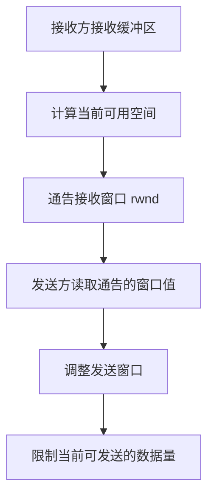
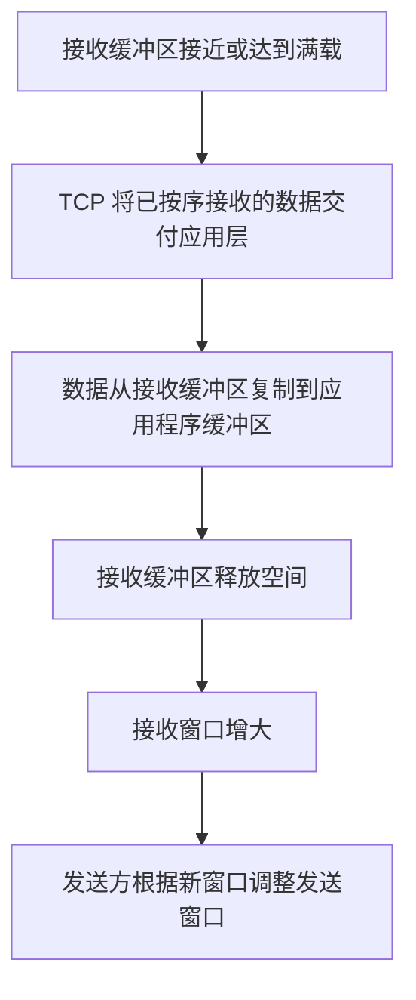
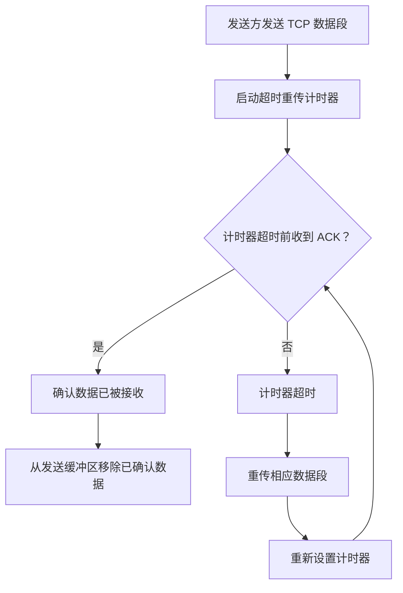
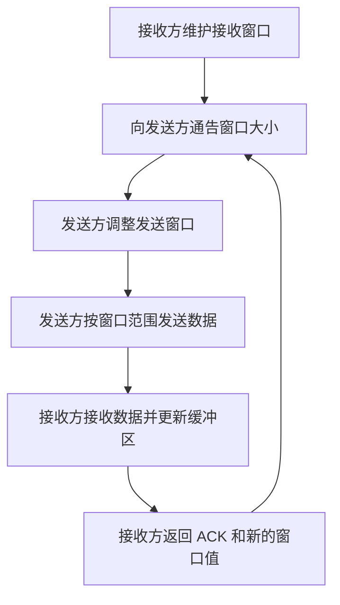

# TCP 可靠传输与流量控制

> 计算机网络 · 传输层 · TCP  
> 本笔记按照课程讲解顺序整理，重点保留序号、确认号、接收窗口、发送窗口、累积确认、捎带确认、按序交付和超时重传等内容。

---

## 一、TCP 可靠传输与流量控制的基本思路

TCP 通过**序号、确认机制、重传机制和窗口机制**，实现可靠传输与流量控制。

- **可靠传输**：让发送方知道哪些字节已经被正确接收；如果数据或确认丢失，可以通过重传恢复。
- **流量控制**：接收方通过通告自己的接收窗口，限制发送方继续发送的数据量，避免接收缓冲区被超出容量的数据填满。
- **按序交付**：TCP 可以将收到的数据暂存在接收缓冲区中，并按照字节序号把连续、有序的数据交付给应用层。

### 1. 本节示例中的初始条件

为了方便理解，课程示例使用了以下初始状态：

- 客户端发送方向的起始序号为 `600`。
- 服务器发送方向的起始序号为 `200`。
- 接收缓冲区大小为 `8` 字节。
- 序号分别属于两个方向，各自独立编号。

**注意：** 客户端发往服务器的数据序号，与服务器发往客户端的数据序号是两套独立的序号空间。因此，客户端数据从 `600` 开始，并不影响服务器数据从 `200` 开始。

---

## 二、序号、确认号与接收窗口

### 1. 客户端发送 3 个字节

假设客户端进程首先向服务器进程发送 3 个字节的数据，内容可以记作 `0、1、2`。

这 3 个字节从发送缓冲区中取出，并封装成一个 TCP 报文段：

- 序号字段为 `600`。
- 报文段携带的 3 个字节，其序号分别为 `600、601、602`。

TCP 首部中还包含确认号和接收窗口等字段。此处为了突出讲解重点，先关注数据序号以及接收方返回的信息。

报文段会被封装进 IP 数据报，经路由器转发，最终到达服务器的传输层。服务器将数据放入接收缓冲区，并根据 TCP 首部中的**校验和**检查报文段是否存在比特错误。

TCP 校验和的基本规则与 UDP 校验和相同。假设这 3 个字节都通过了差错检查，服务器就可以确认这些数据是正确接收的。

### 2. 服务器返回 ACK

假设服务器进程当前还没有准备好要发送给客户端的数据，服务器发送缓冲区暂时为空。因此，服务器返回的 TCP 报文段只包含首部，不携带应用数据。这种报文段用于专门返回确认信息。

服务器返回的关键信息如下：

| 字段     |    值 | 含义                                                            |
| -------- | ----: | --------------------------------------------------------------- |
| 序号     | `200` | 服务器发送方向的当前序号；此报文段没有携带数据                  |
| 确认号   | `603` | `603` 之前的所有字节都已正确接收，接下来期待序号为 `603` 的字节 |
| 接收窗口 |   `5` | 当前还可以接收 5 个字节                                         |

确认号为什么是 `603`？

客户端发送的数据序号是 `600～602`，共 3 个字节。因此，服务器接下来期待收到的字节序号是 `603`。确认号 `603` 表示：**序号小于 `603` 的字节都已经正确接收**。

接收窗口为什么是 `5`？

接收缓冲区总容量为 8 字节，已经放入了 3 个字节，还剩余 5 个字节的空间。因此，服务器通告的接收窗口为 5。

客户端收到这个 ACK 后，可以进行两项处理：

1. 根据确认号 `603`，确定序号 `600～602` 的数据已被确认接收，将这些字节从发送缓冲区中移除。
2. 根据对方通告的接收窗口 `5`，调整自己的发送窗口。接下来最多只能再发送 5 个字节，即序号 `603～607` 的数据。

### 3. 接收窗口与发送窗口的关系

接收窗口反映接收方当前还能接收多少字节；发送方根据接收方通告的窗口调整自己的发送窗口。



本例中，接收缓冲区容量是 8 字节。接收 3 个字节后，剩余空间为 5 字节，因此接收窗口从 8 缩小为 5，发送方也需要相应调整发送窗口。

---

## 三、累积确认（Cumulative ACK）

### 1. 客户端连续发送两个 TCP 报文段

接下来，客户端连续发送两个 TCP 报文段：

| 报文段       | 携带的字节序号 | 序号字段 |
| ------------ | -------------- | -------: |
| 第一个报文段 | `603～604`     |    `603` |
| 第二个报文段 | `605～606`     |    `605` |

服务器连续收到这两个报文段后，可以采用**累积确认**，只返回一个 ACK。

无论这两个报文段谁先到达，服务器都可以根据各自的序号字段，将数据放入接收缓冲区中对应的位置。若后一个报文段先到达，其数据可以先放入相应位置；前一个报文段到达后，再补上前面的数据。

假设这两个报文段都没有差错，并且 `603～606` 的数据已经连续、完整地收到，那么服务器返回：

- **确认号：`607`**
- **接收窗口：`1`**

确认号 `607` 表示：序号小于 `607` 的所有字节，即 `603～606`，都已正确接收。由于接收缓冲区中的可用空间只剩 1 字节，所以接收窗口为 1。

### 2. 累积确认的含义

**累积确认：一个确认号可以确认该序号之前所有连续、正确接收的字节。**

例如，服务器返回确认号 `607`，并不是只确认序号为 `606` 的一个字节，而是表示 `607` 之前的所有字节都已经正确接收。

客户端收到 ACK 后：

1. 将已确认的 `603～606` 从发送缓冲区中移除。
2. 根据接收窗口 `1`，将发送窗口调整为最多还能发送 1 个字节。

---

## 四、接收缓冲区满后，按序交付应用层

### 1. 再发送一个字节

此时发送窗口大小只有 1，因此客户端接下来最多只能发送一个字节。这个字节的序号为 `607`。

服务器收到该字节后，将它放入接收缓冲区。此时接收缓冲区中的 8 个字节为：

```text
600 601 602 603 604 605 606 607
```

接收缓冲区已经满了。如果服务器一直不处理缓冲区中的数据，发送方就无法继续发送更多数据。

因此，服务器的 TCP 协议会将已经按序接收的数据交付给应用层。本质上，就是把接收缓冲区中的数据复制到应用程序的用户区缓冲区，例如从 TCP 接收缓冲区中的 `char` 数组复制到应用程序定义的 `char` 数组。

### 2. 接收缓冲区清空后，窗口恢复

数据交付给应用层后，接收缓冲区被清空，可用空间恢复为 8 字节。

此时：

- 接下来期待接收的序号是 `608`。
- 服务器返回的确认号为 `608`。
- 服务器通告的接收窗口恢复为 `8`。

客户端收到该 ACK 后，将 `608` 之前已确认的数据从发送缓冲区中移除，并可以将后续数据读入发送缓冲区。由于服务器的接收窗口恢复为 8，客户端的发送窗口也可以相应扩大到 8。

### 3. 核心过程



按序交付的重点是：TCP 将数据按正确的字节顺序交给应用层，而不是简单地把任何已经到达的数据立即交付。

---

## 五、捎带确认（Piggybacking）

### 1. 服务器也有数据要发送

接下来，客户端向服务器发送两个字节的数据，序号为 `608～609`。

与此同时，服务器进程刚好准备好了 5 个字节的数据，并已通过 `send()` 函数将它们放入发送缓冲区。这 5 个字节属于服务器发往客户端的方向，序号分别为：

```text
200、201、202、203、204
```

服务器本来需要向客户端返回 ACK。由于服务器此时也有数据要发送，就可以在返回确认信息的同时，把自己的 5 个字节数据一起带回去。这就是**捎带确认**。

### 2. 服务器构造捎带确认报文段

服务器返回的 TCP 报文段包含数据，并在首部中设置以下字段：

| 字段     |         值 | 含义                                      |
| -------- | ---------: | ----------------------------------------- |
| 序号     |      `200` | 本报文段携带的服务器数据从序号 `200` 开始 |
| 确认号   |      `610` | 客户端序号小于 `610` 的字节都已正确接收   |
| 接收窗口 |        `6` | 当前还可以接收 6 个字节                   |
| 数据     | `200～204` | 携带服务器准备好的 5 个字节               |

客户端收到该报文段后，将这 5 个字节复制到自己的接收缓冲区。服务器方向的数据序号 `200～204` 已被接收，因此客户端接下来期待服务器发送的下一个字节序号为 `205`。

客户端还要根据确认号 `610`，确认自己发送方向中序号 `610` 之前的数据已经被服务器正确接收，并将相应数据从发送缓冲区中移除。

另一方面，服务器通告的接收窗口为 6，因此客户端需要将发送窗口调整为最多 6 个字节。

### 3. 客户端也采用捎带确认

客户端收到服务器的数据后，也需要向服务器返回确认信息。假设客户端此时也有数据待发送，于是客户端在 ACK 中捎带 6 个字节的数据。

客户端发往服务器的数据序号为 `610～615`，因此：

| 字段     |         值 | 含义                                    |
| -------- | ---------: | --------------------------------------- |
| 序号     |      `610` | 客户端本次发送的数据从 `610` 开始       |
| 确认号   |      `205` | 服务器序号小于 `205` 的字节都已正确接收 |
| 接收窗口 |        `5` | 客户端当前还可以接收 5 个字节           |
| 数据     | `610～615` | 携带 6 个字节                           |

客户端此时尚未将接收缓冲区中的服务器数据交给应用层，因此接收缓冲区仍占用空间。按照课程示例，客户端本次通告的接收窗口为 **5**，后续计算按这个窗口值继续。

服务器收到这 6 个字节后，将数据放入接收缓冲区。接收缓冲区满后，服务器尽快把已按序接收的数据交付应用层，从而释放缓冲区空间。

随后服务器期待接收的下一个字节序号为 `616`，并返回 ACK。假设服务器此时没有新的应用数据要发送，因此返回的是只包含首部的专门确认报文段：

| 字段     |    值 | 含义                                    |
| -------- | ----: | --------------------------------------- |
| 序号     | `205` | 服务器下一段待发送数据的起始序号        |
| 确认号   | `616` | 客户端序号小于 `616` 的字节都已正确接收 |
| 接收窗口 |   `8` | 接收缓冲区释放空间后，窗口恢复为 8      |
| 数据     |    无 | 本次报文段只用于确认                    |

客户端收到该确认后，将已确认的 `610～615` 从发送缓冲区中移除，并根据服务器通告的接收窗口 `8` 调整发送窗口。

### 4. 捎带确认与专门确认

| 类型     | 含义                                      | 报文段是否携带应用数据 |
| -------- | ----------------------------------------- | ---------------------- |
| 捎带确认 | 返回 ACK 的同时，顺便携带本端要发送的数据 | 携带                   |
| 专门确认 | 报文段专门用于返回确认信息                | 不携带                 |

> “专门确认”是课程讲解中为了方便对比而使用的说法；教材中常见的术语是“捎带确认”。

---

## 六、接收缓冲区未满时，也可以提前交付数据

前面的示例主要在接收缓冲区满时，将其中的数据交付给应用层。但在实际应用中，**并不是只有接收缓冲区满了，才能向应用层交付数据**。

只要缓冲区中的数据已经连续、有序，就可以提前交付给应用层。这样能够释放缓冲区空间，使接收窗口尽可能保持较大。

### 1. 按序收到数据

假设客户端继续向服务器发送两个字节，序号分别是 `616` 和 `617`。

服务器收到后，将其放入接收缓冲区。此时序号小于 `618` 的所有字节都已经连续、正确地收到。

虽然接收缓冲区没有满，但服务器仍然可以将已经连续、有序的数据提前交付给应用层。随后，服务器返回：

- 确认号：`618`
- 接收窗口：`8`

确认号 `618` 表示序号小于 `618` 的字节均已正确接收；接收窗口 `8` 表示服务器当前能够接收从序号 `618` 开始的 8 个字节。

客户端收到 ACK 后，可以将已经确认的 `616～617` 从发送缓冲区中移除。由于接收窗口仍为 8，发送窗口不必缩小。

### 2. 什么是按序数据？

TCP 必须保证交付给应用层的数据是有序的。

例如，假设服务器先收到了序号 `2021、2022` 的数据，但序号 `2018、2019、2020` 尚未到达。那么，虽然 `2021、2022` 已经到达，服务器也不能越过前面的缺失数据，直接把它们交给应用层。

如果把后到的数据提前交付，就可能造成应用层收到的数据顺序错误。

因此：

- **连续、有序的数据**：可以按序交付给应用层。
- **前面仍有缺失字节的乱序数据**：必须先保留在接收缓冲区中，等待缺失的数据到达，再按序交付。

---

## 七、超时重传机制

为了确保可靠传输，TCP 使用**超时重传**机制。

发送方发出 TCP 报文段后，会为相关数据设置超时重传计时器。如果在计时器到期前，没有收到能够确认这些数据的 ACK，发送方就会重传相应数据，并重新设置计时器。

### 1. 数据报文段丢失

假设客户端发送一个携带两个字节的 TCP 报文段，起始序号为 `618`，其中数据序号为 `618、619`。

发送方发出该报文段时启动计时器。假设报文段在网络传输过程中丢失，服务器没有收到数据，也就不会返回相应的确认。

计时器到期后，客户端重新发送该报文段，并重置计时器。

假设本次重传成功，服务器收到数据后返回 ACK：

- 确认号：`620`
- 接收窗口：`6`

客户端在计时器再次超时之前收到了 ACK，于是确认 `618、619` 已经正确接收，将它们从发送缓冲区中移除，并根据接收窗口 `6` 调整发送窗口。

### 2. ACK 确认报文段丢失

再看另一种情况：数据成功到达服务器，但服务器返回的 ACK 在网络中丢失。

假设客户端发送两个字节，起始序号为 `620`：

1. 客户端发送序号为 `620、621` 的数据，并启动计时器。
2. 服务器收到数据，将其放入接收缓冲区。
3. 服务器接下来期待接收的序号为 `622`，于是返回 ACK，确认号为 `622`，接收窗口为 `4`。
4. 这个 ACK 丢失，客户端在计时器到期前没有收到确认。
5. 计时器到期后，客户端重传相同的数据报文段。
6. 服务器再次收到这些数据时，发现序号小于 `622` 的数据已经正确接收，因此识别出这是重复数据。
7. 服务器不会把重复数据当成新的数据继续交付，而是再次返回 ACK，确认号仍为 `622`，接收窗口仍为 `4`。
8. 客户端这次成功收到 ACK，在计时器超时前确认数据已被接收，将相应数据从发送缓冲区中移除，并把发送窗口调整为 `4`。

### 3. 两种丢失情况对比

| 情况           | 接收方是否收到原始数据 | 发送方为什么重传         | 接收方收到重传数据后的处理 |
| -------------- | ---------------------- | ------------------------ | -------------------------- |
| 数据报文段丢失 | 没有                   | 没有收到 ACK，计时器超时 | 接收并保存数据，返回 ACK   |
| ACK 丢失       | 已经收到               | ACK 丢失，发送方未能确认 | 识别重复数据，再次返回 ACK |

无论是数据报文段丢失，还是 ACK 丢失，超时重传机制都能处理这些情况，从而保证 TCP 的可靠性。



---

## 八、确认机制：何时返回 ACK？

TCP 接收方返回 ACK 时，可以使用捎带确认，也可以发送不携带数据的专门确认报文段。除此之外，还需要考虑**何时返回 ACK**。

### 1. 推迟确认（Delayed ACK）

由于 TCP 使用累积确认，接收方可以稍微推迟确认，等待后续数据到达，以便一个 ACK 确认多个连续到达的报文段。

课程示例给出的规则是：

- ACK 最多可以推迟 **0.5 秒**。
- 如果这段时间内又有连续数据到达，接收方可以用一个 ACK 累积确认多个报文段。
- 如果接收方自己刚好也有数据要发送，就不必继续等待，可以立即返回 ACK，并捎带上自己的数据。
- 如果接收方连续收到两个长度为最大报文段长度（MSS）的报文段，就应该立即返回 ACK。

推迟确认的意义在于：减少 ACK 的数量，让一个 ACK 尽可能确认多个已经连续收到的数据报文段。

### 2. 有数据可捎带时，不必推迟 ACK

例如，客户端给服务器发送数据时，服务器刚好已经准备好要发送的数据。此时服务器可以立即返回 ACK，并把自己的数据捎带在同一个 TCP 报文段中，不必等待 0.5 秒。

相反，如果服务器暂时没有数据要发送，就可以在规定限制内适当等待，观察是否有后续数据到达，以便进行累积确认。

### 3. 连续收到两个 MSS 长度的报文段时，立即确认

如果接收方连续收到两个长度为 MSS 的报文段，应立即返回 ACK。

原因是：MSS 长度的报文段携带的数据量较大。如果它们在传输过程中发生问题，重传这些数据的代价可能较高。因此，接收方应尽快返回确认，让发送方及时知道数据已经被正确接收，不必等到超时重传。

---

## 九、超时重传与快重传

本节重点介绍的是**超时重传**。下一节课程将继续讲解另一种机制：**快重传（Fast Retransmit）**。

| 机制     | 基本思想                                                 |
| -------- | -------------------------------------------------------- |
| 超时重传 | 发送数据后设置计时器；计时器到期仍未收到确认，就重传数据 |
| 快重传   | 根据冗余 ACK 等信息，在计时器超时之前触发重传            |

为了支持快重传，课程还会介绍与之配套的**立即确认**机制。

### 立即确认与推迟确认的区别

- **推迟确认**：接收方收到 TCP 报文段后，不一定立即返回 ACK，而是在允许的时间范围内等待后续数据，尝试通过累积确认减少 ACK 数量。
- **立即确认**：接收方收到 TCP 报文段后，立即返回 ACK，不再等待后续数据，也不必等到自己有数据需要捎带时才返回。

后续课程会将推迟确认的情形切换到立即确认的情形，再结合冗余 ACK 讲解快重传。

---

## 十、TCP 可靠传输与流量控制总结

### 1. 可靠传输的实现

TCP 可靠传输主要依靠以下机制：

1. **字节编号**：建立连接时确定起始序号，数据传输过程中每个字节都有对应的序号。
2. **确认机制**：接收方通过 ACK 告诉发送方哪些数据已经正确接收。
3. **累积确认**：确认号为 `n`，表示序号小于 `n` 的所有字节都已正确接收。
4. **重传机制**：超时后重传尚未得到确认的数据；后续课程还会学习快重传。
5. **按序交付**：TCP 将连续、有序的数据交付给应用层，避免应用层收到乱序数据。

### 2. ACK 的两种形式

| 类型     | 特点                                           |
| -------- | ---------------------------------------------- |
| 捎带确认 | ACK 与本端待发送的数据一起发送                 |
| 专门确认 | TCP 报文段只包含首部，用于确认，不携带应用数据 |

### 3. 接收窗口与发送窗口

**接收方需要维护接收窗口，发送方需要维护发送窗口。**

- 接收窗口大小不能大于接收缓冲区的大小。
- 接收窗口表示接收方当前还允许接收的字节序号范围。
- 发送窗口大小不能大于发送缓冲区的容量。
- 发送方根据接收方通告的接收窗口调整自己的发送窗口，以限制发送数据的速度。
- 发送窗口覆盖发送缓冲区中**已经发送但尚未收到确认的数据**，以及**允许发送但尚未发送的数据**。

可以用下图概括流量控制过程：



### 4. 核心概念速查表

| 概念                            | 含义                                                       |
| ------------------------------- | ---------------------------------------------------------- |
| 序号（Sequence Number）         | 本报文段携带的数据中，第一个字节的序号                     |
| 确认号（Acknowledgment Number） | 接收方期望收到的下一个字节的序号；其之前的字节均已正确接收 |
| 接收窗口（rwnd）                | 接收方当前还能接收的字节数所对应的窗口范围                 |
| 发送窗口                        | 发送方当前允许发送的数据序号范围                           |
| 累积确认                        | 一个确认号确认其之前所有连续、正确接收的字节               |
| 捎带确认                        | 在发送 ACK 时顺便携带本端要发送的数据                      |
| 推迟确认                        | 在允许范围内适当延迟 ACK，尝试累积确认多个报文段           |
| 超时重传                        | 计时器超时仍未收到确认时，重传相应数据                     |
| 快重传                          | 根据冗余 ACK 等信息，在超时之前触发重传                    |
| 按序交付                        | 只将连续、有序的数据按正确顺序交付给应用层                 |

---

## 十一、本节复习要点

1. **TCP 的序号按字节编号。** 一个报文段的序号字段，表示该报文段中第一个数据字节的序号。
2. **确认号表示下一个期望收到的字节序号。** 例如，确认号为 `603`，表示序号小于 `603` 的数据都已正确接收。
3. **累积确认可以用一个 ACK 确认多个连续收到的字节。**
4. **接收窗口会随着接收缓冲区的占用情况变化。** 缓冲区中的数据被交付给应用层后，空闲空间增加，接收窗口可能随之增大。
5. **发送方根据接收方通告的窗口调整发送窗口。** 这样可以避免发送过多数据导致接收缓冲区溢出。
6. **接收数据不必等到缓冲区满才交付应用层。** 只要数据连续、有序，就可以提前交付；乱序数据则不能越过前面缺失的字节直接交付。
7. **捎带确认可以让 ACK 和本端数据共用一个 TCP 报文段。**
8. **超时重传既能处理数据丢失，也能处理 ACK 丢失。** 如果重传数据是重复数据，接收方会识别重复内容并再次返回 ACK。
9. **推迟确认可以配合累积确认减少 ACK 数量。** 课程示例中，最多推迟 0.5 秒；若有数据可捎带，则可以立即确认；连续收到两个 MSS 长度的报文段时也应立即确认。
10. **后续还要掌握快重传。** 快重传利用冗余 ACK 等信息，在超时之前触发重传。

---

_笔记整理说明：对口语转写中的重复表达、明显的语音识别错误和段落顺序做了排版性整理；保留课程的核心概念、例子及讲解结论。_
