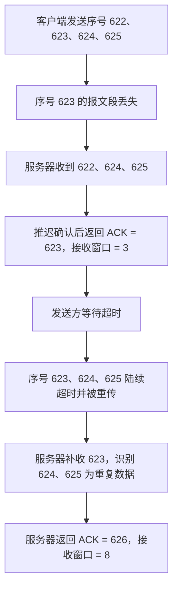
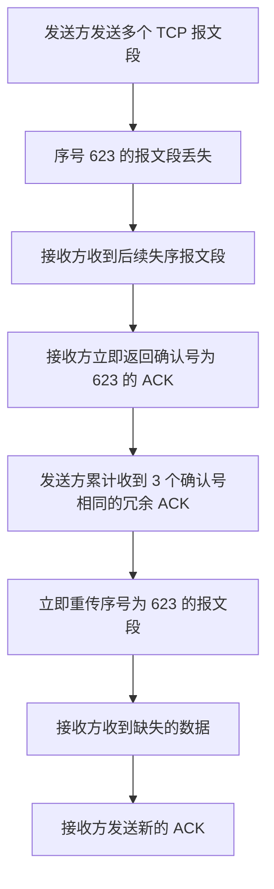
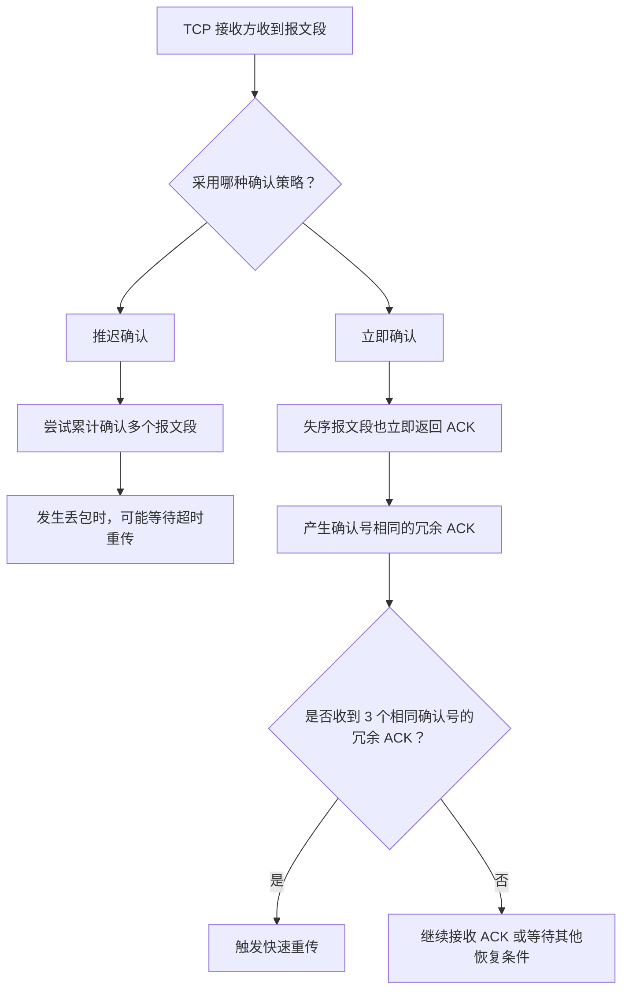

# TCP 可靠传输与流量控制：快速重传

## 一、为什么需要快速重传？

上一节学习了 TCP 的可靠传输与流量控制。本节补充可靠传输的最后一个内容：**快速重传（Fast Retransmit）**。

TCP 使用**累计确认（Cumulative ACK）**机制。接收方如果适当推迟返回 ACK 的时机，就有机会一次确认多个连续到达的报文段，从而减少 ACK 的数量。

例如，接收方收到第一个 TCP 报文段后，可以先等待一小段时间（本例中不超过 **0.5 秒**）。如果在这段时间内又收到其他报文段，就可以利用累计确认规则，最终只返回一个 ACK，确认多个报文段。

不过，推迟确认也有缺点：如果多个报文段中有个别报文段丢失，接收方可能迟迟无法确认后续数据，发送方也可能只能等待超时。这样会导致已经成功到达的报文段也被重复传输。

因此，本节通过两个例子比较：

- **左侧例子：推迟确认**，依靠超时重传恢复丢失的数据。
- **右侧例子：立即确认**，配合快速重传，尽早重传丢失的数据。

---

## 二、例一：推迟确认与超时重传

### 2.1 初始条件

假设：

- 左侧是客户端，负责发送数据；右侧是服务器，负责接收数据。
- 客户端连续向服务器发送 4 个 TCP 报文段。
- 每个 TCP 报文段都只携带 **1 字节**的数据。
- 这 4 个字节的序号依次为 `622`、`623`、`624`、`625`。
- 传输过程中，序号为 `623` 的报文段丢失，其他报文段均顺利到达。
- 接收方采用推迟确认策略，推迟时间不能超过 **0.5 秒**。

### 2.2 四个报文段的到达情况

| 报文段序号 | 是否到达服务器 | 说明                       |
| ---------: | -------------- | -------------------------- |
|        622 | 到达           | 正常接收                   |
|        623 | 丢失           | 服务器缺少这个字节         |
|        624 | 到达           | 失序到达，暂时不能按序交付 |
|        625 | 到达           | 失序到达，暂时不能按序交付 |

虽然服务器已经收到了序号为 `624` 和 `625` 的数据，但由于序号 `623` 缺失，接收方仍然期待的下一个按序字节是 `623`。

### 2.3 服务器返回 ACK = 623，接收窗口 = 3

由于采用推迟确认策略，假设服务器在 0.5 秒内收到了序号为 `622`、`624` 和 `625` 的报文段。等待时间到达后，服务器不得不返回 ACK。

此时，服务器返回：

- **确认号（ACK）= 623**
- **接收窗口（rwnd）= 3**

确认号 `623` 表示：**序号 `623` 之前的字节都已经按序收到，服务器接下来期待接收序号为 `623` 的字节。**

接收窗口为 `3`，表示服务器当前通告客户端：从序号 `623` 开始，后续还可以接收 3 个字节。

这里需要特别注意：**不能仅仅根据接收缓冲区还剩多少空位，就判断接收窗口应该通告多大。确认号和接收窗口需要结合起来理解。**

客户端收到 ACK 后，可以确定序号为 `622` 的字节已经被接收，因此不必再将它保留在发送缓冲区中。同时，根据服务器通告的接收窗口大小，客户端的发送窗口也相应调整。

### 2.4 为什么会出现不必要的重传？

此时，客户端已经发送了序号为 `623`、`624`、`625` 的报文段，但还没有收到能够确认这些数据的 ACK。只要这些报文段的超时重传计时器尚未超时，客户端就不会立即重发它们。

接下来，序号为 `623` 的报文段首先超时。随后，序号为 `624` 和 `625` 的报文段也陆续超时，于是客户端依次重传这三个报文段。

但是，服务器其实早已成功收到序号为 `624` 和 `625` 的数据。因此，这两个报文段的重传是**不必要的重复传输**。

### 2.5 重传后的结果

假设这次三个报文段都顺利到达服务器：

1. 服务器发现序号为 `624` 和 `625` 的数据属于重复报文段。
2. 服务器只需要补上之前缺失的序号 `623` 的字节。
3. 服务器期待的下一个序号变为 `626`，因此返回 **ACK = 626**。
4. 在接收缓冲区中的数据交给应用层后，假设接收窗口恢复为 `8`，服务器就通告 **接收窗口 = 8**。
5. 客户端收到 ACK 后，确认这三个报文段对应的数据已经被接收，并将它们移出发送缓冲区。
6. 随着发送缓冲区腾出空间，客户端可以读入新数据，发送窗口相应调整为 `8`。

### 2.6 推迟确认示意图

**这个例子反映的主要问题：**推迟确认虽然能发挥累计确认的优势，但当个别报文段丢失时，后续已经成功到达的报文段也可能因为等待超时而被重复传输。

---

## 三、例二：立即确认与快速重传

### 3.1 立即确认的基本策略

为了解决上面的问题，可以采用**立即确认**策略：

- 接收方每收到一个 TCP 报文段，就立即返回 ACK。
- 即使收到的是失序到达的报文段，也要立即返回 ACK。
- 如果接收方发现中间有字节缺失，就会反复确认自己当前期待的最早字节序号。

例如，序号 `623` 的报文段丢失，而后续的序号 `624`、`625` 等报文段到达服务器。由于 `623` 尚未收到，服务器返回的确认号仍然只能是 `623`。

因此，发送方会在较短时间内连续收到多个确认号相同的 ACK。

### 3.2 什么是冗余 ACK？

当服务器收到失序报文段时，它虽然收到了后续数据，但因为缺少前面的字节，仍然期待序号为 `623` 的数据。因此，它返回的确认号依旧是 `623`。

如果后续失序报文段继续到达，服务器会继续返回确认号为 `623` 的 ACK。这些重复的确认称为**冗余 ACK**，也常称为**重复 ACK（Duplicate ACK）**。

### 3.3 快速重传的触发条件

**快速重传机制：发送方连续收到 3 个确认号相同的冗余 ACK 时，就立即重传与该确认号对应的、尚未被确认的报文段，而不必等待超时重传计时器到期。**

例如，发送方连续收到 3 个确认号均为 `623` 的冗余 ACK，就可以立即重传携带序号 `623` 的报文段。

重传时机因此大大提前：原本需要等到计时器超时之后才能重传的数据，现在在收到第 3 个冗余 ACK 时就可以被重传。

### 3.4 快速重传的过程

1. 客户端发送多个 TCP 报文段，其中序号为 `623` 的报文段丢失。
2. 服务器收到后续失序报文段时，立即返回确认号为 `623` 的 ACK。
3. 客户端连续收到 3 个确认号相同的冗余 ACK。
4. 客户端立即重传序号为 `623` 的报文段。
5. 服务器收到缺失的报文段后，可以尽早按序接收数据，并发送新的 ACK。
6. 发送方依据新的 ACK 更新发送缓冲区和发送窗口。

这样，原本已经成功到达的数据不必仅仅因为某个报文段丢失，就跟着一起等待超时并被重复发送。

### 3.5 快速重传示意图

### 3.6 快速重传的优势

快速重传与单纯依赖超时重传相比，有以下优势：

- **重传更及时：**不必等到超时重传计时器到期。
- **减少无效重传：**已经顺利送达的数据不必仅仅因为前面的报文段丢失而再次传输。
- **提高传输效率：**实际应用中，一个 TCP 报文段携带的数据可能达到约 `1 KB`，甚至更多。如果重复传输大量已经到达的数据，会造成明显的资源浪费；快速重传可以减少这类开销。

---

## 四、推迟确认与快速重传对比

| 对比项目         | 推迟确认                                       | 立即确认 + 快速重传                            |
| ---------------- | ---------------------------------------------- | ---------------------------------------------- |
| ACK 返回时机     | 接收方可以适当等待，尝试累计确认               | 每收到一个报文段就立即返回 ACK，包括失序报文段 |
| 主要优势         | 有机会用一个 ACK 确认多个报文段，减少 ACK 数量 | 可以利用重复 ACK 尽早发现缺失的数据            |
| 丢包后的恢复方式 | 可能需要等待超时重传                           | 收到 3 个确认号相同的冗余 ACK 后立即重传       |
| 可能的问题       | 后续已到达的报文段可能也因超时而被重复传输     | 需要通过重复 ACK 触发快速重传                  |
| 关键理解         | 利用累计确认，但可能增加等待时间               | 利用冗余 ACK 提前触发重传                      |

---

## 五、核心机制关系

本讲强调的配合关系是：**快速重传依靠冗余 ACK 触发，而立即确认有助于及时产生冗余 ACK。**立即确认是推迟确认的反面，即接收方收到报文段后立即确认，包括失序到达的报文段。

---

## 六、考点总结

1. **累计确认：**确认号表示接收方下一个期待收到的字节序号。确认号为 `623`，意味着序号 `623` 之前的数据已经按序收到，接收方接下来期待序号 `623`。
2. **接收窗口：**接收窗口与确认号需要结合起来理解。确认号指出接收方期待的起始序号，接收窗口说明接收方当前还可以接收多少字节。
3. **推迟确认的优缺点：**推迟 ACK 可能让一个 ACK 确认多个报文段，但个别报文段丢失时，可能导致其他已经到达的报文段也被不必要地重传。
4. **立即确认：**接收方每收到一个 TCP 报文段就立即返回 ACK；即使报文段失序到达，也应立即返回 ACK。
5. **冗余 ACK：**由于缺少前面的数据，接收方可能连续返回多个确认号相同的 ACK。
6. **快速重传：**发送方连续收到 3 个确认号相同的冗余 ACK 后，立即重传该确认号所指向的缺失报文段，不必等待超时。
7. **效率提升：**快速重传使丢失的数据更早得到重传，并减少已经成功到达的数据被重复传输的情况。

至此，本讲关于 **TCP 可靠传输与流量控制** 的内容补充完毕。
