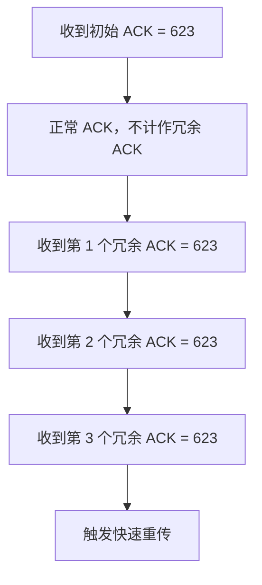
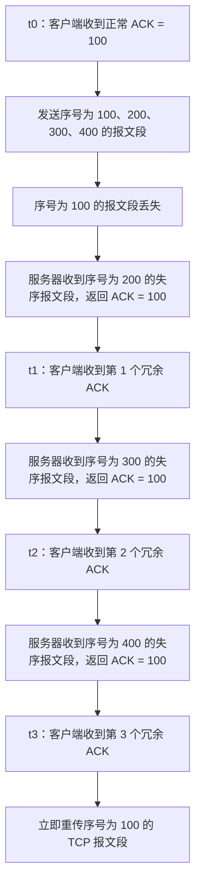

# TCP 快速重传机制：冗余 ACK 的计数细节

> **核心修正：**触发快速重传的是发送方收到的**第 3 个冗余 ACK**，不是把最开始那个正常 ACK 算进去。换句话说，若把初始的正常 ACK 也计入相同确认号的 ACK 总数，就是连续收到 **1 个正常 ACK + 3 个冗余 ACK** 时触发快速重传。

## 一、修正之前容易产生的误解

在前面的学习中，我们介绍过 TCP 的快速重传机制：

- 当数据发送方收到 **3 个确认号相同的冗余 ACK** 时，就会立即重传相应的报文段。
- 这里需要注意：**第一个 ACK 不属于冗余 ACK**，只有后面额外收到的三个相同确认号 ACK 才是冗余 ACK。
- 因此，不能把最初那个合理、合法的 ACK 算作冗余 ACK。

教材中常见的“当发送方收到三个确认号相同的冗余 ACK 时，就立即重传”这一说法，理解时一定要保留“**冗余**”这个限定。

## 二、什么时候触发快速重传？

假设发送方最初收到一个正常的 `ACK = 623`。之后，如果接收方因为收到失序报文段而连续返回三个 `ACK = 623`，那么：

1. 第一个 `ACK = 623` 是正常 ACK，不计入冗余 ACK。
2. 后续第一个相同确认号的 ACK，是第 1 个冗余 ACK。
3. 后续第二个相同确认号的 ACK，是第 2 个冗余 ACK。
4. 后续第三个相同确认号的 ACK，是第 3 个冗余 ACK；**此时触发快速重传**。

因此，也可以把规则理解为：

> 当发送方连续收到 **1 个正常 ACK + 3 个确认号相同的冗余 ACK** 时，会触发快速重传。严格来说，触发条件是收到第 3 个冗余 ACK 的那个时刻。

### Mermaid 图：ACK 的计数方式

## 三、2019 年考研真题第 38 题

### 1. 题目条件

客户通过一条 TCP 连接向服务器发送数据，题目给出了以下过程：

1. 客户端在 \(t_0\) 时刻第一次收到服务器发来的 `ACK = 100`。
2. 收到该 ACK 后，客户端发送序号分别为 `100`、`200`、`300`、`400` 的四个 TCP 报文段。
3. 由于序号为 `100` 的报文段丢失，服务器收到序号为 `200`、`300`、`400` 的三个失序报文段。
4. 每收到一个失序报文段，服务器都会立即返回 `ACK = 100`。
5. 客户端分别在 \(t_1\)、\(t_2\)、\(t_3\) 时刻收到这三个确认号相同的冗余 ACK。

### 2. 分析过程

| 时刻    | 客户端收到的 ACK | ACK 的性质      | 冗余 ACK 计数 | 是否触发快速重传 |
| ------- | ---------------- | --------------- | ------------: | ---------------- |
| \(t_0\) | `ACK = 100`      | 初始正常 ACK    |             0 | 否               |
| \(t_1\) | `ACK = 100`      | 第 1 个冗余 ACK |             1 | 否               |
| \(t_2\) | `ACK = 100`      | 第 2 个冗余 ACK |             2 | 否               |
| \(t_3\) | `ACK = 100`      | 第 3 个冗余 ACK |             3 | **是**           |

因此，客户端在 **\(t_3\) 时刻**触发快速重传，重新发送序号为 `100` 的 TCP 报文段。该题选择 **C 选项**。

### Mermaid 图：真题中的重传时刻

## 四、考点总结

| 表述                            | 正确理解                                       |
| ------------------------------- | ---------------------------------------------- |
| 收到三个确认号相同的冗余 ACK    | 收到第 3 个冗余 ACK 时，触发快速重传           |
| 初始的正常 ACK 是否计入冗余 ACK | **不计入**                                     |
| 若把初始正常 ACK 也一起计数     | 可理解为总共出现 `1 个正常 ACK + 3 个冗余 ACK` |
| 2019 年第 38 题的重传时刻       | \(t_3\)                                        |
| 需要重传的报文段                | 序号为 `100` 的 TCP 报文段                     |

### 记忆口诀

**正常 ACK 不算数，第三个冗余 ACK 到达时，立即快速重传。**

在可靠传输的总结思维导图中，可以补充以下表述：

- **严谨表述：**发送方连续收到三个确认号相同的冗余 ACK 时，立即重传该确认号所对应、尚未被确认的数据报文段。
- **辅助理解：**如果把前面的正常 ACK 也算在内，就是收到 `1 个正常 ACK + 3 个冗余 ACK` 后触发快速重传。

> 注意：上面“连续收到 1 + 3 个相同确认号的 ACK”是为了帮助理解计数方式；快速重传的直接触发条件仍然是**收到第 3 个冗余 ACK**。
