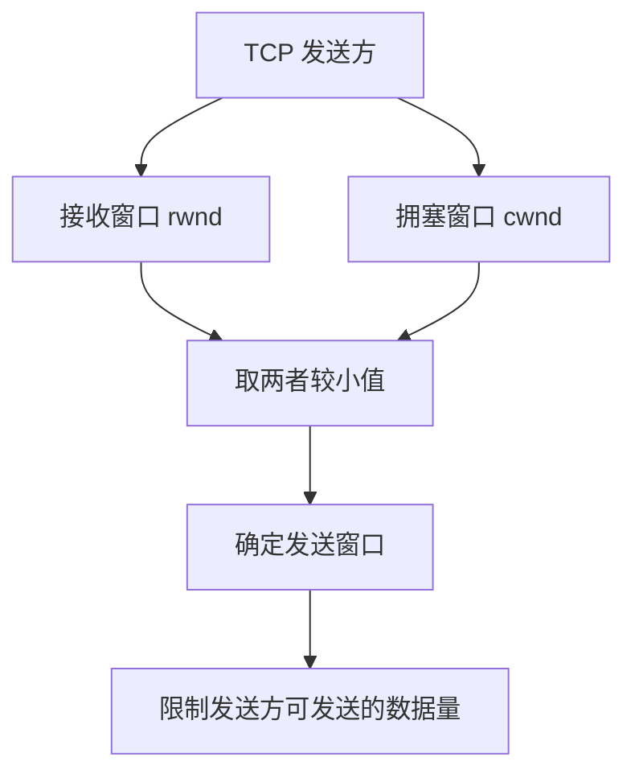
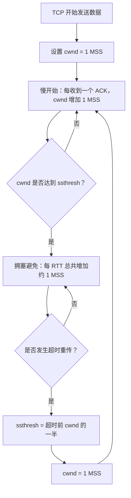

# TCP 拥塞控制

> 408 / 计算机网络 · 传输层  
> 本笔记根据课程字幕整理，主要优化标题层级、段落、表格和示意图；保留核心讲解、算法过程与真题推演。

## 一、考点概览

TCP 拥塞控制主要涉及以下算法：

1. **慢开始（Slow Start）**
2. **拥塞避免（Congestion Avoidance）**
3. **快恢复（Fast Recovery）**

对于考研 408，重点掌握**慢开始算法**和**拥塞避免算法**。历年相关真题主要围绕这两个算法展开。快恢复算法的触发条件与快重传有关：当发送方收到 **3 个冗余 ACK**、触发快重传时，会进入快恢复相关处理；本节先学习前两个算法，快恢复留到后续内容。

## 二、拥塞控制与流量控制

初学者容易把拥塞控制和流量控制混淆。两者都可能通过限制发送窗口来控制发送速度，但解决的问题不同。

| 对比项     | 流量控制                                     | 拥塞控制                                       |
| ---------- | -------------------------------------------- | ---------------------------------------------- |
| 解决的问题 | 避免发送方发送过快，导致接收方来不及接收     | 避免注入网络的数据过多，超过网络的承载能力     |
| 关注范围   | 发送方与接收方之间的端到端问题，属于局部问题 | 整个网络中的主机、路由器及其负载，属于全局问题 |
| 主要依据   | 接收窗口 `rwnd`                              | 拥塞窗口 `cwnd`                                |
| 反映的能力 | 接收方接收数据的能力                         | 当前网络传输数据的能力                         |
| 调整目的   | 让发送速率与接收方的处理、缓存能力相适应     | 降低网络负载，缓解拥塞                         |

### 2.1 流量控制：解决接收方的压力

假设主机 A 与主机 D 上的两个进程通过 TCP 连接进行通信。流量控制要控制这条 TCP 连接双方发送数据的速度，避免接收方缓存被过快填满。

流量控制主要关注**一条 TCP 连接的接收端**，属于端到端的局部问题。

### 2.2 拥塞控制：解决整个网络的压力

一个网络可能由许多路由器组成，并连接着多台主机。如果学校网络在高峰时段有大量主机同时刷视频、玩游戏或传输数据，所有主机都向网络注入大量数据，路由器的负载就会变大。

当主机注入的数据量超过网络的传输能力时，网络中的路由器可能来不及接收或转发数据，进而出现丢包。用户感受到的“整个网络都很卡”，就是网络发生拥塞时可能出现的现象。

缓解拥塞最直接的思路是：**减少各台主机向网络发送的数据量**。当多台主机都降低发送量时，整个网络的负载就有机会下降。

### 2.3 发送窗口同时受两种窗口限制

流量控制使用接收窗口，拥塞控制使用拥塞窗口：

- `rwnd`（接收窗口）：反映接收方当前能够接收的数据量。
- `cwnd`（拥塞窗口）：反映发送方根据网络拥塞情况允许发送的数据量。

发送方的发送窗口不能超过这两个窗口中的任意一个，因此：

\[
\boxed{\text{发送窗口}=\min(\text{接收窗口 rwnd},\ \text{拥塞窗口 cwnd})}
\]

这里的窗口大小应结合题目给出的单位理解。若以 MSS 为单位记录窗口值，那么窗口值 `cwnd = 8` 表示窗口大小为 `8 × MSS`，而不是直接表示 8 KB。

当发送方检测到网络拥塞时，可以降低自己的拥塞窗口 `cwnd`。拥塞窗口变小，发送窗口也会受到限制，发送方往网络中继续注入的数据量便会减少。如果多台主机都采取相应措施，整个网络的负载就可能下降。

## 三、如何判断网络是否拥塞

拥塞控制需要先判断网络状态，再决定如何调整拥塞窗口。

| 发送方观察到的现象                       | 对网络状态的判断                                             | 处理思路                         |
| ---------------------------------------- | ------------------------------------------------------------ | -------------------------------- |
| TCP 报文段都能顺利收到 ACK，没有发生超时 | 数据传输较顺利，通常认为没有检测到拥塞                       | 继续按照当前算法调整窗口         |
| TCP 报文段发生超时重传                   | 认为网络可能发生了比较严重的拥塞                             | 迅速减小拥塞窗口                 |
| 收到冗余 ACK，并触发快重传               | 认为网络可能有一定程度的拥塞，但通常没有超时所代表的情况严重 | 适当降低拥塞窗口；涉及快恢复算法 |

### 3.1 为什么超时通常表示严重拥塞

例如，主机 C 发出一个 TCP 报文段。该报文段在网络层被封装为 IP 数据报。当 IP 数据报到达某台路由器时，如果路由器的负载过大，来不及接收或转发数据，就可能发生丢包。

如果数据发送方迟迟收不到相应 ACK，最终发生超时重传，就说明数据传输遇到了比较严重的问题。因此，TCP 会在超时后大幅缩小拥塞窗口。

### 3.2 为什么冗余 ACK 表示的拥塞程度相对较轻

假设发送方发出了 4 个 TCP 报文段，其中 3 个顺利到达，另一个可能丢失。接收方仍然能够对已收到的报文段作出确认，发送方因而可能收到冗余 ACK 并触发快重传。

这表示网络仍能够传送部分数据，只是可能出现了丢包，所以可以认为网络有一定程度的拥塞。具体的拥塞窗口调整属于快恢复相关内容；与超时不同，这种情况**不会把拥塞窗口直接降回 1 MSS**。

## 四、拥塞控制的总体思路

从发送方角度看，可以把 TCP 拥塞控制的基本思路概括如下：

- **未检测到拥塞**：根据当前阶段的算法逐步增大拥塞窗口。
- **发生超时重传**：认为出现了严重拥塞，拥塞窗口降为 1 MSS，并重新执行慢开始；慢开始门限调整为发生超时前拥塞窗口的一半。
- **收到冗余 ACK 并触发快重传**：认为可能出现一定程度的拥塞，采取相应的窗口调整；快恢复算法在后续内容中讨论。

其中：

- **慢开始算法**：刚开始传输数据时使用；超时后也会重新开始。它在窗口较小时使拥塞窗口较快增长。
- **拥塞避免算法**：拥塞窗口达到慢开始门限后使用，谨慎地增大窗口。
- **快恢复算法**：与收到冗余 ACK、触发快重传的情况相关。

## 五、真题的常见前提与单位

分析拥塞控制题目之前，先确认题目默认条件。历年真题通常有以下特点。

### 5.1 经常与流量控制综合考查

发送窗口同时受到接收窗口和拥塞窗口的限制。若题目没有讨论接收窗口，或者明确假设接收窗口足够大，就可以只分析拥塞窗口。

本节第一个示例为简化分析，假设接收方的接收窗口足够大，因此：

\[
\text{发送窗口}=\text{拥塞窗口}
\]

2015 年的真题则需要同时考虑接收窗口与拥塞窗口。

### 5.2 通常只分析单向数据传输

真题通常假设 TCP 连接的一方持续发送数据，另一方没有数据需要发送，只返回纯 ACK 报文段。这样可以降低分析的复杂程度。

### 5.3 TCP 报文段通常满载数据

题目经常说明 TCP 连接始终以最大段长 MSS 发送数据。例如，若题目给出 `MSS = 1 KB`，就表示每个满载 TCP 报文段携带 1 KB 数据。

### 5.4 拥塞窗口经常以 MSS 的倍数表示

分析图表或真题时，拥塞窗口的数值通常以 MSS 为单位。

例如：

- `cwnd = 1`：窗口大小为 `1 × MSS`。
- `cwnd = 8`：窗口大小为 `8 × MSS`。
- 若 `MSS = 1 KB` 且 `cwnd = 8`，则拥塞窗口大小为 8 KB。
- 若 `MSS = 2 KB` 且 `cwnd = 9`，则拥塞窗口大小为 18 KB。

因此，要区分**窗口值是 MSS 的倍数**，还是题目要求的 KB 等实际容量。

### 5.5 接收方立即确认

拥塞控制真题通常默认接收方收到一个报文段后立即返回 ACK，即使收到的是失序报文段也会立即确认。这种确认方式可能产生冗余 ACK，并进一步触发快重传。

## 六、两个核心算法

### 6.1 慢开始算法（Slow Start）

TCP 连接刚开始发送数据时，发送方还不确定网络的承载能力，所以不能一开始就发送大量数据。慢开始算法使拥塞窗口从较小的值开始，再逐步增加。

基本规则：

1. 初始拥塞窗口通常设为 `cwnd = 1 MSS`（本节例子采用这个起点）。
2. **每收到一个 ACK，拥塞窗口就增加 1 MSS**。
3. 因此，在一个 RTT 内，如果当前窗口允许发送并成功确认了 `cwnd` 个满载报文段，拥塞窗口就会从 `cwnd` 增长到 `2 × cwnd`。
4. 在慢开始阶段，拥塞窗口通常每经过一个 RTT 翻倍，表现为指数增长。
5. 当拥塞窗口达到或超过慢开始门限 `ssthresh` 时，转入拥塞避免阶段。本节图例中若下一次翻倍会超过门限，则按图示将增长限制到门限处。

> **关键记忆：** 慢开始不是“每经过一个 RTT 只加 1”，而是“每收到一个 ACK 加 1 MSS”。由于一个 RTT 内可能收到多个 ACK，所以在该阶段拥塞窗口通常每 RTT 翻倍。

### 6.2 拥塞避免算法（Congestion Avoidance）

当拥塞窗口达到慢开始门限后，发送方需要更加谨慎地探测网络承载能力，避免窗口持续快速翻倍。

基本规则：

1. 当 `cwnd >= ssthresh` 时，采用拥塞避免算法。
2. 一个 RTT 内即使收到了多个 ACK，也只让拥塞窗口总共增加约 1 MSS。
3. 因此，拥塞避免阶段的拥塞窗口通常每经过一个 RTT 线性增加 1 MSS。

> **关键记忆：** 慢开始阶段通常每 RTT 翻倍；拥塞避免阶段通常每 RTT 加 1 MSS。

### 6.3 两个算法对比

| 对比项            | 慢开始                             | 拥塞避免                                   |
| ----------------- | ---------------------------------- | ------------------------------------------ |
| 典型使用时机      | TCP 刚开始传输；超时后重新开始     | 拥塞窗口达到慢开始门限后                   |
| ACK 到达时的规则  | 每收到一个 ACK，`cwnd` 增加 1 MSS  | 一个 RTT 内总共只增加约 1 MSS              |
| 每 RTT 的典型变化 | 窗口翻倍，指数增长                 | 窗口增加 1 MSS，线性增长                   |
| 主要目的          | 从较小的窗口开始，较快探测网络能力 | 更谨慎地增大窗口                           |
| 遇到超时后        | 重新开始慢开始，窗口降为 1 MSS     | 不再继续原来的增长过程，转入重新开始的过程 |

## 七、慢开始门限 `ssthresh`

`ssthresh` 的含义是**慢开始门限**。在部分真题或教材表述中，也会直接称为“拥塞控制阈值”或简称“阈值”。

它是决定拥塞窗口增长方式的分界线：

- 当 `cwnd < ssthresh` 时，处于慢开始阶段。
- 当 `cwnd >= ssthresh` 时，进入拥塞避免阶段。
- 超时重传发生时，慢开始门限通常设置为**发生超时前拥塞窗口的一半**。

例如，若初始门限为 16 MSS：

- `cwnd` 从 1 开始，在慢开始阶段依次增长为 2、4、8、16。
- 达到门限 16 后，转入拥塞避免阶段。
- 后续每个 RTT，窗口只增加 1，变为 17、18、19……。

可以把 `ssthresh` 理解为一个“增长策略分界线”：分界线以下，窗口增长得较快；达到分界线后，窗口增长得较慢。

## 八、图示例子：先慢开始，再拥塞避免，随后发生超时

本节采用以下条件：

- 初始慢开始门限：`ssthresh = 16 MSS`。
- 初始拥塞窗口：`cwnd = 1 MSS`。
- 接收窗口足够大，所以发送窗口等于拥塞窗口。
- 每个 TCP 报文段都满载数据，接收方立即确认。
- 横轴用 RTT 的倍数表示时间，纵轴用 MSS 的倍数表示拥塞窗口。

### 8.1 如何看图

- **横轴**：传输轮次，本质上表示时间，以 RTT 为单位。例如，横轴上的 4 表示从 0 时刻开始经过 4 个 RTT。
- **纵轴**：拥塞窗口大小，以 MSS 为单位。例如，`cwnd = 16` 表示拥塞窗口大小为 `16 × MSS`。
- **门限 `ssthresh`**：决定采用慢开始还是拥塞避免的分界线。

### 8.2 初始慢开始阶段

初始 `cwnd = 1`，`ssthresh = 16`。

在 `t = 0` 时，发送方只能发送 1 个满载 TCP 报文段。接收方收到后立即返回 ACK，发送方每收到一个 ACK，就将拥塞窗口增加 1。

于是每一轮的变化如下：

| 时间（RTT） | 该轮开始时可发送的报文段数（约） | ACK 到达后窗口变化 | 该时刻的 `cwnd` |
| ----------: | -------------------------------: | ------------------ | --------------: |
|           0 |                                1 | 初始值             |               1 |
|           1 |                                1 | `1 + 1`            |               2 |
|           2 |                                2 | `2 + 2`            |               4 |
|           3 |                                4 | `4 + 4`            |               8 |
|           4 |                                8 | `8 + 8`            |              16 |

因为每轮发送的报文段得到确认后，拥塞窗口会按 ACK 数量增加，所以窗口通常每经过一个 RTT 翻倍。当 `cwnd` 达到门限 16 时，慢开始阶段结束。

### 8.3 转入拥塞避免阶段

当 `cwnd = 16` 时，发送方可以发送 16 个满载 TCP 报文段。虽然接收方会返回 16 个 ACK，但拥塞避免算法规定一个 RTT 内拥塞窗口总共只增加约 1 MSS。

因此，后续的变化为：

| 时间（RTT） | `cwnd` | 所处阶段               |
| ----------: | -----: | ---------------------- |
|           4 |     16 | 到达门限，转入拥塞避免 |
|           5 |     17 | 拥塞避免               |
|           6 |     18 | 拥塞避免               |
|           7 |     19 | 拥塞避免               |
|           8 |     20 | 拥塞避免               |
|           9 |     21 | 拥塞避免               |
|          10 |     22 | 拥塞避免               |
|          11 |     23 | 拥塞避免               |
|          12 |     24 | 拥塞避免               |

### 8.4 第 12 至第 13 个 RTT 发生超时

假设在第 12 个 RTT 到第 13 个 RTT 之间，发送方发出的某个或某些报文段发生了超时重传。

超时代表可能发生了严重拥塞，TCP 需要迅速限制发送量。本例在超时发生时进行以下调整：

1. 超时前 `cwnd = 24`。
2. 慢开始门限设为超时前拥塞窗口的一半：

   \[
   ssthresh = \frac{24}{2}=12
   \]

3. 拥塞窗口重新设置为 `cwnd = 1 MSS`。
4. 重新执行慢开始算法。

因此，门限从原来的 16 变成 12，拥塞窗口从 24 降到 1。

> 注意：这里将拥塞窗口降为 1 MSS 的触发事件是**超时重传**。若只是收到冗余 ACK 并触发快重传，不会采用同样的“直接降为 1”处理。

### 8.5 超时后的第二轮增长

门限已经变成 `ssthresh = 12`，拥塞窗口从 1 开始重新增长：

| 时间（RTT） | `cwnd` | 说明                                      |
| ----------: | -----: | ----------------------------------------- |
|          13 |      1 | 超时后重新开始慢开始                      |
|          14 |      2 | 慢开始                                    |
|          15 |      4 | 慢开始                                    |
|          16 |      8 | 慢开始                                    |
|          17 |     12 | 下一次翻倍将超过门限，本例按门限限制到 12 |
|          18 |     13 | 转入拥塞避免                              |
|          19 |     14 | 拥塞避免                                  |
|          20 |     15 | 拥塞避免                                  |
|          21 |     16 | 拥塞避免                                  |

### 8.6 算法切换示意图

## 九、超时重传与冗余 ACK：必须区分

| 事件                      | 对拥塞程度的判断           | 本节重点涉及的处理                                                 |
| ------------------------- | -------------------------- | ------------------------------------------------------------------ |
| **超时重传**              | 认为可能发生严重拥塞       | `ssthresh` 设为超时前 `cwnd` 的一半；`cwnd` 降为 1 MSS；重新慢开始 |
| **冗余 ACK 并触发快重传** | 认为可能发生一定程度的拥塞 | 与快恢复算法相关；不能把拥塞窗口直接降为 1 MSS                     |

本节重点是慢开始和拥塞避免。快恢复算法用于处理收到冗余 ACK、触发快重传时的相关窗口调整，将在后续内容中学习。

## 十、2009 年真题：超时之后 4 个 RTT 的拥塞窗口

### 题目条件

某 TCP 连接总是以 `MSS = 1 KB` 的最大段长发送 TCP 段。发送方有足够多的数据要发送。当拥塞窗口为 16 KB 时发生超时。假设超时后接下来的 4 个 RTT 内，所有 TCP 段的传输都成功。问：当第 4 个 RTT 内发送的所有 TCP 段都得到肯定应答后，拥塞窗口大小是多少？

### 解题步骤

先记下单位：

- `MSS = 1 KB`。
- 超时前拥塞窗口为 `16 KB = 16 MSS`。
- 以下用 MSS 为单位记录 `cwnd` 和 `ssthresh`。

发生超时后：

\[
ssthresh = \frac{16}{2}=8,\qquad cwnd=1
\]

将超时发生的时刻记为 `t = 0`。

| RTT 时刻 | `ssthresh`（MSS） | `cwnd`（MSS） | 变化过程                        |
| -------: | ----------------: | ------------: | ------------------------------- |
|        0 |                 8 |             1 | 超时后窗口降为 1，重新慢开始    |
|        1 |                 8 |             2 | 慢开始，窗口翻倍                |
|        2 |                 8 |             4 | 慢开始，窗口翻倍                |
|        3 |                 8 |             8 | 达到门限                        |
|        4 |                 8 |             9 | 进入拥塞避免，本 RTT 总共增加 1 |

第 4 个 RTT 结束、该轮发送的报文段均得到 ACK 后，拥塞窗口为：

\[
cwnd=9\ \text{MSS}=9\times1\text{ KB}=9\text{ KB}
\]

**答案：9 KB（若选项以 MSS 的倍数表示，则为 9 MSS）。**

> 做题时要先明确题目问的是第几个 RTT 结束后的窗口；不要把“发送前的窗口”和“收到本轮所有 ACK 后的窗口”混淆。

## 十一、2015 年真题：同时考虑拥塞窗口与接收窗口

### 题目条件

主机甲和主机乙建立 TCP 连接。已知：

- 甲的初始慢开始门限为 `32 KB`。
- 甲始终以 `MSS = 1 KB` 发送数据。
- 甲一直有数据要发送。
- 乙为该连接分配了 `16 KB` 的接收缓存。
- 乙对每一个数据段都进行确认，即采用立即确认。
- 忽略报文段的传输时延，只考虑传播时延。
- 乙收到的数据全部存入缓存且不会被取走。
- 没有发生发送超时。
- 问：从连接建立成功时刻起，经过 4 个 RTT 后，甲的发送窗口是多少？

### 11.1 先理解接收窗口为什么会变化

乙的接收缓存总容量为 16 KB，且已收到的数据会一直留在缓存中，不会被应用层取走。因此，缓存剩余空间会不断减少，接收窗口也随之减小。

由于 `MSS = 1 KB`，每收到一个满载报文段，缓存可用空间就减少 1 KB。

发送窗口同时受到接收窗口和拥塞窗口限制：

\[
\text{发送窗口}=\min(rwnd,cwnd)
\]

本题需要同时跟踪三个窗口值，以及慢开始门限。

### 11.2 逐 RTT 分析

用 MSS（即 1 KB）为单位记录窗口大小。初始门限 `ssthresh = 32`，接收窗口初始为 16，初始拥塞窗口为 1。

| RTT 时刻 | 门限 `ssthresh` | 拥塞窗口 `cwnd` | 接收窗口 `rwnd` | 发送窗口 `min(cwnd, rwnd)` | 说明                                          |
| -------: | --------------: | --------------: | --------------: | -------------------------: | --------------------------------------------- |
|        0 |              32 |               1 |              16 |                          1 | 初始窗口为 1，只能发送 1 个报文段             |
|        1 |              32 |               2 |              15 |                          2 | 收到 1 个 ACK 后，拥塞窗口增至 2；缓存少 1 KB |
|        2 |              32 |               4 |              13 |                          4 | 发送 2 个报文段后，接收窗口由 15 降至 13      |
|        3 |              32 |               8 |               9 |                          8 | 发送 4 个报文段后，接收窗口由 13 降至 9       |
|        4 |              32 |              16 |               1 |                          1 | 发送 8 个报文段后，接收窗口只剩 1 KB          |

解释：

1. **`t = 0`**：初始 `cwnd = 1`、`rwnd = 16`，所以发送窗口为 1。甲发送 1 个报文段后，乙的接收窗口剩余 15。
2. **`t = 1 RTT`**：慢开始使 `cwnd = 2`，接收窗口为 15，发送窗口为 2。甲发送 2 个报文段后，接收窗口剩余 13。
3. **`t = 2 RTT`**：拥塞窗口变成 4，接收窗口为 13，发送窗口为 4。甲发送 4 个报文段后，接收窗口剩余 9。
4. **`t = 3 RTT`**：拥塞窗口变成 8，接收窗口为 9，发送窗口为 8。甲发送 8 个报文段后，接收窗口只剩 1。
5. **`t = 4 RTT`**：拥塞窗口在门限 32 以内，按慢开始继续增长到 16；但接收窗口只剩 1，因此发送窗口取两者较小值，即 1。

所以，经过 4 个 RTT 后：

\[
\text{发送窗口}=\min(16,1)=1\text{ KB}
\]

**答案：1 KB（对应选项 A）。**

### 11.3 两道题的区别

| 题目      | 是否考虑接收窗口                     | 关键条件                                              | 结论                                                 |
| --------- | ------------------------------------ | ----------------------------------------------------- | ---------------------------------------------------- |
| 2009 年题 | 不需要单独考虑，题目只考拥塞窗口变化 | 超时前 `cwnd = 16 MSS`，超时后连续 4 个 RTT 成功      | `cwnd = 9 MSS = 9 KB`                                |
| 2015 年题 | 需要                                 | 接收缓存为 16 KB，收到的数据不被取走，`rwnd` 不断减小 | 4 个 RTT 后 `cwnd = 16`、`rwnd = 1`，发送窗口为 1 KB |

## 十二、做题方法总结

分析拥塞控制题目时，建议按以下顺序进行：

1. **先记下 MSS**：区分题目给出的窗口值究竟是 MSS 的倍数，还是 KB 等实际容量。
2. **记下初始门限与初始拥塞窗口**：本节例子中，初始 `cwnd = 1 MSS`。
3. **判断事件类型**：超时重传与冗余 ACK 触发的快重传不能混淆。
4. **每经过一个 RTT 更新窗口**：
   - 慢开始阶段：每收到一个 ACK，`cwnd` 增加 1 MSS，窗口通常每 RTT 翻倍。
   - 拥塞避免阶段：每 RTT 总共增加约 1 MSS。
5. **遇到超时就重新计算**：`ssthresh` 设为超时前 `cwnd` 的一半，`cwnd` 降为 1 MSS，再从慢开始分析。
6. **若题目给出了接收缓存或接收窗口，就同时跟踪 `rwnd`**。
7. **求发送窗口时取较小者**：

   \[
   \text{发送窗口}=\min(rwnd,cwnd)
   \]

8. **最后换算单位**：若 `MSS = 1 KB`、`cwnd = 9`，实际窗口就是 9 KB；若 `MSS = 2 KB`，则是 18 KB。

## 十三、考前速记

| 关键词            | 记忆要点                                                      |
| ----------------- | ------------------------------------------------------------- |
| `rwnd`            | 接收窗口，反映接收方接收能力                                  |
| `cwnd`            | 拥塞窗口，反映发送方允许注入网络的数据量                      |
| 发送窗口          | 同时受 `rwnd` 和 `cwnd` 限制，取两者较小值                    |
| 慢开始            | 每收到一个 ACK，`cwnd` 增加 1 MSS；窗口通常每 RTT 翻倍        |
| 拥塞避免          | 每 RTT 总共增加约 1 MSS，线性增长                             |
| `ssthresh`        | 慢开始门限，决定慢开始与拥塞避免的切换                        |
| 超时重传          | 认为可能严重拥塞；门限设为超时前窗口的一半，`cwnd` 降为 1 MSS |
| 冗余 ACK / 快重传 | 认为可能有一定程度的拥塞；相关调整由快恢复部分进一步讨论      |
| MSS               | 最大段长；窗口值为 MSS 的倍数，需按题目要求换算实际容量       |

本节复习重点是理解窗口随 RTT 变化的过程，以及超时前后 `cwnd`、`ssthresh` 的调整。2015 年真题还提醒我们：**发送窗口不是只看拥塞窗口，而是要同时考虑接收窗口和拥塞窗口。**
