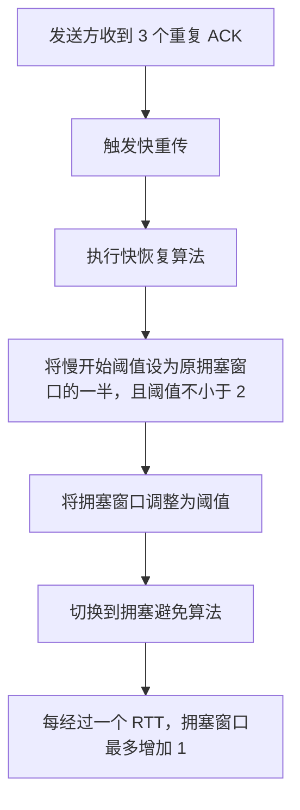

# TCP 拥塞控制：快重传与快恢复

## 1. 本节内容

本节主要介绍 TCP 拥塞控制中的两个机制：

- **快重传（Fast Retransmit）**
- **快恢复（Fast Recovery）**

在本课的示例中，前 12 个 RTT 的过程与上一节的例子完全相同，区别在于 **第 12 个 RTT 时发生的事件不同**。

---

## 2. 回顾：前 12 个 RTT 的拥塞窗口变化

在第 12 个 RTT 之前，拥塞窗口的变化与上一节的例子一致：

| 时间范围             | 使用的算法 | 拥塞窗口变化特点                   |
| -------------------- | ---------- | ---------------------------------- |
| \(0 \sim 4\) 个 RTT  | 慢开始     | 拥塞窗口按指数规律增长             |
| \(4 \sim 12\) 个 RTT | 拥塞避免   | 每经过一个 RTT，拥塞窗口最多增加 1 |

因此，在第 12 个 RTT 之前，两张图中的拥塞窗口变化完全相同。

### 第 12 个 RTT 的两种不同情况

上一节假设第 12 个 RTT 时发生了**超时重传**；本节则假设此时没有超时，而是发送方收到了 **3 个重复 ACK**。

这两种情况的处理方式不同：

| 触发事件          | 对网络拥塞程度的判断                       | 本课介绍的处理方式                                   |
| ----------------- | ------------------------------------------ | ---------------------------------------------------- |
| 超时重传          | 认为网络发生了比较严重的拥塞               | 将拥塞窗口设为 1，并将慢开始阈值设为原拥塞窗口的一半 |
| 收到 3 个重复 ACK | 认为网络有些拥塞，但还没有严重到超时的程度 | 触发快重传，并执行快恢复，适当缩小拥塞窗口           |

---

## 3. 快重传（Fast Retransmit）

当发送方收到 **3 个重复 ACK** 时，会触发**快重传**机制。

快重传说明某个报文段可能丢失，但发送方仍然能够收到重复 ACK，因此本课将这种情况理解为网络存在一定程度的拥塞，但不像超时那样严重。

因此，拥塞窗口不必像超时重传时那样直接降到 1，而是可以适当缩小。

快重传事件会进一步触发**快恢复算法**。

---

## 4. 快恢复（Fast Recovery）

### 4.1 基本处理

按照本课图示中的处理方式，发生快重传后，快恢复算法会将：

- **拥塞窗口（cwnd）**设为原拥塞窗口的一半；
- **慢开始阈值（ssthresh）**也设为原拥塞窗口的一半。

例如，第 12 个 RTT 时，原拥塞窗口为 24：

\[
cwnd = 24 \div 2 = 12
\]

\[
ssthresh = 24 \div 2 = 12
\]

因此，执行快恢复后，拥塞窗口和慢开始阈值都变为 12。

> 注意：TCP 规定慢开始阈值不能小于 2。假如按“一半”计算会得到小于 2 的阈值，就不能将阈值设置为小于 2 的值。

### 4.2 为什么之后切换到拥塞避免？

快恢复执行后，拥塞窗口和慢开始阈值相等：

\[
cwnd = ssthresh = 12
\]

由于拥塞窗口已经达到阈值，因此接下来采用**拥塞避免算法**，而不是继续执行慢开始算法。

拥塞避免算法规定：**每经过一个 RTT，拥塞窗口最多增加 1**。即使一个 RTT 内收到了多个 ACK，拥塞窗口也不会因此在该 RTT 内增加多次。

例如：

- 第 13 个 RTT：拥塞窗口为 12，可以发送 12 个报文段；
- 第 14 个 RTT：收到这 12 个报文段对应的 ACK 后，拥塞窗口最多增加 1，变为 13。

### 4.3 快重传与快恢复的关系

两者的逻辑关系可以概括为：



核心逻辑：

1. **快重传**由收到 3 个重复 ACK 触发。
2. 快重传事件会触发**快恢复算法**。
3. 快恢复将拥塞窗口和慢开始阈值调整到原拥塞窗口的一半；阈值不能小于 2。
4. 在本课的示例中，执行快恢复后，拥塞窗口与阈值相等，因此接下来进入拥塞避免阶段。

---

## 5. 示例中的拥塞窗口变化

假设第 12 个 RTT 时，发送方原来的拥塞窗口为 24，并且收到 3 个重复 ACK。

| 时间点       | 发生的事件                            | 拥塞窗口（cwnd） | 慢开始阈值（ssthresh） | 后续处理           |
| ------------ | ------------------------------------- | ---------------: | ---------------------: | ------------------ |
| 第 12 个 RTT | 收到 3 个重复 ACK，触发快重传和快恢复 |               12 |                     12 | 转入拥塞避免       |
| 第 13 个 RTT | 按拥塞避免策略发送数据                |               12 |                     12 | 等待 ACK           |
| 第 14 个 RTT | 收到这一 RTT 对应的 12 个 ACK         |               13 |                     12 | 拥塞窗口最多增加 1 |

### 用时间线理解

```text
0 RTT             4 RTT                                  12 RTT
  |-----------------|---------------------------------------|
      慢开始                    拥塞避免

12 RTT：收到 3 个重复 ACK
         ↓
       快重传
         ↓
       快恢复：cwnd、ssthresh 调整为 12
         ↓
       拥塞避免：每个 RTT 的 cwnd 最多增加 1
```

---

## 6. 旧版本 TCP 与当前处理方式的区别

图中还有一条虚线，对应的是 TCP 较早期版本中的处理方式。

- **较早期的 TCP 版本：**发生快重传事件后，也会立即采用慢开始算法，使拥塞窗口回到 1。
- **本课介绍的当前处理方式：**发生快重传事件后，采用快恢复算法调整拥塞窗口，而不是直接将拥塞窗口降到 1。

因此，图中的虚线表示较早期 TCP 版本在快重传后采用慢开始算法的情况；理解本课主要介绍的快重传和快恢复时，可以重点关注实线所表示的变化。

---

## 7. 本节小结

- **超时重传：**认为网络发生了比较严重的拥塞；本课前一节的例子中，拥塞窗口降为 1，慢开始阈值设为原拥塞窗口的一半。
- **3 个重复 ACK：**触发快重传，随后执行快恢复，避免拥塞窗口直接降到 1。
- **快恢复：**按照本课示例，将拥塞窗口与慢开始阈值调整为原拥塞窗口的一半；阈值不能小于 2。
- **快恢复之后：**由于拥塞窗口与阈值相等，因此转入拥塞避免算法，每经过一个 RTT，拥塞窗口最多增加 1。

至此，传输层的学习内容结束。
